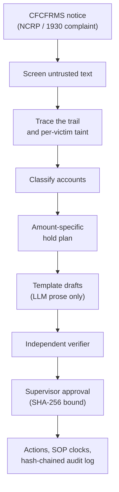

# Wapsi (वापसी)

**A money-trail and victim-restoration copilot for a bank's cyber-fraud nodal officer: trace stolen money through
mule accounts, hold only the victim's money in each account, and hand a supervisor verified paperwork to approve.**

> **Judges: start here → [pitch/START_HERE_FOR_JUDGES.md](pitch/START_HERE_FOR_JUDGES.md).** The 60-second hook,
> every headline number with its source file, and a 2-minute tour you can run from this checkout. Every number
> in the pitch is re-checked by `uv run python pitch/check_numbers.py` ([pitch/NUMBERS.md](pitch/NUMBERS.md)).

*Wapsi* means "return". It follows the MHA/I4C *SOP for NCRP-CFCFRMS, Custody, Restoration of money and Grievance
Redressal* (02.01.2026). All banking data in this repository is synthetic.

## ₹7,647 crore held. ₹167 crore returned. 2.18%.

From April 2021 to November 2025, CFCFRMS kept **₹7,647 crore** of the **₹52,969 crore** reported from reaching
cyber criminals, but only **₹167 crore (2.18% of the money held)** had been restored to victims (SOP Para 2;
`data/docs/facts.json`).

Money goes back only when someone can prove whose money is in which account after it has been split and layered.
Freezing whole accounts skips that proof and hurts people who did nothing wrong. The SOP says: "Unwarranted orders
for freezing accounts shall be discouraged, and accountability measures shall be established." (`SOP-5-IX`)

On the 39-case synthetic demo world, a whole-account freeze locks **₹35.26 crore in 101 accounts**. Wapsi holds
**₹29.19 lakh in 84**: 0.83% of it, every rupee victim money, **over-hold ₹0, 0 false freezes, every hold exact to
the paisa** (`evals/reports/demo.json`).


## What Wapsi does

- **Traces the trail.** It follows the victim's transfer through every mule layer at the home bank. Money that
  has moved to another bank becomes an outbound CFCFRMS request.
- **Splits mixed money exactly per victim** (pro-rata by default, SOP Para 5(xiii); FIFO and LIFO on request) and
  plans **amount-specific holds by default**: a hold is `min(victim money in the account, balance)`. Account-level
  action exists only as a **recorded, supervisor-approved exception**: an officer requests it with at least one
  reason from a closed list of four, a different supervisor approves it, and the hold plan never emits it on its
  own. The whole-account freeze figure Wapsi shows is a comparison baseline, never a recommendation.
- **Classifies each account** as a mule, a merchant (SOP 9.2), a nodal / pool / escrow account (SOP 9.1(iii)) or
  an innocent holder (SOP 5(xii)), split into a **bona fide recipient** (kept the money as rent, salary or payment)
  and an **unwitting conduit** (used as a pass-through by someone else). Innocent holders get an amount hold, an
  EDD memo and no escalation; there is **no automatic STR: the officer decides, and an STR is recommended where the
  account was used as a conduit**. Unclear accounts go to the officer.
- **Checks police / LEA hold requests** against an 8-field checklist, limits the hold to the amount identifiable
  on the trail, and drafts a template-bound clarification letter for whatever is missing.
- **Takes a victim's voice note.** A frightened victim's WhatsApp-style voice note in Hinglish, Hindi or English
  becomes a verbatim transcript, an English translation and structured complaint fields (one Gemini multimodal
  call with a response schema). Every number in it is a **claim**: the phone is masked in code, spoken
  instructions are quoted and never followed, and each UTR, amount, date and account digit is reconciled with the
  ledger (matched, mismatch or not in ledger). Only a ledger match opens a case, and the case's amounts come from
  the ledger. Works offline on six bundled synthetic samples.
- **Shows exactly what the AI agent did.** The Case Room's **Agent trace** tab lists every tool call the ADK agent
  made on a case, in order: redacted arguments, a result summary taken from the tool's own result, latency, and the
  guard, maker-checker and verifier verdicts around it, plus a check that every amount and account number in the
  agent's reply came from a tool. Each run is sealed into the case's hash-chained audit log.
- **Drafts the paperwork from templates**: hold instruction, customer notice, EDD memo, outbound CFCFRMS request,
  STR (modelled on FINnet 2.0), CFCFRMS update, restoration pack (Process 1 or 2) and the officer's account-level
  hold request. The LLM writes prose only, through placeholders.
- **Verifies, then waits for a supervisor.** A separate verifier re-checks every amount, account number, UTR, date,
  citation and policy rule. Each approval is bound to the SHA-256 fingerprint of the exact draft, every event is
  sealed into a **hash-chained, append-only audit log**, and the SOP and STR clocks run on an Indian bank-holiday
  calendar.
- **Watches the rules.** A read-only **regulatory change radar** sets new and pending rules (the RBI draft SOP on
  money-mule accounts of 11 Sep 2026, a **DRAFT**; the RBI Fraud Risk Management Directions, 2026) against the
  SOP, with verbatim quotes, and shows what each would change for a case. It flags and suggests; every row waits
  for human review, and it never edits a plan, clock, draft or citation.

Wapsi is not connected to the CFCFRMS portal: it is a **simulated CFCFRMS interface**, and every CFCFRMS action it
prepares says so.

## Showcase: whole-account freeze vs Wapsi

On 10-09-2026 a caller posing as the victim's bank talks her into moving ₹4,80,000.00 by IMPS to a "safe
account". Within about 90 minutes the money passes through three mule accounts at the home bank. The first mule
pays ₹5,000.00 of rent to a landlord, withdraws ₹1,00,000.00 in two ATM withdrawals and sends ₹50,000.00 to
another bank; the second pays ₹1,200.00 to a kirana shop and ₹20,000.00 into a payment-aggregator pool account;
the third sends ₹2,00,000.00 to the other bank. Every number below is hand-computed in
`src/wapsi/fixtures/showcase.py`, and the pipeline reproduces it exactly.

| | Whole-account freeze baseline | Wapsi |
|---|---|---|
| Money immobilised at the home bank | ₹5,03,50,000.00 in 6 accounts | **₹1,42,848.00 in 5 accounts**, only the victim's money |
| Three mule accounts | whole balances frozen (₹1,23,800.00) | ₹43,200.00 + ₹27,648.00 + ₹48,000.00 held |
| Landlord who received ₹5,000.00 rent from a mule | whole account frozen (₹1,55,000.00) | ₹4,800.00 held, no escalation, EDD memo (bona fide recipient, SOP 5(xii)) |
| Kirana shop, goods delivered | whole account frozen (₹51,200.00) | no hold; CFCFRMS update only (SOP 9.2) |
| Payment-aggregator pool account | ₹5,00,20,000.00 frozen | ₹19,200.00 held; the account keeps running (SOP 9.1(iii)) |
| Money now at the other bank | outside this comparison | outbound CFCFRMS requests for ₹48,000.00 and ₹1,44,000.00 |
| Recoverable for the victim | not worked out | **₹3,34,848.00** (69.76% of the stolen money) |

The freeze locks 352× what Wapsi holds. Wapsi also marks a forward hold of ₹96,000.00 on the first-layer mule
account (SOP 9.1(i)); a forward hold is not money in hand, so it is not counted as recoverable, and it gets its own
90-day review clock.


## Results

All results come from synthetic data with the deterministic stub LLM. [Evaluation](docs/evaluation.md) explains
the method; every figure here is also in [pitch/NUMBERS.md](pitch/NUMBERS.md).

| Check | Result | Source |
|---|---|---|
| The SOP's own worked example (Annexure-V, Illustration 2: five victims, ₹2,06,543 left) | all five pro-rata shares match the SOP to the paisa | `tests/test_sop_annexure_v.py` |
| Demo world: 39 cases, 10 fraud typologies, 3 with injected instructions | holds exact 1.0, over-hold ₹0, false freezes 0, dispositions 1.0, drafts passing the verifier 1.0, injection leaks 0 | `evals/reports/demo.json` |
| Demo world: money immobilised | Wapsi ₹29,19,245.69 in 84 accounts; whole-account freeze baseline ₹35,25,90,069.78 in 101 accounts (0.83%) | `evals/reports/demo.json` (`baseline`) |
| **Hard world**: 64 cases, 15 typologies incl. 5 realistic confounders (seed 7) | holds exact 1.0, over-hold ₹0, false freezes 0, drafts passing the verifier 1.0; dispositions 0.9198, mule P / R 0.8987 / 0.966, innocent-holder P / R 0.9429 / 0.6875 | `evals/reports/hard.json` |
| Hard world, held-out seed 101 (62 cases) | holds exact 1.0, over-hold ₹0, false freezes 0; dispositions 0.9139 (heuristic), 0.9569 with XGBoost trained on seed 202 | `evals/reports/hard-101.json` |
| Five held-out demo-size worlds, 202 cases on unseen seeds | hold exact-match 100% and 0 false freezes in every world; innocent-holder recall 75% to 100%; disposition accuracy 98.4% to 100% | `evals/reports/classify-after-heldout-*.json` |
| Hallucination stress test: the stub LLM writes a wrong rupee amount into every prose field | 27.57% of drafts had their prose rejected and replaced by fixed text; drafts passing the verifier still 1.0, holds still exact | `evals/reports/baseline/demo-fake-hallucinate.json` |
| Legal quotes, pinned figures and radar quotes | 121 of 121 checks pass: 35 citation ids (32 verbatim quotes, 3 judgments cited by URL), 33 pinned facts, 52 regulatory-radar quotes and the radar registry | `uv run python -m wapsi.search.check_citations` (after `wapsi.search.fetch` and `wapsi.search.radar fetch`) |
| Tamper-evident audit log | 6 of 6 tampering attempts on a 40-event case log detected (edit, re-hash one event, delete, reorder, truncate, re-hash the whole tail), plus an edit inside the store | `uv run python -m wapsi.audit drill` |
| Prompt-injection guard, blind holdout of 151 texts | precision 0.9661, recall 0.75 | `evals/reports/guard-latest.json` |
| Speed, demo world, stub LLM | p95 0.72 s per case, trace to verified drafts (laptop) | `evals/reports/demo.json` |
| Voice intake, 6 synthetic Hinglish voice notes (offline model) | every sample reconciles as documented: the showcase victim's note matches 9 of 9 claims; two notes with spoken "release the hold" instructions get them quoted, never followed; claimed figures the ledger lacks show as mismatch or not in ledger | `tests/intake`, `data/samples/voice/manifest.json` |
| Test suite | 1,765 tests pass, 0 fail (full suite, 07-10-2026) | `uv run pytest -q` |

**Every miss is a label, never money.** The hard world adds sleeper mules, task-scam victim chains, a labour
contractor's salary pool, a festival-season home seller and same-second relays. Dispositions drop to 0.9198, but
holds stay exact, over-hold stays ₹0 and false freezes stay 0: a wrong label changes the paperwork (an EDD memo
instead of an STR ground, or the reverse), and a supervisor approves every draft. The guard misses a quarter of
unseen attacks; it only warns the officer, and the template-bound drafts and the verifier are the real defence
([Trust and safety](docs/trust-and-safety.md), [Limitations](docs/limitations-and-roadmap.md)).

## Quick start

You need [uv](https://docs.astral.sh/uv/) and Python 3.11 or later.

```bash
uv sync --extra ui --extra ml --extra docs   # core + officer app + XGBoost option + PDF reader
uv run streamlit run ui/app.py               # officer app, opens on the Inbox
```

The app runs the real pipeline on the showcase world with an offline FakeLLM, so it needs no API keys and no
generated data. Its **Voice Intake** page reads the bundled synthetic voice notes offline (set `GEMINI_API_KEY` to
transcribe your own recording), and the Case Room's **Agent trace** tab shows a recorded offline agent run on the
showcase case. To reproduce the results:

```bash
uv run pytest -q                                                              # full test suite
uv run python -m wapsi.synth --size demo --seed 7 --out data/generated/demo   # synthetic world + golden set
uv run python -m evals.harness --world demo --report-name demo                # writes evals/reports/demo.json
uv run python -m wapsi.synth --size hard --seed 7 --out data/generated/hard   # hard world (15 typologies)
uv run python -m evals.harness --world hard --scorer heuristic --scorer xgb:models/xgb_hard202.json
uv run python -m wapsi.search.fetch                                           # downloads the public legal texts
uv run python -m wapsi.search.radar fetch                                     # radar documents (not indexed)
uv run python -m wapsi.search.build                                           # builds the local search index
uv run python -m wapsi.search.check_citations                                 # checks every quote and figure
uv run python -m wapsi.audit drill                                            # audit-chain tamper drill
```

`models/` is gitignored: train the XGBoost scorer first with `wapsi.classify.train` (see
[Evaluation](docs/evaluation.md#scorers-and-harness-options)). On Windows, set `PYTHONIOENCODING=utf-8` (or
`PYTHONUTF8=1`) if you pipe or redirect the output: the reports contain the ₹ sign. `uv sync --all-extras` also
installs the Google Cloud and AMD dependencies (PyTorch among them), which is a much larger download. To browse
these docs as a site: `uv run --with mkdocs-material mkdocs serve`.

## How it works



| Path | What |
|---|---|
| `src/wapsi/graph` | trail expansion, exact taint replay (pro-rata / FIFO / LIFO), hold plan, account-level exception |
| `src/wapsi/classify` | account features, transparent heuristic scorer, optional XGBoost, bona fide recipient vs unwitting conduit, plain-English reasons |
| `src/wapsi/draft` | fact sheets, document templates (incl. the LEA clarification letter), LLM prose through placeholders |
| `src/wapsi/verify` | numeric, citation, policy and prompt-injection checks; police / LEA request checklist |
| `src/wapsi/domain` | India bank working-day calendar, SOP clocks, regulatory change radar (read-only) |
| `src/wapsi/audit` | hash-chained, append-only audit log per case and the tamper drill |
| `src/wapsi/intake` | voice-note intake: audio checks, the schema-bound extraction, phone masking, guard screening, reconciliation of every claim with the ledger, the bundled synthetic samples |
| `src/wapsi/agenttrace` | agent trace: every tool call an agent makes, with redacted arguments, result, latency and the guard and verifier verdicts around it, sealed into the case's audit chain |
| `src/wapsi/search` | legal corpus fetcher, section-aware chunking, pure-Python BM25, citation and radar checks |
| `src/wapsi/synth` | synthetic Indian banking world (demo, full and hard sizes), independent reference implementation, golden sets |
| `src/wapsi/pipeline` | end-to-end case processing, maker-checker approval, account-level requests, LEA checks |
| `ui/` | Streamlit officer app: Inbox, Voice Intake, Case Room (money trail and agent trace), Hold Plan, Drafts & Verification, Approvals, Clocks, Regulatory Radar, KPIs, Audit |
| `evals/` | golden-set harness (`--scorer`, `--world-dir`, `--report-name`), guard corpus and reports |
| `editions/` | the two platform editions (below) |
| `.claude/skills` | 6 skills shared by Claude Code and Gemini CLI (mirrored to `.agents/skills`) |

More: [Architecture](docs/architecture.md) and the [decision records](docs/adr/README.md).

## One core, two editions

The Python core (`src/wapsi`) and the officer app (`ui/`) are shared. Each edition swaps in its own adapters for
the ledger, the LLM, the guard and the case store; the showcase numbers are the parity test for both.
Details: [Editions](docs/editions.md).

| Edition | Built for | Platform | Status (07-10-2026) |
|---|---|---|---|
| [Google Cloud](editions/gcp/README.md) | AI Builder Cup | ADK agents on Cloud Run, Gemini (agent, voice and document intake, draft prose), BigQuery, Firestore (cases and a transaction-sealed audit chain); optional Model Armor and a Gemma tier on Cloud Run GPU | Built and unit-tested offline with fakes, including the voice-note tool, the agent trace and the Firestore audit seal. Deploy scripts are dry-run in tests with a fake `gcloud`. Deployment follows in October. |
| [AMD](editions/amd/README.md) | lablab.ai AMD Developer Hackathon ACT III | One AMD Instinct MI300X with ROCm: vLLM serving, a GraphSAGE mule scorer, a LoRA fine-tune, benchmarks | Code prepared before the event and tested on CPU only. GPU training, serving and benchmarks run only during the event (12–18 Oct 2026). |

## Documentation

| If you want to... | Read |
|---|---|
| Judge the entry fast | [pitch/START_HERE_FOR_JUDGES.md](pitch/START_HERE_FOR_JUDGES.md), [pitch/NUMBERS.md](pitch/NUMBERS.md) |
| Get the whole picture in a few minutes | [Home](docs/index.md), [Overview](docs/overview.md) |
| Use the officer app screen by screen | [User guide](docs/user-guide.md) |
| See how the pieces fit | [Architecture](docs/architecture.md), [Editions](docs/editions.md), [Decision records](docs/adr/README.md) |
| Check the legal basis of every rule | [Legal spine](docs/legal-spine.md), [Glossary](docs/glossary.md) |
| Follow the algorithms | [Money trail](docs/algorithms/money-trail.md), [Hold plan](docs/algorithms/hold-plan.md), [Classification](docs/algorithms/classification.md) |
| Judge whether it can be trusted | [Trust and safety](docs/trust-and-safety.md), [Evaluation](docs/evaluation.md), [Synthetic data](docs/synthetic-data.md) |
| Build on it | [Developer guide](docs/developer-guide.md), [API reference](docs/api-reference.md), [CONTRIBUTING.md](CONTRIBUTING.md), [AGENTS.md](AGENTS.md) |
| Read the contracts | [Data contract](docs/data-contract.md), [Draft contract](docs/draft-contract.md), [Eval report format](docs/eval-report.md) |
| Check what was built when | [Originality](docs/originality.md) |
| Get straight answers | [FAQ](docs/faq.md), [Limitations and roadmap](docs/limitations-and-roadmap.md) |

## Trust and safety

- **Numbers come from data, words come from the LLM.** Every amount, account number, UTR and date in a draft is a
  slot filled from case tables. The verifier recomputes each one and checks that it sits in the right place; if
  the LLM's prose fails a check, a fixed paragraph replaces it.
- **No invented law.** Every rule cites an id from `src/wapsi/citations.py`; stored quotes are verbatim, at most
  25 words, and checked against the downloaded texts ([Legal spine](docs/legal-spine.md)). RBI fraud-risk
  citations point to the (Commercial Banks – Fraud Risk Management) Directions, 2026; the RBI mule-account SOP of
  11 Sep 2026 is labelled DRAFT everywhere and never treated as in force.
- **Amount-specific by default; account-level only by recorded exception.** The verifier fails any plan or draft
  with an account-level hold that lacks a recorded reason or a valid supervisor approval, and any draft that
  instructs a whole-account or debit freeze outside such an exception.
- **Complaint text cannot change a hold.** Narratives never feed tracing, classification or the hold plan. The LLM
  sees them only inside `UNTRUSTED` markers, and the guard flags instruction-like text for the officer.
- **A voice note is a claim, not a fact.** Every value heard is reconciled with the ledger, the ledger's figure is
  the one used, an amount alone never identifies a complaint, and spoken instructions are quoted, never followed.
- **The agent is accountable.** Every tool call it makes is recorded with its checks, redacted (account numbers,
  phones, e-mails, secrets, complaint text) and sealed into the case's audit chain; behind IAP an analyst reads
  only their own runs.
- **Nothing happens without a supervisor, and nothing is forgotten.** An approval applies only to the exact
  verified draft (SHA-256 fingerprint); the audit log is hash-chained and append-only; auditors see names and
  mobile numbers masked. See [SECURITY.md](SECURITY.md).

## Data and licence

All banking data is synthetic, generated by `wapsi.synth`; no real customer, victim or employer data is used.
Public legal texts are downloaded at build time and are not redistributed beyond short attributed quotes
(`data/docs/MANIFEST.md`). Wapsi is decision support for trained officers: it is not legal advice, and it does not
act on its own. The code is MIT-licensed ([LICENSE](LICENSE)).

## Originality

Wapsi's two current hackathon entries, the Google Cloud and AMD editions, come from one repository.
[docs/originality.md](docs/originality.md) records what was built when, including the AMD edition code prepared
before the AMD event and an edition for a separate, earlier event that has since been removed from the tree, so each
event's rules can be checked against the git history. Commit dates are never rewritten.
