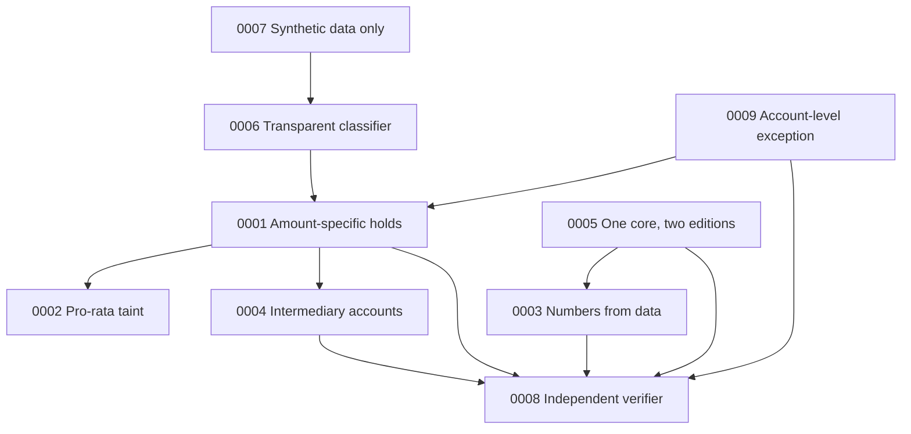

# Architecture decision records

An architecture decision record (ADR) captures one significant decision: the situation that forced it, what was
decided, what it costs, and what else was considered. These ADRs record decisions that shape Wapsi's legal
behaviour and its structure. Each one points to the code, tests, data and reports that show the decision in
practice, so a reviewer can check it instead of taking it on trust.

| ADR | Decision | Status | Date |
|---|---|---|---|
| [0001](0001-amount-specific-holds.md) | Hold the tainted amount in each account: amount-specific holds by default | Accepted; amended by 0009 | 2026-09-16 |
| [0002](0002-pro-rata-apportionment.md) | Apportion mixed money to victims pro-rata, by exact replay of every transaction | Accepted | 2026-09-16 |
| [0003](0003-numbers-from-data-words-from-llm.md) | Numbers come from data, words come from the LLM | Accepted | 2026-09-16 |
| [0004](0004-intermediary-accounts-sop-9-1-iii.md) | Nodal, pool and escrow accounts: hold the disputed amount only (SOP Para 9.1(iii)), replacing an earlier "never hold" rule | Accepted; supersedes the earlier `BLOCK_NODAL_POOL_ESCROW` rule | 2026-09-16 |
| [0005](0005-one-core-two-editions.md) | One portable core behind six ports, two thin platform editions | Accepted | 2026-09-16 |
| [0006](0006-transparent-heuristic-classifier-default.md) | A transparent heuristic classifier by default; XGBoost only on request | Accepted | 2026-09-16 |
| [0007](0007-synthetic-data-only.md) | Synthetic banking data only; public legal texts fetched, not redistributed | Accepted | 2026-09-16 |
| [0008](0008-verifier-independent-of-planner.md) | The verifier re-implements the rules instead of trusting the planner | Accepted | 2026-09-16 |
| [0009](0009-account-level-hold-as-recorded-exception.md) | Account-level holds only as a recorded, supervisor-approved exception (closed reason list, maker-checker), never emitted by the planner | Accepted; amends 0001 | 2026-09-28 |

The dates are when the decision took effect in the code. Work started on 2026-09-16, but the first git commit is
dated 2026-09-23 ([originality.md](../originality.md)), so the history behind these decisions is not in the
commit log. It is in dated records: the timestamps inside `evals/reports/*.json`, `AGENTS.md`, and the "Legal
corrections applied on 2026-09-16" block of a build playbook that was removed from the tree on 2026-10-07 and is
still readable in the git history (commits `b27a8de` to `13ee458`). These records were written on 2026-09-23 and
re-checked against the repository on 2026-09-28; ADR 0009 was added on 2026-09-29.

## How the decisions fit together

- Amount-specific holds (0001) need an exact answer to "how much of this balance is the victim's", which is
  pro-rata taint (0002). Intermediary accounts are a special case of the same rule (0004).
- The verifier (0008) is what makes 0001, 0003, 0004 and 0009 hold in every draft, not only in the planner's output.
- The account-level exception (0009) narrows 0001's first wording ("never the whole account") to the law: amount-specific
  by default, account-level only as a recorded, supervisor-approved exception.
- Synthetic data (0007) limits what any classifier score can prove, which is one reason the default classifier is
  a transparent heuristic (0006).
- One core for two editions (0005) is only safe because the rules and their checks live in that core.

## Format

Each ADR has the same sections:

- **Status**: Proposed, Accepted, Superseded (with a link to the replacement) or Deprecated.
- **Context**: the facts that forced a decision, with sources.
- **Decision**: what Wapsi does, in terms of code.
- **Consequences**: what gets better, what gets worse, with real numbers where the repository has them.
- **Alternatives considered**: the options not taken, and why.
- **Evidence**: files, tests and reports a reviewer can open.

Legal quotes are the verbatim quotes in `data/docs/citations.json`, shown with their citation id (for example
`[SOP-9-1-III]`). `uv run python -m wapsi.search.check_citations` re-checks every one against the downloaded
documents.

## Adding an ADR

1. Copy the section headings of an existing ADR into `docs/adr/NNNN-short-title.md`, using the next number.
2. Link every claim to a file, test or report in the repository.
3. Add a row to the table above.
4. If the decision replaces an earlier one, set the old ADR's status to `Superseded by NNNN` and keep its text.
