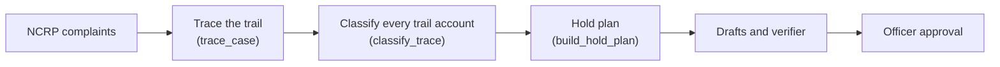
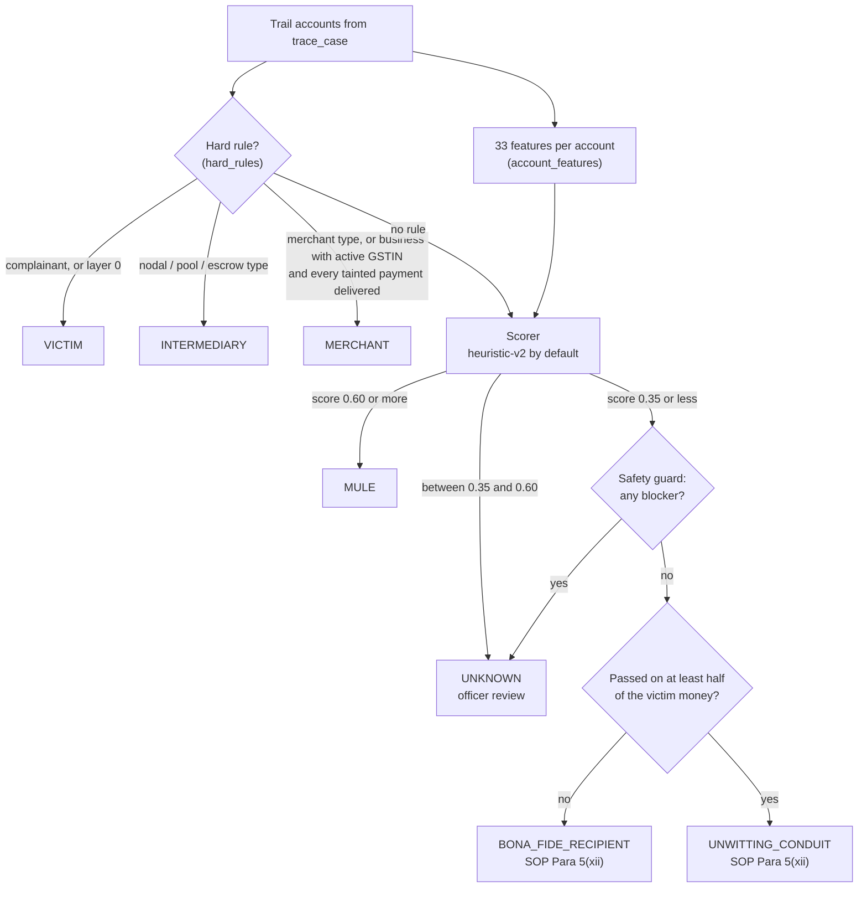
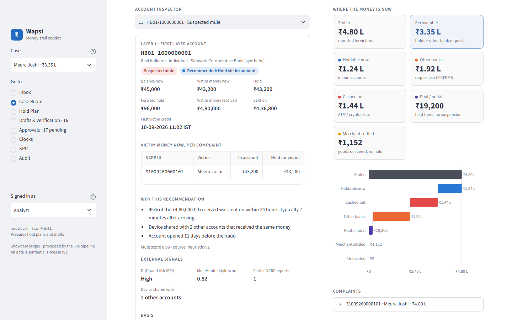
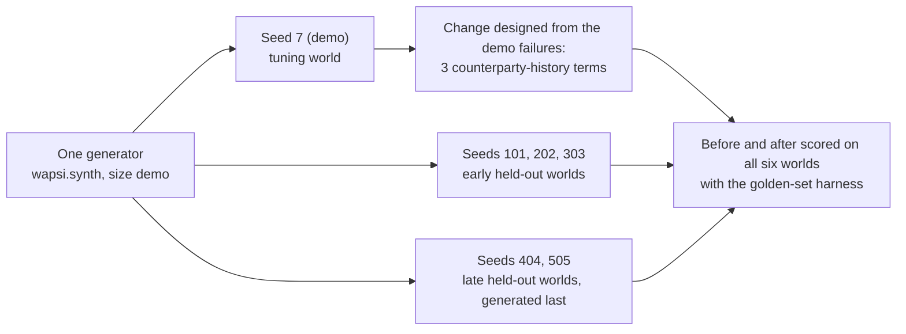

# Account classification

This page explains how Wapsi decides what each account on a money trail is: the victim, a mule, an innocent
holder, a merchant, or a nodal / pool / escrow account. When the evidence is mixed, Wapsi says so and gives the
decision to the officer. Every label comes with plain-English reasons written in the SOP's vocabulary.

| | |
|---|---|
| Code | `src/wapsi/classify/` (`__init__.py`, `rules.py`, `features.py`, `scoring.py`, `explain.py`, `train.py`) |
| Entry point | `wapsi.classify.classify_trace(ledger, trace, cfg: ClassifyConfig, model=None) -> dict[str, ClassificationResult]` |
| Input | a `TraceResult` from [the money trail](money-trail.md), the `Ledger`, `ClassifyConfig` |
| Output | one `ClassificationResult` per trail account (victims included): `account_id`, `role`, `score`, `reasons`, `features`, `model` |
| Used by | [the hold plan](hold-plan.md), the drafts (EDD memo, STR grounds), the Case Room in the UI |
| Tests | `tests/classify/`: 110 tests on 29-09-2026 (`uv run pytest tests/classify -q`) |
| Evidence | `evals/reports/classify-*.json` (before / after, held-out and XGBoost runs) |

Amounts are in rupees with Indian digit grouping (₹4,80,000.00). All data is synthetic.

## In two minutes

- **Seven roles.** Hard rules come first and pick three of them: `VICTIM`, `INTERMEDIARY` (nodal / pool / escrow)
  and `MERCHANT`. Every other account gets a mule score from 0 to 1. A score of at least 0.60 means `MULE`, a
  score of at most 0.35 means an innocent holder, and anything in between is `UNKNOWN` (officer review). An
  innocent holder that passed on at least half of the victim money it received is an `UNWITTING_CONDUIT`; one
  that kept it is a `BONA_FIDE_RECIPIENT` (wire value `INNOCENT_HOLDER`, so golden sets and reports keep that
  label).
- **A score-based role never changes how much is held.** For a `MULE`, `UNKNOWN` or innocent-holder account the
  hold is `min(tainted money, balance)`. The role changes the treatment around the hold: whether the account is
  flagged for escalation, whether a forward hold is possible, whether the STR (suspicious transaction report)
  cites proceeds of crime, and whether an EDD (enhanced due diligence) memo is drafted. Only the merchant rule
  changes the amount: goods delivered means no hold (SOP Para 9.2). See [the hold plan](hold-plan.md).
- **The default scorer is a transparent logistic model** (`heuristic-v2`) with 27 hand-set terms over 26 of the
  33 behavioural features. It is deterministic, needs no training data and no extra dependencies. Every score
  breaks down into additive per-feature contributions in log-odds (positive pushes towards `MULE`, negative
  towards a legitimate profile).
- **A safety guard protects the innocent label.** An account in the innocent band still becomes `UNKNOWN` if it
  did something a genuine holder rarely does with the money. The five triggers are: forwarding most of it quickly
  to new payees, cashing it out, sharing a device with the trail, waking from dormancy, or two or more earlier NCRP
  reports.
- **Reasons, not verdicts.** Reasons describe what was observed ("95% of the ₹4,80,000.00 received was sent on
  within 24 hours, typically 7 minutes after arriving"). They never state guilt. Innocent-holder reasons end with
  the SOP Para 5(xii) wording.
- **Checked on worlds it was not designed on.** Three counterparty-history features were designed to fix
  genuine sellers being mislabelled in the tuning world (seed 7). This is the T6 triangulation typology: a
  fraudster pays a genuine seller with victim money, and the seller pays its landlord. On five held-out worlds
  (seeds 101, 202, 303, 404 and 505), innocent holders labelled correctly went from 21 of 38 to 33 of 38. Mule
  recall stayed at 1.0, and holds stayed exact to the paisa. These are unseen seeds of the same generator, not a
  sealed blind test and not real bank data (see [Limitations](#limitations)).
- **Optional models.** An XGBoost baseline can be trained (`ml` extra), and a graph model from the AMD edition
  plugs in the same way. Both use the same `Scorer` protocol, and neither is the default. The reasons are
  [below](#xgboost-option-opt-in).

## Where classification sits



Classification is ordinary deterministic Python code. No LLM is involved at this step. Running the same trace
twice gives identical results (`test_deterministic`).

## What a role changes

The hold plan uses the role as follows (`src/wapsi/graph/holdplan.py`; details in [the hold plan](hold-plan.md)).
The account's type still wins for nodal / pool / escrow and merchant accounts, whatever the classifier says.

| Role | Home-bank disposition when money is present | Officer review flag | Forward hold possible (layer 1) | s.106 flag possible | STR "proceeds of crime" ground |
|---|---|---|---|---|---|
| `MULE` | `HOLD_AMOUNT` | only if flagged for s.106 | yes | yes (FIR + at least 2 prior NCRP reports) | yes |
| `UNKNOWN` | `HOLD_AMOUNT` + reason `ROLE_UNKNOWN` | always (`requires_human`) | yes | yes | no |
| `BONA_FIDE_RECIPIENT` (`INNOCENT_HOLDER`) | `HOLD_AMOUNT_NO_ESCALATION`, EDD memo; no STR recommended by default | no | no | no | no |
| `UNWITTING_CONDUIT` | `HOLD_AMOUNT_NO_ESCALATION`, EDD memo, reasons `UNWITTING_CONDUIT` and `STR_RECOMMENDED_OFFICER_DECISION`: no automatic STR; an STR is recommended and the officer decides | always (`requires_human`) | no | no | no |
| `MERCHANT` | `NO_HOLD_UPDATE_ONLY` (delivered) or `HOLD_IN_POOL` (not delivered) | no | no | no | no |
| `INTERMEDIARY` | `HOLD_AMOUNT_INTERMEDIARY` | no | no (SOP 9.1(i)) | never | no |
| `VICTIM` | layer-0 victim accounts get no decision; a victim account that received another complaint's money gets `HOLD_AMOUNT` + reasons `ROLE_UNKNOWN` and `VICTIM_ACCOUNT_ON_TRAIL` | always | yes | never | no |

"s.106" is Section 106 of the BNSS (a police officer's power to seize property, `BNSS-106`). Wapsi never seizes
anything: it only adds the reason code `ESCALATE_S106_CANDIDATE` and sends the decision to a human.

The two costly mistakes are asymmetric:

- **A mule labelled innocent** is never escalated, gets no forward hold and gives no STR ground. This is the error
  the design tries hardest to avoid, and the safety guard exists for it.
- **An innocent holder labelled mule** still has only the tainted amount held, but the STR may cite proceeds of
  crime, and a forward hold or an s.106 flag becomes possible. The maker-checker approval step is the control for
  this. Labelling the account `UNKNOWN` is the safer miss: the hold is the same, and the account goes to officer
  review (`requires_human`) instead of carrying a label.

## The pipeline



`classify_trace` runs these steps for every account in `trace.accounts`, victims included:

1. **Features.** It calls `account_features` for all accounts in one pass, with two time anchors (next section).
   Every trail account (layer 1 or deeper) is a seed for `shared_device_with_seed_accounts`.
2. **Hard rules.** `hard_rules` checks VICTIM, then INTERMEDIARY, then MERCHANT. The first match wins, and the model
   name becomes `rules+<scorer name>`.
3. **Score.** The scorer (default `HeuristicScorer`) gives a mule score. `role_from_score` maps it to `MULE`,
   `INNOCENT_HOLDER` or `UNKNOWN` using `ClassifyConfig`.
4. **Safety guard.** If the role is an innocent holder, `innocent_blockers` may downgrade it to `UNKNOWN`.
5. **Innocent split.** An innocent-band account that passes the guard is a `BONA_FIDE_RECIPIENT`, or an
   `UNWITTING_CONDUIT` when `conduit_indicators` finds it passed on at least `CONDUIT_SHARE` (0.5) of the victim
   money it received (trace amounts, pro-rata). The conduit reason comes first: "Passed on most of the victim
   money it received: the account appears to have been used as a pass-through by someone else".
6. **Reasons.** Rule roles carry the rule's reasons. Score roles get the top indicators from the scorer's
   contributions (`wapsi.classify.explain`).

A scorer with the optional `bind_trace(ledger, trace)` hook (`TraceAwareScorer`) receives the trace once per
case, before step 3, and scores with the scorer it returns ([GNN extension point](#gnn-extension-point-amd-edition)).

Scores are reported for rule roles too. A `MERCHANT` whose score reaches the mule threshold keeps its role but
gets one more reason: "Mule indicators are also present (score …); verify the business before relying on the
merchant treatment".

### Time anchors

| Anchor | Value in `classify_trace` | What it controls |
|---|---|---|
| `as_of` | `trace.window_start`, the first reported victim transfer | *History* features look only at transactions strictly before it. The fraud itself is never counted as history. |
| burst window | `[first tainted receipt, + feature_window_hours]`, per account (default 24 h). Accounts without a tainted receipt (victims) use `window_start`. | The `*_24h` features: what the account did with the money in the day after it arrived |
| `obs_end` | `max(as_of, burst end)` | End of the 7-day, 30-day and 90-day behaviour windows, which therefore include the burst |
| lookback | at most 180 days before `as_of` (`HISTORY_LOOKBACK_DAYS`) | `history_days`, the dormancy gap, known payees |

The burst window is anchored on each account's *own* first tainted receipt. Without this, a layer-3 account
reached hours after the first transfer could not be compared fairly with a first-layer account.

Cost: `account_features` makes one transaction query per visibility view (home bank through
`transactions_touching`, other banks through `consortium_transactions`, which simulates CFCFRMS responses). Every
window is then a vectorised mask. `tests/classify/test_classify_perf.py` requires 500 accounts over a ledger of
about 20,000 transactions to take under 3 seconds.

## Hard rules

`src/wapsi/classify/rules.py`, applied before any score. Hard rules ignore the thresholds
(`test_thresholds_come_from_config`).

| Order | Rule id | Condition | Role | Reasons (verbatim strings) |
|---|---|---|---|---|
| 1 | `VICTIM_COMPLAINANT` | the complainant's account for any complaint in the trace, or any layer-0 account | `VICTIM` | "Account of the complainant who reported this fraud"; "Reported loss of ₹… from this account"; "Money traced from this account is to be restored to it, not held" |
| 2 | `INTERMEDIARY_TYPE` | account type `NODAL`, `POOL` or `ESCROW` | `INTERMEDIARY` | "Nodal account" / "Payment-aggregator pool account" / "Escrow account"; "Only the disputed amount is held; the account is not suspended or seized (SOP Para 9.1(iii))" |
| 3a | `MERCHANT_TYPE` | account type `MERCHANT` | `MERCHANT` | GSTIN status, then the invoice status (below) |
| 3b | `BUSINESS_DELIVERED` | account type `BUSINESS` **and** an `ACTIVE` GSTIN **and** every tainted inflow covered by a `DELIVERED` invoice of that account | `MERCHANT` | "Business account with an active GSTIN", then the invoice status |

The invoice status sentence follows SOP Para 9.2. When invoices exist, it comes after a sentence that names
them (for example "Invoice INV-K-5521 for the payment was delivered at 10-09-2026 11:55 IST").

| Invoices for the tainted payments | Reason |
|---|---|
| all delivered | "Goods delivered: update CFCFRMS only, no hold (SOP Para 9.2)" |
| any not marked delivered | "Goods not delivered: cancel the order and keep the amount in the pool / nodal account (SOP Para 9.2)" |
| none found | "No invoice found for the payment received; confirm delivery before deciding (SOP Para 9.2)" |

A business account that fails rule 3b is not turned into a merchant. It goes to the scorer like any other
account (`test_business_rules`: an undelivered order, or a cancelled GSTIN, means "scored, not a rule
merchant").

The legal basis for the intermediary rule is `SOP-9-1-III`: "where CFCFRMS notifies for action against a nodal,
escrow, or pool account, the bank shall hold the disputed amount". For merchants it is `SOP-9-2`: "It will cancel
the order if delivery of goods or services is not made, and the amount shall be held back".

## Features

`account_features(ledger, account_ids, as_of, cfg, *, seed_accounts=None, burst_start=None)` returns a numeric
frame with the 33 columns of `FEATURE_COLUMNS` and no NaN values. The tables below group the columns and give,
for each one, what it measures, why it separates mules from genuine holders, and its weight in `heuristic-v2`. A
positive weight pushes towards `MULE`, a negative one towards a legitimate profile. A dash means the heuristic does
not use the column.

### Tenure and profile

| Feature | What it measures | Why it matters | Heuristic |
|---|---|---|---|
| `age_days` | days from account opening to `as_of` | Mule accounts are often opened, or bought, shortly before use. Years of tenure are costly to fake. | +0.8 when new (full at 0 days, none from 90); −1.2 when established (none up to 180 days, full from 1,275 days, about 3.5 years) |
| `history_days` | days between the first transaction in the 180-day lookback and `as_of` (max 180) | An account with no observed history is an unknown quantity | −0.6, full at 90 days |
| `dormant_then_burst` | 1 if: no activity for at least 30 days before `as_of`, the account is at least 90 days old, and the burst window has at least 3 transactions and at least ₹10,000.00 received | Dormant accounts are revived, rented or sold for fraud | +1.2 |
| `kyc_min` | customer KYC tier is `MIN` | Less identity assurance behind the account | +0.5 |
| `kyc_vkyc` | customer KYC tier is `VKYC` (opened remotely by video KYC) | Remote opening is a weak signal: most such accounts are genuine | +0.2 |

### What the account did with the money (burst window)

| Feature | What it measures | Why it matters | Heuristic |
|---|---|---|---|
| `in_count_24h`, `out_count_24h` | credits / debits in the burst window (self-transfers excluded) | Context for reasons and for trained models | — |
| `in_amount_24h`, `out_amount_24h` | credit / debit amounts in the burst window | Used by the guard (cash-out share) and quoted in reasons | — |
| `pass_through_ratio_24h` | burst debits ÷ burst credits, capped at 1 | A mule's job is to move the money on. A genuine recipient keeps it or spends it gradually. | +2.0 |
| `median_forward_minutes` | median minutes from each burst credit to the account's next debit in the window; 10,080 (one week) if nothing was forwarded | Layering happens in minutes, to stay ahead of hold notices | +1.4 × e^(−minutes/120); the factor is 1 at 0 min, 0.61 at 1 h, 0.14 at 4 h |
| `round_amount_share` | share of burst transactions that are non-zero multiples of ₹1,000.00 | Manual layering uses round figures. Many genuine payments (rent) are round too, so the weight is small. | +0.3 |
| `known_payee_out_ratio_24h` | burst debits to counterparties the account had already paid before `as_of` (180-day lookback) ÷ burst credits; capped at 1 and never above `pass_through_ratio_24h` | Paying the usual landlord or supplier is spending, not layering | −1.5 |

### Network

| Feature | What it measures | Why it matters | Heuristic |
|---|---|---|---|
| `n_distinct_payers_7d` | distinct counterparties crediting the account, `as_of` − 7 days to `obs_end` | Fan-in: a collection account receives from several victims or mules | +0.8, from 2 payers, full at 5 |
| `n_distinct_payees_7d` | distinct counterparties debited, same window | Fan-out: splitting money to the next layer | +0.5, from 3 payees, full at 7 |
| `device_shared_count` | distinct other accounts on the same devices (links first seen by `obs_end`) | One handset operating several accounts suggests a controller | +0.8, full at 3 |
| `shared_device_with_seed_accounts` | of those accounts, how many are on this same trail | The same device on two accounts that received the same money is the strongest network signal | +1.5, full at 2 |

### Exits and timing

| Feature | What it measures | Why it matters | Heuristic |
|---|---|---|---|
| `atm_share_24h` | ATM share of burst debit amount | Cash ends the traceable trail | +1.0 |
| `crypto_share_24h` | crypto-exchange share of burst debit amount | Same, through crypto | +1.2 |
| `night_share` | share of transactions between 23:00 and 05:00 IST, `as_of` − 30 days to `obs_end` | Off-hours operation | +0.8 |

### External signals (synthetic in this repository)

| Feature | What it measures | Why it matters | Heuristic |
|---|---|---|---|
| `fri_risk` | DoT Financial Fraud Risk Indicator of the linked mobile: none 0, medium 1, high 2, very high 3 | A telecom-side risk flag on the number behind the account | +1.5, very high = full |
| `mulehunter_score` | MuleHunter-style mule-risk score, 0 to 1 | An external model's opinion | +2.0 |
| `ncrp_prior_reports` | earlier NCRP reports on the account | Repeat reports on the same account | +1.2, full at 2 |

`ExternalSignal` in `src/wapsi/models.py` marks both `fri_risk` and `mulehunter_score` as synthetic. The
explanations rank these third-party signals below what the bank observed itself (see
[Explanations](#explanations-in-sop-vocabulary)).

### Legitimate-profile evidence

| Feature | What it measures | Why it matters | Heuristic |
|---|---|---|---|
| `salary_credits_90d` | credits in the 90 days before `as_of` whose remark matches salary, sal, payroll, wage(s), stipend, pension or vetan | Payroll is hard to fake and points to an identified person | −0.8, full at 2 |
| `recurring_rent_like_90d` | credits (at least ₹500.00, `as_of` − 90 days to `obs_end`) that form a pair 25 to 35 days apart, within ±10% in amount, either from the same payer or both with a rent-type remark (rent, rental, lease, kiraya, bhada, bhaada), with at least one of the pair before `as_of` | This is the landlord of SOP Para 5(xii): monthly credits of about the same amount | −1.5, full at 2 |
| `merchant_delivered_share` | share of burst credit amount backed by a `DELIVERED` invoice of the receiving account | Goods were given for the money (SOP Para 9.2) | −1.5 |
| `gst_active` | the GSTIN on record has status `ACTIVE` | A registered business | −0.5 |
| `hist_distinct_payers_90d` | distinct counterparties that credited the account in the 90 days before `as_of` (cash deposits excluded) | A shop's or landlord's customer book. One or two payers (family, employer) is normal for anyone and earns nothing. | −1.0, from 3 payers, full at 10 |
| `hist_credit_turnover_ratio` | credits in the 90 days before `as_of` ÷ burst inflow, capped at 10; 0 without burst inflow | A payment that is small next to usual turnover is ordinary business. Mule accounts are kept nearly empty. | −0.5, none up to 1×, full at 3× |

### Account type flags

| Feature | Heuristic |
|---|---|
| `is_intermediary` (nodal / pool / escrow) | −3.0 (the hard rule decides these accounts anyway) |
| `is_business`, `is_merchant`, `is_other_bank` | — (types are handled by the rules; trained models may use them) |

The last three columns of `FEATURE_COLUMNS` (`hist_distinct_payers_90d`, `hist_credit_turnover_ratio`,
`known_payee_out_ratio_24h`) are the counterparty-history features. The source says they were "added after the
T6 triangulation review". The [evaluation](#evaluation-tuning-world-and-held-out-worlds) section measures what
they changed.

## The `heuristic-v2` scorer

`HeuristicScorer` in `src/wapsi/classify/scoring.py`:

```text
z     = bias + Σ weight × transform(feature)          (27 terms, bias = −0.4)
score = clip(sigmoid(z), 0.01, 0.99)                  (HEURISTIC_SCORE_RANGE: never claims certainty)
```

Each transform maps a raw feature to a value from 0 to 1, so a weight is the log-odds the term adds when fully
present. The contributions (`HeuristicScorer.contributions`) are those same terms plus a `bias` column. They sum
exactly to `z` (`test_heuristic_contributions_are_additive`). `HeuristicScorer().describe()` returns the weights
table for the UI or for review.

| Transform | Formula (result clipped to [0, 1]) | Used by |
|---|---|---|
| `_clip01` | x | ratios, shares, 0/1 flags |
| `_new` | 1 − days/90 | `age_days` (+0.8) |
| `_established` | (days − 180) / 1,095 | `age_days` (−1.2) |
| `_fast` | e^(−minutes/120) | `median_forward_minutes` |
| `_per(n, offset)` | (x − offset) / n | counts, e.g. `_per(8, 2)` for past payers |

The weights are hand-set, not fitted. `tests/classify/test_classify_heuristic.py` (13 archetypes) and
`test_classify_counterparty.py` (7 archetypes) pin down the calibration intent. One archetype (an old account
without salary history that forwards 95% within 10 minutes) appears in both files, so the table has 19 rows. The
scores were computed with the current weights; the tests assert the roles. The guard only runs in the innocent
band, so the last column shows whether a blocker is present, not whether it changed the label.

| Test archetype | Score | Role from score | Guard blocker present |
|---|---|---|---|
| 10-day-old account that only received money | 0.5772 | `UNKNOWN` | — |
| the same account forwarding 95% within 10 minutes | 0.9707 | `MULE` | yes |
| 10-day-old minimum-KYC account, all outflow at ATMs | 0.8595 | `MULE` | — |
| 10-day-old account, MuleHunter-style score 0.8, FRI high | 0.9484 | `MULE` | — |
| 10-day-old account with 2 past payers and turnover 1× the payment | 0.5772 | `UNKNOWN` | — |
| no evidence at all (every feature 0, nothing forwarded) | 0.5987 | `UNKNOWN` | — |
| salaried long-standing account that kept the money | 0.0573 | `INNOCENT_HOLDER` | — |
| salaried long-standing account forwarding 95% within 10 minutes | 0.5469 | `UNKNOWN` | yes |
| old account, no salary history, forwarding 95% within 10 minutes | 0.7287 | `MULE` | yes |
| landlord with two rent credits | 0.0353 | `INNOCENT_HOLDER` | — |
| genuine seller: 2,500 days old, 12 past payers, turnover 2.5×, 30% of the money to a known payee | 0.1115 | `INNOCENT_HOLDER` | — |
| the same seller with MuleHunter-style score 0.45 and FRI medium | 0.3374 | `INNOCENT_HOLDER` | — |
| established salaried account with 12 past payers that layers 95% within 10 minutes | 0.2122 | `INNOCENT_HOLDER` band | **yes, so `UNKNOWN`** |
| the same account without salary credits | 0.3747 | `UNKNOWN` | yes |
| 10-day-old account that pays its "known" payee (a ring warm-up) and shares a device with 2 trail accounts | 0.9707 | `MULE` | yes |
| dormant old account, burst, 80% forwarded in 30 minutes, half the outflow at ATMs | 0.9422 | `MULE` | yes |
| device ring (2 trail accounts on the same device) | 0.9125 | `MULE` | yes |
| 200-day-old account, night activity, all outflow to crypto | 0.8050 | `MULE` | — |
| merchant-like: delivered invoices, active GSTIN | 0.0221 | `INNOCENT_HOLDER` | — |

Two design points follow from this table:

- **No data means review, not innocence.** An empty row (every feature 0, nothing forwarded) scores 0.5987,
  because an account with no observed age reads as brand new. Innocence has to be earned with positive evidence:
  tenure, salary, rent, a customer base, delivered invoices.
- **A good profile is bounded.** The payer-base and turnover terms together can add at most −1.5 log-odds.
  `test_new_terms_only_pull_towards_legitimate_and_are_neutral_at_zero` checks that those two terms, even at
  extreme values, cannot bring an old account that layers fast into the innocent band. The three
  counterparty-history terms only ever pull towards legitimate, and are exactly 0 when the feature is 0.

## Thresholds

`ClassifyConfig` in `src/wapsi/config.py`:

| Setting | Default | Meaning |
|---|---|---|
| `mule_threshold` | 0.6 | score ≥ 0.6 → `MULE` |
| `innocent_threshold` | 0.35 | score ≤ 0.35 → `INNOCENT_HOLDER` (subject to the guard) |
| `feature_window_hours` | 24.0 | length of the burst window |

Both boundaries are inclusive. `role_from_score(0.6)` gives `MULE`, `role_from_score(0.35)` gives
`INNOCENT_HOLDER` and `role_from_score(0.5)` gives `UNKNOWN`. The thresholds come from the config, not from code
(`test_thresholds_come_from_config`). With `mule_threshold=0.995` and `innocent_threshold=0.001`, showcase 1's
first-layer account A (score 0.99) and landlord L both become `UNKNOWN`, while the kirana shop K stays `MERCHANT`
by rule.

## Safety guard

`innocent_blockers(row)` in `src/wapsi/classify/rules.py`. It runs only when the score falls in the innocent band
and no hard rule applies. If any blocker fires, the role becomes `UNKNOWN`.

| Blocker | Condition on the feature row | Reason shown to the officer |
|---|---|---|
| fast layering to new payees | `pass_through_ratio_24h − known_payee_out_ratio_24h ≥ 0.5` **and** `median_forward_minutes ≤ 120` | "Most of the money received was sent on quickly to accounts it had not paid before" |
| cash / crypto exit | `(atm_share_24h + crypto_share_24h) × out_amount_24h ≥ 0.5 × in_amount_24h` | "Most of the money received was withdrawn in cash or sent to crypto exchanges" |
| device shared with the trail | `shared_device_with_seed_accounts ≥ 1` | "Device shared with another account that received the same money" |
| dormancy then burst | `dormant_then_burst ≥ 1` | "Dormant account that suddenly became active around the time of the fraud" |
| repeat reports | `ncrp_prior_reports ≥ 2` (the same count the s.106 flag needs) | "Reported on NCRP more than once before" |

Why the guard exists: the score adds evidence together, so a strong legitimate profile (tenure, salary, a
customer base) can outweigh what the account actually did with the victim's money. The source puts the rule
plainly: a legitimate-looking profile "must never outweigh those actions on its own". Where the evidence sits
between `MULE` and `INNOCENT_HOLDER`, a human decision is preferred to a confident wrong label.

Worked example (the "established salaried account that layers" archetype from
`tests/classify/test_classify_counterparty.py`):

| Term | Contribution (log-odds) |
|---|---|
| `bias` | −0.400 |
| `age_days` = 1,800 (established) | −1.200 |
| `history_days` = 180 | −0.600 |
| `salary_credits_90d` = 3 | −0.800 |
| `hist_distinct_payers_90d` = 12 | −1.000 |
| `hist_credit_turnover_ratio` = 3.0 | −0.500 |
| `pass_through_ratio_24h` = 0.95 | +1.900 |
| `median_forward_minutes` = 10 | +1.288 |
| **z** | **−1.312, so score 0.2122 (innocent band)** |

The first blocker fires: 95% was passed on, none of it to known payees, within 10 minutes. The officer sees:

1. Most of the money received was sent on quickly to accounts it had not paid before
2. Long-standing account, open about 4 years
3. Profile otherwise looks legitimate (mule score 0.21); officer review needed before treating the holder as
   innocent (SOP Para 5(xii))

The guard reads only the feature row, so it works with **any** scorer. `test_custom_scorer_protocol` plugs in a
scorer that returns 0.1 for every account. The landlord becomes `INNOCENT_HOLDER`, but the first-layer mule A
becomes `UNKNOWN` with the "sent on quickly" reason.

What the guard does not cover is listed under [Limitations](#limitations). It only looks at actions: an account
that received the money and kept it is not blocked. On the six evaluation worlds the guard never fired, because no
account there reached the innocent band with a blocker.

## Explanations in SOP vocabulary

`src/wapsi/classify/explain.py` turns contributions into at most three sentences for each score-based role.
Rule roles carry the rule's own reasons instead.

- **Direction.** For `MULE`, the strongest positive contributions are used. For `INNOCENT_HOLDER`, the strongest
  negative ones, topped up if needed with plain facts (nothing sent on, a low MuleHunter-style score, no earlier
  NCRP reports, no FRI flag). For `UNKNOWN`, one of each (or two mule indicators if nothing points the other way),
  plus a line saying the evidence is mixed.
- **Floor.** A contribution under 0.25 log-odds (`MIN_CONTRIBUTION`) is not worth a sentence.
- **Diversity first.** A first pass takes at most one reason per feature group (tenure, flow, network, exit,
  external, kyc, legit, profile, type), and only contributions whose ranking weight (next point) is at least 0.6
  (`STRONG_CONTRIBUTION`). The list is then filled by rank.
- **The bank's own observations first.** Ranking multiplies each contribution by a group factor (`RANK_FACTOR`):
  tenure 1.5, profile 1.2, kyc 0.8, external 0.6, others 1.0. Facts the bank saw itself outrank third-party scores.
- **Merging and suppression.** When pass-through and forwarding speed are both mule indicators and at least half
  the money was passed on (`MERGE_MIN_PASS_THROUGH` 0.5), they become one sentence. The seed-device sentence
  suppresses the general device-sharing one.
- **No overclaiming.** A customer base is described as "established" only with at least 3 past payers
  (`ESTABLISHED_MIN_PAYERS`), whatever a trained scorer attributes to that feature. Legitimate-profile facts are
  never stated as mule indicators.
- **Hygiene.** Sentences state indicators, never guilt. `tests/classify` rejects the words guilty, criminal,
  fraudster, culprit, convicted and "is a mule". Score-based reasons contain no account numbers, UTRs or NCRP ids.
  Every rupee amount is formatted with `fmt_inr`.

Closing sentences (quoted text is verbatim; `0.xx` stands for the score):

| Role | Last reason |
|---|---|
| `INNOCENT_HOLDER` | For example "Long-standing account (open about 7 years) with regular rent credits — may have been operated without the holder's knowledge (SOP Para 5(xii))". The opening is "Long-standing account (…)" or "Account". The middle is one of: with regular rent credits, with regular salary credits, with invoices showing delivered goods, with an established base of payers, with few mule indicators. |
| `UNKNOWN` (mixed score) | "Indicators are mixed (mule score 0.xx); officer review needed before any escalation" |
| `UNKNOWN` (guard) | "Profile otherwise looks legitimate (mule score 0.xx); officer review needed before treating the holder as innocent (SOP Para 5(xii))" |
| `MULE` with no describable indicator | "Model mule score of 0.xx is above the review threshold" |

The SOP text behind the innocent-holder wording (`SOP-5-XII`): "An IO must take into account the possibility of
reported accounts being operated without the knowledge or connivance or consent of the account holder".

Rupee amounts in reasons, such as the burst inflow, are feature values and not hold-plan slots. When a draft
quotes a reason, an amount that equals a slot value becomes that slot, and any other amount is replaced by "an
amount" (`TextCleaner` in `src/wapsi/draft/render.py`), so no unverified figure reaches a draft (see
[the draft contract](../draft-contract.md)).



*The Case Room shows the first three reasons, the mule score and the scorer that produced them
(`ui/views/case_room.py`).*

## Worked example: showcase 1

The hand-computed fixture in `src/wapsi/fixtures/showcase.py`: a victim loses ₹4,80,000.00 and the money moves
through three home-bank mule layers, a landlord, a kirana shop, a payment-aggregator pool account, two accounts at
another bank and three ATM withdrawals. This is the output of `classify_trace` with the default config:

| Account | What it is | Layer | Role | Score | First reason |
|---|---|---|---|---|---|
| `HB01-1000000001` (A) | first-layer account | 1 | `MULE` | 0.99 | 95% of the ₹4,80,000.00 received was sent on within 24 hours, typically 7 minutes after arriving |
| `HB01-1000000002` (B) | second layer | 2 | `MULE` | 0.99 | 90% of the ₹3,00,000.00 received was sent on within 24 hours, typically 31 minutes after arriving |
| `HB01-1000000003` (D) | third layer | 3 | `MULE` | 0.99 | 80% of the ₹2,50,000.00 received was sent on within 24 hours, typically 25 minutes after arriving |
| `HB01-2000000001` (L) | landlord paid ₹5,000.00 rent | 2 | `INNOCENT_HOLDER` | 0.0499 | None of the money received was sent on within 24 hours |
| `HB01-3000000001` (K) | kirana shop, goods delivered | 3 | `MERCHANT` (rule) | 0.0271 | Merchant with an active GSTIN |
| `HB01-9000000001` (P) | payment-aggregator pool | 3 | `INTERMEDIARY` (rule) | 0.0134 | Payment-aggregator pool account |
| `OB02-5000000001` (V1) | the victim | 0 | `VICTIM` (rule) | 0.2142 | Account of the complainant who reported this fraud |
| `OB03-4000000001` (C) | other bank | 2 | `MULE` | 0.973 | Account opened 13 days before the fraud |
| `OB03-4000000002` (E) | other bank | 4 | `MULE` | 0.99 | Account opened 8 days before the fraud |

Full reasons for three of these accounts:

- **A (mule):** "95% of the ₹4,80,000.00 received was sent on within 24 hours, typically 7 minutes after
  arriving"; "Device shared with 2 other accounts that received the same money"; "Account opened 11 days before
  the fraud".
- **L (landlord):** "None of the money received was sent on within 24 hours"; "Low MuleHunter-style risk score
  (0.03)"; "Long-standing account (open about 7 years) with regular rent credits — may have been operated without
  the holder's knowledge (SOP Para 5(xii))".
- **K (kirana shop):** "Merchant with an active GSTIN"; "Invoice INV-K-5521 for the payment was delivered at
  10-09-2026 11:55 IST"; "Goods delivered: update CFCFRMS only, no hold (SOP Para 9.2)".

Where the two scores come from:

| Term | A: feature | A: log-odds | L: feature | L: log-odds |
|---|---|---|---|---|
| `bias` | | −0.400 | | −0.400 |
| `age_days` | 11.04 days | +0.702 (new) | 2,656 days | −1.200 (established) |
| `history_days` | 8.75 | −0.058 | 31.06 | −0.207 |
| `kyc_min` | 1 | +0.500 | 0 | 0 |
| `pass_through_ratio_24h` | 0.9479 | +1.896 | 0 | 0 |
| `median_forward_minutes` | 7 | +1.321 | 10,080 (none) | 0 |
| `n_distinct_payees_7d` | 3 | +0.100 | 0 | 0 |
| `atm_share_24h` | 0.2198 | +0.220 | 0 | 0 |
| `device_shared_count` | 2 | +0.533 | 0 | 0 |
| `shared_device_with_seed_accounts` | 2 | +1.500 | 0 | 0 |
| `round_amount_share` | 1.0 | +0.300 | 1.0 | +0.300 |
| `fri_risk` | 2 (high) | +1.000 | 0 | 0 |
| `mulehunter_score` | 0.82 | +1.640 | 0.03 | +0.060 |
| `ncrp_prior_reports` | 1 | +0.600 | 0 | 0 |
| `recurring_rent_like_90d` | 0 | 0 | 2 | −1.500 |
| **z → score** | | **9.853 → 0.99** (clipped) | | **−2.947 → 0.0499** |

No blocker fires for L: nothing was forwarded or cashed out, no device is shared, the account was not dormant and
has no earlier reports. So L is `INNOCENT_HOLDER`, and the hold plan holds its ₹4,800.00 of tainted money with
`HOLD_AMOUNT_NO_ESCALATION` and an EDD memo. It does not freeze the landlord's account.

To reproduce the table:

```python
from wapsi.classify import classify_trace
from wapsi.config import ClassifyConfig
from wapsi.fixtures import showcase as sc
from wapsi.fixtures.bundles import showcase_bundle

res = classify_trace(sc.showcase_ledger(), showcase_bundle(1).trace, ClassifyConfig())
for acct, r in res.items():
    print(acct, r.role.value, r.score, r.reasons)
```

On Windows, set `PYTHONUTF8=1` first (PowerShell: `$env:PYTHONUTF8=1`): the reasons contain `₹`, which a cp1252
console cannot print.

## Evaluation: tuning world and held-out worlds

### The question

The heuristic's weights are hand-set by looking at failures. A change that fixes the world it was designed on
proves little. The question is whether it also fixes worlds it was not designed on.

### Protocol



- **Tuning world: seed 7** (`demo`, 39 cases). The four disposition failures in its "before" report are all
  T6 triangulation cases. In each, the genuine seller (layer 1) paid with victim money got `HOLD_AMOUNT` where the
  golden set expects `HOLD_AMOUNT_NO_ESCALATION`. The counterparty-history features were designed from this
  failure mode.
- **Early held-out worlds: seeds 101, 202 and 303.** Same generator and size, different seeds, no weight fitted
  on them. Their "before" reports were produced within a minute of the tuning world's, so they were visible during
  development.
- **Late held-out worlds: seeds 404 and 505.** Generated last. Their first report (18:23 UTC) comes after the
  first report that used the new features (the 33-feature XGBoost run at 18:20:04 UTC), so the features existed
  before these worlds were looked at. The heuristic's weights carry no timestamp of their own, and the "after"
  reports came six minutes later. So these, like the other three, are unseen seeds, not a sealed blind test (the
  [evaluation page](../evaluation.md#a-note-on-these-seeds) says the same).
- **Same harness, same golden sets.** Expected roles, dispositions and holds come from the independent reference
  implementation `wapsi.synth.reference`, which never imports `wapsi.classify`.

Report timestamps (`generated_at`, all on 2026-09-16, UTC):

| Report files | Time |
|---|---|
| `classify-before-demo.json`, `-heldout-101`, `-202`, `-303` | 18:09:52 to 18:10:32 |
| `classify-xgb-oldfeat-*` (demo, 101 to 303) | 18:19:14 to 18:19:50 |
| `classify-xgb-newfeat-*` (demo, 101 to 303) | 18:20:04 to 18:20:42 |
| `classify-before-heldout-404`, `-505` | 18:23:08, 18:23:17 |
| `classify-after-*` (all six worlds) | 18:29:07 to 18:29:50 |
| `classify-xgb-newfeat-heldout-404`, `-505` | 18:30:15, 18:30:28 |

The repository's git history starts on 2026-09-23, so these report timestamps are the only record of this order.

### What "before" and "after" mean

- **After** is the current code. Re-running the harness on all six worlds today reproduces the role, disposition,
  hold and STR-ground numbers of the six `classify-after-*.json` summaries exactly.
- **Before** is the current code with the three counterparty-history terms removed from the heuristic:
  `HeuristicScorer([t for t in HEURISTIC_TERMS if t.feature not in NEW_FEATURES])`, where `NEW_FEATURES` holds the
  three column names. This is the same "old" scorer `tests/classify/test_classify_counterparty.py` uses.
  Re-running with it reproduces all six `classify-before-*.json` summaries exactly, whether or not the guard is
  active. So the whole before-to-after change comes from those three terms.

### Results

From the `summary` blocks of `evals/reports/classify-before-*.json` and `classify-after-*.json`.
"Innocent" is the `INNOCENT_HOLDER` role.

| World | Seed | Status | Cases | Innocent holders | Innocent recall | Mule precision | Disposition accuracy | STR-ground accuracy |
|---|---|---|---|---|---|---|---|---|
| demo | 7 | tuning | 39 | 10 | 0.60 → **1.00** | 0.9897 → 1.00 | 0.9664 → 1.00 | 0.9744 → 1.00 |
| heldout-101 | 101 | held out (early) | 45 | 10 | 0.60 → **0.90** | 0.9832 → 1.00 | 0.9716 → 0.9929 | 0.9556 → 1.00 |
| heldout-202 | 202 | held out (early) | 36 | 6 | 0.6667 → **1.00** | 0.9894 → 1.00 | 0.9818 → 1.00 | 0.9722 → 1.00 |
| heldout-303 | 303 | held out (early) | 40 | 8 | 0.375 → **0.75** | 0.9907 → 0.9907 | 0.96 → 0.984 | 0.975 → 0.975 |
| heldout-404 | 404 | held out (late) | 43 | 6 | 0.50 → **0.8333** | 0.9918 → 0.9918 | 0.9786 → 0.9929 | 0.9767 → 0.9767 |
| heldout-505 | 505 | held out (late) | 38 | 8 | 0.625 → **0.875** | 0.9787 → 1.00 | 0.9722 → 0.9907 | 0.9474 → 1.00 |

Unchanged in all twelve reports:

- mule recall 1.0 and innocent-holder precision 1.0;
- merchant and intermediary precision and recall 1.0;
- hold exact-match rate 1.0, over-hold ₹0.00, false freezes 0;
- escalation precision and recall 1.0.

"Innocent holders" is the number of `INNOCENT_HOLDER` accounts in the world's golden set (its `SUMMARY.md`).

Counted as accounts:

| Worlds | Innocent holders | Labelled correctly before | After |
|---|---|---|---|
| tuning (7) | 10 | 6 | 10 |
| all held-out (101, 202, 303, 404, 505) | 38 | 21 (55%) | 33 (87%) |
| late held-out only (404, 505) | 14 | 8 (57%) | 12 (86%) |

The misses moved in the safe direction. Before the change, 7 held-out innocent holders were labelled `MULE` (the
lower mule precision in the "before" column for seeds 101, 202 and 505). After it, 2 were.

### The five remaining held-out misses

All five are T6 triangulation innocent holders: four genuine sellers (layer 1) and one landlord (layer 2). None
hits a guard blocker. The hold amount is correct in every case. What is wrong is the role, so the disposition is
`HOLD_AMOUNT` instead of `HOLD_AMOUNT_NO_ESCALATION` (no EDD memo), and, for the two labelled `MULE`, the STR
ground of the case. The [evaluation page](../evaluation.md#what-the-errors-look-like) lists the account numbers
and hold amounts.

| World | Who | Got | Score | Why it looks like a mule |
|---|---|---|---|---|
| heldout-101 | seller | `UNKNOWN` | 0.387 | 64% of ₹1,11,590.00 sent on within 24 hours; turnover only 1.05× the payment |
| heldout-303 | seller | `MULE` | 0.7549 | 85% of ₹82,409.00 sent on, typically about 3 hours after arriving; 5 senders in a week |
| heldout-303 | landlord | `UNKNOWN` | 0.3788 | kept the ₹15,500.00, but only 13 days of history, 2 past payers, MuleHunter-style score 0.48, FRI medium |
| heldout-404 | seller | `MULE` | 0.6485 | 100% of ₹1,33,000.00 sent on within 24 hours; 14 senders in a week |
| heldout-505 | seller | `UNKNOWN` | 0.5541 | forwarding typically 34 minutes after arrival, despite 15 past payers |

A genuine seller who passes most of a large payment to new counterparties within hours looks, on these features,
like a mule. Three of the five go to officer review (`UNKNOWN`). For the two labelled `MULE`, the approval step
has to catch the error.

### Reproduce

The Parquet worlds under `data/generated/` and the held-out golden sets are not committed, but the generator is
deterministic: regenerating seed 404 today reproduces, byte for byte, the golden set generated for these reports
on 2026-09-16. The harness reads the golden set from `data/golden/<world>/cases.jsonl`.

```bash
# tuning world (its golden set, data/golden/demo, is committed)
uv run python -m wapsi.synth --size demo --seed 7 --out data/generated/demo
uv run python -m evals.harness --world demo --no-draft --out data/generated/reports

# a held-out world: same generator, another seed. The golden set is also copied to data/golden/heldout-404/;
# do not commit it.
uv run python -m wapsi.synth --size demo --seed 404 --name heldout-404 --out data/generated/heldout-404
uv run python -m evals.harness --world heldout-404 --no-draft --out data/generated/reports
```

With `--out`, the report files go to that folder (`data/generated/` is gitignored) and the committed
`evals/reports/latest.json` is left untouched. The report format is described in
[the evaluation report format](../eval-report.md). These commands score the current code, the "after" column.

The twelve before and after reports record `"scorer": "heuristic"`, the value the harness wrote for every run on
2026-09-16. The `classify-xgb-*` reports record the model name instead (for example `xgb:demo-newfeat`). The
script that produced all these runs is not in the repository. To re-run the "before" variant, give the pipeline
the scorer without the three terms. Save this in the repository root (for example as `before_404.py`) and run
`uv run python before_404.py` after the commands above:

```python
import evals.harness as harness
import wapsi.pipeline.run as run
from wapsi.classify.scoring import HEURISTIC_TERMS, HeuristicScorer

NEW = ("hist_distinct_payers_90d", "hist_credit_turnover_ratio", "known_payee_out_ratio_24h")
before = HeuristicScorer([t for t in HEURISTIC_TERMS if t.feature not in NEW])
process_case = run.process_case
run.process_case = lambda *args, **kw: process_case(*args, **{**kw, "scorer": before})

rep = harness.evaluate("heldout-404", "fake", draft=False)
m = rep["metrics"]
print(m["role_recall"]["INNOCENT_HOLDER"], m["role_precision"]["MULE"], m["disposition_accuracy"])
# 0.5 0.9918 0.9786, as in classify-before-heldout-404.json
```

The report this returns still names the default scorer in `config.scorer`; the scores come from `before`.

### Hard world

The demo-size worlds are separable by single features. The hard world (`--size hard`, [Synthetic
data](../synthetic-data.md#the-hard-world)) adds sleeper mules, task-scam victim chains, a salary pool, a festival
seller and same-second relays, plus hard-mode noise on every typology. Seed 7 was used while the classifier was
tuned; seed 101 is held out. The harness compares scorers side by side (`--scorer`, repeatable):

| Scorer | Hard (seed 7) dispositions | Mule P / R | Innocent P / R | Mule ROC-AUC | Hard-101 dispositions |
|---|---:|---:|---:|---:|---:|
| `heuristic-v2` (default) | 0.9198 | 0.8987 / 0.966 | 0.9429 / 0.6875 | 0.9411 | 0.9139 |
| XGBoost trained on demo | 0.9151 | 0.99 / 0.6735 | 0.7736 / 0.8542 | 0.9729 | 0.9474 |
| XGBoost trained on hard seed 202 | 0.9481 | 0.9793 / 0.966 | 0.9111 / 0.8542 | 0.9686 | 0.9569 |
| GNN, CPU development checkpoint | 0.9151 | 1.0 / 0.7415 | 0.7636 / 0.875 | 0.9786 | 0.9378 |

Sources: `by_scorer` in `evals/reports/hard.json` and `hard-101.json`. Holds are exact with every scorer. The
GNN row is a CPU development checkpoint (`gnn:cpu-dev-base`), not an MI300X result.

## XGBoost option (opt-in)

`XgbScorer` (in `scoring.py`) and the trainer `python -m wapsi.classify.train` need the optional `ml` extra
(`xgboost`, `scikit-learn`; `uv sync --extra ml`).

### Training

```bash
uv run python -m wapsi.classify.train --world data/generated/demo --out models/xgb_demo.json
```

| Aspect | What `train.py` does |
|---|---|
| Rows | every non-victim account that received tainted money, plus a seeded random sample of other non-victim accounts (`--normal-ratio 3.0` per tainted account, at most `--max-normal 5000`) |
| Labels | `labels_accounts.role_truth`: ground truth that the product never reads |
| Features | the same 33 columns, anchored like `classify_trace`: `as_of` = start of the earliest complaint whose money reached the account, burst from its first tainted receipt. Sampled accounts get a random instant between the 10th and 90th percentile of transaction times. All tainted accounts are the seeds for `shared_device_with_seed_accounts`. |
| Model | `multi:softprob`, `max_depth` 4, `eta` 0.1, `subsample` 0.9, `colsample_bytree` 0.9, 200 rounds, `nthread` 1 (deterministic), class-balanced weights, seed 7 |
| Hold-out | 25% test split (`--test-size 0.25`), stratified by class when every class has at least two rows; per-class precision, recall and F1 written to `<out stem>.metrics.json` |
| Output | one XGBoost JSON file; class order and name stored as booster attributes |

`score` is P(`MULE`). `contributions` are TreeSHAP values of the `MULE` margin: XGBoost's per-feature
attributions, which add up to the model's raw score for the `MULE` class before the softmax
(`test_contributions_sum_to_margin`), so the same explanation code works. In the pipeline the role comes from
P(`MULE`) and the same thresholds, not from the model's own top class, and the hard rules and safety guard apply
unchanged.

To use a model in the pipeline:

```python
from wapsi.adapters.llm_fake import FakeLLM
from wapsi.classify import XgbScorer
from wapsi.fixtures import showcase as sc
from wapsi.pipeline.run import process_case

scorer = XgbScorer.load("evals/reports/classify-xgb-demo-newfeat.json")  # trained on the demo world
bundle = process_case(sc.showcase_ledger(), [sc.N1], llm=FakeLLM(), scorer=scorer, draft=False)
for acct, r in sorted(bundle.classifications.items()):
    print(acct, r.role.value, r.score, r.model)  # e.g. HB01-9000000001 INTERMEDIARY 0.809 rules+xgb:demo-newfeat
```

On showcase 1 the hold plan is unchanged with this model (total hold ₹1,42,848.00): every role matches the
heuristic's, and the plan reads roles, never scores.

The two models used in the evaluation are kept in `evals/reports/`:

- `classify-xgb-demo-oldfeat.json`: the 30 features that existed before the counterparty-history change;
- `classify-xgb-demo-newfeat.json`: all 33 features.

Both have five classes (`INNOCENT_HOLDER`, `INTERMEDIARY`, `LEGIT`, `MERCHANT`, `MULE`) and 1,000 trees
(200 rounds × 5 classes), and both were trained on the demo world only. `LEGIT` is the generator's label for
ordinary background accounts; it is a training class only, and `classify_trace` never returns it.

### Results on the same worlds

Case-level, from the `classify-xgb-*` harness reports (a dash means no report for that world):

| World | heuristic-v2 (after): innocent recall / mule precision / disposition | XGBoost, 30 features | XGBoost, 33 features |
|---|---|---|---|
| demo (trained on) | 1.00 / 1.00 / 1.00 | 1.00 / 1.00 / 1.00 | 1.00 / 1.00 / 1.00 |
| heldout-101 | 0.90 / 1.00 / 0.9929 | 1.00 / 1.00 / 1.00; mule recall 0.9829 | 1.00 / 1.00 / 1.00; mule recall 0.9915 |
| heldout-202 | 1.00 / 1.00 / 1.00 | 1.00 / 1.00 / 1.00 | 1.00 / 1.00 / 1.00 |
| heldout-303 | 0.75 / 0.9907 / 0.984 | 1.00 / 1.00 / 0.992; mule recall 0.9907; **innocent precision 0.8889** | 1.00 / 1.00 / 1.00; mule recall 0.9907 |
| heldout-404 | 0.8333 / 0.9918 / 0.9929 | — | 1.00 / 1.00 / 1.00 |
| heldout-505 | 0.875 / 1.00 / 0.9907 | — | 0.875 / 1.00 / 0.9907 |

These reports are from 2026-09-16. The [evaluation page](../evaluation.md#xgboost-baseline-optional) has a later
re-run with a freshly trained model over all five held-out worlds.

Account-level, from `classify-xgb-heldout-account-metrics.json`. These are argmax over the five classes on a
training-style frame of each held-out world, built by `build_training_frame` with its defaults. Re-running
`evaluate` on those frames today reproduces the numbers exactly.

| World (rows) | Model | Accuracy | Macro-F1 | Innocent P / R (support) | Mule P / R (support) | Mule ROC-AUC |
|---|---|---|---|---|---|---|
| heldout-101 (552) | 30 features | 0.9928 | 0.9665 | 0.8889 / 0.80 (10) | 1.00 / 0.9915 (117) | 0.9999 |
| | 33 features | 0.9891 | 0.95 | 0.7273 / 0.80 (10) | 1.00 / 0.9915 (117) | 1.0 |
| heldout-202 (428) | 30 features | 0.993 | 0.9815 | 0.8571 / 1.00 (6) | 0.9894 / 0.9894 (94) | 0.9998 |
| | 33 features | 0.9953 | 0.9829 | 0.8571 / 1.00 (6) | 1.00 / 0.9894 (94) | 0.9999 |
| heldout-303 (492) | 30 features | 0.9919 | 0.972 | 0.875 / 0.875 (8) | 1.00 / 0.9815 (108) | 0.9998 |
| | 33 features | 0.998 | 0.9988 | 1.00 / 1.00 (8) | 1.00 / 0.9907 (108) | 1.0 |

### Why it is opt-in

On case-level innocent recall, the trained model looks better than the heuristic on these worlds. It is still not
the default, for five reasons.

1. **It learns from the generator it is tested on.** No labelled real mule accounts exist in this repository. A
   mule ROC-AUC of 0.9998 to 1.0 on held-out seeds shows that `wapsi.synth`'s patterns are easy to learn. It says
   nothing about real ledgers.
2. **It picks up shortcuts.** On showcase 1, the 33-feature model gives "100% of transfers were in round amounts"
   (or 75% for account B) as one of the three reasons for all five accounts it labels `MULE`. In the heuristic
   this feature has weight 0.3. The same model gives the payment-aggregator pool account P(MULE) = 0.809; only the
   hard rule keeps that account `INTERMEDIARY`.
3. **It made the dangerous error once in these reports.** On heldout-303 the 30-feature model labelled a layer-3
   chain-layering (T2) mule `INNOCENT_HOLDER` (P(MULE) 0.2717): `HOLD_AMOUNT_NO_ESCALATION` where `HOLD_AMOUNT`
   was expected. The account had received ₹2,000.00 and kept it, so no guard blocker applied. Its MuleHunter-style
   score of 0.802, FRI medium and one earlier report give it 0.8504 (`MULE`) under the heuristic. `heuristic-v2`
   never labelled a mule innocent in any of the twelve before and after reports.
4. **Its behaviour cannot be read off a table.** A compliance reviewer can audit 27 weights and the 20 archetype
   tests that pin them. A 1,000-tree ensemble can only be audited by testing it. The thresholds 0.6 and 0.35 were
   calibrated against the heuristic's tests, not against the trained model.
5. **Adding features did not help it evenly.** At account level, the new features raised innocent-holder precision
   on seed 303 (0.875 to 1.0) and lowered it on seed 101 (0.8889 to 0.7273: ordinary accounts predicted innocent
   went from 1 to 3).

The trained model is kept as a comparison baseline and as a ready slot for a bank that has real labelled
outcomes. The decision is recorded in
[ADR 0006](../adr/0006-transparent-heuristic-classifier-default.md).

## GNN extension point (AMD edition)

The extension point is the `Scorer` protocol in `src/wapsi/classify/scoring.py`. Any object with these three
members can be passed as `classify_trace(model=...)` or `process_case(scorer=...)`:

| Member | Contract |
|---|---|
| `name: str` | recorded in `ClassificationResult.model` (`rules+<name>` for rule roles) and shown in the UI |
| `score(features) -> pd.Series` | mule score from 0 to 1 per row; the index (`account_id`) is preserved |
| `contributions(features) -> pd.DataFrame` | same index; one column per feature plus `bias`; additive log-odds; positive means towards `MULE` |

`score` receives only the per-account feature frame, so a graph model takes its graph context from the optional
trace hook: `bind_trace(ledger, trace) -> Scorer` (`TraceAwareScorer`). `classify_trace` calls it once per case,
before scoring, and scores with the scorer it returns (`self` after binding, or a bound copy so a shared scorer is
not mutated); scorers without the method are used as given (`scorer_for_trace`). To keep explanations working,
per-neighbour attributions must be mapped back to feature names, or summed into one `graph_neighbourhood`
column (`GRAPH_NEIGHBOURHOOD`): the reasons render it as one sentence naming what the graph model looked at (who
paid the account, whom it paid, the devices it shares), ranked below what the bank observed directly. Whatever the model, the
hard rules, thresholds and safety guard still apply. A graph model can never relabel a pool account or a
complainant, and it cannot give the innocent label to an account that trips a guard blocker.

The graph model itself, an edge-aware GraphSAGE mule scorer in pure PyTorch, belongs to the AMD edition
(MI300X / ROCm). Its code was prepared before the AMD event; on 14 October 2026 it was trained and evaluated on an
AMD Instinct MI300X in an AMD AI Notebook (hard world: mule ROC-AUC 0.9202, dispositions 0.9198, innocent-holder
recall 0.875; `editions/amd/evidence/notebook/2026-10-14/`). See
[`editions/amd/README.md`](../../editions/amd/README.md) for how it fits into that edition,
[`editions/amd/gnn/README.md`](../../editions/amd/gnn/README.md) for the model and its training, and
[the originality and build timeline](../originality.md) for what was built when.

## Limitations

- **One generator.** Every world here, tuning and held-out alike, comes from `wapsi.synth`. A new seed
  varies the random draws, not the generator's assumptions about how mules, sellers and landlords behave. The
  held-out numbers show the change was not overfitted to one seed. They do not measure performance on a real bank's
  ledger, where base rates, remarks and data quality differ.
- **Few innocent-holder scenarios.** Every innocent holder in the six demo-size worlds comes from the T6
  triangulation typology: a genuine seller paid with victim money, and the landlord it pays. The hard world adds
  a labour contractor's salary pool and a festival-season seller with its suppliers, and that is where the
  heuristic struggles most (innocent-holder recall 0.6875 on seed 7, `evals/reports/hard.json`).
- **Small counts.** The five held-out worlds contain 38 innocent holders in total. One account moves a world's
  innocent recall by 0.10 to 0.17.
- **Unseen, not sealed.** All five held-out seeds had "before" reports (18:10 to 18:23 UTC on 2026-09-16) before
  the "after" reports were run (see [Protocol](#protocol)). No seed was kept unscored until the weights were final.
- **T6 sellers who forward fast are still hard.** Two of 38 held-out innocent holders are labelled `MULE`. Their
  holds are correct, but the case's STR ground is wrong until the officer or checker corrects it.
- **The evaluation worlds never exercise the guard.** It fired on none of the six. It is covered by unit tests
  and by its independence from the scorer. It only looks at actions, so an account that kept the money is not
  blocked by it.
- **Hand-set weights.** The weights encode reasoning, not estimates. They are pinned by archetype tests and checked
  on generated worlds. The thresholds were not tuned on ROC curves from real data.
- **24-hour view of behaviour.** Flow features use the day after the first tainted receipt. An account that waits
  longer before forwarding looks like a keeper in the flow features; the hard world's sleeper mules
  (`T11_SLEEPER_MULE`, 26 to 44 hours of dwell) are exactly this case.
- **Remarks-based features.** Salary and rent detection match remark keywords in English and a few Hindi
  transliterations. Real remarks are noisier and multilingual.
- **Other-bank accounts.** Features for other-bank accounts come from simulated CFCFRMS consortium responses.
  Real visibility into another bank's ledger is far more limited.
- **External signals are synthetic.** FRI, MuleHunter-style scores and earlier-report counts are generated. Real
  availability and quality vary, and the heuristic gives them up to 4.7 log-odds together (2.0 + 1.5 + 1.2).

## Code and tests

| File | What it holds |
|---|---|
| `src/wapsi/classify/__init__.py` | `classify_trace`, `role_from_score` |
| `src/wapsi/classify/rules.py` | `hard_rules`, `RuleHit`, `innocent_blockers` and its thresholds (`BLOCK_*`), `conduit_indicators` (`CONDUIT_SHARE`) |
| `src/wapsi/classify/features.py` | `account_features`, `FEATURE_COLUMNS`, window constants |
| `src/wapsi/classify/scoring.py` | `Scorer` protocol, `TraceAwareScorer` and `scorer_for_trace` (the `bind_trace` hook), `GRAPH_NEIGHBOURHOOD`, `HeuristicScorer` (`HEURISTIC_TERMS`, `HEURISTIC_BIAS`), `XgbScorer` |
| `src/wapsi/classify/explain.py` | `explain`, `explain_blocked`, `top_indicators`, sentence templates |
| `src/wapsi/classify/train.py` | `build_training_frame`, `train_xgb`, `evaluate`, CLI |
| `src/wapsi/config.py` | `ClassifyConfig` |
| `tests/classify/test_classify_features.py` | features on hand-built ledgers, IST / UTC anchors |
| `tests/classify/test_classify_heuristic.py` | calibration archetypes, wording |
| `tests/classify/test_classify_counterparty.py` | counterparty-history features, bounded weights, safety guard, T6 end to end |
| `tests/classify/test_classify_showcase.py` | showcase roles and reasons, hard rules, custom-scorer protocol |
| `tests/classify/test_classify_xgb.py` | training, TreeSHAP additivity, save / load, CLI |
| `tests/classify/test_classify_perf.py` | 500 accounts over about 20,000 transactions in under 3 s |
| `tests/classify/test_classify_innocent_split.py` | bona fide recipient vs unwitting conduit |
| `tests/classify/test_classify_graph_hooks.py` | the `bind_trace` hook and the `graph_neighbourhood` reason |

Related pages: [the money trail](money-trail.md), [the hold plan](hold-plan.md),
[the data contract](../data-contract.md), [the draft contract](../draft-contract.md),
[the evaluation report format](../eval-report.md).
