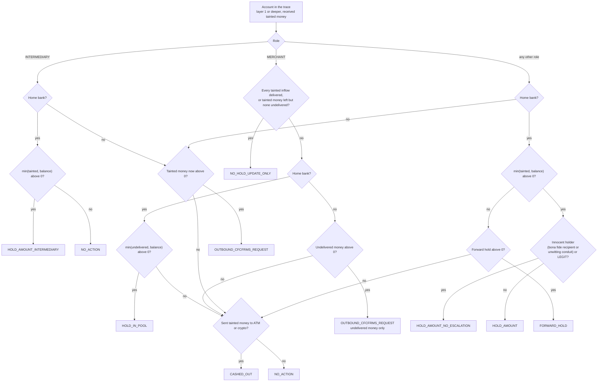

# Hold plan

How Wapsi turns a traced money trail into one decision per account: hold an exact amount, request it from
another bank, hold future credits, or leave the account alone. Each decision carries its legal citations and
reason codes.

| | |
|---|---|
| Code | `src/wapsi/graph/holdplan.py` |
| Entry point | `wapsi.graph.build_hold_plan(trace, classifications, ledger, cfg=None) -> HoldPlan` |
| Input | a `TraceResult` from [the money trail](money-trail.md), roles from the classifier, the ledger, `WapsiConfig` |
| Re-checked by | `wapsi.verify.runner.verify_plan` (policy rules in `src/wapsi/verify/policy.py`), run by `wapsi.pipeline.run.process_case` right after the plan is built |
| Tests | `tests/graph/`, `tests/test_sop_annexure_v.py`, `tests/verify/test_verify_plan.py` |

Amounts are in rupees with Indian digit grouping (₹4,80,000.00). Paise are shown only where they are not zero.
All data is synthetic.

## In two minutes

- **One decision per account** that received tainted money (layer 1 or deeper), ordered by layer and then
  account id. Victim accounts at layer 0 are skipped.
- **Amount-specific holds by default.** A hold is `min(tainted money now, balance)`. SOP Para 5(ix) says:
  "Unwarranted orders for freezing accounts shall be discouraged, and accountability measures shall be
  established." (`SOP-5-IX`) Account-level action is only a recorded, supervisor-approved exception that the plan
  never emits on its own ([Exceptional account-level hold](#exceptional-account-level-hold)).
- **Innocent holders** (SOP 5(xii)) are held for the amount only, with no escalation and no automatic STR: the
  officer decides, and an STR is recommended where the account was used as a conduit.
- **Nodal / pool / escrow accounts:** the disputed amount only (`SOP-9-1-III`). Wapsi never suggests suspending
  or seizing the account; the SOP asks LEAs to normally refrain from both. No forward hold, never an s.106 flag.
- **Merchants:** goods delivered means update only; undelivered means hold in the pool (`SOP-9-2`).
- **Money in another bank** becomes an outbound CFCFRMS request (hold ₹0 here, request amount stated).
- **Forward hold** only on first-layer accounts, and only for tainted money they cashed out or sent beyond the
  traced accounts (`SOP-9-1-I`).
- **s.106 BNSS escalation** is a flag for the investigating officer, never a disposition.
- **Showcase 1:** Wapsi holds ₹1,42,848 across 5 accounts. Freezing every home-bank account that received tainted
  money would immobilise ₹5,03,50,000 across 6. Recoverable for the victim: ₹3,34,848 of the ₹4,80,000 stolen.

## Inputs and roles

`build_hold_plan` decides for every account in `trace.accounts` with `layer > 0` and
`tainted_received_total > 0`. The account's role comes from `account_role`:

| Account | Role used by the plan |
|---|---|
| account type `NODAL`, `POOL` or `ESCROW` | `INTERMEDIARY`, whatever the classifier says |
| account type `MERCHANT` | `MERCHANT`, whatever the classifier says |
| anything else | the classifier's role (`MULE`, `BONA_FIDE_RECIPIENT` (wire value `INNOCENT_HOLDER`), `UNWITTING_CONDUIT`, `LEGIT`, `VICTIM`, ...); `UNKNOWN` if not classified |

The classifier therefore cannot turn a pool account into a mule
(`test_intermediary_holds_disputed_amount_only_even_if_classified_mule`). How the classifier assigns roles is
described in [Account classification](classification.md).

The plan also reads other data from the ledger:

- FIR numbers on the complaints;
- `ExternalSignal.ncrp_prior_reports`, for the s.106 flag;
- the case's victim accounts;
- merchant invoices, for the delivered / undelivered split described in
  [the money trail](money-trail.md#merchants-delivered-and-undelivered).

Whether other-bank accounts were followed is read from the trace (`consortium_followed`), not from `cfg`.

## Decision flowchart



Once the disposition is chosen, the flags are added: the forward-hold amount, the s.106 flag, and the review codes
(see [Flags and reason codes](#flags-and-reason-codes)). A flag never changes the disposition.

## Decision table

"Tainted" means the account's `tainted_now_total` from the trace. Every hold is rounded to paise (`r2`). A
*holding* disposition is one of `HOLD_AMOUNT`, `HOLD_AMOUNT_NO_ESCALATION`, `HOLD_IN_POOL` and
`HOLD_AMOUNT_INTERMEDIARY`, plus the approved exception `EXCEPTIONAL_ACCOUNT_LEVEL_HOLD` (`HOLDING_DISPOSITIONS` in
`src/wapsi/models.py`). A holding disposition is never emitted with a zero hold.

| Disposition | Applies when | `hold_amount` | `forward_hold_amount` | `tainted_amount` | Citations |
|---|---|---|---|---|---|
| `HOLD_AMOUNT` | home-bank account, role `MULE`, `UNKNOWN` or `VICTIM`, hold > 0 | `min(tainted, balance)` | see [Forward hold](#forward-hold) | tainted | `SOP-9-1`, `SOP-ANNEX-I`, `SOP-5-IX` |
| `HOLD_AMOUNT_NO_ESCALATION` | home-bank account, role `BONA_FIDE_RECIPIENT` (`INNOCENT_HOLDER`), `UNWITTING_CONDUIT` or `LEGIT`, hold > 0 | `min(tainted, balance)` | always 0 | tainted | `SOP-5-XII`, `SOP-10-1`, `SOP-9-1` |
| `FORWARD_HOLD` | as `HOLD_AMOUNT`, but nothing is holdable now and the forward hold is above 0 | 0 | tainted money that left the trail | tainted | `SOP-9-1-I`, `SOP-DEF-FIRST-LAYER` |
| `HOLD_AMOUNT_INTERMEDIARY` | home-bank account with role `INTERMEDIARY` (every nodal / pool / escrow account), hold > 0 | `min(tainted, balance)` | always 0 | tainted | `SOP-9-1-III`, `SOP-9-1`, `SOP-ANNEX-I` |
| `NO_HOLD_UPDATE_ONLY` | role `MERCHANT` (every merchant account), any bank: every tainted inflow paid for delivered goods, or no undelivered money is left while tainted money remains | 0 | 0 | tainted | `SOP-9-2` |
| `HOLD_IN_POOL` | home-bank merchant with undelivered tainted money *u*, and `min(u, balance)` > 0 | `min(u, balance)` | 0 | tainted (delivered part included) | `SOP-9-2` |
| `OUTBOUND_CFCFRMS_REQUEST` | other-bank account holding tainted money (a merchant: undelivered money only) | 0 | 0 | the **request amount**: tainted, or *u* for a merchant | `SOP-9-1`, `SOP-6` |
| `CASHED_OUT` | none of the above apply, and the account sent tainted money to an ATM or crypto exit | 0 | 0 | tainted (normally ₹0) | `SOP-9-1` |
| `NO_ACTION` | none of the above apply, and there was no exit, for example because the account passed everything on to traced accounts. A home-bank nodal / pool / escrow account with nothing to hold is always `NO_ACTION` | 0 | 0 | tainted (normally ₹0) | none |
| `ESCALATE_S106_CANDIDATE` | **reserved; never emitted.** Escalation is a reason code on `HOLD_AMOUNT` or `FORWARD_HOLD` | | | | |
| `EXCEPTIONAL_ACCOUNT_LEVEL_HOLD` | **never emitted by `build_hold_plan`.** Set by `apply_account_level_hold` on a `HOLD_AMOUNT` or `HOLD_AMOUNT_NO_ESCALATION` row after a supervisor approves an officer's recorded request | unchanged (the amount-specific hold) | unchanged | unchanged | adds `SOP-5-IX`, `SOP-9-1` |

Per-victim amounts (`per_victim`), extra reason codes and examples:

| Disposition | `per_victim` | Extra reason codes it can carry | Example |
|---|---|---|---|
| `HOLD_AMOUNT` | the account's taint vector scaled to the hold ([largest remainder](#per-victim-amounts)) | `ESCALATE_S106_CANDIDATE`, `FORWARD_HOLD_FIRST_LAYER`, `HOLD_CAPPED_AT_BALANCE` | Showcase 1, accounts A, B, D |
| `HOLD_AMOUNT_NO_ESCALATION` | same | `HOLD_CAPPED_AT_BALANCE`; for an unwitting conduit `UNWITTING_CONDUIT` and `STR_RECOMMENDED_OFFICER_DECISION` | Showcase 1, landlord L (bona fide recipient): ₹4,800 |
| `FORWARD_HOLD` | empty | `FORWARD_HOLD_FIRST_LAYER` (always), `ESCALATE_S106_CANDIDATE` | `test_first_layer_forward_hold_covers_unlocated_money`: ₹10,000 forward, ₹0 hold |
| `HOLD_AMOUNT_INTERMEDIARY` | taint vector scaled to the hold | `NO_SUSPENSION_OR_SEIZURE` (always), `HOLD_CAPPED_AT_BALANCE` | Showcase 1, pool P: ₹19,200 |
| `NO_HOLD_UPDATE_ONLY` | empty | none | Showcase 1, kirana K (invoice `INV-K-5521` delivered) |
| `HOLD_IN_POOL` | undelivered vector scaled to the hold | `HOLD_CAPPED_AT_BALANCE` | `test_mixed_invoices_on_one_payment_hold_the_undelivered_part`: tainted ₹90,000, hold ₹80,000 |
| `OUTBOUND_CFCFRMS_REQUEST` | taint vector (a merchant: undelivered vector) | none | Showcase 1, C ₹48,000 and E ₹1,44,000 |
| `CASHED_OUT` | empty | none | `test_undelivered_merchant_that_cashed_out_is_not_held` |
| `NO_ACTION` | empty | none | `test_other_bank_pass_through_accounts`, account A |

On top of these, `ROLE_UNKNOWN` is added to any row whose role is `UNKNOWN` or `VICTIM`, and
`VICTIM_ACCOUNT_ON_TRAIL` to any row for a victim account of the case.

The table below says what each citation is about. The descriptions are the `section` field that
`wapsi.citations.registry()` returns (from `data/docs/citations.json`, with `src/wapsi/citations.py` as the
fallback). For the court case, the case title is shown instead.

| Citation id | Section |
|---|---|
| `SOP-9-1` | Para 9.1: bank nodal officer to put the amount on hold (s.168 r/w s.94 BNSS) |
| `SOP-ANNEX-I` | Annexure-I: notice under s.168 read with s.94 BNSS |
| `SOP-5-IX` | Para 5(ix): unwarranted freezing of accounts discouraged |
| `SOP-5-XII` | Para 5(xii): accounts operated without knowledge, connivance or consent |
| `SOP-10-1` | Para 10.1: grievance redressal, EDD, timelines, 90-day lapse of hold |
| `SOP-9-1-I` | Para 9.1(i): forward-looking hold only on first-layer accounts; not applied to nodal, pool and escrow accounts |
| `SOP-DEF-FIRST-LAYER` | Para 12(x), General Definitions: first-layer accounts |
| `SOP-9-1-III` | Para 9.1(iii): nodal, escrow or pool account: hold the disputed amount; LEAs to normally refrain from suspension or seizure |
| `SOP-9-2` | Para 9.2: merchants and e-commerce entities |
| `SOP-6` | Para 6 (6.1(j)): reporting and pushing complaints to CFCFRMS; beneficiary bank holds the reported amount |
| `BNSS-106` | Section 106: power of police officer to seize certain property (BNSS) |
| `CASE-KARTIK-CHATUR` | Kartik Yogeshwar Chatur v. Union of India, Bombay HC, 20.11.2025 |
| `SOP-5-XIII` | Para 5(xiii): attribution to victim / equitable pro-rata distribution |
| `SOP-11-P2` | Para 11, Process 2: multiple victims / competing claims |

Each SOP and BNSS id above resolves to a verbatim quote in `data/docs/citations.json`. The case-law id
`CASE-KARTIK-CHATUR` carries only the registry's one-line summary. The verifier rejects any id that is not in the
registry. For example, the quote for `SOP-9-2` begins: "It will cancel the order if delivery of goods or services
is not made".

Which drafts each disposition produces (hold instruction, EDD memo, outbound request, STR) is set out in
[draft-contract.md](../draft-contract.md).

## Flags and reason codes

`reason_codes` always starts with the disposition's own value. The flags below follow in this order.

| Reason code | Added when | Effect |
|---|---|---|
| `ESCALATE_S106_CANDIDATE` | see [s.106 escalation flag](#s106-escalation-flag) | `requires_human = True`; adds `BNSS-106` and `CASE-KARTIK-CHATUR` |
| `FORWARD_HOLD_FIRST_LAYER` | `forward_hold_amount` > 0 | adds `SOP-9-1-I` and `SOP-DEF-FIRST-LAYER` |
| `NO_SUSPENSION_OR_SEIZURE` | every `HOLD_AMOUNT_INTERMEDIARY` | note: "digital banking is not suspended and the account is not seized" |
| `HOLD_CAPPED_AT_BALANCE` | the hold is below the tainted (or undelivered) amount by more than half a paisa | note stating both amounts |
| `ROLE_UNKNOWN` | role `UNKNOWN` or `VICTIM` | `requires_human = True` |
| `VICTIM_ACCOUNT_ON_TRAIL` | the account is a victim account of the case (a complaint's victim account, or the sender of a reported transfer) | `requires_human = True`; never an escalation candidate |
| `UNWITTING_CONDUIT`, `STR_RECOMMENDED_OFFICER_DECISION` | home-bank account classified `UNWITTING_CONDUIT` (it passed on at least half of the victim money it received) | `requires_human = True`; note: no automatic STR, an STR is recommended and the officer decides. A bona fide recipient gets no extra code, so its plan row matches the legacy golden sets |
| `OFFICER_REQUESTED_EXCEPTION`, the recorded `AccountLevelReason` values, `SUPERVISOR_APPROVED_EXCEPTION` | an approved account-level exception | `requires_human = True`; note naming the requester and the approver |

`requires_human` is true when there is an escalation flag, a role of `UNKNOWN` or `VICTIM`, a victim account on
the trail, an unwitting conduit or an approved account-level exception. Otherwise it is false.

`HOLD_CAPPED_AT_BALANCE` is a safeguard. In a trace produced by `trace_case`, an account the plan can hold
(replayed under the rule, or as a terminal) never has more tainted money than balance; a property test checks
this within rounding. So the cap normally fires only on traces built or edited elsewhere, or when per-victim
rounding pushes the tainted total a paisa or two above the balance. The tests exercise it with hand-edited
traces.

## Forward hold

SOP Para 9.1(i): "hold shall be placed only in the case of first-layer accounts" (`SOP-9-1-I`). The SOP defines a
first-layer account as one that receives the defrauded money directly from the victim's account
(`SOP-DEF-FIRST-LAYER`).

**When.** All of the following must be true:

1. The account is at the home bank and takes the ordinary-account branch (it is not a merchant or intermediary).
2. Its layer is 1.
3. Its role is `MULE`, `UNKNOWN` or `VICTIM`. Innocent holders and legitimate accounts never get one.
4. Its account type is not `NODAL`, `POOL` or `ESCROW`.
5. Its balance now is below the tainted money it received, by more than ₹0.005.

**How much.** The tainted money this account sent to:

- ATM or crypto exits; or
- accounts outside `trace.accounts` that are not un-followed other-bank accounts. Money sent to un-followed other
  banks is requested through `OUTBOUND_CFCFRMS_REQUEST` instead.

Money sent to traced accounts is not counted: whatever is left of it is held or requested where it now sits, so
nothing is counted twice. Money sent back to a victim is not counted either.

**Not money in hand.** A forward hold marks future credits into the account. It is reported in
`total_forward_hold` and is never part of `total_recoverable`. If the account holds something now, the
disposition stays `HOLD_AMOUNT` and the forward hold is added. If nothing is holdable now, the disposition is
`FORWARD_HOLD`.

| Case (fixture or test) | Forward hold | Why |
|---|---|---|
| Showcase 1, account A | ₹96,000 | two ATM withdrawals carrying ₹48,000 each; the ₹48,000 sent to C is traced and requested from C's bank |
| Showcase 2, account M | ₹40,000 | ATM withdrawal carrying {N2 ₹25,000, N3 ₹15,000} |
| `test_follow_consortium_off_is_outbound`, account A | ₹1,000 | only the ATM money; the ₹6,000 sent to `OB03-C` is an outbound request |
| `test_plan_reads_consortium_following_from_the_trace`, `max_depth=1`, consortium followed | ₹7,000 | ATM ₹1,000 + ₹6,000 sent to an account cut off by the depth limit |
| `test_first_layer_forward_hold_covers_unlocated_money`, `max_depth=1` | ₹10,000 (`FORWARD_HOLD`, hold ₹0) | A passed everything to B, beyond the depth limit |
| Annexure-V mule account | ₹47,226 | the ATM debit (engine output; not asserted by the test) |

## s.106 escalation flag

The hold plan never recommends seizure. When the facts might support an escalation under s.106 BNSS
(`BNSS-106`), it raises a flag for the investigating officer to decide on. The citation registry summarises the
Bombay High Court case `CASE-KARTIK-CHATUR` as "Banks may only place the disputed amount under lien; no debit
freeze under s.106". Consistent with that, the flag never changes the amount-specific hold.

**When.** All of the following must be true:

1. The account is at the home bank and is not a victim account of the case.
2. Its role is `MULE` or `UNKNOWN`.
3. Its disposition is `HOLD_AMOUNT` or `FORWARD_HOLD`.
4. Money from a complaint that carries an FIR number reached the account: it was sent from the account, received
   by it (payouts of merchant or intermediary terminals do not count), or is held in it now.
5. `ExternalSignal.ncrp_prior_reports` ≥ `WapsiConfig.escalation_min_prior_reports`, which defaults to 2.

**Effect.** The flag adds:

- the reason code `ESCALATE_S106_CANDIDATE`;
- the citations `BNSS-106` and `CASE-KARTIK-CHATUR`;
- `requires_human = True`;
- a note naming the complaint with the FIR and the number of prior reports, ending "for the investigating officer
  to decide".

The disposition and the hold amount do not change.

`test_s106_escalation_flag` checks the conditions. In each case, account A receives ₹5,000 from one complaint and
still holds it. The FIR, the prior reports and A's role vary:

| FIR on the complaint | Prior NCRP reports | Role | Flagged |
|---|---|---|---|
| FIR 9/2026 | 2 | `MULE` | yes |
| FIR 9/2026 | 2 | `UNKNOWN` | yes |
| FIR 9/2026 | 1 | `MULE` | no |
| none | 5 | `MULE` | no |
| FIR 9/2026 | 5 | `INNOCENT_HOLDER` | no |

The showcase worlds show the same logic:

- In Showcase 2, M is flagged: complaint N2 carries FIR 112/2026 and M has 2 prior reports. With
  `escalation_min_prior_reports=3`, M is not flagged.
- In Showcase 1, nothing is flagged. D has 2 prior reports, but complaint N1 has no FIR.

Nodal / pool / escrow accounts, merchants, innocent holders, legitimate accounts, other-bank accounts and victim
accounts on the trail are never flagged.

## Per-victim amounts

When the hold covers the whole taint vector (the usual case), `per_victim` is that vector as it is. When the
hold is smaller (capped at the balance, or the undelivered part of a merchant's money), `_scale` splits it with
**largest-remainder apportionment in paise**:

1. Convert the hold to a whole number of paise: `goal = round(hold × 100)`.
2. Give each victim `floor(τ[v] × goal / T)` paise, where `T` is the sum of the vector.
3. Hand out the leftover paise one at a time, to the victims with the largest fractional remainders. Ties go to
   the complaint listed earlier in the case.

By construction, every share is at least ₹0 and at most that victim's own tainted money, and the shares add up
to the hold exactly. Victims whose share is ₹0 are left out of `per_victim`. `test_scale_random_vectors` checks
these properties on 2,000 random vectors.

- Four victims with ₹0.01 each and a hold of ₹0.02 get {N1 ₹0.01, N2 ₹0.01}
  (`test_scale_never_goes_negative_and_sums_to_the_hold`).
- Three victims with ₹100 each and a hold of ₹100 get ₹33.34, ₹33.33 and ₹33.33, from calling `_scale` directly.

**Per-victim paisa cap.** Each account's tainted money is rounded to paise on its own, so a victim whose money is
recoverable from several accounts could be attributed a paisa or two more than the victim lost (three accounts
holding ₹6,666.666… each round to 3 × ₹6,666.67 = ₹20,000.01 of a ₹20,000.00 loss). `cap_recoverable_at_loss`
takes the excess paise back, one at a time, from that victim's largest share (ties: plan order), and lowers the
row's hold (or request amount) by the same paisa, so shares, amounts and totals stay consistent and no amount goes
to zero. The row's note says so. Plans already within every victim's loss, the showcase and golden plans among
them, are returned unchanged (`tests/graph/test_graph_rounding.py`).

## Plan totals

| Field | Definition | Showcase 1 |
|---|---|---|
| `total_hold` | sum of `hold_amount`; only holding dispositions hold money, including intermediary and in-pool holds | ₹1,42,848 |
| `total_forward_hold` | sum of `forward_hold_amount` | ₹96,000 |
| `total_recoverable` | `total_hold` + the request amounts (`tainted_amount`) of `OUTBOUND_CFCFRMS_REQUEST` rows | ₹3,34,848 |
| `per_victim_recoverable` | per `ncrp_id`: sum of `per_victim` over holding and outbound rows, rounded to paise; never more than the victim's loss (the paisa cap above) | {`31009260000101`: ₹3,34,848} |
| `over_hold_amount` | sum of `max(0, hold − tainted_amount)`; must be ₹0 | ₹0 |
| `baseline_freeze_amount` | the whole-account freeze baseline: sum of `max(balance_now, 0)` over the home-bank accounts that received tainted money, i.e. what freezing those whole accounts would immobilise. A comparison figure, never a recommendation | ₹5,03,50,000 |
| `baseline_freeze_accounts` | number of those accounts | 6 |
| `restoration_process` | see [Restoration process](#restoration-process) | `P1` |
| `str_ground` | `PROCEEDS_OF_CRIME` if any `MULE` decision has tainted money or sent tainted money to exits; otherwise none | `PROCEEDS_OF_CRIME` |

Held money at any layer counts as recoverable. SOP Para 5(x) says money held "at any layer, can be released to the
victim" (`SOP-5-X`).

## Restoration process

- **P2** when more than one victim has recoverable money above ₹0. Every decision then also cites `SOP-5-XIII`
  and `SOP-11-P2`. Under Process 2, "the IO or Police Officer shall ascribe the said amount in accordance with
  Para 5(xiii) of this SOP" (`SOP-11-P2`). Para 5(xiii) attributes money to the victim where possible, and uses
  equitable or pro-rata distribution where commingling makes that impossible (`SOP-5-XIII`).
- **P1** otherwise.

| Case | Recoverable per victim | Process |
|---|---|---|
| Showcase 1 | one victim, ₹3,34,848 | `P1` |
| Showcase 2 | N2 ₹75,000, N3 ₹45,000 | `P2` |
| Annexure-V Illustration 2 | five victims | `P2` |
| `test_process_p1_when_only_one_victim_is_recoverable` | N1 ₹0 (all cashed out), N2 ₹2,000 | `P1`, and no `SOP-11-P2` citation |

`RestorationProcess` also has `P3`, `P4` and `P5` (court, s.107 attachment, court-directed). Drafts and the UI
can name them, but the planner never selects them: those routes are decided by the IO or a court.

## Worked example: showcase 1

Showcase 1 is the world in `src/wapsi/fixtures/showcase.py`, traced step by step in
[the money trail](money-trail.md#worked-example-1-the-showcase-world). It has one victim, ₹4,80,000 stolen, and
pro-rata apportionment. The roles are the fixture's `SHOWCASE_1["roles"]`; in the live pipeline the classifier
supplies them.

| Account | Layer | Role | Disposition | Hold | Forward hold | Tainted amount | Balance now | Reason codes |
|---|---|---|---|---|---|---|---|---|
| A `HB01-1000000001` | 1 | `MULE` | `HOLD_AMOUNT` | ₹43,200 | ₹96,000 | ₹43,200 | ₹45,000 | `HOLD_AMOUNT`, `FORWARD_HOLD_FIRST_LAYER` |
| B `HB01-1000000002` | 2 | `MULE` | `HOLD_AMOUNT` | ₹27,648 | ₹0 | ₹27,648 | ₹28,800 | `HOLD_AMOUNT` |
| L `HB01-2000000001` | 2 | `INNOCENT_HOLDER` | `HOLD_AMOUNT_NO_ESCALATION` | ₹4,800 | ₹0 | ₹4,800 | ₹1,55,000 | `HOLD_AMOUNT_NO_ESCALATION` |
| C `OB03-4000000001` | 2 | `MULE` | `OUTBOUND_CFCFRMS_REQUEST` | ₹0 | ₹0 | ₹48,000 (request) | ₹50,000 | `OUTBOUND_CFCFRMS_REQUEST` |
| D `HB01-1000000003` | 3 | `MULE` | `HOLD_AMOUNT` | ₹48,000 | ₹0 | ₹48,000 | ₹50,000 | `HOLD_AMOUNT` |
| K `HB01-3000000001` | 3 | `MERCHANT` | `NO_HOLD_UPDATE_ONLY` | ₹0 | ₹0 | ₹1,152 | ₹51,200 | `NO_HOLD_UPDATE_ONLY` |
| P `HB01-9000000001` | 3 | `INTERMEDIARY` | `HOLD_AMOUNT_INTERMEDIARY` | ₹19,200 | ₹0 | ₹19,200 | ₹5,00,20,000 | `HOLD_AMOUNT_INTERMEDIARY`, `NO_SUSPENSION_OR_SEIZURE` |
| E `OB03-4000000002` | 4 | `MULE` | `OUTBOUND_CFCFRMS_REQUEST` | ₹0 | ₹0 | ₹1,44,000 (request) | ₹1,50,000 | `OUTBOUND_CFCFRMS_REQUEST` |

The citations:

- A cites `SOP-9-1`, `SOP-ANNEX-I`, `SOP-5-IX`, `SOP-9-1-I` and `SOP-DEF-FIRST-LAYER`.
- P cites `SOP-9-1-III`, `SOP-9-1` and `SOP-ANNEX-I`.
- Every other row cites its disposition's default set from the decision table.
- No row needs a human, and no row is flagged for s.106.

**Totals** (`test_showcase1_plan`):

| | Amount | Accounts |
|---|---|---|
| Wapsi holds (`total_hold`) | ₹1,42,848 = 43,200 + 27,648 + 4,800 + 48,000 + 19,200 | 5 (A, B, L, D, P) |
| Outbound requests | ₹1,92,000 = 48,000 + 1,44,000 | 2 (C, E) |
| Recoverable (`total_recoverable`) | ₹3,34,848 | |
| Forward hold on A's future credits | ₹96,000 | 1 |
| Whole-account freeze baseline | ₹5,03,50,000 | 6 (A, B, L, D, K, P) |

The whole-account freeze baseline locks 352× what Wapsi holds. Most of the baseline is the pool account's
₹5,00,20,000; Wapsi holds only the victim's ₹19,200 there.

The stolen ₹4,80,000 reconciles exactly:

- ₹3,34,848 recoverable;
- ₹1,44,000 cashed out at ATMs;
- ₹1,152 paid to a merchant for delivered goods.

The restoration process is `P1` (one victim) and the STR ground is `PROCEEDS_OF_CRIME`.

## Worked example: showcase 2

This is the two-victim world in the same fixture:

- 15:00 IST: victim V2 sends ₹1,00,000 to M `HB01-1000000004` (N2).
- 15:10 IST: victim V3 sends ₹60,000 to M (N3).
- 15:30 IST: M withdraws ₹40,000 at an ATM.

Pro-rata, the withdrawal carries {N2 ₹25,000, N3 ₹15,000}, and M keeps {N2 ₹75,000, N3 ₹45,000}.

| Field | Value |
|---|---|
| Disposition | `HOLD_AMOUNT` |
| Hold / per victim | ₹1,20,000 = N2 ₹75,000 + N3 ₹45,000 |
| Forward hold | ₹40,000 (M is first-layer and its balance of ₹1,20,000 is below the ₹1,60,000 it received) |
| Reason codes | `HOLD_AMOUNT`, `ESCALATE_S106_CANDIDATE`, `FORWARD_HOLD_FIRST_LAYER` |
| Citations | `SOP-9-1`, `SOP-ANNEX-I`, `SOP-5-IX`, `SOP-9-1-I`, `SOP-DEF-FIRST-LAYER`, `BNSS-106`, `CASE-KARTIK-CHATUR`, `SOP-5-XIII`, `SOP-11-P2` |
| `requires_human` | true (s.106 flag: FIR 112/2026 on N2, 2 prior reports on M) |
| Plan | `total_hold` ₹1,20,000, `total_recoverable` ₹1,20,000, `P2`, baseline ₹1,20,000 across 1 account |

Here the amount-specific hold equals the whole balance, because every rupee in M is tainted. Holding only the
tainted amount differs from a freeze when an account also holds legitimate money, as A, L and P do in Showcase 1.

## Worked example: Annexure-V

On the SOP's Illustration 2 ([money trail, worked example 2](money-trail.md#worked-example-2-sop-annexure-v-illustration-2)),
the mule account is classified `MULE` and the plan gives:

- one `HOLD_AMOUNT` of ₹2,06,543, the whole available balance, which is all tainted;
- `per_victim` equal to the SOP's printed shares: V ₹69,446.97, W ₹31,288.82, X ₹40,695.08, Y ₹40,695.08 and
  Z ₹24,417.05;
- restoration process `P2`.

`tests/test_sop_annexure_v.py` asserts all of these. The engine also adds a ₹47,226 forward hold for the ATM
debit, because the account is first-layer and its balance is below the ₹2,53,769 it received. The test does not
assert this.

## Independent checks

### Plan re-check

`verify_plan` → `check_plan` in `src/wapsi/verify/policy.py` re-derives the rules from the trace, not from the
plan's own fields. It fails the plan on, for example:

- `over_hold`: a hold above `min(tainted, balance)`;
- `victim_in_plan`: a layer-0 account in the plan;
- `forward_hold_not_first_layer`: a forward hold on an account that is not at layer 1;
- `intermediary_disposition`: a nodal / pool / escrow account without `HOLD_AMOUNT_INTERMEDIARY` (home bank) or
  an outbound request (other bank);
- `intermediary_disposition_misused`: `HOLD_AMOUNT_INTERMEDIARY` on an account that is not nodal, pool or escrow;
- `hold_without_holding_disposition`: money held under a non-holding disposition.

`tests/verify/test_verify_plan.py` breaks the showcase plans on purpose and checks that the verifier catches each
break. The breaks include over-holds, forward holds on deeper layers, a pool account held as an ordinary account,
and escalations without an FIR.

### Property tests

On 100 random worlds, `_check_plan` in `tests/graph/test_graph_property.py` asserts that:

- `over_hold_amount` is ₹0;
- `total_recoverable` ≤ `stolen`;
- every holding row holds more than ₹0, never more than its tainted money or balance, and only at the home bank;
- per-victim shares add up to the hold;
- forward holds appear only at layer 1;
- intermediaries never get forward holds or s.106 flags;
- `ESCALATE_S106_CANDIDATE` is never a disposition;
- every citation id is known.

### Evaluation

The demo world has 39 cases across 10 typologies, including 3 adversarial cases. Its expected answers come from an
independent reference implementation (`src/wapsi/synth/reference.py`, which shares no code with `wapsi.graph`).
In the committed `evals/reports/demo.json` (generated 29-09-2026):

| Metric | Value |
|---|---|
| `hold_exact_match_rate` | 1.0 |
| `disposition_accuracy` | 1.0 |
| `process_accuracy` | 1.0 |
| escalation precision / recall | 1.0 / 1.0 |
| `over_hold_inr` | 0.0 |
| `false_freeze_count` | 0 |

Across the 39 cases, the whole-account-freeze baseline is ₹35,25,90,069.78 across 101 accounts, and Wapsi holds
₹29,19,245.69 across 84 accounts. On the 64-case hard world (`evals/reports/hard.json`), holds stay exact,
over-hold ₹0 and false freezes 0 while dispositions are 0.9198: the plan's money rules hold even when the
classifier's labels are wrong. The metrics are defined in [Evaluation](../evaluation.md) and
[eval-report.md](../eval-report.md). The reference implementation was written for this repo, so a perfect score
shows that the two implementations agree on these synthetic cases; it is not an external benchmark.

## Limitations

- **Roles come from the classifier.** For an ordinary account, whichever of `MULE`, `UNKNOWN`, `VICTIM`,
  `BONA_FIDE_RECIPIENT`, `UNWITTING_CONDUIT` or `LEGIT` the classifier picks, the hold amount is the same. The role does change the
  disposition, the forward hold, the s.106 flag and the STR ground. `UNKNOWN` and `VICTIM` roles always require a
  human.
- **Merchant delivery depends on invoices** in the ledger. A tainted payment without a `DELIVERED` invoice from
  that merchant is treated as undelivered, so the money is held in the pool, not released.
- **The s.106 flag depends on inputs.** It uses FIR numbers on complaints and `ncrp_prior_reports`, which are
  synthetic in this repo.
- **Only P1 or P2 is chosen.** Processes 3 to 5 are left to the IO or the court.
- **The plan is a recommendation.** Drafts built from it are verified and then approved by a supervisor in a
  maker-checker step. The approval is bound to the SHA-256 of the exact draft (`Approval.draft_sha256`, see
  `approve` in `src/wapsi/pipeline/run.py`).
- **Synthetic data only.** No real customer, victim or bank data is used.

## Exceptional account-level hold

`build_hold_plan` never emits `EXCEPTIONAL_ACCOUNT_LEVEL_HOLD`. The route to it is recorded and two-person
([ADR 0009](../adr/0009-account-level-hold-as-recorded-exception.md)):

1. An officer calls `wapsi.pipeline.run.request_account_level_hold(bundle, ledger, account_id, reasons,
   requested_by=, role=)` with at least one reason from the closed `AccountLevelReason` list
   (`FRAUDSTER_CONTROLLED_ACCOUNT`, `CONTINUING_FRAUD_EVIDENCE`, `LEA_ORDER_ACCOUNT_LEVEL`,
   `IDENTITY_THEFT_ACCOUNT`). `account_level_reasons()` rejects an empty or unknown reason, and
   `account_level_block()` rejects an ineligible account: only home-bank accounts on the trail whose decision is
   `HOLD_AMOUNT` or `HOLD_AMOUNT_NO_ESCALATION` qualify, never nodal / pool / escrow, merchant, other-bank or
   victim accounts. The request is an `ACCOUNT_LEVEL_HOLD_REQUEST` draft, verified like any other.
2. A supervisor other than the requester approves it with `approve()` (fingerprint-bound).
3. `apply_account_level_hold(plan, account_id, reasons, requested_by=, approved_by=)` returns a copy of the plan
   with that row set to `EXCEPTIONAL_ACCOUNT_LEVEL_HOLD`. `hold_amount`, `per_victim` and every plan total stay the
   amount-specific figures: they are the recoverable money. Reason codes: the disposition,
   `OFFICER_REQUESTED_EXCEPTION`, the recorded reasons, `SUPERVISOR_APPROVED_EXCEPTION`, then the row's earlier
   codes; `requires_human` is set.

In showcase 1, an exception on mule A with `FRAUDSTER_CONTROLLED_ACCOUNT` keeps A's hold at ₹43,200, its forward
hold at ₹96,000 and the plan totals at ₹1,42,848 held and ₹3,34,848 recoverable
(`tests/pipeline/test_pipeline_account_level.py`).

## Reproduce

```python
# uv run python <this file>, from the repository root
from wapsi.config import TraceConfig, WapsiConfig
from wapsi.fixtures import showcase as sc
from wapsi.graph import build_hold_plan, trace_case
from wapsi.models import ClassificationResult

ledger = sc.showcase_ledger()
trace = trace_case(ledger, sc.SHOWCASE_1["ncrp_ids"], TraceConfig())
roles = {a: ClassificationResult(account_id=a, role=r, score=0.5) for a, r in sc.SHOWCASE_1["roles"].items()}
plan = build_hold_plan(trace, roles, ledger, WapsiConfig())
for d in plan.decisions:
    print(d.account_id, d.disposition.value, d.hold_amount, d.forward_hold_amount, d.reason_codes)
print(plan.total_hold, plan.total_recoverable, plan.baseline_freeze_amount, plan.restoration_process.value)
```

```bash
uv run pytest tests/graph/test_graph_showcase.py tests/test_sop_annexure_v.py tests/verify/test_verify_plan.py -q
```

Related: [Money trail](money-trail.md) · [Account classification](classification.md) ·
[Legal spine](../legal-spine.md) · [Draft contract](../draft-contract.md) ·
[Evaluation report format](../eval-report.md)
