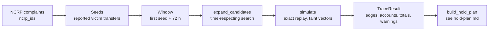
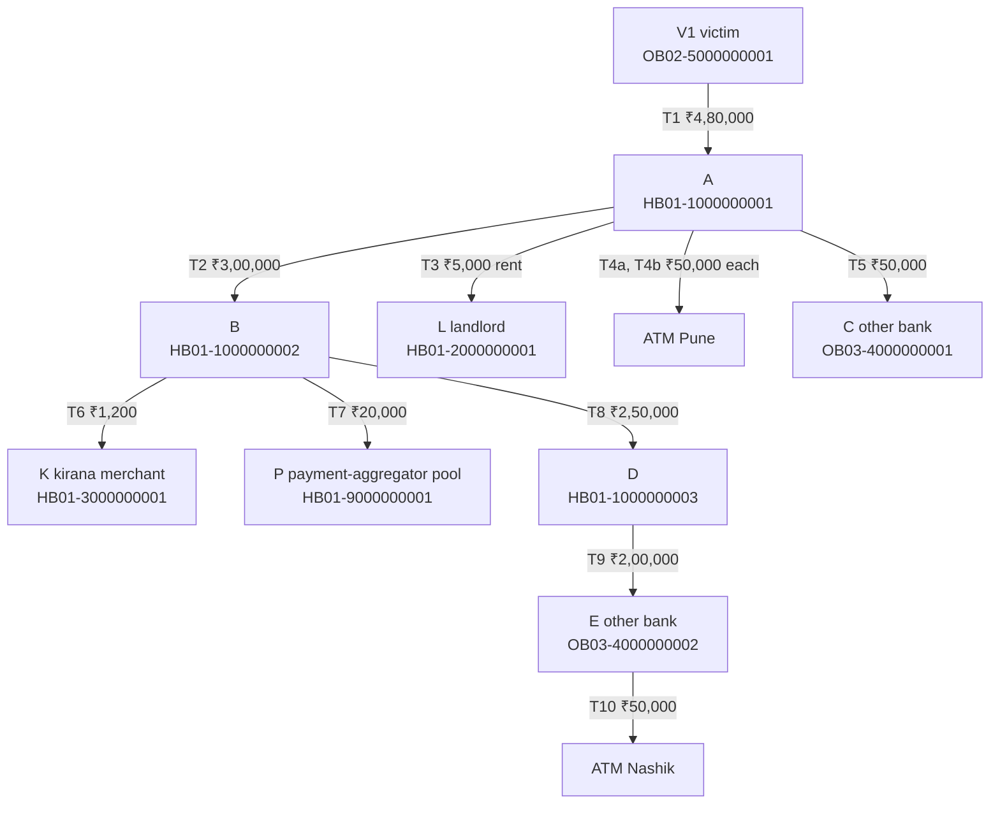

# Money trail

How Wapsi follows a victim's money from the reported transfer through the mule layers, and how it works out,
to the paisa, how much of each victim's money is in each account now.

| | |
|---|---|
| Code | `src/wapsi/graph/`: `trace.py`, `expand.py`, `taint.py`, `common.py` |
| Entry point | `wapsi.graph.trace_case(ledger, ncrp_ids, cfg=None, case_id=None) -> TraceResult` |
| Next step | `wapsi.graph.build_hold_plan`, described in [Hold plan](hold-plan.md) |
| Tests | `tests/graph/` and `tests/test_sop_annexure_v.py`: 289 tests on 29-09-2026, all passing in that day's full-suite run |

Amounts are in rupees with Indian digit grouping (₹4,80,000.00). Paise are shown only where they are not zero.
All data is synthetic.

## In two minutes

- **Input:** one or more NCRP complaint ids. The victim transfers reported in them are the *seeds*.
- **Search:** starting from the seeds, the engine searches forward in time for every account the money could have
  reached. The default limits are 72 hours, 6 layers and 500 accounts. Other banks are followed through
  (simulated) CFCFRMS responses.
- **Replay:** it then replays every transaction touching those accounts in exact time order. Each account keeps
  a *taint vector*: the rupees of each complaint's money in it now, keyed by `ncrp_id`.
- **Rule:** the default apportionment rule is pro-rata. SOP Para 5(xiii) says that when commingled money cannot
  be attributed, "the principle of equitable or pro-rata distribution will be adopted" (`SOP-5-XIII`). FIFO and
  LIFO are available for comparison.
- **Terminals:** merchants and nodal / pool / escrow accounts are never expanded. They keep the disputed amount
  for as long as their balance covers it.
- **Conservation:** every stolen rupee ends in one of six buckets: holdable, cashed out, outbound, intermediary,
  merchant settled or unlocated. The buckets add up to the stolen amount exactly. `unlocated` is the remainder,
  so the property tests also check it against the money the engine explicitly lost track of
  ([why](#totals-and-the-conservation-invariant)).
- **Showcase 1 in one line:** ₹4,80,000 stolen = ₹1,23,648 holdable + ₹1,44,000 cashed out + ₹1,92,000 outbound +
  ₹19,200 intermediary + ₹1,152 merchant settled + ₹0 unlocated
  ([worked example 1](#worked-example-1-the-showcase-world)).
- **Checked against the SOP:** the engine reproduces the SOP's own worked example (Annexure-V, Illustration 2) to
  the paisa. See [worked example 2](#worked-example-2-sop-annexure-v-illustration-2).
- **Deterministic:** events are ordered by timestamp, and within one timestamp by a fixed rule (credits before
  the debits they fund, then `txn_id`). The same ledger therefore always gives the same trace, apart from the
  `computed_at` timestamp. Tests check this on repeated runs and with `txn_id`s chosen to sort against the money's
  path.



## Files

| File | What it does |
|---|---|
| `src/wapsi/graph/trace.py` | `trace_case`: runs the expansion, then the simulation, and returns a `TraceResult` |
| `src/wapsi/graph/expand.py` | `expand_candidates`: seeds, window, and the time-respecting search for candidate accounts |
| `src/wapsi/graph/taint.py` | `simulate`: exact replay, apportionment rules, terminals, totals and warnings |
| `src/wapsi/graph/common.py` | terminal kinds, same-second event order, merchant delivery split, rounding helpers |
| `src/wapsi/graph/holdplan.py` | `build_hold_plan` (see [Hold plan](hold-plan.md)) |

The trace reads data only through the `Ledger` protocol in `src/wapsi/ports.py`. It uses `home_bank_id`,
`complaint`, `complaint_transactions`, `accounts`, `balances_at`, `transactions_touching`,
`consortium_transactions` and `invoices_for_transactions`. The hold plan also reads `external_signals`. The data
contract, including what the home bank can see, is in [data-contract.md](../data-contract.md).

## Configuration

`TraceConfig` in `src/wapsi/config.py`:

| Field | Default | Effect |
|---|---|---|
| `window_hours` | `72.0` | follow transactions up to this long after the first victim transfer |
| `max_depth` | `6` | an account whose nearest layer is this deep is simulated but not expanded |
| `max_accounts` | `500` | cap on candidate accounts; further accounts are dropped with a warning |
| `min_edge_amount` | `100.0` | account-to-account edges carrying less taint than this are left out of `TraceResult.edges`; the totals are not affected |
| `rule` | `PRO_RATA` | `PRO_RATA`, `FIFO` or `LIFO` (`ApportionmentRule` in `src/wapsi/models.py`) |
| `follow_consortium` | `True` | follow other-bank accounts through `Ledger.consortium_transactions` |
| `lookback_days` | `30` | declared in `TraceConfig`; no code in `src/wapsi` reads it yet |

## Step 1: seeds and the window

- **Seeds.** For each `ncrp_id`, `Ledger.complaint_transactions(ncrp_id)` returns the reported victim transfers
  (victim to first-layer account). Each seed carries taint for its own complaint only.
- **De-duplication.** A complaint listed twice is traced once. A transaction reported in two complaints is
  attributed to the first one, with a warning. A seed with a non-positive amount is ignored, with a warning. A
  complaint with no linked transactions produces a warning and a `victim_seed` of ₹0.
- **Victim accounts** are the senders of the seeds plus each `Complaint.victim_account`.
- **Window.** `window_start` is the earliest seed timestamp and `window_end = window_start + window_hours`. If a
  later seed falls outside that, `window_end` becomes the last seed plus `window_hours`, with a warning that the
  window was extended. Transactions outside `[window_start, window_end]` are ignored.
- **Opening balances.** Each candidate starts at `Ledger.balances_at(candidates, window_start)`: its opening
  balance plus credits minus debits strictly before the window. Money already in the account counts as
  legitimate, so it dilutes the tainted share.

## Step 2: candidate expansion

`expand_candidates` in `src/wapsi/graph/expand.py` runs a **time-respecting breadth-first search**. It
deliberately over-approximates: it finds every account that *could* have received the money. The exact replay in
step 3 then decides how much actually moved.

1. Each seed offers its destination account at layer 1, with the seed's timestamp as the earliest possible
   arrival time.
2. Each round fetches, in batches, the debits of the accounts to expand, from their arrival time up to
   `window_end`. Home-bank accounts use `Ledger.transactions_touching`. Other-bank accounts use
   `Ledger.consortium_transactions` when `follow_consortium` is on. Fetched debits are cached, and an account
   is re-fetched only if its arrival time moves earlier.
3. Each debit at or after the arrival time (`ts >= arrival`, so same-second transfers are included) offers its
   destination at layer + 1. Debits with no destination account (ATM cash withdrawals, crypto transfers) are
   exits and need no expansion.
4. The search is **label-correcting**. It keeps the earliest arrival and the smallest layer per account, and it
   re-expands an account whenever either improves.

Why re-expansion matters (`test_time_respecting_layers_and_reexpansion`): A sends to C at minute 5, C sends to
B at minute 10, B sends ₹1,000 to D at minute 20, and A sends to B directly at minute 30. The direct path finds
B first, with arrival at minute 30. The path through C then improves B's arrival to minute 10, so B is
re-expanded from minute 10 and D is found. D ends with ₹1,000 of taint at layer 4, because its money arrived
through A, C and B.

### Terminals

Some accounts are candidates, so their balance and taint are tracked, but they are never expanded
(`terminal_kind` in `src/wapsi/graph/common.py`):

| Account | `TerminalKind` | How the replay treats it |
|---|---|---|
| `NODAL`, `POOL`, `ESCROW` account types | `NODAL_POOL_ESCROW` | lowest intermediate balance ([Terminal accounts](#terminal-accounts)) |
| `MERCHANT` account type | `MERCHANT` | lowest intermediate balance, plus the delivered / undelivered split |
| other-bank account when `follow_consortium` is off | `OTHER_BANK` | absorbs: keeps every tainted rupee it receives; its debits carry none |

Victim accounts of the case are never terminals. An other-bank merchant or intermediary is replayed with the
lowest-intermediate-balance rule when the consortium is followed, and absorbs its taint when it is not.

### Limits

| Limit | What happens | Where the money shows up |
|---|---|---|
| `max_depth` | accounts at layer `max_depth` are simulated but not expanded | money they send on is `unlocated`, with a "Depth limit reached" warning |
| `max_accounts` | accounts beyond the cap are dropped | money sent to them is `unlocated`, with an "Account limit reached" warning |
| unknown account | the destination is not in the ledger | `unlocated`, with a "not found in the ledger" warning |

Money moved to accounts beyond a limit is still shown as edges. In `test_max_depth_truncation_is_unlocated`
(`max_depth=2`), the edge B to C is listed at depth 3 carrying ₹10,000, and the whole ₹10,000 is reported
unlocated.

### Victim accounts on the trail

A victim account of the case becomes a candidate only when money from *another* complaint in the same case can
reach it. Examples are a victim paying into another victim's account, or a traced account paying a victim in a
multi-complaint case. Victim candidates are always expanded. Victims that only send money stay out of the
candidate set and are listed at layer 0. See [Victim-to-victim chains](#victim-to-victim-chains).

## Step 3: exact replay

`simulate` in `src/wapsi/graph/taint.py` builds the event stream from:

- every transaction touching a candidate inside the window that the home bank can see;
- consortium transactions of other-bank candidates, when following;
- the seeds.

### Event order

Events are replayed in `event_order` (`src/wapsi/graph/common.py`):

1. **By timestamp** (UTC).
2. **Within one timestamp, a credit into an account comes before the debits it funds.** The same-timestamp
   transactions form a small graph with an edge from *i* to *j* when *i* credits an account that *j* debits.
   Tarjan's algorithm finds cycles, such as X paying Y while Y pays X in the same second. Members of a cycle are
   ordered by `txn_id`. A topological sort (Kahn's algorithm) over the graph with each cycle collapsed into one
   node gives the order, with ties going to the smallest `txn_id`.
3. Before ordering, `_close_same_second_groups` (in `taint.py`) adds same-second transactions linked through
   accounts outside the simulated set. They move no taint, but without them the order would depend on which accounts happen to be
   candidates.

Examples from `tests/graph/test_graph_review_fixes.py`:

- The victim pays A ₹1,00,000 and A pays B ₹90,000 in the same second. Whichever of the two has the smaller
  `txn_id`, A keeps ₹10,000 of taint, B receives ₹90,000 of taint, and B is at layer 2.
- A chain V1 to A to B to C to ATM happens in one second, with `txn_id`s that sort in reverse order of the
  money's path (`Z9`, `Z5`, `Z1`, `A0`). The layers still come out as 1, 2 and 3. C keeps ₹6,000 and ₹4,000 is
  cashed out.
- A and B each open with ₹1,000. In one second, the victim pays A ₹5,000 (`S`), A pays B ₹3,000 (`AB`) and B
  pays A ₹2,000 (`BA`). The victim's credit is applied first. `AB` and `BA` form a cycle, which is broken by
  `txn_id` (`AB` first), so B receives 3,000 × 5,000 / 6,000 = ₹2,500 of taint. The result is identical on every
  run.

### What happens to one transaction

**Step A: skip.** Transactions with a non-positive amount are skipped and counted in a warning. So are
self-transfers that are not seeds.

**Step B: debit side.** Work out `moved`, the taint vector this transfer carries.

- *Seed:* the reporting victim's own money is tagged with the seed's `ncrp_id`. If the victim account is itself
  on the trail, the transfer first carries other complaints' money under the configured rule, and only the rest
  counts as the reporter's own money.
- *Debit from a simulated account:* the account's book decides (`_Book.take`), according to its mode (below).
- *Anything else:* clean money that carries no taint.

**Step C: credit side.** Decide where `moved` goes.

- *To a simulated account:* the receiver adds `moved` to its taint. Two exceptions apply. Payouts from merchant or
  nodal / pool / escrow terminals are credited as clean money. A complaint's own money arriving back at that
  complaint's victim account is returned money: it is reported unlocated, not taint. The receiver's layer becomes
  `min(layer, sender layer + 1)`, and its parents and first-tainted time are recorded.
- *No destination account* (ATM, crypto): `cashed_out`.
- *A victim account that is not simulated:* `unlocated` (returned to a victim).
- *An other-bank account outside the simulated set, when the consortium is not followed:* `outbound`.
- *Any other account outside the simulated set:* `unlocated`, with its reason.

## Taint vectors and apportionment rules

Every simulated account has a *book* (`_Book` in `taint.py`) holding its balance and its taint vector
`τ = {ncrp_id: rupees}`. Taint vectors are keyed by `ncrp_id` (AGENTS.md, convention 4). A book has one of three
modes:

| Mode | Accounts | What a debit carries |
|---|---|---|
| `rule` | ordinary candidates, other-bank accounts when followed, victim accounts on the trail | taint chosen by the configured rule |
| `libr` (lowest intermediate balance) | merchant and nodal / pool / escrow accounts of the home bank, or of any bank when followed | only the shortfall below the tainted amount, which leaves the trail |
| `absorb` | other-bank accounts when the consortium is not followed | nothing |

### Pro-rata (default)

A debit takes every victim's money in proportion to that victim's share of the balance:

```text
debit of x from a balance B with taint vector τ, T = sum(τ):

    f = min(x / B, 1)            share of the balance that leaves
    if T * f > x:  f = x / T     never move more taint than the debit amount
    moved[v] = f * τ[v]          for every complaint v
    τ[v]     = τ[v] - moved[v]
    B        = B - x
```

A clean credit raises `B` only, which lowers the tainted share. A tainted credit raises both `B` and `τ`. If the
book has taint but a balance of `TINY` (₹0.0000001) or less, which means the data is inconsistent, then
`f = min(x, T) / T`.

### FIFO and LIFO

Each account keeps a queue of *lots*. The opening balance is one clean lot at the front. A credit appends a lot
with its own taint vector, and consecutive clean credits merge into one lot. A debit consumes lots from the front
(FIFO) or the back (LIFO). When only part of a lot leaves, the lot's vector is split in proportion.

### The three rules on one small world

The world below is from `tests/graph/test_graph_rules.py`. X opens with ₹5,000 of its own money.

- At minute 0 the victim sends X ₹10,000.
- At minute 10, X sends Y ₹6,000.
- At minute 20, ₹2,000 cash is deposited into X.
- At minute 30, X withdraws ₹9,500 at an ATM.
- At minute 40, Y sends Z ₹3,000.

| | `PRO_RATA` | `FIFO` | `LIFO` |
|---|---|---|---|
| Taint carried X to Y | ₹4,000 | ₹1,000 | ₹6,000 |
| Taint carried X to ATM (cashed out) | ₹5,181.82 | ₹9,000 | ₹4,000 |
| Taint carried Y to Z | ₹2,000 | ₹500 | ₹3,000 |
| Taint left in X / Y / Z | ₹818.18 / ₹2,000 / ₹2,000 | ₹0 / ₹500 / ₹500 | ₹0 / ₹3,000 / ₹3,000 |
| `holdable` | ₹4,818.18 | ₹1,000 | ₹6,000 |

How the pro-rata figures arise:

- X to Y carries 6,000 × 10,000 / 15,000 = 4,000.
- The deposit leaves X with a balance of 11,000, of which 6,000 is tainted.
- The ATM withdrawal carries 9,500 × 6,000 / 11,000 = 5,181.818…, which rounds to ₹5,181.82.

With two victims, the rules differ in *whose* money moves (`test_multi_victim_vectors`). X receives ₹1,000 from
complaint A, then ₹3,000 from complaint B, then sends ₹2,000 to Y. The ₹2,000 carries {A ₹500, B ₹1,500} under
pro-rata, {A ₹1,000, B ₹1,000} under FIFO, and {B ₹2,000} under LIFO.

## Terminal accounts

Nodal, pool and escrow accounts can hold very large balances of other people's money. Under SOP Para 9.1(iii),
when CFCFRMS notifies action against such an account, "the bank shall hold the disputed amount" (`SOP-9-1-III`).
Merchants are covered by SOP Para 9.2. To keep the disputed amount in place, the engine replays these accounts with
the **lowest intermediate balance** rule: tainted money stays for as long as the balance covers it. This rule is a
Wapsi design choice, not a formula quoted from the SOP.

```text
debit of x from a terminal with balance B and taint τ, T = sum(τ):

    B' = B - x
    if T <= max(B', 0):  nothing tainted leaves
    elif B' <= 0:        all taint leaves
    else:                moved[v] = τ[v] * (1 - B' / T)     the shortfall, split pro-rata
```

Tainted money that leaves a terminal **leaves the trail**. It never taints the receiving account, even a traced
one. It is counted as `cashed_out` (exit), `outbound` (an other-bank account that is not followed) or `unlocated`
(reason: terminal payout, with a warning).

Example (`test_terminal_keeps_the_disputed_amount_while_its_balance_covers_it`). A pool opens with ₹5,000 and
receives ₹10,000 of tainted money, giving a balance of ₹15,000.

1. It pays out ₹3,000. The balance of ₹12,000 still covers the ₹10,000 of taint, so nothing tainted leaves.
   (Plain pro-rata would have moved 3,000 × 10,000 / 15,000 = ₹2,000 of taint.)
2. It pays out ₹8,000. The balance of ₹4,000 is now below the taint, so ₹6,000 of taint leaves and is reported
   unlocated.

The pool keeps ₹4,000 of taint, `totals.intermediary` is ₹4,000, and the hold plan holds ₹4,000 there as
`HOLD_AMOUNT_INTERMEDIARY`.

In `test_terminal_payouts_do_not_taint_traced_accounts`, a nodal account pays ₹6,000 to B, a traced account. The
edge is shown carrying ₹6,000 at depth 3. B's taint stays at the ₹4,000 it received from A, and B's parents list
only A.

### Merchants: delivered and undelivered

For each tainted payment into a merchant, `delivery_fractions` in `common.py` looks only at **that merchant's own
invoices for that payment**:

| Invoices for the payment | Share treated as delivered |
|---|---|
| none | 0 |
| only `UNDELIVERED` or `CANCELLED` | 0 |
| only `DELIVERED` | 1 |
| both | delivered invoice amount ÷ all invoice amounts |

The delivered share becomes `merchant_settled`. The undelivered share stays holdable in the merchant's account
(home bank) or becomes `outbound` (other bank). When a merchant with a mix of delivered and undelivered money
pays out, `merchant_undelivered` takes each victim's delivered and undelivered money in proportion.

Example (`test_mixed_invoices_on_one_payment_hold_the_undelivered_part`): A pays merchant K ₹90,000, with
invoices of ₹10,000 delivered and ₹80,000 undelivered. The result is `merchant_settled` ₹10,000 and `holdable`
₹90,000 (A's remaining ₹10,000 plus K's undelivered ₹80,000).

## Victim-to-victim chains

Sometimes one victim's money passes through another victim's account. The engine handles this without counting
any rupee twice (`test_victim_account_forwarding_another_victims_money`):

- V2's home-bank account has ₹30,000 of its own.
- V1 is defrauded of ₹50,000, paid into V2's account (complaint N1).
- V2 then reports a ₹60,000 transfer to M (complaint N2).

| | Result |
|---|---|
| V2's account | traced at layer 1: balance ₹20,000, taint {N1 ₹12,500} |
| V2's reported ₹60,000 transfer | carries 60,000 × 50,000 / 80,000 = ₹37,500 of N1's money; the remaining ₹22,500 is V2's own |
| M | taint {N1 ₹37,500, N2 ₹22,500}, layer 1 |
| `victim_seed` | {N1 ₹50,000, N2 ₹22,500}; `stolen` = ₹72,500 |

V2 claimed ₹60,000, but V2 lost ₹22,500 of its own money: it started with ₹30,000 and still holds ₹7,500 of it.
The engine warns the officer about the split. In the hold plan, any hold on V2's account is marked
`requires_human` with the reason `VICTIM_ACCOUNT_ON_TRAIL` (see [Hold plan](hold-plan.md)).

If V2 had sent its ₹60,000 *before* receiving V1's money, V2 would keep its full ₹60,000 claim
(`test_victim_that_sends_before_receiving_keeps_its_full_claim`).

## Where the money ends up

### Totals and the conservation invariant

After the replay, `TraceTotals` sorts every rupee:

| Bucket | What it holds |
|---|---|
| `stolen` | sum of `victim_seed`: each complaint's own money in its reported transfers |
| `holdable` | taint still in home-bank accounts that are not intermediaries, including undelivered money in home-bank merchants |
| `cashed_out` | taint that left through ATM or crypto exits |
| `outbound` | taint in other-bank accounts (including other-bank pools and undelivered money in other-bank merchants), plus taint sent to other banks that are not followed |
| `intermediary` | taint in home-bank nodal / pool / escrow accounts |
| `merchant_settled` | taint that paid merchants for delivered goods |
| `unlocated` | the remainder: money that left the traced set, plus paise of rounding residue |

The invariant:

```text
stolen = holdable + cashed_out + outbound + intermediary + merchant_settled + unlocated
```

The first five buckets are each rounded once from exact flows. `unlocated` is computed as the remainder, so the
identity holds by construction. That alone would prove nothing, so the property tests also check the other
side: `unlocated` must equal the explicitly untraced flow within one paisa per rounded quantity. A bucket cannot
hide an accounting error behind the remainder.

### Unlocated money and warnings

Every rupee of unlocated money has a reason, and each reason produces a warning in `TraceResult.warnings`:

| Reason | When |
|---|---|
| depth | sent on by an account at the depth limit |
| limit | sent to an account dropped by `max_accounts` |
| unknown | sent to an account not in the ledger |
| victim | returned to a victim account |
| terminal | paid out of a merchant or nodal / pool / escrow account beyond its balance cover |
| overdraft | repaid an overdrawn balance |
| untraced | sent to any other account outside the traced set |

The engine also warns about:

- a missing opening balance (₹0.00 is assumed);
- debits larger than the balance, which are handled defensively: the debit carries all the taint;
- an extended window;
- a transaction reported in two complaints;
- a complaint with no linked transactions;
- transactions with non-positive amounts;
- a victim account whose reported transfer carried another complaint's money.

## Rounding in paise

- Money is float rupees (AGENTS.md, convention 2). The replay keeps full precision internally, and residue below
  `TINY` = ₹0.0000001 is treated as zero.
- Outputs are rounded to paise with `wapsi.money.r2`, which rounds half away from zero using a 10⁻⁹ nudge.
  `round_vec` rounds each victim's entry separately and drops entries that round to zero. A vector total is the
  rounded sum of its rounded entries (`vec_total`).
- Comparisons use `wapsi.money.eq`: two amounts are equal if they round to the same paisa (`EPSILON` = ₹0.005).
- Because `unlocated` is the remainder, rounding residue lands there. In `_dusty_world`
  (`test_min_edge_amount_pruning_keeps_totals_exact`), the victim's ₹10,000 lands in an account that already
  holds ₹10,00,000 of its own money, so every onward transfer carries less than 1% taint. The buckets come out as
  holdable ₹9,900.99, cashed out ₹49.50, merchant settled ₹49.50 and unlocated ₹0.01, which add to ₹10,000.00.
  That paisa comes from rounding alone, so no unlocated-money warning is raised.

## Output

`TraceResult` (`src/wapsi/models.py`) holds:

- `case_id`, which defaults to `CASE-<first ncrp_id>`;
- `ncrp_ids`, `rule`, `window_start` and `window_end`;
- `victim_seed`, `edges`, `accounts`, `totals`, `warnings` and `computed_at`.

Details of the main fields:

- **`accounts`** lists victim accounts at layer 0 first, then every account that received at least a paisa of
  tainted money, sorted by layer and then `account_id`. A victim account on the trail is listed at its trail
  layer instead of layer 0. An `AccountState` carries `layer` (the minimum depth at which taint arrived),
  `balance_now`, `tainted_now` (a vector) with its `tainted_now_total`, `tainted_received_total`,
  `tainted_sent_total`, `terminal` and `parents`.
- **`edges`** are the tainted transfers (`TrailEdge`). An edge's `depth` is the final layer of the receiving
  account. For exits and off-trail transfers, it is the sender's layer + 1. `via_consortium` is true when neither
  side is at the home bank.
- **Pruning.** Account-to-account edges carrying less than `min_edge_amount` (₹100) are left out of `edges`.
  Seeds, exits, off-trail edges and edges into merchants are always kept. The accounting does not change:
  `test_min_edge_amount_pruning_keeps_totals_exact` checks that the totals, the accounts and the resulting hold
  plan are identical with and without pruning.

## Worked example 1: the showcase world

The hand-computed world in `src/wapsi/fixtures/showcase.py` (Showcase 1) is the reference every module is tested
against. Complaint `31009260000101`: victim V1 (`OB02-5000000001`) loses ₹4,80,000 on 10-09-2026 at 11:02 IST.
Default `TraceConfig` (pro-rata, following the consortium). The window runs from 10-09-2026 11:02 IST to
13-09-2026 11:02 IST.



**Balances at the window start** (`Ledger.balances_at` at 11:02 IST):

| Account | Balance | Why |
|---|---|---|
| A | ₹20,000 | cash deposit `TX-H02` on 01-09-2026 |
| B, D, C, E | ₹0 | no earlier transactions |
| L | ₹1,50,000 | opening ₹1,45,000 + ₹5,000 rent (`TX-H01`, August) |
| K | ₹50,000 | opening ₹45,000 + ₹5,000 of grocery payments (`TX-K00` to `TX-K04`, 09-09-2026) |
| P | ₹5,00,00,000 | opening balance of the pool account |

**Replay, one row per transaction** (all on 10-09-2026, IST). The tainted share is the sender's tainted money
divided by its balance just before the debit. A's ₹20,000 of its own money makes the share
4,80,000 / 5,00,000 = 0.96. Every later account received only A-mixed money, so the share stays at 0.96 down the
chain.

| Step | Txn | Time | Transfer | Amount | Tainted share | Taint carried | Sender after: balance / taint | Receiver after: balance / taint |
|---|---|---|---|---|---|---|---|---|
| T1 | `TX-001` | 11:02 | V1 → A | ₹4,80,000 | seed | ₹4,80,000 | (victim, layer 0) | A ₹5,00,000 / ₹4,80,000 |
| T2 | `TX-002` | 11:09 | A → B | ₹3,00,000 | 0.96 | ₹2,88,000 | A ₹2,00,000 / ₹1,92,000 | B ₹3,00,000 / ₹2,88,000 |
| T3 | `TX-003` | 11:15 | A → L | ₹5,000 | 0.96 | ₹4,800 | A ₹1,95,000 / ₹1,87,200 | L ₹1,55,000 / ₹4,800 |
| T4a | `TX-004` | 11:20 | A → ATM | ₹50,000 | 0.96 | ₹48,000 | A ₹1,45,000 / ₹1,39,200 | cashed out |
| T4b | `TX-005` | 11:24 | A → ATM | ₹50,000 | 0.96 | ₹48,000 | A ₹95,000 / ₹91,200 | cashed out |
| T5 | `TX-006` | 11:30 | A → C | ₹50,000 | 0.96 | ₹48,000 | A ₹45,000 / ₹43,200 | C ₹50,000 / ₹48,000 |
| T6 | `TX-007` | 11:40 | B → K | ₹1,200 | 0.96 | ₹1,152 | B ₹2,98,800 / ₹2,86,848 | K ₹51,200 / ₹1,152 |
| T7 | `TX-008` | 11:45 | B → P | ₹20,000 | 0.96 | ₹19,200 | B ₹2,78,800 / ₹2,67,648 | P ₹5,00,20,000 / ₹19,200 |
| T8 | `TX-009` | 12:05 | B → D | ₹2,50,000 | 0.96 | ₹2,40,000 | B ₹28,800 / ₹27,648 | D ₹2,50,000 / ₹2,40,000 |
| T9 | `TX-010` | 12:30 | D → E | ₹2,00,000 | 0.96 | ₹1,92,000 | D ₹50,000 / ₹48,000 | E ₹2,00,000 / ₹1,92,000 |
| T10 | `TX-011` | 13:10 | E → ATM | ₹50,000 | 0.96 | ₹48,000 | E ₹1,50,000 / ₹1,44,000 | cashed out |

K and P are terminals and make no payouts in the window, so they keep all the taint they received. L has
₹1,50,000 of its own money but never sends any, so its ₹4,800 stays put.

**Final state** (`SHOWCASE_1` in the fixture; `test_showcase1_accounts`, `test_showcase1_edges`):

| Account | Layer | Kind | Balance now | Tainted now | Bucket |
|---|---|---|---|---|---|
| A `HB01-1000000001` | 1 | individual, home | ₹45,000 | ₹43,200 | holdable |
| B `HB01-1000000002` | 2 | individual, home | ₹28,800 | ₹27,648 | holdable |
| L `HB01-2000000001` | 2 | individual, home | ₹1,55,000 | ₹4,800 | holdable |
| C `OB03-4000000001` | 2 | individual, other bank | ₹50,000 | ₹48,000 | outbound |
| D `HB01-1000000003` | 3 | individual, home | ₹50,000 | ₹48,000 | holdable |
| K `HB01-3000000001` | 3 | merchant, home (terminal) | ₹51,200 | ₹1,152 | merchant settled: invoice `INV-K-5521` is `DELIVERED` |
| P `HB01-9000000001` | 3 | pool, home (terminal) | ₹5,00,20,000 | ₹19,200 | intermediary |
| E `OB03-4000000002` | 4 | individual, other bank | ₹1,50,000 | ₹1,44,000 | outbound |

Edge depths: `TX-001` is 1; `TX-002` to `TX-006` are 2; `TX-007` to `TX-009` are 3; `TX-010` is 4; `TX-011` is 5
(a cash-out: E's layer 4 + 1). Only `TX-011` has `via_consortium = True`: it was learned from the simulated
CFCFRMS response of bank OB03.

**Totals** (`test_showcase1_totals`; no warnings):

| stolen | holdable | cashed out | outbound | intermediary | merchant settled | unlocated |
|---|---|---|---|---|---|---|
| ₹4,80,000 | ₹1,23,648 | ₹1,44,000 | ₹1,92,000 | ₹19,200 | ₹1,152 | ₹0 |

- Holdable: 43,200 + 27,648 + 4,800 + 48,000 = 1,23,648.
- Cashed out: three ATM withdrawals of 48,000 each = 1,44,000.
- Outbound: 48,000 (C) + 1,44,000 (E) = 1,92,000.

The six buckets add to exactly ₹4,80,000. What the bank does with this is in the
[showcase hold plan](hold-plan.md#worked-example-showcase-1).

## Worked example 2: SOP Annexure-V, Illustration 2

The SOP gives its own pro-rata example: five complainants' money is mixed in one account, part of it is
debited, and "the interim custody is released on a pro rata basis" (`SOP-ANNEX-V`).
`tests/test_sop_annexure_v.py` rebuilds that account statement as a ledger. The mule account is
`HB01-7000000001` with an opening balance of ₹0, and each complainant pays from an other-bank account. The test
checks that Wapsi's output matches the SOP's printed shares. The SOP figures are also recorded in
`data/docs/facts.json` (`ANNEX_V_ILL2_*`).

**Statement** (15-12-2024, IST):

| Time | Entry | Complainant | Amount | Balance after |
|---|---|---|---|---|
| 12:20 | credit | V | ₹85,326 | ₹85,326 |
| 12:51 | credit | W | ₹38,443 | ₹1,23,769 |
| 13:23 | credit | X | ₹50,000 | ₹1,73,769 |
| 13:55 | credit | Y | ₹50,000 | ₹2,23,769 |
| 14:30 | credit | Z | ₹30,000 | ₹2,53,769 |
| 15:06 | debit (an ATM withdrawal in the test) | | ₹47,226 | ₹2,06,543 |

Before the debit, all ₹2,53,769 in the account is tainted. The debit carries 47,226 × τ[v] / 2,53,769 of each
complainant's money. Each complainant keeps τ[v] × 2,06,543 / 2,53,769, which is 81.39% of what they lost.

| Complainant | Credited | Carried by the debit | Left in the account (share to release) | SOP Annexure-V share |
|---|---|---|---|---|
| V | ₹85,326.00 | ₹15,879.03 | ₹69,446.97 | ₹69,446.97 |
| W | ₹38,443.00 | ₹7,154.18 | ₹31,288.82 | ₹31,288.82 |
| X | ₹50,000.00 | ₹9,304.92 | ₹40,695.08 | ₹40,695.08 |
| Y | ₹50,000.00 | ₹9,304.92 | ₹40,695.08 | ₹40,695.08 |
| Z | ₹30,000.00 | ₹5,582.95 | ₹24,417.05 | ₹24,417.05 |
| Total | ₹2,53,769.00 | ₹47,226.00 | ₹2,06,543.00 | ₹2,06,543 (available balance) |

Every share matches the SOP to the paisa. Each share is rounded separately, and here the five rounded shares add
to exactly ₹2,06,543.00. The hold plan then holds ₹2,06,543 with exactly these per-victim amounts and selects
Process 2 (`test_pro_rata_matches_sop_annexure_v_illustration_2`).

**Why the rule matters.** The SOP's release table (printed page 96) lists the complainants in the order X, V, Y,
Z, W, with dates of 16-12-2024 (X, V) and 17-12-2024 (Y, Z, W). Next to the pro-rata shares it shows two more
columns:

- a running balance that falls 2,06,543 → 1,56,543 → 71,217 → 21,217 → 0;
- the smaller of each complainant's loss and that balance: 50,000, 85,326, 50,000, 21,217 and 0.

Releasing in that order, first come first served, would give Z only ₹21,217 of its ₹30,000 and leave W, listed
last, with nothing. Pro-rata gives every complainant the same 81.39%.

Running the engine on the same ledger with the other rules gives the following. This is the output of the
snippet below; no test pins the FIFO and LIFO rows.

| Rule | V | W | X | Y | Z |
|---|---|---|---|---|---|
| `PRO_RATA` | ₹69,446.97 | ₹31,288.82 | ₹40,695.08 | ₹40,695.08 | ₹24,417.05 |
| `FIFO` (oldest money leaves first) | ₹38,100 | ₹38,443 | ₹50,000 | ₹50,000 | ₹30,000 |
| `LIFO` (newest money leaves first) | ₹85,326 | ₹38,443 | ₹50,000 | ₹32,774 | ₹0 |

```python
# run from the repository root with: uv run python <this file>
import sys

sys.path.insert(0, "tests")
from test_sop_annexure_v import MULE, NCRP, _ledger

from wapsi.config import TraceConfig
from wapsi.graph import trace_case
from wapsi.models import ApportionmentRule

names = {n: k for k, n in NCRP.items()}
for rule in ApportionmentRule:
    st = trace_case(_ledger(), list(NCRP.values()), TraceConfig(rule=rule)).accounts[MULE]
    print(rule.value, {names[n]: x for n, x in st.tainted_now.items()})
```

## Tests

| File | What it pins |
|---|---|
| `tests/graph/test_graph_showcase.py` | every hand-computed number of Showcase 1 and 2: totals, layers, balances, edges, depths |
| `tests/test_sop_annexure_v.py` | Annexure-V Illustration 2 to the paisa, trace and hold plan |
| `tests/graph/test_graph_rules.py` | pro-rata, FIFO and LIFO on hand-computed worlds, including multi-victim vectors |
| `tests/graph/test_graph_edge_cases.py` | cycles, ping-pong (30 hops), re-expansion, depth and account limits, consortium on and off, overdrafts, pruning, merchants, intermediaries |
| `tests/graph/test_graph_review_fixes.py` | same-second ordering, victim-to-victim chains, merchant invoices, terminals releasing taint, other-bank pools |
| `tests/graph/test_graph_property.py` | the randomized invariants below |

**Property tests.** Each of the two randomized tests runs on 100 seeded random worlds: 50 plain, and 50 with
same-second bursts (`txn_id`s unrelated to the order of the money) and victim-to-victim chains. The worlds include
negative opening balances, unknown accounts, merchants and pools.

`test_random_worlds_conserve_money` draws a random configuration for each world: rule, consortium setting,
`max_depth` (1–6), `max_accounts` (2, 4 or 500) and `min_edge_amount` (₹0, ₹100 or ₹5,000). It checks that:

- the six buckets add to `stolen`;
- no bucket is negative beyond rounding;
- no victim's money is counted twice;
- a rule-based or terminal account never holds more taint than money;
- an absorbing account never sends taint;
- every edge carries 0 < taint ≤ its amount, with a timestamp inside the window;
- `unlocated` equals the explicitly untraced flow within one paisa per rounded quantity;
- the hold plan's invariants hold;
- two runs give identical results.

`test_search_finds_every_reachable_account` sets generous limits and checks that simulating only the searched
candidates gives exactly the same totals, accounts and edges as simulating *every* account in the ledger. On these
worlds, the search misses nothing that changes the result.

`test_performance_20k_transactions` runs once per rule (see below).

Run them:

```bash
uv run pytest tests/graph tests/test_sop_annexure_v.py -q
```

## Complexity and speed

Notation: *n* is the number of transactions in the window touching candidate accounts, *a* is the number of
candidate accounts, and *k* is the number of complaints in the case (the width of a taint vector).

- **Search.** Each round makes one batched account lookup for newly found accounts and at most two batched
  transaction fetches (home bank and consortium) for the accounts that need fetching. The search is bounded by
  `max_depth` and `max_accounts`. Re-expansion happens only when an account's arrival time or layer improves.
- **Replay.** Sorting the events costs O(*n* log *n*). Each event then costs O(*k*) under pro-rata and in
  terminals. Under FIFO and LIFO, each lot is created once and fully consumed at most once, and each debit splits
  at most one lot, so the lot work is O((*n* + *a*) · *k*) in total.
- **Same-second groups.** Tarjan's algorithm and the topological sort are linear in the group size plus the number
  of credit-to-debit links. The links can grow quadratically when many transfers into and out of one account share
  one timestamp.
- **Memory.** O(*a* · *k* + *n*) under pro-rata. Under FIFO and LIFO each lot keeps its own vector, so the lots
  can take up to O((*n* + *a*) · *k*).

Measured on the performance world (300 home-bank and 30 other-bank accounts, 3 victims, 20,000 random
transactions over 72 hours):

- The test requires `trace_case` and `build_hold_plan` to each finish in under 2 seconds for every rule.
- One measurement on a Windows development laptop (CPU, best of 3 runs): `trace_case` took 0.74 s under
  pro-rata, 0.57 s under FIFO and 0.78 s under LIFO, and `build_hold_plan` took 0.02 s or less. Timings vary
  with the machine and its load; treat them as a sanity check, not a benchmark.
- The rules spread the money very differently in this world. Under FIFO, the first-layer accounts' large opening
  balances sit in front of the victims' money, so only the 3 first-layer accounts receive taint. Under pro-rata
  and LIFO, taint reaches all 330 non-victim accounts.
- In the committed demo-world evaluation (`evals/reports/demo.json`, generated 29-09-2026, 39 cases), time to
  hold plan, covering screening, trace, classification, plan and plan re-check, was 0.2765 s at p50 and
  0.349 s at p95, on a development machine shared with other jobs.

## Limitations

- **Float rupees.** Amounts are floats rounded to paise, not decimals, so rounding residue of a few paise can
  appear in `unlocated`. Against the independent reference implementation used by the evaluation
  (`src/wapsi/synth/reference.py`), the summed absolute error over all totals fields in all 39 demo cases is
  ₹0.34 (`totals_abs_error_inr` in `evals/reports/latest.json`).
- **Window and depth.** Money moved after the 72-hour window is not traced. Money that goes beyond `max_depth`
  layers, or past `max_accounts`, is reported as unlocated with a warning. The warning tells the officer where
  the trail stopped.
- **Terminals are not expanded.** Money paid out of a merchant or pool account beyond its balance cover leaves the
  trail (cashed out, outbound or unlocated). Following it needs the intermediary's own settlement records.
- **Other banks.** Other-bank visibility comes from `Ledger.consortium_transactions`, which is a *simulated*
  CFCFRMS response in this repo. With following off, money in other banks is `outbound`, and the hold plan turns
  it into requests.
- **Order within one timestamp** is inferred (credits before the debits they fund, then `txn_id`). Real
  sub-second ordering data, where it exists, would be more exact.
- **Rule choice.** Pro-rata follows SOP Para 5(xiii) and Annexure-V. FIFO and LIFO are there to compare and to
  test sensitivity. Deciding how held money is restored remains with the investigating officer or the court.
- **Balances.** Opening balances come from `Ledger.balances_at`. A missing balance is assumed to be ₹0, with a
  warning. Overdrafts are handled defensively: the debit carries all the taint, and a credit into a negative
  balance first repays the deficit, with that part reported unlocated.
- **Synthetic data only.** No real customer, victim or bank data is used.

## Reproduce

```python
# uv run python <this file>, from the repository root
from wapsi.config import TraceConfig
from wapsi.fixtures import showcase as sc
from wapsi.graph import trace_case

trace = trace_case(sc.showcase_ledger(), sc.SHOWCASE_1["ncrp_ids"], TraceConfig())
for e in trace.edges:
    print(e.txn_id, e.depth, e.amount, e.tainted_total)
print(trace.totals)
```

Related: [Hold plan](hold-plan.md) · [Account classification](classification.md) ·
[Legal spine](../legal-spine.md) · [Data contract](../data-contract.md) ·
[Evaluation report format](../eval-report.md)
