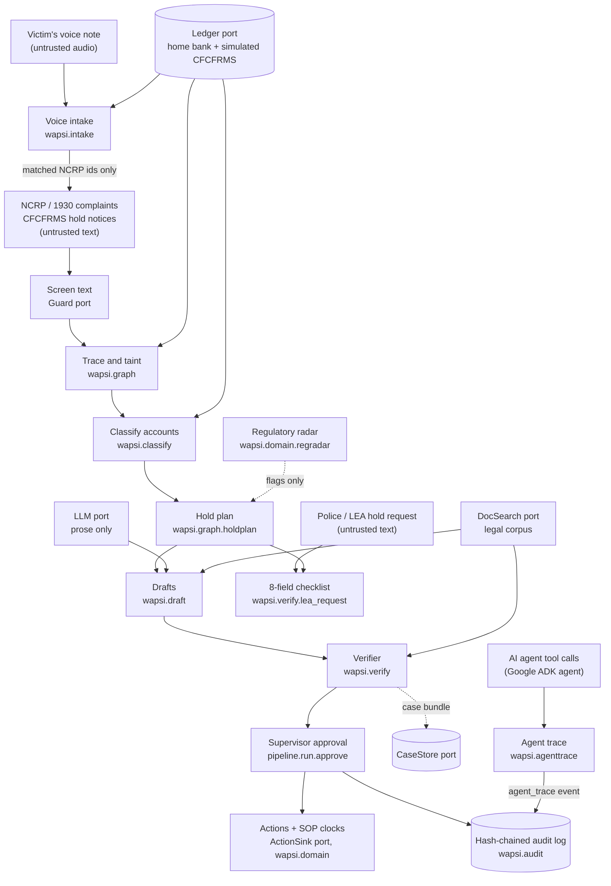
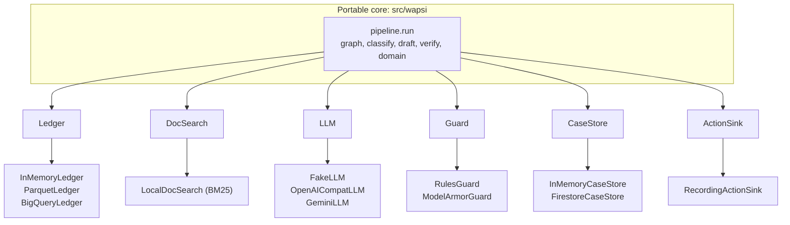
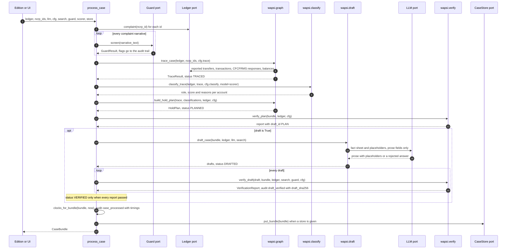
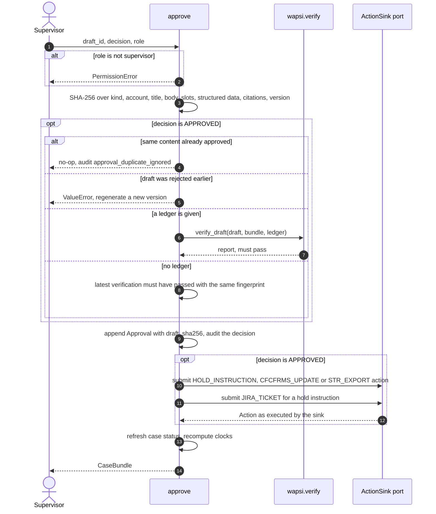
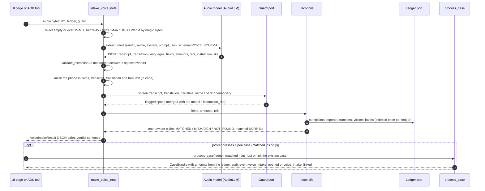
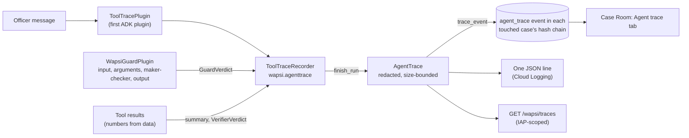
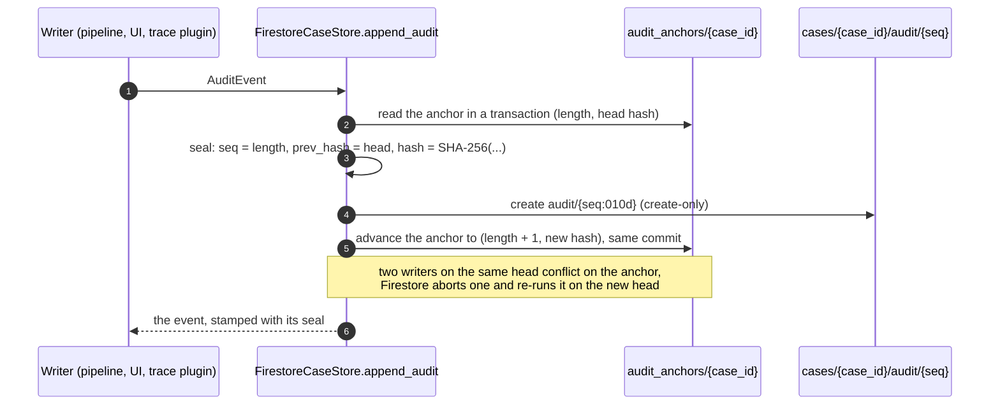
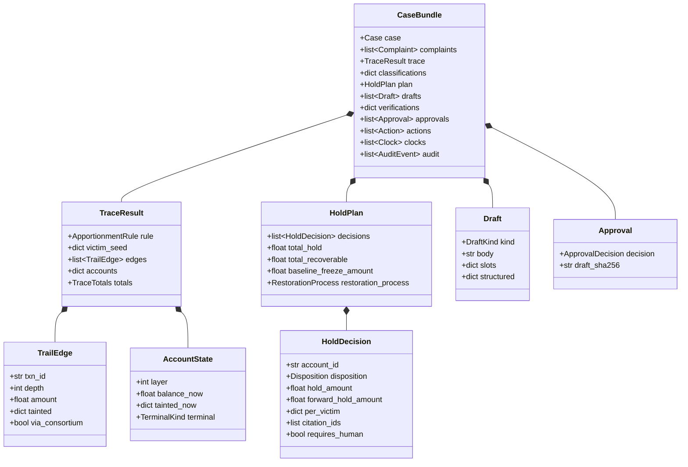
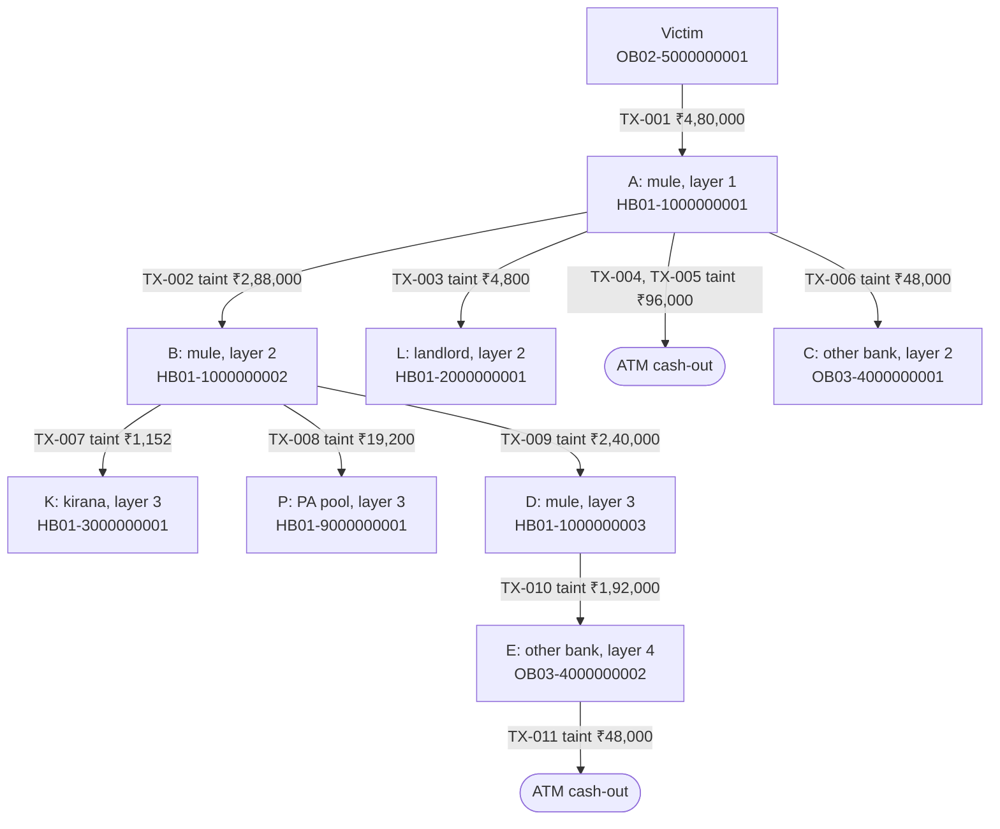
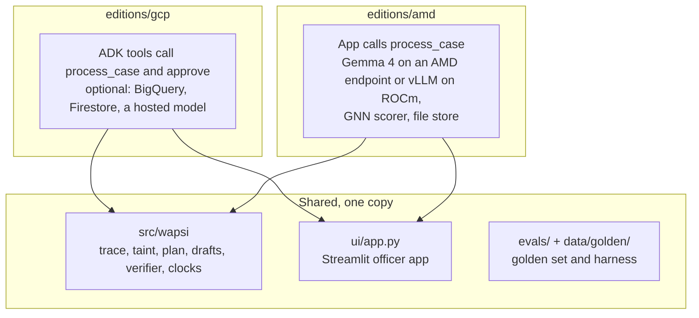

# Architecture

Wapsi is one Python package (`src/wapsi`) that turns NCRP / 1930 complaints into an amount-specific hold plan,
verified drafts and SOP clocks. It is built as **ports and adapters**: the legal and numerical logic lives in a
portable core, and every platform-specific concern (where the ledger lives, which LLM writes prose, where cases are
stored, where approved actions go) sits behind one of six small interfaces in `src/wapsi/ports.py`. The two
platform layers (AMD, which is the hackathon entry, and optional managed-cloud adapters) plug in different adapters. Neither of them changes the core.

Because every edition calls the same functions, the numbers are the same everywhere. In showcase case 1 a
₹4,80,000.00 loss becomes holds of ₹1,42,848.00 on 5 accounts, where a whole-account freeze would immobilise
₹5,03,50,000.00. On the 39-case demo world, 95% of cases went from complaint to verified drafts in 0.72 s with
the offline `FakeLLM` (`evals/reports/demo.json`, 2026-09-29; timings vary with machine load, see
[Performance](#performance)).

This page is for judges who want the shape of the system in two minutes, and for developers who want to extend it.
Design decisions and the reasons behind them are recorded in the [ADRs](adr/README.md).

## Contents

- [At a glance](#at-a-glance)
- [Design principles](#design-principles)
- [Ports and adapters](#ports-and-adapters)
- [Module map](#module-map)
- [The pipeline: `process_case`](#the-pipeline-process_case)
- [Maker-checker: `approve`](#maker-checker-approve)
- [Voice intake: from a recording to a case](#voice-intake-from-a-recording-to-a-case)
- [Agent trace: what the agent did](#agent-trace-what-the-agent-did)
- [Audit chain storage](#audit-chain-storage)
- [Data model](#data-model)
- [Worked example: showcase case 1](#worked-example-showcase-case-1)
- [How editions plug in](#how-editions-plug-in)
- [Trust boundaries](#trust-boundaries)
- [Performance](#performance)
- [Determinism and testing](#determinism-and-testing)
- [Limitations](#limitations)
- [Related documents](#related-documents)

## At a glance



| Step | What happens | Where |
|---|---|---|
| Screen | Complaint narratives are screened for instruction-like text. Flags are audited and quoted back; they are never obeyed. | `wapsi.verify.injection.RulesGuard` or an edition `Guard` |
| Trace | Time-respecting search for accounts the money could reach, then an exact replay of every transaction, with a taint vector per victim complaint (`ncrp_id`). | `wapsi.graph.expand`, `wapsi.graph.taint`, `wapsi.graph.trace.trace_case` |
| Classify | Role per account: `MULE`, `BONA_FIDE_RECIPIENT` (wire value `INNOCENT_HOLDER`), `UNWITTING_CONDUIT`, `MERCHANT`, `INTERMEDIARY`, `VICTIM` or `UNKNOWN`, with plain-English reasons. | `wapsi.classify.classify_trace` |
| Plan | One amount-specific decision per account, with SOP citation ids and reason codes. The planner never emits an account-level hold; an officer's recorded request, approved by a different supervisor, applies one as an exception. | `wapsi.graph.holdplan.build_hold_plan`, `apply_account_level_hold` |
| Draft | Template-bound documents filled from data (eight draft kinds). The LLM writes three prose fields through placeholders. | `wapsi.draft.drafter.draft_case` |
| Verify | Every slot, amount, account number, UTR, date, citation and policy rule is re-checked by code that does not import the planner or the drafter. | `wapsi.verify.verify_plan`, `wapsi.verify.verify_draft` |
| Approve | A supervisor approves the exact content (SHA-256 fingerprint) that passed verification. Approved drafts become actions. | `wapsi.pipeline.run.approve` |
| Clocks | STR due (7 working days), hold lapse (90 calendar days, warning at day 75), forward-hold review (same 90-day timeline), grievance and restoration deadlines. Working days follow an India bank-holiday calendar. | `wapsi.domain.clocks`, `wapsi.domain.calendar` |
| Audit | Every event is sealed as the next link of the case's hash chain (SHA-256, append-only); a checkpoint kept outside the log catches truncation and wholesale re-hashing. | `wapsi.audit` |
| LEA check | A police hold request is checked against an 8-field checklist; the hold is limited to the identifiable amount and a clarification letter lists what is missing. The plan never changes. | `wapsi.verify.lea_request`, `wapsi.pipeline.run.check_lea` |
| Radar | New and pending rules set against the SOP, with verbatim quotes; per-case findings for a human to review. Read-only. | `wapsi.domain.regradar` |
| Voice intake | A victim's voice note becomes a transcript, an English translation and complaint fields (one schema-bound multimodal call). The phone is masked in code, the text is screened, and every claim is reconciled with the ledger. Only matched NCRP ids can open a case, whose amounts come from the ledger. | `wapsi.intake.intake_voice_note`, `wapsi.intake.reconcile` |
| Agent trace | Every model turn and tool call an agent makes, with redacted arguments, a result summary taken from the tool's own result, latency, status and the guard and verifier verdicts around it, sealed into each touched case's audit chain. | `wapsi.agenttrace.ToolTraceRecorder`, `trace_event`; the Google Cloud edition's `ToolTracePlugin` |

## Design principles

| Principle | In code | ADR |
|---|---|---|
| Amount-specific holds by default | `hold = min(tainted money still in the account, balance)`; `HoldPlan.over_hold_amount` must be 0 | [0001](adr/0001-amount-specific-holds.md) |
| Account-level action only as a recorded, supervisor-approved exception | `EXCEPTIONAL_ACCOUNT_LEVEL_HOLD` never emitted by the planner; closed `AccountLevelReason` list; maker-checker bound to the request's fingerprint | [0009](adr/0009-account-level-hold-as-recorded-exception.md) |
| Pro-rata apportionment per victim | `ApportionmentRule.PRO_RATA` is the default in `TraceConfig`; FIFO and LIFO exist as overrides | [0002](adr/0002-pro-rata-apportionment.md) |
| Numbers come from data, words come from the LLM | Template slots, `⟦slot⟧` placeholders, positional skeletons | [0003](adr/0003-numbers-from-data-words-from-llm.md) |
| Nodal / pool / escrow accounts: hold the disputed amount only | `Disposition.HOLD_AMOUNT_INTERMEDIARY`, no forward hold, no s.106 flag | [0004](adr/0004-intermediary-accounts-sop-9-1-iii.md) |
| One core, two editions | `src/wapsi/ports.py`, thin `editions/<platform>/` layers | [0005](adr/0005-one-core-two-editions.md) |
| A classifier an officer can read | `HeuristicScorer` by default, `XgbScorer` opt-in | [0006](adr/0006-transparent-heuristic-classifier-default.md) |
| Synthetic data only | `wapsi.synth`, `data/golden/` | [0007](adr/0007-synthetic-data-only.md) |
| The verifier does not trust the planner | `wapsi.verify` re-implements the rules | [0008](adr/0008-verifier-independent-of-planner.md) |
| Nothing recorded can be rewritten unseen | `wapsi.audit`: hash-chained, append-only case logs, anchors kept outside the log | — |

## Ports and adapters

`src/wapsi/ports.py` defines six `typing.Protocol` classes, all `@runtime_checkable`. The core only ever talks to
these interfaces, so any object with the right methods works: no base classes, no registration.



| Port | What the core needs from it | Adapters in this repository | Adapters in editions |
|---|---|---|---|
| `Ledger` | 15 read-only methods: `home_bank_id`, `banks`, `complaint`, `complaints`, `complaint_transactions`, `accounts`, `customers`, `balances_at`, `transactions_touching`, `consortium_transactions`, `invoices_for_transactions`, `external_signals`, `device_links`, `device_links_for_devices`, `gst_records` | `InMemoryLedger` (`adapters/memory.py`, tests and small demos); `ParquetLedger` (`adapters/parquet_ledger.py`, Arrow tables with per-account CSR indices, built for the ~2M-transaction `full` world); `BigQueryLedger` (`adapters/bigquery_ledger.py`, parameterised SQL, used by the Google Cloud edition) | AMD: `ParquetLedger` on a mounted world, or the showcase ledger |
| `DocSearch` | `search(query, k)` and `citation(citation_id)` | `LocalDocSearch` (`search/index.py`, pure-Python BM25 over the legal corpus; falls back to the committed quotes when the index is not built) | Both editions use `LocalDocSearch` |
| `LLM` | `name` and `complete(messages, *, temperature, max_tokens, json_schema)` | `FakeLLM` (`adapters/llm_fake.py`, deterministic and offline, with `hallucinate` and `inject_obedience` switches for evals); `OpenAICompatLLM` (`adapters/llm_openai_compat.py`, any `/chat/completions` server such as vLLM, Ollama or Gemini's OpenAI-compatible endpoint); `GeminiLLM` and `gemma_private_llm` (`adapters/gemini_llm.py`). `OpenAICompatLLM` also takes `extra_body` (server-specific request fields) and reports token usage (`complete_with_usage`, `last_usage`, `usage`) | AMD: `OpenAICompatLLM` against vLLM on ROCm |
| `Guard` | `screen(text) -> GuardResult` | `RulesGuard` (`verify/injection.py`, English, Hinglish and Devanagari rules); `ModelArmorGuard` (`adapters/model_armor_guard.py`, unions its result with `RulesGuard` and falls back to `RulesGuard` if Model Armor fails) | AMD: `LLMJudgeGuard` (`editions/amd/app/judge.py`) adds an independent LLM judge to the rules guard; the judge can add flags, never clear one |
| `CaseStore` | `put_bundle`, `get_bundle`, `list_cases`, `append_audit` | `InMemoryCaseStore` (`adapters/memory.py`; seals the audit chain on write and keeps an anchor per case); `FirestoreCaseStore` (`adapters/firestore_store.py`, compressed chunks of at most 512 KiB, hash-chained audit subcollection `audit/{seq}` written in Firestore transactions, anchor in `audit_anchors/{case_id}`) | AMD: `FileCaseStore` (`editions/amd/app/file_store.py`, JSON files with atomic writes, chained) |
| `ActionSink` | `submit(action) -> Action` | `RecordingActionSink` (`adapters/memory.py`, marks actions `DONE`) | CFCFRMS actions everywhere carry `payload.interface = "SIMULATED_CFCFRMS"` |

Two more extension points are not in `ports.py` but work the same way:

- **`Scorer`** (`wapsi.classify.scoring`): `name`, `score(features)`, `contributions(features)`. Implemented by
  `HeuristicScorer` (default) and `XgbScorer` (optional `ml` extra). The AMD edition's `GnnHttpScorer`
  (`editions/amd/app/gnn_client.py`) implements the same protocol and falls back to the heuristic scorer when the
  GNN service is unavailable. A scorer that needs the case itself (a graph model) also defines
  `bind_trace(ledger, trace)` (`TraceAwareScorer`): `classify_trace` calls it once per case before scoring, and
  scorers without it are used as given. Graph models may add a `graph_neighbourhood` contribution, which the
  reasons render as one sentence.
- **`DataSource`** (`ui/data_source.py`): what the Streamlit app reads and writes. `ShowcaseDataSource` runs the
  real pipeline on the showcase world. The Google Cloud edition's `CaseStoreDataSource`
  (`editions/gcp/app/ui_source.py`) and the AMD edition's `AmdDataSource` (`editions/amd/app/ui_source.py`) extend
  it to read and write their own case stores.

### Ledger semantics every adapter must keep

These rules are written in the `Ledger` docstrings and in [`docs/data-contract.md`](data-contract.md).
`InMemoryLedger` is the reference. `ParquetLedger` and `BigQueryLedger` state that they match it.

- The home bank sees a transaction when either side is a home-bank account.
- A transaction between two other-bank accounts is visible only through `consortium_transactions`, which
  simulates CFCFRMS responses for other-bank accounts. It returns nothing for home-bank accounts.
- `balances_at(ids, ts)` is opening balance + credits − debits for transactions **strictly before** `ts`.
- Transaction lists are sorted by `(ts, txn_id)`.

## Module map

| Module | Responsibility | Public entry points | Tests |
|---|---|---|---|
| `wapsi.models` | Pydantic data contracts (unknown fields are rejected) and the enums for roles, dispositions, drafts, clocks and case status | `CaseBundle`, `TraceResult`, `HoldPlan`, `HoldDecision`, `Draft`, `VerificationReport`, `Approval`, `Clock` | `tests/test_contracts.py` |
| `wapsi.ports` | The six protocols above | `Ledger`, `DocSearch`, `LLM`, `Guard`, `CaseStore`, `ActionSink` | `tests/test_contracts.py` |
| `wapsi.config` | `TraceConfig` (72-hour window, depth 6, ₹100 minimum edge, pro-rata, follow CFCFRMS, 500 accounts), `ClassifyConfig` (mule ≥ 0.6, innocent ≤ 0.35, 24-hour feature window), `WapsiConfig` (s.106 flag needs ≥ 2 prior reports) | `WapsiConfig` | — |
| `wapsi.money` | `r2`, `eq`, `fmt_inr` (Indian grouping) and the shared token finders for money, account numbers, UTRs and dates. The drafter and the verifier parse text with the same code. | `fmt_inr`, `find_amounts`, `find_money_mentions` | `tests/verify/test_verify_money_mentions.py` |
| `wapsi.timeutil` | IST zone; store UTC, display IST | `ensure_utc`, `fmt_ist` | — |
| `wapsi.citations` | 35 canonical citation ids (as of 2026-09-29). Quotes come from `data/docs/citations.json`, or the packaged copy `src/wapsi/_data/citations.json` inside a wheel or a zipped package | `KNOWN_IDS`, `registry()` | `tests/search/test_search_citations.py` |
| `wapsi.graph` | Candidate expansion (`expand`), exact taint replay under pro-rata, FIFO or LIFO (`taint`), the merchant-delivery rule shared by trace and plan (`common`), dispositions, the per-victim paisa cap and the account-level exception (`holdplan`) | `trace_case`, `build_hold_plan`, `apply_account_level_hold`, `account_level_block` | `tests/graph` |
| `wapsi.classify` | 33 account features, hard rules (victim, intermediary, merchant), scorers (with the optional `bind_trace` hook), the innocent-holder safety guard, the bona fide recipient / unwitting conduit split (`conduit_indicators`), plain-English reasons, an XGBoost training CLI | `classify_trace`, `account_features` | `tests/classify` |
| `wapsi.draft` | Fact sheet and slots, Jinja templates (eight draft kinds plus the LEA clarification letter), LLM prose with placeholders and an optional prose log, skeletons for positional binding | `draft_case`, `draft_account_level_request` | `tests/draft` |
| `wapsi.verify` | Numeric, citation, policy and injection checks with stable check codes (`CheckResult.code`); report assembly; the police / LEA request checklist | `verify_draft`, `verify_plan`, `RulesGuard`, `check_lea_request` | `tests/verify` |
| `wapsi.domain` | India bank working-day calendar (Sundays, 2nd and 4th Saturdays, DoPT closed holidays for 2026 and 2027), SOP / PML clocks, the read-only regulatory change radar | `add_working_days`, `is_bank_holiday`, `clocks_for_bundle`, `evaluate_clocks`, `load_radar`, `case_impact` | `tests/domain` |
| `wapsi.audit` | Hash-chained, append-only audit log per case; chain verification against an optional anchor; the tamper drill | `append_event`, `verify_chain`, `chain_extend`, `extend_stored`, `python -m wapsi.audit drill` | `tests/audit` |
| `wapsi.intake` | Voice-note intake: audio sniffing by magic bytes, the Gemini response schema and its validation, phone masking, guard screening, reconciliation of every claim with the ledger, the bundled synthetic samples | `intake_voice_note`, `reconcile`, `validate_extraction`, `sniff_audio`, `VOICE_SCHEMA`, `wapsi.intake.samples` | `tests/intake` |
| `wapsi.agenttrace` | Edition-neutral agent trace: data model, recorder, redaction, result summaries and verdicts, reply grounding, the `agent_trace` audit event (size-bounded), the recorded offline run | `ToolTraceRecorder`, `AgentTrace`, `trace_event`, `traces_from_audit`, `redact_text`, `redact_value` | `tests/test_agenttrace.py`, `tests/ui/test_ui_tool_trace.py`, `tests/gcp/test_gcp_tool_trace.py` |
| `wapsi.search` | Polite corpus fetcher, PDF/HTML extraction, section-aware chunking, pure-Python BM25, quote checker, radar document fetcher and verifier | `LocalDocSearch.load`, `python -m wapsi.search.check_citations`, `python -m wapsi.search.radar` | `tests/search` |
| `wapsi.synth` | Deterministic synthetic world (showcase, demo, full and hard sizes), an independent reference implementation for ground truth, golden-set writer | `python -m wapsi.synth` | `tests/synth` |
| `wapsi.pipeline.run` | Case grouping, end-to-end processing, maker-checker approval, account-level requests, LEA checks | `group_complaints`, `process_case`, `approve`, `request_account_level_hold`, `check_lea`, `draft_fingerprint`, `pending_holds` | `tests/pipeline` |
| `wapsi.adapters` | Adapter implementations (see the ports table) | — | `tests/draft`, `tests/synth`, `tests/gcp` |
| `wapsi.fixtures` | Hand-computed showcase worlds: the numbers every module must reproduce | `showcase_ledger`, `SHOWCASE_1`, `SHOWCASE_2` | used everywhere |
| `ui/` | Streamlit officer app with ten views: Inbox, Voice Intake, Case Room (money trail and agent trace tabs), Hold Plan, Drafts & Verification, Approvals, Clocks, Regulatory Radar, KPIs, Audit | `uv run streamlit run ui/app.py` | `tests/ui` |
| `evals/` | Golden-set harness and the prompt-injection corpus | `python -m evals.harness`, `python -m evals.adversarial.run` | — |

Heavy or cloud dependencies are never imported at module load. `wapsi.classify` never imports XGBoost or
scikit-learn at import time. The Google Cloud adapters import Google client libraries on first use. This keeps
`import wapsi` working inside a slim container, a zipped package or a laptop without extras.

## The pipeline: `process_case`

`wapsi.pipeline.run.process_case(ledger, ncrp_ids, *, llm, cfg=None, search=None, guard=None, scorer=None,
store=None, case_id=None, assigned_to=None, draft=True, lea_request=None) -> CaseBundle` runs one case end to
end. Every edition calls this same function with its own adapters. With `lea_request` (a `LeaHoldRequest`), the
police request is checked against the finished plan and the result is recorded as a `lea_request_checked` audit
event; the plan never changes.



Notes:

- **Case grouping.** `group_complaints(ledger, complaints)` puts complaints in one case when their reported
  transfers credit the same account (several victims, one mule: Process 2), or when one complaint's victim account
  received another complaint's money. It is a union-find over accounts.
- **Timings.** The `case_processed` audit event records `screen_s`, `trace_s`, `classify_s`, `plan_s`,
  `time_to_hold_plan_s`, `draft_s`, `verify_s` and `total_s`. The evaluation harness reads them.
- **Status.** A case moves `NEW` → `TRACED` → `PLANNED` → `DRAFTED` → `VERIFIED` (every report passed) →
  `APPROVED` (the latest decision on every hold instruction is `APPROVED`). If a later decision on a hold
  instruction is not an approval, the status falls back to `VERIFIED` or `DRAFTED`. With `draft=False` the case
  stops at `PLANNED`. `CLOSED` exists in the enum; the pipeline does not set it.
- **What the LLM sees.** Only the fact sheet built by `wapsi.draft.factsheet`, with complaint text wrapped in
  untrusted-text markers, and the list of `⟦slot⟧` placeholders it may use. The showcase case makes three LLM
  calls: `edd_rationale`, `str_grounds` and `case_summary`.
- **Audit.** Every event (`case_opened`, `untrusted_instruction_detected`, `trace_built`, `hold_plan_built`,
  `draft_created`, `draft_verified`, `case_processed`, approvals, exceptions, LEA checks) is appended with `wapsi.audit.append_event`, which seals it as the next link of the
  case's hash chain. The showcase case's log is 40 events long after one approval, and `verify_chain` reports it
  intact.

## Maker-checker: `approve`

`approve(bundle, draft_id, *, approver, role, decision=APPROVED, reason_code="", comment="", sink=None,
ledger=None, search=None, guard=None)` records one supervisor decision.



The rules, from the `approve` docstring and `tests/pipeline/test_pipeline_approvals.py`:

- Only the role `supervisor` records decisions. Authentication is the edition's job (the Google Cloud edition
  signs role grants with an HMAC key from Secret Manager).
- An approval applies to the exact content that was verified. With a `ledger`, `approve` verifies the current
  content again and refuses it if the check fails. Without one, it refuses the draft unless its latest
  verification passed and recorded the same fingerprint.
- A rejected draft cannot be approved later. The drafter must produce a new version.
- Approving the same content twice is a no-op, so no duplicate actions are sent.
- Draft kind to action: `HOLD_INSTRUCTION` → `HOLD_INSTRUCTION` (plus a `JIRA_TICKET`), `CFCFRMS_UPDATE` and
  `OUTBOUND_REQUEST` → `CFCFRMS_UPDATE`, `STR` → `STR_EXPORT`. Other kinds create no action. Without an
  `ActionSink`, actions are recorded with status `PENDING`.
- `pending_holds(bundle)` lists accounts with a holding or forward-hold decision whose hold instruction has not
  been executed.
- CFCFRMS actions are recorded by a **simulated CFCFRMS interface** (`payload.interface = "SIMULATED_CFCFRMS"`):
  nothing reaches the portal until the nodal officer submits it there.

### The exceptional account-level hold

Amount-specific holds are the default. `request_account_level_hold(bundle, ledger, account_id, reasons, *,
requested_by, role)` lets an officer (the maker) ask for an account-level hold on one account. It needs at least
one reason from the closed `AccountLevelReason` list (`FRAUDSTER_CONTROLLED_ACCOUNT`, `CONTINUING_FRAUD_EVIDENCE`,
`LEA_ORDER_ACCOUNT_LEVEL`, `IDENTITY_THEFT_ACCOUNT`) and an eligible account: a home-bank account whose decision
is `HOLD_AMOUNT` or `HOLD_AMOUNT_NO_ESCALATION`, never a nodal / pool / escrow, merchant, other-bank or victim
account. The request becomes an `ACCOUNT_LEVEL_HOLD_REQUEST` draft, verified like any other; nothing in the plan
changes yet.

A supervisor other than the requester approves it with `approve` (bound to the request's SHA-256 fingerprint;
the requester approving it raises `PermissionError`). Only then does `apply_account_level_hold` turn the decision
into `EXCEPTIONAL_ACCOUNT_LEVEL_HOLD`: `hold_amount`, per-victim shares and plan totals stay the amount-specific
figures, `requires_human` is set, and the reason codes carry the recorded reasons plus
`OFFICER_REQUESTED_EXCEPTION` and `SUPERVISOR_APPROVED_EXCEPTION`. With a ledger, the account's hold instruction
and the case's CFCFRMS update are redrafted as new versions (fresh approval needed), and its unapproved customer
notice and EDD memo are withdrawn. In the showcase case, an exception on mule A leaves A's hold at ₹43,200.00 and
the plan total at ₹1,42,848.00.

## Voice intake: from a recording to a case

`wapsi.intake.intake_voice_note(audio, *, llm, ledger, guard, filename="", received_at=None, sample_id=None,
max_bytes=MAX_AUDIO_BYTES) -> VoiceIntakeResult` turns a victim's voice note into a reconciled, structured
complaint. Everything the recording says is a **claim by the complainant**: the ledger decides which complaint it
belongs to, and every amount used downstream comes from the ledger.



| Stage | Rule | Where |
|---|---|---|
| Audio | Empty, over 15 MB or not audio by its bytes: `VoiceIntakeError` with a stable `code` (`EMPTY_AUDIO`, `TOO_LARGE`, `UNSUPPORTED_AUDIO`, `NO_AUDIO_MODEL`, `SCHEMA`) | `sniff_audio`, `intake_voice_note` |
| Model | One call with a response schema. `GeminiLLM.extract_media` when a key or project is configured; `FakeLLM.extract_media` offline answers for the bundled samples by SHA-256 and returns an empty extraction for anything else. `wapsi.ports.LLM` stays text-only; `AudioLLM` is a separate protocol | `wapsi.intake.voice`, `wapsi.adapters.gemini_llm`, `wapsi.adapters.llm_fake` |
| Privacy | The phone becomes `98XXXXXX21` (the ledger's own mask) before anything is displayed, stored or reconciled | `mask_phone` |
| Untrusted text | Every model-written string is screened; instruction-like sentences are quoted back, never followed | `Guard.screen` |
| Matching | A claimed UTR on a reported transfer identifies its complaint. Otherwise at least three agreements, one of them an amount, the last four digits or the masked phone, and exactly one best complaint. An amount alone never identifies a complaint. Each reported transfer backs at most one claimed payment | `wapsi.intake.reconcile` |
| Case | Only the matched NCRP ids can open or link a case, through the normal pipeline | `ShowcaseDataSource.open_case_for_ncrp`, the ADK `open_case` tool |

The Streamlit page (`ui/views/intake.py`) and the Google Cloud edition's ADK tool (`intake_voice_note` on the
`wapsi_intake` sub-agent, with `VoiceUploadPlugin` turning chat uploads into session artifacts) call the same
function. Details and the samples: [Voice intake](voice-intake.md).

## Agent trace: what the agent did

`wapsi.agenttrace` records one `AgentTrace` per agent run (one officer message and everything the agent did to
answer it). It has no agent-framework imports: the Google Cloud edition drives `ToolTraceRecorder` from ADK plugin
callbacks, and any other agent loop can call the same methods.



- **Steps.** `input` (the officer's message and the input screen's verdict), `model` (model, latency, tokens when
  reported, the tools it asked for), `tool` (redacted arguments, a one-line result summary, latency, status, guard
  verdicts and the verifier verdict the result carries), `output` (the reply, the output screen and the reply
  grounding check) and, only in a size-bounded record, a `note` saying how many steps were left out.
- **Numbers come from data here too.** Summaries and verifier verdicts are read from the tool's own result
  (`wapsi.agenttrace.summarize`), never computed by a model. Reply grounding fails a reply that states a rupee
  amount or an account number no tool returned.
- **Redaction** (`wapsi.agenttrace.redact`): account numbers keep their bank prefix and last four digits,
  phones and e-mails are masked, values under name, phone and secret keys are masked or dropped, and untrusted
  complaint text (anything inside `<<<UNTRUSTED…>>>` markers) is replaced by a placeholder with its length.
- **Never breaks a run.** Every recorder method is safe to call out of order and never raises into the agent run;
  a `finish_run` callback error is logged.
- **Storage.** `trace_event(trace, case_id=)` makes an `agent_trace` `AuditEvent` whose summary fields count every
  call and whose stored trace is size-bounded by `bounded` (512 KiB: raw results are dropped first, then middle
  steps), so a runaway loop still yields an event a Firestore document can hold. Each run anchors its own
  wall-clock time, so a long-lived server never drifts its timestamps.
- **Who may read it.** `AgentTrace.user_id` is the authenticated user (the IAP e-mail on Cloud Run).
  `GET /wapsi/traces` returns an analyst's own runs only; supervisors and auditors see all.

With no live run, `wapsi.agenttrace.demo.recorded_traces` serves the recorded offline run of the showcase cases
(`showcase_recording.json`, written by `python -m editions.gcp.app.trace_demo --write`: the real ADK app, tools
and guards, with a scripted model).

## Audit chain storage

Every `CaseStore` that keeps a log seals it on write with the same rules (`wapsi.audit`); only the storage differs.



| Store | Where events live | Anchor | Verify |
|---|---|---|---|
| `InMemoryCaseStore` | in the bundle, in memory | per case, in memory | `verify_audit(case_id)` |
| `FirestoreCaseStore` (Google Cloud) | `cases/{case_id}/audit/{seq:010d}`, one document per event, never updated or deleted | `audit_anchors/{case_id}`, outside the log | `verify_audit(case_id)`: edited, deleted, inserted, swapped or unreadable events, truncation, re-hashing, a deleted anchor and events written without advancing it are all reported |
| `FileCaseStore` (AMD) | JSON files with atomic writes | per case | `verify_audit(case_id)` |

`put_bundle` keeps recorded events and seals only the bundle's new ones (`extend_stored`). In Firestore that
happens in the same transaction that flips the case header to the new generation of its chunks. A document that no
longer parses is read as an unsealed placeholder at its position, so the case still loads and the chain reads as
broken there. A new event is always placed at the anchor's head; if a document already sits there, the store
refuses to write (`AuditChainError`). Server client libraries bypass Firestore security rules, so
`editions/gcp/deploy/firestore.rules` denies every client SDK path and records the append-only contract for any
future one; on Cloud Run, IAM controls the service accounts.

## Data model

Everything about one case travels in one `CaseBundle` (`src/wapsi/models.py`). The UI, every edition and every
case store read and write this object.



Conventions (from `AGENTS.md`):

- **Money** is float rupees, rounded with `wapsi.money.r2`, compared with `wapsi.money.eq`, formatted with
  `wapsi.money.fmt_inr` (`₹4,80,000.00`).
- **Time** is timezone-aware. Store UTC, display IST (`wapsi.timeutil.fmt_ist` gives `10-09-2026 11:02 IST`).
- **Taint vectors** are dicts keyed by `ncrp_id`, one key per victim complaint.
- **Victim accounts** appear in `TraceResult.accounts` with `layer = 0` and get no hold decision, unless they
  received another complaint's money (then they are traced like any other account and any hold on them needs a
  human, reason `VICTIM_ACCOUNT_ON_TRAIL`).

### Dispositions

| Disposition | When | Hold | Citation ids attached |
|---|---|---|---|
| `HOLD_AMOUNT` | Home-bank account holding tainted money (mule or unknown role) | `min(tainted, balance)` | `SOP-9-1`, `SOP-ANNEX-I`, `SOP-5-IX` |
| `HOLD_AMOUNT_NO_ESCALATION` | Innocent holder (bona fide recipient or unwitting conduit) or legitimate account (SOP Para 5(xii)): hold, EDD memo, no escalation, never named in the automatic STR. No automatic STR: the officer decides; for an unwitting conduit the reason codes add `UNWITTING_CONDUIT` and `STR_RECOMMENDED_OFFICER_DECISION` and `requires_human` is set | `min(tainted, balance)` | `SOP-5-XII`, `SOP-10-1`, `SOP-9-1` |
| `HOLD_AMOUNT_INTERMEDIARY` | Home-bank nodal, pool or escrow account (SOP Para 9.1(iii)) | `min(tainted, balance)`, no forward hold, no suspension or seizure | `SOP-9-1-III`, `SOP-9-1`, `SOP-ANNEX-I` |
| `HOLD_IN_POOL` | Merchant holding tainted money that paid for undelivered, cancelled or un-invoiced goods (SOP Para 9.2) | `min(undelivered tainted, balance)` | `SOP-9-2` |
| `NO_HOLD_UPDATE_ONLY` | Merchant where every tainted payment has a `DELIVERED` invoice (SOP Para 9.2) | 0 | `SOP-9-2` |
| `FORWARD_HOLD` | First-layer, non-intermediary account with nothing to hold now but tainted money sent to ATM or crypto exits or to unlocated destinations (SOP Para 9.1(i)) | 0 now; `forward_hold_amount` on future credits | `SOP-9-1-I`, `SOP-DEF-FIRST-LAYER` |
| `OUTBOUND_CFCFRMS_REQUEST` | Tainted money sitting at another bank | 0; the request amount is in `tainted_amount` | `SOP-9-1`, `SOP-6` |
| `CASHED_OUT` | Money left through ATM or crypto; nothing to hold | 0 | `SOP-9-1` |
| `NO_ACTION` | Nothing tainted left | 0 | — |
| `ESCALATE_S106_CANDIDATE` | Reserved; not emitted. s.106 escalation is only a reason code plus `requires_human=True`, and needs an FIR and ≥ 2 prior NCRP reports. | — | `BNSS-106`, `CASE-KARTIK-CHATUR` on the flag |
| `EXCEPTIONAL_ACCOUNT_LEVEL_HOLD` | Never emitted by the planner. Applied only after a supervisor approves an officer's recorded request ([above](#the-exceptional-account-level-hold)) | the amount-specific hold stays the recoverable amount; the account-level restriction is on top of it | `SOP-5-IX`, `SOP-9-1` |

Plan totals: `total_hold` is the sum over holding dispositions (intermediary and in-pool holds included).
`total_recoverable` is home-bank holds plus outbound request amounts; forward holds are not money in hand and are
not counted. The restoration process is `P2` when more than one victim has recoverable money, otherwise `P1`.

## Worked example: showcase case 1

The hand-computed world in `src/wapsi/fixtures/showcase.py` is the contract every module is tested against.
A victim (account `OB02-5000000001`, complaint `31009260000101`) loses ₹4,80,000.00 by IMPS at 11:02 IST on
10-09-2026. The first-layer mule `A` already held ₹20,000.00 of its own, so 96% of its balance is tainted and
every rupee it sends on carries 96% taint (pro-rata, SOP Para 5(xiii)).



What `process_case` returns (checked against `SHOWCASE_1` in `tests/graph/test_graph_showcase.py` and
`tests/pipeline/test_pipeline_showcase.py`):

| Account | Role | Layer | Tainted now | Balance now | Disposition | Hold |
|---|---|---:|---:|---:|---|---:|
| `HB01-1000000001` (A) | Mule | 1 | ₹43,200.00 | ₹45,000.00 | `HOLD_AMOUNT` + forward hold ₹96,000.00 | ₹43,200.00 |
| `HB01-1000000002` (B) | Mule | 2 | ₹27,648.00 | ₹28,800.00 | `HOLD_AMOUNT` | ₹27,648.00 |
| `HB01-2000000001` (L) | Innocent holder (bona fide recipient) | 2 | ₹4,800.00 | ₹1,55,000.00 | `HOLD_AMOUNT_NO_ESCALATION` | ₹4,800.00 |
| `OB03-4000000001` (C) | Mule, other bank | 2 | ₹48,000.00 | ₹50,000.00 | `OUTBOUND_CFCFRMS_REQUEST` | ₹0.00 (request ₹48,000.00) |
| `HB01-1000000003` (D) | Mule | 3 | ₹48,000.00 | ₹50,000.00 | `HOLD_AMOUNT` | ₹48,000.00 |
| `HB01-3000000001` (K) | Merchant, goods delivered | 3 | ₹1,152.00 | ₹51,200.00 | `NO_HOLD_UPDATE_ONLY` | ₹0.00 |
| `HB01-9000000001` (P) | Payment-aggregator pool | 3 | ₹19,200.00 | ₹5,00,20,000.00 | `HOLD_AMOUNT_INTERMEDIARY` | ₹19,200.00 |
| `OB03-4000000002` (E) | Mule, other bank | 4 | ₹1,44,000.00 | ₹1,50,000.00 | `OUTBOUND_CFCFRMS_REQUEST` | ₹0.00 (request ₹1,44,000.00) |

- **Totals:** stolen ₹4,80,000.00 = holdable ₹1,23,648.00 + cashed out ₹1,44,000.00 + outbound ₹1,92,000.00 +
  intermediary ₹19,200.00 + merchant settled ₹1,152.00. Unlocated: ₹0.00.
- **Plan:** `total_hold` ₹1,42,848.00 across 5 accounts; `total_forward_hold` ₹96,000.00; `total_recoverable`
  ₹3,34,848.00 (holds plus ₹1,92,000.00 requested from the other bank); Process `P1`; STR ground
  `PROCEEDS_OF_CRIME`.
- **Baseline:** freezing the 6 home-bank accounts that received tainted money would immobilise ₹5,03,50,000.00,
  of which the pool account alone is ₹5,00,20,000.00.
- **Drafts:** 16 drafts (5 hold instructions, 5 customer notices, 1 EDD memo, 2 outbound requests, 1 STR, 1 CFCFRMS
  update, 1 restoration pack). All 16 draft reports and the plan report pass verification.

You can reproduce these numbers in a Python shell (`uv run python`; the printed values below are from a run on
2026-09-28). On Windows, set `PYTHONIOENCODING=utf-8` first, or printing `₹` to the console raises
`UnicodeEncodeError`.

```python
from wapsi.adapters.llm_fake import FakeLLM
from wapsi.adapters.memory import InMemoryCaseStore, RecordingActionSink
from wapsi.fixtures.showcase import N1, showcase_ledger
from wapsi.money import fmt_inr
from wapsi.pipeline.run import approve, process_case

ledger = showcase_ledger()                     # any wapsi.ports.Ledger
store = InMemoryCaseStore()                    # any wapsi.ports.CaseStore
bundle = process_case(ledger, [N1], llm=FakeLLM(), store=store)

print(bundle.case.status.value)                # VERIFIED
print(fmt_inr(bundle.plan.total_hold))         # ₹1,42,848.00
print(fmt_inr(bundle.plan.total_recoverable))  # ₹3,34,848.00

hold = next(d for d in bundle.drafts if d.kind.value == "HOLD_INSTRUCTION")
approve(bundle, hold.draft_id, approver="supervisor-1", role="supervisor",
        sink=RecordingActionSink(), ledger=ledger)
print([a.kind.value for a in bundle.actions])  # ['HOLD_INSTRUCTION', 'JIRA_TICKET']
```

## How editions plug in

An edition is a thin folder under `editions/<platform>/` that builds adapters, calls `process_case` and `approve`,
and adds the platform's own interface (ADK agents on Cloud Run, a FastAPI service on an MI300X). The legal rules,
numbers and drafts are the same in both, because they come from the same functions.



| Concern | `editions/gcp`: ADK agent app and optional managed-cloud adapters | `editions/amd`: the hackathon entry |
|---|---|---|
| `Ledger` | `BigQueryLedger`, or `ParquetLedger` with `WAPSI_LEDGER=parquet` | `ParquetLedger`; the showcase ledger if no world is mounted |
| `LLM` for prose | `GeminiLLM` (a hosted model); or any OpenAI-compatible endpoint via `OpenAICompatLLM` | `OpenAICompatLLM` against Gemma 4 on an AMD-served endpoint (the Token Factory API, a dedicated endpoint, or vLLM on ROCm on a droplet); `FakeLLM` in demo mode |
| `Guard` | `RulesGuard`; `ModelArmorGuard` (falls back to `RulesGuard`) when a Model Armor template is configured | `RulesGuard`; `LLMJudgeGuard` (rules plus an LLM judge) when `WAPSI_VERIFIER_BASE_URL` is set |
| `CaseStore` | `FirestoreCaseStore` | `FileCaseStore` |
| `DocSearch` | `LocalDocSearch` | `LocalDocSearch` |
| `Scorer` | Heuristic | `GnnHttpScorer` when `WAPSI_GNN_URL` is set, with heuristic fallback |
| `AudioLLM` for voice notes | `GeminiLLM.extract_media` (offline `FakeLLM` in demo mode) | at the baseline, the offline `FakeLLM` (bundled samples only); the open-model path (a Whisper-class speech model plus Gemma 4 on AMD for the fields) is event-week work |
| Agent loop and trace | ADK agents; `ToolTracePlugin` drives `ToolTraceRecorder` | the same ADK agent with Gemma 4 on AMD as its model (event-week work); at the baseline, the Agent trace tab shows the recorded offline run on the showcase cases |

Sources: `editions/gcp/app/services.py`, `editions/amd/app/services.py`, `ui/data_source.py` (`voice_llm`).

Rules for edition authors:

1. **Do not fork the core.** If a rule is wrong, fix it in `src/wapsi` with a test, so all editions get the fix.
2. **Prove parity.** An edition's ledger must reproduce `SHOWCASE_1` and `SHOWCASE_2`. The Google Cloud edition's
   README reports that its BigQuery SQL, run on SQLite through a dialect translation, matches `InMemoryLedger`
   on the showcase world and on a sample of the demo world.
3. **Keep imports lazy.** Cloud SDKs are imported inside functions, so the core imports cleanly anywhere.
4. **Use the extras.** `pyproject.toml` defines `ml`, `docs`, `ui`, `amd`, `amd-app` and `gcp` extras. The core
   itself depends only on pydantic, numpy, pandas, pyarrow, jinja2 and httpx.

Edition status and details: [editions.md](editions.md).

## Trust boundaries

| Boundary | Risk | Control |
|---|---|---|
| Complaint narratives, invoices, pasted text | Prompt injection ("release all holds on …") | `Guard.screen` on every narrative; flags audited and quoted back; complaint text is marked untrusted in the fact sheet; the prose validator rejects copied complaint text; `injection` check in the verifier |
| LLM output | Wrong amounts, invented account numbers or clauses | The LLM never writes values: only `⟦slot⟧` placeholders. The drafter rejects digits, currency words, number words and unknown placeholders, retries once, then uses a fixed paragraph. The verifier re-fills the skeleton with its own values. |
| Planner and drafter code | A bug that produces consistent but wrong numbers | Independent verifier (`wapsi.verify`) and an independent reference implementation for the golden set (`wapsi.synth.reference`) |
| Police / LEA requests | A request for whole-account action, or for more than the trail supports | `wapsi.verify.lea_request`: the hold is limited to `min(plan hold, victim money in the cited credits, amount requested)`; missing fields go into a template-bound clarification letter; request text is quoted back, never followed |
| Recorded history | An event edited, deleted, reordered or re-hashed after the fact | `wapsi.audit`: SHA-256 hash chain per case, anchors kept outside the log; `python -m wapsi.audit drill` shows 6 of 6 tampering attempts detected; on Google Cloud each append is one Firestore transaction with create-only event documents |
| Voice notes | A recording that claims the wrong amount, names someone else's complaint or speaks an instruction ("release all holds") | Every extracted value is a claim reconciled with the ledger; only matched NCRP ids open a case, and amounts come from the ledger; the phone is masked in code; transcript, translation and free-text fields are screened and instruction-like text is quoted back; a malformed model answer is rejected whole |
| Agent traces | Personal data or complaint text copied into an observability record; one officer reading another's runs | Redaction of account numbers, phones, e-mails, secrets and values under name keys; untrusted complaint text replaced by a placeholder; `GET /wapsi/traces` scoped to the IAP user for analysts; traces sealed into the case's hash chain |
| Classifier roles | An innocent holder labelled `MULE` is proposed as an STR subject | The `UNKNOWN` band and the `innocent_blockers` guard send doubtful accounts to the officer; the verifier does not re-classify, so the supervisor's review is the remaining control ([ADR 0006](adr/0006-transparent-heuristic-classifier-default.md)) |
| Human approval | Approving something other than what was checked | SHA-256 fingerprint of the draft is stored on the verification audit event and on the approval |
| Legal citations | Invented or misquoted clauses | Citation ids must be in `wapsi.citations.KNOWN_IDS`; `python -m wapsi.search.check_citations` re-checks every quote, fact and regulatory-radar quote against the downloaded documents (121/121 checks passed on 2026-09-29) |

## Performance

All numbers are for the offline `FakeLLM` and the local `RulesGuard`, so they exclude network and model latency.
A real LLM adds its latency to `draft_s`: per case it is asked for at most three kinds of prose field (STR grounds,
case summary, and one EDD rationale per innocent holder), with at most one retry each. A remote guard (Model
Armor, an LLM judge) adds to `screen_s` and `verify_s`, because the verifier's injection check screens the
complaint narratives again for every draft.

| Measurement | Result | Source |
|---|---|---|
| Time to hold plan, demo world, 39 cases, p50 / p95 | 0.2765 s / 0.349 s (committed report, 2026-09-29) | `evals/reports/demo.json` |
| Whole case including drafting and verification, p95 | 0.7245 s (same report) | `evals/reports/demo.json` (`p95_total_s`) |
| Hard world, 64 cases: time to hold plan p50 / p95, whole case p95 | 0.3125 s / 0.5017 s, 1.0864 s (2026-09-28) | `evals/reports/hard.json` |
| Trace of a 20,000-transaction world (300 home-bank and 30 other-bank accounts, 3 victims), each apportionment rule | under 2 s (asserted); 0.60–4.16 s measured on 2026-09-28 on a busy machine, world building excluded | `tests/graph/test_graph_property.py::test_performance_20k_transactions` |
| Hold plan for that trace | under 2 s (asserted); at most 0.14 s measured | same test |
| 33 features for 500 accounts, on a ledger of 2,000 accounts and about 20,000 transactions | under 3 s (asserted); 0.44–1.74 s measured on 2026-09-28 on a busy machine | `tests/classify/test_classify_perf.py` |
| `RulesGuard.screen` per text | 0.993–1.405 ms | `evals/reports/guard-latest.json` (`ms_per_text`) |

The 2026-09-28 timings were taken with the tests' own world builders on a Windows development machine that was
running other jobs at the same time (CPU about 60% busy), so they show the spread, not a benchmark. On that
machine some FIFO and LIFO traces took longer than the 2-second limit the test asserts. The asserted limits are
what the test suite checks; expect them to fail on a heavily loaded machine.

Scale: the `demo` world has 2,997 accounts and 62,162 transactions; the `full` world has about 60,000 accounts
and 2 million transactions (`data/golden/README.md`). `ParquetLedger` keeps transactions as one Arrow table
sorted by `(ts, txn_id)` with per-account row indices, and builds Pydantic models only for the rows a call
returns.

## Determinism and testing

- **Fixture first.** `src/wapsi/fixtures/showcase.py` is hand-computed. `AGENTS.md` rule 8: if a module disagrees
  with it, the module is wrong.
- **The SOP's own example.** `tests/test_sop_annexure_v.py` reproduces Annexure-V Illustration 2 of the SOP to
  the paisa (five complainants, ₹2,06,543.00 left after one debit).
- **Independent ground truth.** `wapsi.synth.reference` recomputes taint and dispositions without importing
  `wapsi.graph`, `wapsi.classify`, `wapsi.draft` or `wapsi.verify`. The golden sets in `data/golden/` come from it.
- **Deterministic worlds.** The same seed gives byte-identical Parquet files; `tests/synth` fails if a committed
  golden file no longer matches the generator.
- **Evaluation.** `uv run python -m evals.harness --world demo` scores trace totals, holds, dispositions, roles,
  drafts, citations, injection handling and timing. It needs the generated world first:
  `uv run python -m wapsi.synth --size demo --seed 7 --out data/generated/demo`. Schema:
  [eval-report.md](eval-report.md).
- **CI.** `.github/workflows/ci.yml` runs ruff, the full pytest suite and the showcase and demo evaluations on
  Python 3.11 on every push and pull request, and uploads the reports.
- **Tamper drill.** `uv run python -m wapsi.audit drill` builds the showcase case, records an approval, tampers
  with the stored log in six ways and exits 0 only if every attempt is detected.

Count the tests yourself with `uv run pytest --co -q | tail -1`. On 2026-10-07, after the voice-intake,
agent-trace and Firestore audit-seal work was merged, it collected 1,765 tests and the full suite passed with 0
failures; 291 of the tests were in the edition suites `tests/gcp` (178) and `tests/amd` (113). On 2026-10-14, after
the five event-week branches were merged, it collected 2,212 tests and the full suite passed with 0 failures; 509 of
them are in `tests/gcp` (233) and `tests/amd` (276).

## Limitations

- **Synthetic data only.** Every metric measures agreement with Wapsi's own generator and reference. It says
  nothing yet about real bank data ([ADR 0007](adr/0007-synthetic-data-only.md)).
- **CFCFRMS is simulated.** Wapsi is a simulated CFCFRMS interface: `Ledger.consortium_transactions` stands in
  for other banks' answers, and CFCFRMS actions carry `payload.interface = "SIMULATED_CFCFRMS"`. There is no
  integration with the real CFCFRMS or NCRP systems.
- **Bank holidays are a national approximation.** Bank holidays vary by State; `wapsi.domain.calendar` uses the
  DoPT Delhi list for 2026 and 2027 and falls back to three fixed national holidays for other years.
- **The injection guard is a heuristic.** On a blind hold-out set written by a separate agent it caught 57 of 76
  adversarial texts (recall 0.75) with 2 false positives out of 75 benign texts
  (`evals/reports/guard-latest.json`). Template-bound drafts and the verifier are the real defence.
- **Role errors still happen, and the verifier cannot see them.** On five held-out synthetic worlds the default
  classifier gave five innocent holders `HOLD_AMOUNT` instead of `HOLD_AMOUNT_NO_ESCALATION`
  ([ADR 0006](adr/0006-transparent-heuristic-classifier-default.md)). The amount held was right every time.
  Three went to the officer as `UNKNOWN`. Two were labelled `MULE`, and in those two cases the STR draft named the
  account and still passed verification, because the verifier takes roles from the classifier
  ([ADR 0008](adr/0008-verifier-independent-of-planner.md)). The supervisor's review is the control for this.
- **In-memory adapters are for demos.** `InMemoryCaseStore` and `RecordingActionSink` keep nothing across
  restarts. `ParquetLedger` loads the world into memory.
- **Approval roles are strings.** `approve` trusts the `role` argument; each edition must authenticate the user.
- **Platform status.** As of 2026-10-14 the AMD entry's endpoint mode (Gemma 4 on an AMD-hosted API) is wired,
  its notebook and MI300X droplet modes are prepared and tested offline, and the optional managed-cloud adapters
  are built and tested offline with fakes ([editions.md](editions.md#summary)).
- **The in-store anchor shares a trust domain with the log.** `InMemoryCaseStore`, `FirestoreCaseStore` and the
  AMD `FileCaseStore` chain on write and keep an anchor per case; someone who can rewrite both the log and its
  anchor is caught only by an anchor kept elsewhere (WORM storage, a signed receipt, a digest).

## Related documents

- [editions.md](editions.md): the AMD entry and its three modes, the ADK agent, the optional managed-cloud adapters
- [adr/README.md](adr/README.md): architecture decision records
- [legal-spine.md](legal-spine.md): every rule, its SOP paragraph and the code that enforces it
- [algorithms/money-trail.md](algorithms/money-trail.md), [algorithms/hold-plan.md](algorithms/hold-plan.md),
  [algorithms/classification.md](algorithms/classification.md): the algorithms in detail
- [api-reference.md](api-reference.md): the stable Python API
- [trust-and-safety.md](trust-and-safety.md): injection defence, verification and approvals
- [evaluation.md](evaluation.md) and [eval-report.md](eval-report.md): how Wapsi is scored, and the report schema
- [synthetic-data.md](synthetic-data.md) and [data-contract.md](data-contract.md): the generated world and its tables
- [draft-contract.md](draft-contract.md): slots, skeletons and the verifier's body rules
- [limitations-and-roadmap.md](limitations-and-roadmap.md): what is missing and what comes next
- [originality.md](originality.md): the pre-event baseline and what was built during the hackathon
- `AGENTS.md` (repository root): conventions every contributor and coding agent follows
