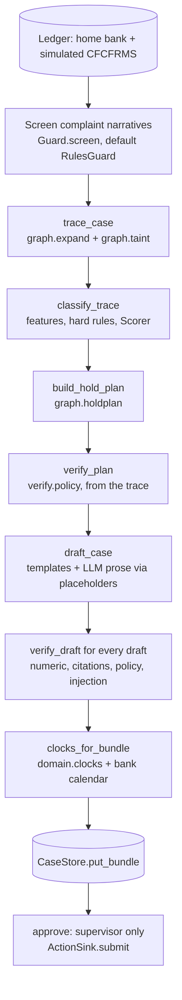
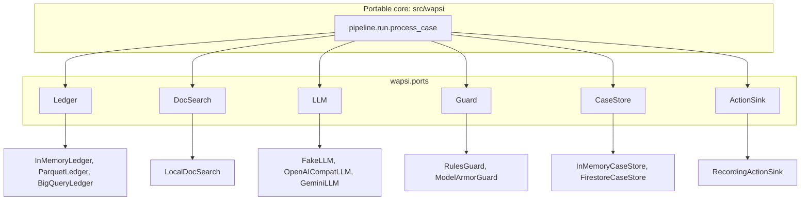
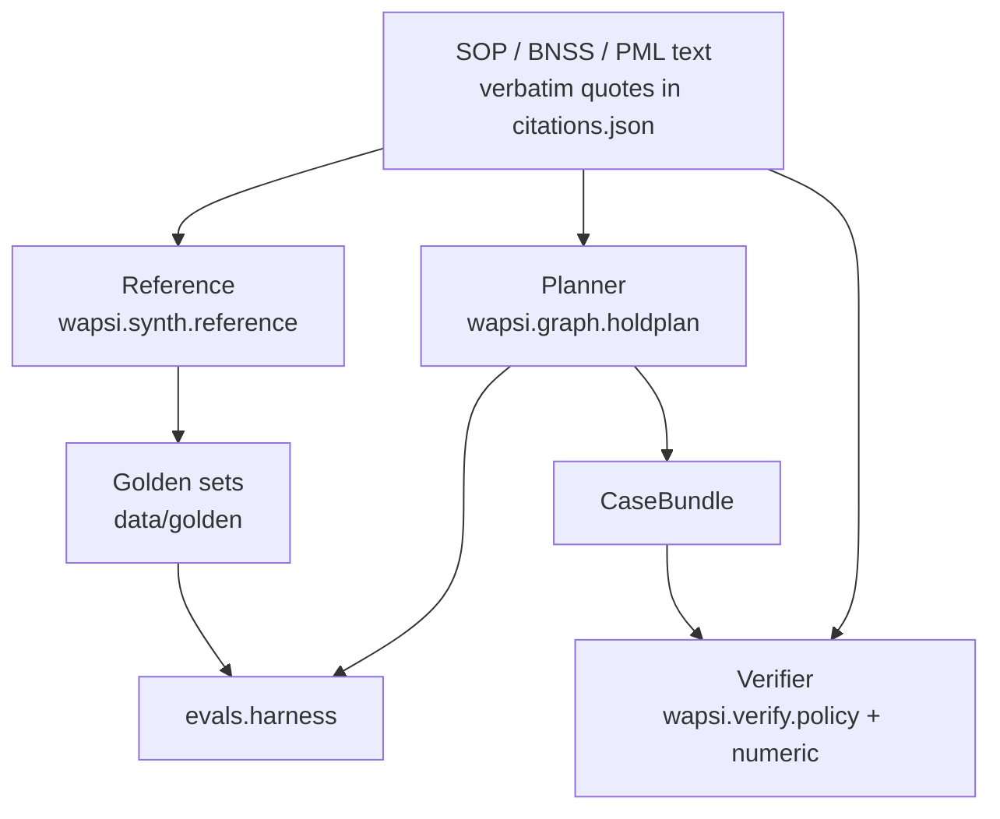
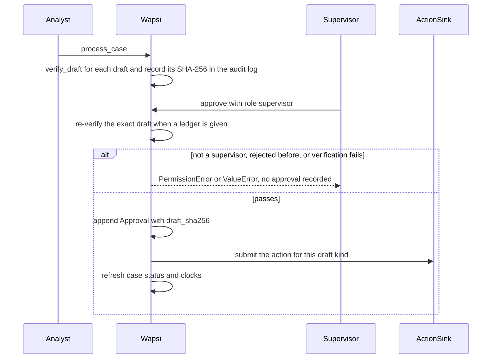

# Developer guide

This guide is for people who want to run, change or extend Wapsi. It covers setup on Linux, macOS and
Windows, every command in the repository, how the modules fit together, how the code is tested, and how to
add an adapter, an edition or a disposition rule without breaking the legal guarantees.

Everything here was checked against the repository at commit `655ca97` (23-09-2026) and re-run on 28-09-2026
and 29-09-2026. Where a count changed, the latest value is given with its date. Commands were run on Windows 11 with Git
Bash, uv 0.9.26 and Python 3.14.2; timings in this guide come from that machine and will differ on yours. CI
(`.github/workflows/ci.yml`) installs every extra and runs ruff, the whole pytest suite, world generation and
the golden-set evaluation on Ubuntu with Python 3.11.

**The two-minute version**

```bash
uv sync --extra ml --extra docs --extra ui              # portable core, officer UI, XGBoost, PDF reader
uv run pytest --ignore=tests/gcp --ignore=tests/amd     # core test suite, no network needed
uv run python -m wapsi.synth --size demo --seed 7 --out data/generated/demo
uv run python -m evals.harness --world demo             # 39 golden cases, 10 typologies; rewrites evals/reports/latest.json
uv run python -m wapsi.audit drill                      # audit-chain tamper drill: 6/6 detected, PASS
uv run streamlit run ui/app.py                          # officer UI on the showcase world
```

On Windows, run `export PYTHONUTF8=1` (Git Bash) or `$env:PYTHONUTF8 = "1"` (PowerShell) first. See
[Windows notes](#windows-notes). `uv sync --all-extras` (what CI runs) also installs the Google Cloud and AMD
dependencies, PyTorch among them; see [Optional extras](#optional-extras).

What you should see: the core suite (everything but `tests/gcp` and `tests/amd`) passes, and the full suite
passes with all extras ([Tests](#tests) has the counts); the demo world has 2,997 accounts, 62,162
transactions and 39 golden cases; and the harness reports hold exact-match 1.0, over-hold ₹0.00, 0 false freezes,
disposition accuracy 1.0, draft verification pass rate 1.0 and 0 injection leaks, the same as the committed
`evals/reports/demo.json`.

**Contents**

- [Prerequisites](#prerequisites)
- [Install](#install)
- [A first run in Python](#a-first-run-in-python)
- [Commands](#commands)
- [Repository layout](#repository-layout)
- [How the pieces connect](#how-the-pieces-connect)
- [Testing strategy](#testing-strategy)
- [Extending Wapsi](#extending-wapsi)
- [Adding a disposition rule safely](#adding-a-disposition-rule-safely)
- [Coding conventions](#coding-conventions)
- [Troubleshooting](#troubleshooting)

---

## Prerequisites

| Tool | Version | Notes |
|---|---|---|
| Python | 3.11 or newer | `requires-python = ">=3.11"` in `pyproject.toml`. CI pins 3.11. uv can install Python for you. |
| [uv](https://docs.astral.sh/uv/) | any recent release | Manages the virtual environment (`.venv/`) and the lock file (`uv.lock`). Every command in this guide starts with `uv run`. |
| Git | any | `.gitattributes` stores text files with LF line endings (`* text=auto eol=lf`); `.ps1`, `.cmd` and `.bat` files use CRLF. |

Nothing else is needed. Tests never touch the network. `process_case` takes the LLM as an argument, and the
tests, the evaluation harness and the officer UI all pass the offline `FakeLLM`, so no model or API key is
needed. The legal corpus falls back to the committed quotes when you have not downloaded it.

### Optional extras

`pyproject.toml` defines six extras. The `dev` dependency group (`pytest`, `ruff`) is installed by
`uv sync` by default.

| Extra | Brings | Needed for | Without it |
|---|---|---|---|
| `ml` | scikit-learn, xgboost | `XgbScorer`, `python -m wapsi.classify.train` | `tests/classify/test_classify_xgb.py` is skipped |
| `docs` | pypdf | `wapsi.search.build`, `wapsi.search.check_citations` | `LocalDocSearch.load()` still works (it never needs pypdf) |
| `ui` | streamlit, plotly | `ui/app.py`, `tests/ui` | the UI cannot start |
| `gcp` | google-adk, BigQuery, Firestore, Model Armor clients, litellm | Google Cloud edition | `tests/gcp` skips itself (`pytest.importorskip("google.adk")`) |
| `amd` | torch, transformers, peft, trl, accelerate, datasets, safetensors | AMD edition (GNN scorer, LoRA pipeline) | the AMD training code cannot run; several `tests/amd` modules import `torch` directly, so add `--ignore=tests/amd` to pytest |
| `amd-app` | fastapi, uvicorn | AMD edition's HTTP services (`editions/amd/app/api.py`, `editions/amd/gnn/service.py`) | those services and their tests cannot run |

The `amd` extra installs PyTorch. On Linux the lock file pulls NVIDIA CUDA wheels with it (16 `nvidia-*`
packages in `uv.lock`), which is a large download. If you only work on the portable core, install the
three light extras instead:

```bash
uv sync --extra ml --extra docs --extra ui
```

### Windows notes

- Run commands from **Git Bash** or **PowerShell**. Both work with `uv run`. Use forward slashes in paths.
- **Set UTF-8 mode.** Wapsi prints rupee amounts (`₹4,80,000.00`). When output is piped or redirected, Python
  on Windows falls back to the `cp1252` code page and fails with
  `UnicodeEncodeError: 'charmap' codec can't encode character '\u20b9'`. The evaluation harness, for example,
  writes its report files and then crashes while printing the summary. Turn on UTF-8 mode once per shell:

  ```bash
  export PYTHONUTF8=1          # Git Bash
  ```

  ```powershell
  $env:PYTHONUTF8 = "1"        # PowerShell
  ```

- Concurrent pytest runs need separate temp directories; see [the basetemp note](#pytest-basetemp).
- The `/tmp/wapsi-reports` scratch paths in this guide work in Git Bash. In PowerShell, use a folder such as
  `$env:TEMP\wapsi-reports`.

---

## Install

```bash
git clone <repository-url> wapsi
cd wapsi
uv sync --extra ml --extra docs --extra ui              # the light install
uv run pytest --ignore=tests/gcp --ignore=tests/amd -q  # core suite; should end with "passed"
```

With `uv sync --all-extras` (what CI runs), plain `uv run pytest` runs the edition suites too. Without the `amd`
extra, always add `--ignore=tests/amd`: several of its modules import PyTorch directly and fail at collection.

On 07-10-2026 the full suite collected **1,765 tests** and passed with 0 failures (`pitch/NUMBERS.md`, row
`cmd_tests`). The current per-area counts are under [Tests](#tests). Run time depends on the machine and on what
else is running.

---

## A first run in Python

The fastest way to see the whole product is to run the pipeline on the hand-computed showcase world. Save
this as `tour.py` in the repository root and run `uv run python tour.py`:

```python
from wapsi.adapters.llm_fake import FakeLLM
from wapsi.fixtures.showcase import N1, showcase_ledger
from wapsi.money import fmt_inr
from wapsi.pipeline.run import process_case

ledger = showcase_ledger()                         # hand-computed Showcase 1 world, in memory
bundle = process_case(ledger, [N1], llm=FakeLLM())  # offline LLM: no network, no key

for d in bundle.plan.decisions:
    print(f"{d.account_id}  {d.disposition.value:<25} hold {fmt_inr(d.hold_amount):>12}")
print("held", fmt_inr(bundle.plan.total_hold), "| recoverable", fmt_inr(bundle.plan.total_recoverable))
print("a whole-account freeze would immobilise", fmt_inr(bundle.plan.baseline_freeze_amount))
print(bundle.case.status.value, "-", len(bundle.drafts), "drafts, all verified:",
      all(r.passed for r in bundle.verifications.values()))
```

Output:

```text
HB01-1000000001  HOLD_AMOUNT               hold   ₹43,200.00
HB01-1000000002  HOLD_AMOUNT               hold   ₹27,648.00
HB01-2000000001  HOLD_AMOUNT_NO_ESCALATION hold    ₹4,800.00
OB03-4000000001  OUTBOUND_CFCFRMS_REQUEST  hold        ₹0.00
HB01-1000000003  HOLD_AMOUNT               hold   ₹48,000.00
HB01-3000000001  NO_HOLD_UPDATE_ONLY       hold        ₹0.00
HB01-9000000001  HOLD_AMOUNT_INTERMEDIARY  hold   ₹19,200.00
OB03-4000000002  OUTBOUND_CFCFRMS_REQUEST  hold        ₹0.00
held ₹1,42,848.00 | recoverable ₹3,34,848.00
a whole-account freeze would immobilise ₹5,03,50,000.00
VERIFIED - 16 drafts, all verified: True
```

These are the numbers in `src/wapsi/fixtures/showcase.py`. The victim lost ₹4,80,000.00. Wapsi holds
₹1,42,848.00 across five home-bank accounts, including ₹4,800.00 at the landlord (innocent holder, SOP
5(xii)) and ₹19,200.00 in the payment-aggregator pool account (SOP 9.1(iii)). The kirana shop that delivered
goods is not held (SOP 9.2). The ₹48,000.00 and ₹1,44,000.00 at the other bank become outbound CFCFRMS
requests. Holds plus requests make ₹3,34,848.00 recoverable. A whole-account freeze of the six home accounts
the money touched would immobilise ₹5,03,50,000.00.

The [API reference](api-reference.md) walks through each step of this pipeline separately.

---

## Commands

All commands run from the repository root.

### At a glance

| Task | Command | Writes |
|---|---|---|
| Install | `uv sync --all-extras` | `.venv/` |
| All tests | `uv run pytest` | `.pytest_tmp/` |
| Tests for one area | `uv run pytest tests/graph` | `.pytest_tmp/` |
| Core tests only | `uv run pytest --ignore=tests/gcp --ignore=tests/amd` | `.pytest_tmp/` |
| Lint (as CI) | `uv run ruff check src tests evals ui` | nothing |
| Format your changes | `uv run ruff format <files you changed>` | those files |
| Showcase world | `uv run python -m wapsi.synth --size showcase` | `data/generated/showcase/`, `data/golden/showcase/` |
| Demo world | `uv run python -m wapsi.synth --size demo --seed 7 --out data/generated/demo` | `data/generated/demo/`, `data/golden/demo/` |
| Full world | `uv run python -m wapsi.synth --size full --seed 7 --out data/generated/full` | `data/generated/full/`, `data/golden/full/` |
| Hard world (15 typologies) | `uv run python -m wapsi.synth --size hard --seed 7 --out data/generated/hard` | `data/generated/hard/` (golden set in `data/generated/hard/golden/`) |
| Download legal corpus | `uv run python -m wapsi.search.fetch` | `data/docs/raw/`, `data/docs/MANIFEST.md` |
| Build search index | `uv run python -m wapsi.search.build` | `data/docs/index/`, `data/docs/MANIFEST.md` |
| Bake the index for an image | `uv run --extra docs python -m wapsi.search.bake --fetch` | `data/docs/index/` (+ `bake.json`); `MANIFEST.md` untouched |
| Public demo, locally | `uv run streamlit run deploy/demo/app.py` | `data/generated/demo/` on first start (gitignored) |
| Evaluate an OpenAI-compatible endpoint | `uv run python -m evals.harness --world demo --llm openai-compat` (needs `WAPSI_LLM_BASE_URL`, `WAPSI_LLM_API_KEY`, `WAPSI_LLM_MODEL`) | `evals/reports/demo-openai-compat.json`, `.cache/llm/` |
| Record the demo's prose | `uv run python scripts/record_demo_prose.py [--source demo] [--refresh] [--dry-run]` (same variables) | `data/recordings/demo_prose.json` |
| Assemble the Hugging Face Space | `uv run python scripts/make_space.py --out ../wapsi-space` | the Space folder (outside the repository) |
| Community Cloud requirements | `uv export --frozen --no-dev --extra ui --extra docs --no-hashes --no-emit-project --format requirements-txt -o deploy/streamlit_cloud/requirements.txt` | `deploy/streamlit_cloud/requirements.txt` |
| Check every quote | `uv run python -m wapsi.search.check_citations` | nothing (exit 1 on any mismatch) |
| Regulatory radar documents | `uv run python -m wapsi.search.radar fetch`, then `radar verify [--write]` | `data/docs/raw/`; `--write` refreshes the rows' verification stamps in `data/docs/reg_radar.json` |
| Audit-chain tamper drill | `uv run python -m wapsi.audit drill` | nothing (exit 0 only on PASS) |
| Regenerate the source list | `uv run python -m wapsi.search.sources` | `data/docs/sources.json` |
| Golden-set evaluation | `uv run python -m evals.harness --world demo` | `evals/reports/demo-<UTC stamp>.json` and `.md`, `evals/reports/latest.json` |
| Compare scorers on the hard world | `uv run python -m evals.harness --world hard --scorer heuristic --scorer xgb:models/xgb_hard202.json` | `evals/reports/hard-<UTC stamp>.json` and `.md`, `evals/reports/hard.json` |
| Guard evaluation | `uv run python -m evals.adversarial.run` | `evals/reports/guard-latest.json` |
| Rebuild the guard corpus | `uv run python -m evals.adversarial.build_corpus` | `evals/adversarial/corpus.jsonl` |
| Train XGBoost scorer | `uv run python -m wapsi.classify.train --world data/generated/demo --out models/xgb_demo.json` | `models/` |
| Officer UI | `uv run streamlit run ui/app.py` | nothing on disk |
| Check skill mirror | `uv run python scripts/sync_skills.py --check` | nothing (exit 1 if stale) |

`data/generated/`, `data/docs/raw/`, `data/docs/index/`, `models/`, `.pytest_tmp/` and the timestamped
reports (`evals/reports/*-2026*.json` and `.md`) are gitignored. `data/golden/*`, `data/docs/MANIFEST.md`,
`data/docs/sources.json`, `evals/adversarial/corpus.jsonl`, `evals/reports/latest.json` and
`evals/reports/guard-latest.json` are committed, so review their diffs before you commit.

`wapsi.search.sources` and `evals.adversarial.build_corpus` take no options: even `--help` runs them and
rewrites their file. Both are deterministic, so an unchanged source gives a byte-identical file.

### Tests

```bash
uv run pytest                                   # everything under tests/
uv run pytest tests/graph                       # one area
uv run pytest tests/test_sop_annexure_v.py -q   # the SOP's own worked example, to the paisa
uv run pytest -k escalation                     # by keyword
uv run pytest --co -q | tail -1                 # count tests without running them
```

On 07-10-2026 `uv run pytest --co -q` collected 1,765 tests:

| Area | Tests | Area | Tests |
|---|---|---|---|
| `tests/verify` | 381 | `tests/domain` | 88 |
| `tests/graph` | 288 | `tests/intake` (voice intake) | 49 |
| `tests/ui` | 176 | `tests/synth` | 49 |
| `tests/draft` | 124 | `tests/audit` | 42 |
| `tests/classify` | 110 | `tests/pipeline` | 35 |
| `tests/search` | 98 | `tests/` root (`test_contracts.py`, `test_sop_annexure_v.py`, `test_agenttrace.py`, ...) | 23 |
| `tests/gcp` (edition) | 178 | `tests/pitch` | 11 |
| `tests/amd` (edition) | 113 | | |

The core suite (everything but `tests/gcp` and `tests/amd`) is 1,474 tests. The suites keep growing, so count
your own checkout with `uv run pytest --co -q | tail -1`. `tests/amd` imports PyTorch at collection time: collecting that folder
alone took 15 to 25 s here. For a fast loop on the core, add `--ignore=tests/gcp --ignore=tests/amd`.

#### pytest basetemp

`pyproject.toml` sets `addopts = "--basetemp=.pytest_tmp"`. pytest's `tmp_path` and `tmp_path_factory`
directories therefore live in `.pytest_tmp/` inside the repository (gitignored), because the system temp
directory may not be writable in sandboxed runs.

pytest **empties the basetemp directory at the start of every run**. Two runs at the same time (an editor
hook and you, two terminals, or two coding agents) delete each other's files and fail in confusing ways. Give
any second, concurrent run its own directory. A `--basetemp` on the command line overrides the one in
`addopts`, and `.pytest_tmp_*/` is gitignored:

```bash
uv run pytest tests/graph --basetemp=.pytest_tmp_graph
```

### Lint and format

```bash
uv run ruff check src tests evals ui          # exactly what CI runs
uv run ruff format path/to/the_file_you_changed.py
uv run ruff format --check src tests          # report only; writes nothing
```

Ruff settings live in `pyproject.toml`: line length 110, target `py311`, rule sets `E`, `F`, `I`, `UP` and
`B`, with `E501` ignored. `ruff check src tests evals ui` passes at commit `655ca97`.

CI checks lint, not formatting, and the tree is not uniformly formatted: `ruff format --check src tests`
lists 34 files that it would reformat, among them `src/wapsi/models.py`, `src/wapsi/ports.py` and
`src/wapsi/fixtures/showcase.py`. AGENTS.md lists `uv run ruff format src tests`, but running it on the whole
tree reflows those shared contracts and the fixture in your pull request. Format the files you change instead.

### Synthetic worlds (`wapsi.synth`)

```bash
uv run python -m wapsi.synth --size showcase                                   # 18 accounts, 21 transactions
uv run python -m wapsi.synth --size demo --seed 7 --out data/generated/demo    # 2,997 accounts, 62,162 transactions
uv run python -m wapsi.synth --size full --seed 7 --out data/generated/full    # 60,011 accounts, about 2.01 million transactions
```

| Option | Default | Meaning |
|---|---|---|
| `--size` | `demo` | `showcase`, `demo`, `full` or `hard` (demo-sized, 15 typologies with five realistic confounders; see [Synthetic data](synthetic-data.md#the-hard-world)) |
| `--seed` | `7` | random seed; the same seed gives byte-identical files (the hand-built showcase world ignores it) |
| `--name` | the size | world name, used for the output folder and the golden folder |
| `--out` | `data/generated/<name>` | Parquet output folder |
| `--golden-dir` | `data/golden` | where `cases.jsonl` and `SUMMARY.md` are copied; `''` keeps them only in `<out>/golden` |
| `--days` | `45` | length of the simulated period |
| `--trace-memory` | off | report peak Python heap (slower) |

The demo run prints:

```text
world=demo size=demo seed=7 accounts=2997 transactions=62162 complaints=43 cases=39 adversarial=3 reference_warnings=0
```

The generator reported between 0.6 s and 2.2 s for it here, depending on what else the machine was doing, and
the golden file it wrote was byte-identical to the committed `data/golden/demo/cases.jsonl` (checked again on
28-09-2026). For `full`, the golden file is copied to `data/golden/full/` only if it is under 2,000,000 bytes
(the committed one is 294,389 bytes).

**Held-out worlds.** The classifier reports in `evals/reports/classify-*-heldout-*.json` come from held-out
demo-size worlds generated with seeds 101, 202, 303, 404 and 505 instead of the usual seed 7. To rebuild one
and evaluate it:

```bash
uv run python -m wapsi.synth --size demo --seed 101 --name heldout-101          # also writes data/golden/heldout-101/
uv run python -m evals.harness --world heldout-101 --out /tmp/wapsi-reports     # --out keeps latest.json untouched
```

`data/golden/heldout-*` is not meant to be committed; delete it afterwards.

The table layout of a world is in [data-contract.md](data-contract.md); how expected values are computed is
in `data/golden/README.md`.

### Legal corpus and citations (`wapsi.search`)

```bash
uv run python -m wapsi.search.fetch             # download to data/docs/raw/ (network; polite, TLS verified)
uv run python -m wapsi.search.build             # raw/ -> index/chunks.jsonl (needs pypdf)
uv run python -m wapsi.search.check_citations   # every quote and fact, verbatim, on its page
uv run python -m wapsi.search.sources           # regenerate data/docs/sources.json from sources.py
```

- `fetch` options: `--only <source ids>`, `--force` (download again), `--probe-mirrors`.
- `build` option: `--only <source ids>` (the index then contains only those sources).
- `check_citations` options: `--citations PATH`, `--facts PATH`. It needs the raw files.
- `fetch` and `build` rewrite the committed `data/docs/MANIFEST.md`.

With the raw files present, `check_citations` runs one check per citation ID, one per fact and one per
regulatory-radar quote. On 29-09-2026 it ended with `121/121 checks passed`: the 35 citation IDs in
`wapsi.citations` (32 with a verbatim quote, 3 judgments cited by URL only), the 33 facts in
`data/docs/facts.json`, and the 52 quotes of `data/docs/reg_radar.json` plus its registry check. The RBI citation
IDs are `RBI-FRM-DIR-2026` (Para 24) and `RBI-FRM-DIR-2026-EWS` (Para 12) of the (Commercial Banks – Fraud Risk
Management) Directions, 2026; the 2024 Master Directions (`RBI-FRM-MD-2024`) are repealed and their ID is
retired. The radar's extra documents (the RBI draft, the repeal circular, RBI's withdrawn list, the repealed
directions) come from `uv run python -m wapsi.search.radar fetch` and are never indexed for search.

The source documents are not redistributed (`data/docs/README.md` explains why), so a fresh clone has no `raw/`
or `index/`. `LocalDocSearch.load()` then serves a small fallback corpus built from the quotes in
`data/docs/citations.json` and emits a warning.

### Golden-set evaluation (`evals.harness`)

```bash
uv run python -m evals.harness --world demo
uv run python -m evals.harness --world showcase
```

| Option | Default | Meaning |
|---|---|---|
| `--world` | `demo` | reads `data/generated/<world>/` and `data/golden/<world>/cases.jsonl` |
| `--llm` | `fake` | `fake`, `fake-hallucinate` (adds a wrong raw amount to LLM prose), or an OpenAI-compatible server (see below) |
| `--limit N` | all | first N golden cases |
| `--quick` | off | first 10 cases (for hooks and CI) |
| `--no-draft` | off | stop after the hold plan (no drafts, no draft verification) |
| `--out DIR` | `evals/reports` | where the timestamped report **and the stable report** are written |
| `--scorer SPEC` | `heuristic` | `heuristic`, `xgb:<model.json>` or `gnn:<checkpoint dir>`; repeat to compare (`by_scorer` in the report) |
| `--world-dir DIR` | `data/generated/<world>` | read the world from another folder |
| `--report-name STEM` | see below | name of the stable report file |

The stable report is `latest.json` for the heuristic on showcase / demo / full, `<world>.json` for hard worlds
(`hard.json`, `hard-101.json`) and `<world>-<xgb or gnn>.json` otherwise; `--report-name` overrides it. A plain
demo run overwrites `<out>/latest.json`. The committed `evals/reports/latest.json` feeds the UI's KPI page,
and the README quotes its figures, so use `--out` for experiments. Metric definitions are in
[eval-report.md](eval-report.md).

A run on the demo world (39 cases, 3 adversarial) with `--out` pointing at a scratch folder took about 11 s
here on an otherwise idle machine and reproduced every metric and baseline figure in the committed
`latest.json`; only the timestamp and the timings differed. A re-run on 28-09-2026 gave the same figures: hold
exact-match rate 1.0, over-hold ₹0.00, false freezes 0, disposition accuracy 1.0, draft verification pass rate
1.0, injection leaks 0. The whole-account-freeze baseline was ₹35,25,90,069.78 across 101 accounts against
Wapsi's ₹29,19,245.69 across 84 accounts.

To evaluate a real model behind an OpenAI-compatible chat-completions endpoint, pass
`--llm "openai:<base_url>|<model>"`. Keep the quotes: `|` separates the URL from the model name and is also
the shell's pipe character. The key, if the server needs one, comes from `WAPSI_LLM_API_KEY`:

```bash
export WAPSI_LLM_API_KEY=...        # optional for local servers such as vLLM or Ollama
uv run python -m evals.harness --world demo --llm "openai:http://localhost:8000/v1|<model-name>" --out /tmp/wapsi-reports
```

With a real model the harness also reports `llm_only_hallucination_rate`: it asks the model for a narrative
with raw numbers and no slot discipline, and counts amounts that match no slot.

### Adversarial guard evaluation (`evals.adversarial`)

```bash
uv run python -m evals.adversarial.run                # dev and test metrics; dev errors printed
uv run python -m evals.adversarial.run --show-test    # also print test and blind-holdout errors (reporting only)
uv run python -m evals.adversarial.run --out PATH     # default evals/reports/guard-latest.json
uv run python -m evals.adversarial.run --no-demo      # skip the demo-world sanity check
uv run python -m evals.adversarial.build_corpus       # rewrite corpus.jsonl from build_corpus.py
```

`--corpus PATH` and `--holdout PATH` point the run at other corpus files (defaults
`evals/adversarial/corpus.jsonl` and `evals/adversarial/holdout_blind.jsonl`).

Output of the last run (with `--out` pointing at a scratch file; the metrics matched the committed
`guard-latest.json`, only the milliseconds per text change between runs):

```text
corpus: 120 adversarial, 115 benign
dev   n=144 (adv 75, benign 69)  P=1.0  R=1.0  F1=1.0  FPR=0.0  tp=75 fp=0 fn=0  0.767 ms/text
test  n= 91 (adv 45, benign 46)  P=1.0  R=1.0  F1=1.0  FPR=0.0  tp=45 fp=0 fn=0  0.78 ms/text
blind n=151 (adv 76, benign 75)  P=0.9661  R=0.75  F1=0.8444  FPR=0.0267  tp=57 fp=2 fn=19  1.181 ms/text
demo sanity: adversarial flagged 3/3, benign flagged 0/40
```

The blind holdout (`holdout_blind.jsonl`) was written by a separate agent that never saw the guard or the
corpus, and it is the honest number: the rules miss 19 of 76 adversarial texts there. That is why the guard
is not the main defence. Drafts are template-bound, and the verifier's injection check looks for complaint
text in every draft. `evals/adversarial/baseline.json` holds an earlier run of the same evaluation on the
same corpus, before the rules were changed (dev recall 0.24, test recall 0.1556).

### Classifier training (`wapsi.classify.train`)

```bash
uv run python -m wapsi.classify.train --world data/generated/demo --out models/xgb_demo.json
```

Options: `--normal-ratio` (default 3.0 normal accounts per tainted account), `--max-normal` (5000),
`--rounds` (200), `--test-size` (0.25), `--seed` (7). It writes the model and `<name>.metrics.json`. On the demo
world it took about 5 s here on an idle machine and printed (the same output again on 28-09-2026):

```text
training frame: 468 accounts; classes: {'LEGIT': 327, 'MULE': 96, 'MERCHANT': 32, 'INNOCENT_HOLDER': 10, 'INTERMEDIARY': 3}
class              precision    recall        f1   support
INNOCENT_HOLDER        1.000     1.000     1.000         2
INTERMEDIARY           1.000     1.000     1.000         1
LEGIT                  1.000     0.988     0.994        82
MERCHANT               1.000     1.000     1.000         8
MULE                   0.960     1.000     0.980        24
accuracy 0.992  macro-F1 0.995  n=117
MULE vs rest ROC-AUC 1.000
```

The test split is small (2 innocent holders and 1 intermediary), so do not read much into its per-class
numbers. The harness scores a trained model directly with `--scorer xgb:models/xgb_demo.json` (see
[Evaluation](evaluation.md#scorers-and-harness-options)); in your own code, pass
`scorer=XgbScorer.load("models/xgb_demo.json")` to `process_case` (`XgbScorer` is in `wapsi.classify` and needs
the `ml` extra). On the hard world, a model trained on hard seed 202 reaches dispositions 0.9481 on seed 7 and
0.9569 on the held-out seed 101 (`evals/reports/hard.json`, `hard-101.json`).

### Officer UI

```bash
uv run streamlit run ui/app.py
```

The UI runs the real pipeline on the showcase world with `FakeLLM`. Pages: Inbox, Voice Intake, Case Room (with
its Money trail and Agent trace tabs), Hold Plan, Drafts & Verification, Approvals, Clocks, Regulatory Radar, KPIs
and Audit. Roles: analyst, supervisor and auditor. Voice Intake reads the bundled samples offline; with
`GEMINI_API_KEY` set it reads any recording with Gemini. The Agent trace tab reads `agent_trace` events from the
case's audit log, or the recorded offline run for the showcase cases.

| Environment variable | Effect |
|---|---|
| `WAPSI_UI_SOURCE=fixtures` | use the hand-built bundles in `wapsi.fixtures.bundles` instead of running the pipeline |
| `WAPSI_NOW=2026-09-12T10:00:00+05:30` | freeze the UI clock (ISO 8601) so SOP clocks show a fixed state |
| `WAPSI_EVAL_REPORT=path/to/report.json` | KPI page reads this report instead of `evals/reports/latest.json` |
| `WAPSI_UI_RAISE=1` | re-raise page errors instead of showing the error panel (debugging) |
| `GEMINI_API_KEY` / `GOOGLE_API_KEY` | Voice Intake transcribes any recording with Gemini (never printed or stored) |
| `WAPSI_VOICE_OFFLINE=1` | force the offline voice model even when a key is set |
| `WAPSI_VOICE_MODEL` | the Gemini model for voice notes (default `WAPSI_MODEL`, else `gemini-3.8-flash`) |
| `WAPSI_VOICE_SAMPLES` | folder of sample voice notes (default `data/samples/voice`) |

Streamlit settings (theme, no usage statistics) are in `.streamlit/config.toml`, with an identical copy in
`ui/.streamlit/config.toml`: current Streamlit releases also read the config next to the main script, so
`streamlit run ui/app.py` gets the same settings when started from another directory. Keep the two files the same.

### Other environment variables

| Variable | Read by | Effect |
|---|---|---|
| `WAPSI_LLM_API_KEY` | `OpenAICompatLLM` | bearer token when no `api_key` argument is given |
| `WAPSI_CITATIONS_JSON` | `wapsi.citations` | read quotes from this file instead of `data/docs/citations.json` |
| `WAPSI_DOCS_DIR` | `wapsi.search.sources` | use a copy of `data/docs` elsewhere (for example in a container) |

The Google Cloud variables (`WAPSI_PROJECT`, `WAPSI_GEMINI_BACKEND` and others) are documented in
[`editions/gcp/README.md`](../editions/gcp/README.md).

### Agent skills

`.claude/skills/` holds six skills (`lien-calculator`, `money-trail-tracer`, `sop-citer`, `str-drafter`,
`synth-fraud-ledger`, `wapsi-eval`) used by Claude Code. Gemini CLI reads
`.agents/skills/`, which is a mirror:

```bash
uv run python scripts/sync_skills.py            # copy .claude/skills -> .agents/skills
uv run python scripts/sync_skills.py --check    # exit 1 if the mirror is stale; writes nothing
uv run python scripts/sync_skills.py -n         # dry run: print what would change
```

Edit skills only in `.claude/skills/`. Each `SKILL.md` must start with YAML front matter holding only `name`
(equal to the directory name) and `description`, so every tool can load it.

---

## Repository layout

```text
wapsi/
├── AGENTS.md                  conventions for people and coding agents (CLAUDE.md imports it)
├── pyproject.toml             dependencies, extras, pytest and ruff settings
├── .github/workflows/ci.yml   ruff, pytest, synth showcase + demo, harness showcase + demo (Python 3.11)
├── src/wapsi/
│   ├── models.py              pydantic data contracts (extra="forbid")
│   ├── ports.py               Ledger, DocSearch, LLM, Guard, CaseStore, ActionSink protocols
│   ├── config.py              TraceConfig, ClassifyConfig, WapsiConfig
│   ├── money.py               r2, eq, fmt_inr, parsers for money / accounts / UTRs / dates
│   ├── timeutil.py            IST, ensure_utc, to_ist, fmt_ist
│   ├── citations.py           the citation IDs (35 on 28-09-2026); quotes come from data/docs/citations.json
│   ├── _data/citations.json   packaged copy of data/docs/citations.json (must stay identical)
│   ├── adapters/              memory.py, parquet_ledger.py, llm_fake.py, llm_openai_compat.py,
│   │                          bigquery_ledger.py, firestore_store.py, gemini_llm.py, model_armor_guard.py
│   ├── fixtures/              showcase.py (hand-computed worlds), bundles.py (hand-built CaseBundles)
│   ├── graph/                 expand.py, taint.py, trace.py, holdplan.py, common.py
│   ├── classify/              features.py, rules.py, scoring.py, explain.py, train.py
│   ├── draft/                 factsheet.py, drafter.py, prose.py, render.py, templates/ (9 Jinja files)
│   ├── verify/                numeric.py, citations.py, policy.py, injection.py, lea_request.py, runner.py,
│   │                          report.py
│   ├── domain/                calendar.py, clocks.py, regradar.py (read-only radar), holidays_in.json
│   ├── audit/                 chain.py (hash chain), drill.py (tamper drill), __main__.py (CLI)
│   ├── intake/                voice.py (voice-note intake, VOICE_SCHEMA), reconcile.py (claims vs ledger),
│   │                          samples.py (bundled synthetic voice notes)
│   ├── agenttrace/            model.py, recorder.py (ToolTraceRecorder), redact.py, summarize.py, demo.py,
│   │                          showcase_recording.json (recorded offline agent run)
│   ├── search/                sources, fetch, extract, sections, chunk, normalize, bm25, index, build,
│   │                          check_citations, manifest, radar (radar fetch / verify)
│   ├── synth/                 world generator, typologies, hard.py (T11-T15), reference.py (independent ground truth),
│   │                          golden.py, export.py, __main__.py (CLI)
│   └── pipeline/run.py        process_case, approve, request_account_level_hold, check_lea, draft_fingerprint,
│                              group_complaints, pending_holds
├── ui/                        Streamlit app: app.py, data_source.py, views/, components/, .streamlit/
├── evals/                     harness.py, adversarial/ (corpus, blind holdout, runner, baseline), reports/
├── data/
│   ├── docs/                  README, MANIFEST, sources.json, citations.json, facts.json, reg_radar.json
│   │                          (raw/, index/ ignored)
│   ├── golden/                showcase/, demo/, full/: cases.jsonl + SUMMARY.md; README.md
│   ├── samples/voice/         six synthetic Hinglish voice notes (WAV), scripts, expected answers, manifest.json
│   └── generated/             Parquet worlds (gitignored)
├── tests/                     one folder per area (intake/ for voice intake), plus test_contracts.py,
│                              test_sop_annexure_v.py, test_packaging.py, test_agenttrace.py
├── scripts/                   sync_skills.py (skill mirror); capture_screenshots.py (docs screenshots, Playwright);
│                              make_voice_samples.py (voice samples, Windows offline text-to-speech)
├── .claude/skills/            six skills (mirrored to .agents/skills/)
├── editions/                  gcp/, amd/ (thin platform layers)
└── docs/                      this documentation
```

The nine templates in `src/wapsi/draft/templates/` are `hold_instruction.j2`, `customer_notice.j2`,
`edd_memo.j2`, `outbound_request.j2`, `str.j2`, `cfcfrms_update.j2`, `restoration_pack.j2`,
`account_level_request.j2` (the officer's exception request) and `lea_clarification.j2` (the reply to an
incomplete police request).

---

## How the pieces connect

### The pipeline

`wapsi.pipeline.run.process_case` runs one case from complaint to verified drafts. The Google Cloud and AMD
editions call it with their own adapters.



Each stage fills one part of the `CaseBundle` and moves `case.status` forward:

| Stage | Function | Fills | Status after |
|---|---|---|---|
| open | `process_case` | `case`, `complaints`, `audit` (`case_opened`) | `NEW` |
| screen | `Guard.screen` | `audit` (`untrusted_instruction_detected`, with quoted spans) | `NEW` |
| trace | `wapsi.graph.trace.trace_case` | `trace` | `TRACED` |
| classify | `wapsi.classify.classify_trace` | `classifications` | `TRACED` |
| plan | `wapsi.graph.holdplan.build_hold_plan` + `verify_plan` | `plan`, `verifications["PLAN"]`, `case.priority_amount` | `PLANNED` |
| draft | `wapsi.draft.drafter.draft_case` | `drafts` | `DRAFTED` |
| verify | `wapsi.verify.verify_draft` | `verifications[draft_id]`, `audit` (`draft_verified` + SHA-256) | `VERIFIED` if every report passed |
| clocks | `wapsi.domain.clocks.clocks_for_bundle` | `clocks` | unchanged |
| approve | `wapsi.pipeline.run.approve` | `approvals`, `actions`, `audit` | `APPROVED` once every hold instruction is approved |

`process_case(..., draft=False)` stops after the plan. The final `case_processed` audit event records the
time spent in each stage.

### Ports and adapters

The core never imports a cloud SDK. It talks to the outside world through six protocols in
`src/wapsi/ports.py`; each edition supplies adapters.



| Port | In the core package | Google Cloud edition (`src/wapsi/adapters/`) | AMD edition |
|---|---|---|---|
| `Ledger` | `InMemoryLedger`, `ParquetLedger` | `BigQueryLedger` | see [`editions/amd/README.md`](../editions/amd/README.md) |
| `DocSearch` | `LocalDocSearch` | same | same |
| `LLM` | `FakeLLM`, `OpenAICompatLLM` (vLLM, Ollama, OpenAI-compatible Gemini endpoint) | `GeminiLLM`; the optional, paid Gemma service through an `OpenAICompatLLM` client (`gemma_private_llm`) | edition README |
| `Guard` | `RulesGuard` | `ModelArmorGuard` (unions its result with `RulesGuard` by default; falls back to it on error) | edition README |
| `CaseStore` | `InMemoryCaseStore` | `FirestoreCaseStore` | edition README |
| `ActionSink` | `RecordingActionSink` | `RecordingActionSink` (from `editions/gcp/app/services.py`) | edition README |

All protocols are `@runtime_checkable`, so `isinstance(obj, Ledger)` is a quick structural check. It confirms
that the methods exist, not that they behave correctly; the equivalence tests below do that.

### Two independent implementations and a verifier

Three separate pieces of code apply the SOP rules:



- The **planner** (`wapsi.graph`) produces the hold plan.
- The **reference** (`wapsi.synth.reference`) computes the expected answers for the golden sets. Of Wapsi's own
  modules it imports only `wapsi.config`, `wapsi.models` and `wapsi.money`, never `wapsi.graph`,
  `wapsi.classify`, `wapsi.draft` or `wapsi.verify`, so a bug in the planner cannot silently become the
  expected answer.
- The **verifier** (`wapsi.verify`) re-checks every plan and draft against the trace, not against the plan's
  own fields, before a human sees it.

### Maker-checker approval



`draft_fingerprint` hashes the draft's kind, account, title, body, slots, structured data, citation IDs and
version. An approval therefore applies to one exact text: edit a draft after verification and `approve`
refuses it until it is verified again. When `approve` re-verifies (a `ledger` is passed), the new report and a
`draft_verified` audit event are kept even if it then refuses. Approving the same content twice is a no-op.
The actions created are:

| Draft kind | Actions on approval |
|---|---|
| `HOLD_INSTRUCTION` | `HOLD_INSTRUCTION` and `JIRA_TICKET` |
| `CFCFRMS_UPDATE`, `OUTBOUND_REQUEST` | `CFCFRMS_UPDATE` |
| `STR` | `STR_EXPORT` |
| `CUSTOMER_NOTICE`, `EDD_MEMO`, `RESTORATION_PACK` | none |

### Where the legal rules live

| Rule | Code | Citation IDs |
|---|---|---|
| Amount-specific by default: hold `min(tainted, balance)` | `graph/holdplan.py`, re-checked in `verify/policy.py` (`over_hold`, `whole_account_freeze`) | `SOP-5-IX`, `SOP-9-1` |
| Account-level action only as a recorded, supervisor-approved exception | `graph/holdplan.py` (`apply_account_level_hold`), `pipeline/run.py` (`request_account_level_hold`, `approve`), `verify/policy.py` (`account_level_*`) | `SOP-5-IX`, `SOP-9-1` |
| Forward hold only on first-layer, non-intermediary accounts | same (`forward_hold_not_first_layer`, `forward_hold_on_intermediary`) | `SOP-9-1-I`, `SOP-DEF-FIRST-LAYER` |
| Nodal / pool / escrow: hold the disputed amount; no suspension, seizure or s.106 flag | same (`intermediary_*`, `suspension_or_seizure`) | `SOP-9-1-III` |
| Merchant: delivered goods, no hold; undelivered, hold in pool | same (`delivered_merchant_held`, `update_only_*`) | `SOP-9-2` |
| Innocent holder: hold, EDD memo, no escalation, no automatic STR (officer decides; STR recommended for an unwitting conduit) | same (`innocent_escalated`, `innocent_in_str`, `conduit_*`, `bona_fide_str_recommended`) | `SOP-5-XII`, `SOP-10-1` |
| s.106 escalation is only a flag: FIR + at least 2 prior reports + human | same (`escalation_*`) | `BNSS-106`, `CASE-KARTIK-CHATUR` |
| Pro-rata apportionment per victim | `graph/taint.py`, `synth/reference.py`, `tests/test_sop_annexure_v.py` | `SOP-5-XIII`, `SOP-ANNEX-V` |
| Process 2 when more than one victim has recoverable money | `graph/holdplan.py`, `verify/policy.py` (`restoration_process`) | `SOP-11-P1`, `SOP-11-P2` |
| STR within 7 working days | `domain/clocks.py`, `domain/calendar.py` | `PMLR-8` |
| 90-day hold lapse, LEA intimation at day 75; forward-hold review on the same timeline | `domain/clocks.py` | `SOP-10-1`, `SOP-9-1-I` |
| Police / LEA request: 8-field checklist, hold limited to the identifiable amount | `verify/lea_request.py` | `SOP-9-1`, `SOP-ANNEX-I`, `SOP-5-IX`, `BNSS-94`, `BNSS-168` |

The full rule set is AGENTS.md convention 6. The [legal spine](legal-spine.md) explains each rule and its
source; the [draft contract](draft-contract.md) defines how every value in a draft is bound and re-derived.

---

## Testing strategy

Wapsi handles money and legal duties, so the tests aim to show that numbers are right to the paisa, not
just that the code runs.

| Layer | What it proves | Where |
|---|---|---|
| Hand-computed fixtures | Every module reproduces numbers worked out by hand | `src/wapsi/fixtures/showcase.py`; `tests/graph/test_graph_showcase.py`, `tests/pipeline/test_pipeline_showcase.py`, `tests/test_contracts.py` |
| The SOP's own worked example | Pro-rata shares match Annexure-V Illustration 2 to the paisa | `tests/test_sop_annexure_v.py` |
| Independent reference + golden sets | A second implementation that shares no code with `wapsi.graph` agrees on every case | `src/wapsi/synth/reference.py`, `tests/synth/test_synth_reference.py`, `data/golden/*` |
| Property tests | Money is conserved and results are deterministic on 100 random worlds; the search finds every reachable account | `tests/graph/test_graph_property.py` (203 cases) |
| Verifier mutation tests | Breaking one rule in a correct plan or draft yields one specific error code | `tests/verify/test_verify_plan.py`, `test_verify_drafts.py`, `test_verify_review_fixes.py` |
| Adapter equivalence | A new `Ledger` behaves exactly like `InMemoryLedger` | `tests/synth/test_synth_parquet_ledger.py`, `tests/gcp/test_gcp_bigquery_ledger.py` |
| Held-out worlds | The classifier and rules hold up on worlds generated with other seeds | `evals/reports/classify-*-heldout-*.json` |
| Adversarial corpus | The guard flags injected instructions and leaves normal narratives alone | `evals/adversarial/`, `tests/verify/test_verify_guard.py`, `test_verify_injection_rules.py` |
| UI | Every page renders for every role without errors | `tests/ui` (Streamlit `AppTest`) |

### Hand-computed fixtures

`src/wapsi/fixtures/showcase.py` holds two small worlds whose every number was computed by hand and is
written in the module docstring. Showcase 1 is one victim (₹4,80,000.00) and four layers; Showcase 2 is two
victims paying one mule, with an FIR and 2 prior NCRP reports, which produces an s.106 escalation flag and
Process 2. The dictionaries `SHOWCASE_1` and `SHOWCASE_2` hold the expected totals, taint per account, layers,
roles, dispositions, holds, forward holds and baseline. AGENTS.md convention 8: *if your module disagrees with
these numbers, your module is wrong* (or raise it; never edit the fixture silently).

`tests/test_sop_annexure_v.py` rebuilds the account statement from the SOP's Annexure-V Illustration 2 (five
credits from complainants V, W, X, Y and Z on 15.12.2024 and one debit of ₹47,226, leaving ₹2,06,543) and checks
Wapsi's pro-rata shares against the SOP's: X ₹40,695.08, V ₹69,446.97, Y ₹40,695.08, Z ₹24,417.05 and
W ₹31,288.82. The same figures are verified against the SOP PDF by `check_citations` (facts `ANNEX_V_ILL2_*`).

### Golden sets from an independent reference

`wapsi.synth` generates a synthetic Indian banking world with 10 fraud typologies, then runs
`wapsi.synth.reference` on it to produce `GoldenCase` records. `tests/synth/test_synth_golden.py` checks
conservation (all buckets add up to `stolen`, `|unlocated| <= ₹0.05`), rule consistency and typology
coverage, and `test_committed_golden_is_current` fails when the committed `data/golden/showcase` or
`data/golden/demo` files no longer match the generator. `test_showcase_golden_matches_fixture` ties the
reference back to the hand-computed numbers.

### Property tests

`tests/graph/test_graph_property.py` builds 50 random worlds, plus 50 more with same-second bursts and
victim-to-victim chains, and runs them under random apportionment rules and limits:

- `test_random_worlds_conserve_money`: holdable + cashed out + outbound + intermediary + merchant settled +
  unlocated equals stolen; plan invariants hold; tracing twice gives identical results.
- `test_search_finds_every_reachable_account`: the breadth-first candidate search gives the same answer as
  simulating every account in the world.
- `test_performance_20k_transactions`: tracing 20,000 transactions takes under 2 s, and so does building the
  plan, for each rule.

### Mutation-style verifier tests

The verifier tests start from a correct showcase bundle, break exactly one thing and assert the error code.
For example, `test_over_hold_in_plan` sets account A's hold to its ₹45,000.00 balance instead of the
₹43,200.00 of victim money and expects `over_hold`. Error messages start with a stable code
(`over_hold: ...`), and `wapsi.verify.report.code_of` extracts it, so tests do not depend on wording.

### Held-out worlds and the adversarial corpus

Classifier changes are compared before and after on the demo world and on five held-out demo-size worlds
(seeds 101 to 505), in `evals/reports/classify-before-*.json` and `classify-after-*.json`. The guard corpus
(`evals/adversarial/corpus.jsonl`, 235 texts) is split deterministically 60/40 into dev and test by
`sha256(id)` within each (label, style) stratum; tune only on dev. `holdout_blind.jsonl` (151 texts) is scored
as a whole and is the number to report.

### Rules every test follows

- **No network.** HTTP clients are tested with `httpx.MockTransport`; cloud adapters with offline fakes
  (`tests/gcp/gcp_fakes.py` has a SQLite-backed BigQuery fake).
- **Optional dependencies skip, they do not fail**: `pytest.importorskip("xgboost")`,
  `pytest.importorskip("google.adk")`, and a skip when the docs index or a committed golden file is absent.
  (Exception: several `tests/amd` modules import `torch` directly; ignore that folder without the `amd` extra.)
- **Unique test file names.** Most test folders have no `__init__.py`, so pytest imports test modules by
  basename. Name files `test_<area>_<topic>.py` (for example `test_graph_rules.py`) to avoid collisions.
- **Session fixtures for heavy worlds.** `tests/synth/conftest.py` builds the demo world once per session.

---

## Extending Wapsi

### Add a Ledger adapter

A ledger is a read-only view of the home bank's data plus simulated CFCFRMS responses. Implement every
method of `wapsi.ports.Ledger` with the same semantics as `InMemoryLedger`:

| Method | Must |
|---|---|
| `home_bank_id()` | return the one bank with `is_home=True` |
| `complaint(ncrp_id)` | raise `KeyError` for an unknown id (the equivalence test checks this) |
| `complaints(since=None)` | filter `reported_at >= since`; sort by `(reported_at, ncrp_id)` |
| `complaint_transactions(ncrp_id)` | return the victim transfers of that complaint, sorted by `(ts, txn_id)` |
| `balances_at(ids, ts)` | `opening_balance + credits - debits` for transactions **strictly before** `ts`, for accounts at any bank, rounded to paise; unknown ids are left out |
| `transactions_touching(ids, start, end)` | transactions with `from_account` or `to_account` in `ids` that the home bank can see (at least one side is a home-bank account), `start <= ts <= end`, sorted by `(ts, txn_id)`, no duplicates |
| `consortium_transactions(ids, start, end)` | transactions in which an *other-bank* account in `ids` is sender or receiver (the simulated CFCFRMS answer), same window and order; nothing for home-bank accounts |
| `banks()` | return every bank (home and others) keyed by `bank_id` |
| `accounts`, `customers`, `external_signals`, `gst_records` | return dicts keyed by id; silently skip unknown ids |
| `invoices_for_transactions`, `device_links`, `device_links_for_devices` | return lists; unknown ids give nothing |

Rules that bite:

- Timestamps are timezone-aware UTC (`wapsi.timeutil.ensure_utc`). Naive datetimes passed in are UTC.
- Money is float rupees rounded to paise (`wapsi.money.r2`).
- Never pass user-supplied values into query text. `BigQueryLedger` shows the pattern: static SQL, values as
  query parameters, table names validated in the constructor.
- The table layout is fixed by [data-contract.md](data-contract.md); load a world with
  `wapsi.synth.export.load_frames(path)`.

Test it the way `ParquetLedger` is tested. `tests/synth/test_synth_parquet_ledger.py` defines
`assert_equivalent(pl, ml, account_ids, windows, ncrp_ids, stamps)`, which compares every protocol method of
your ledger with `InMemoryLedger` over several windows and timestamps, including `KeyError` for an unknown
complaint. Then run the pipeline on your ledger and check it reproduces the showcase numbers, as
`test_pipeline_on_bigquery_ledger_reproduces_showcase` does:

```python
from wapsi.adapters.llm_fake import FakeLLM
from wapsi.fixtures import showcase as sc
from wapsi.money import eq
from wapsi.pipeline.run import process_case

bundle = process_case(my_ledger, [sc.N1], llm=FakeLLM())
assert eq(bundle.plan.total_hold, sc.SHOWCASE_1["total_hold"])                 # 142848.0
assert eq(bundle.plan.total_recoverable, sc.SHOWCASE_1["total_recoverable"])   # 334848.0
```

### Add an LLM adapter

The LLM writes prose only. Implement `wapsi.ports.LLM`:

```python
class MyLLM:
    name = "my-model"                     # recorded in drafts (llm_model) and in the audit log

    def complete(self, messages, *, temperature=0.0, max_tokens=1024, json_schema=None) -> str:
        ...                               # return text; JSON text when json_schema is given
```

What the drafter sends and expects (`wapsi.draft.prose`):

- `messages` is a system prompt plus one user message whose content is a JSON payload with `task`,
  `instructions`, `placeholders` (name, value, meaning) and `facts`. Complaint text inside `facts` is wrapped
  in `<<<UNTRUSTED_COMPLAINT_TEXT>>>` markers.
- The drafter calls `complete(messages, temperature=0.0, max_tokens=700, json_schema=RESPONSE_SCHEMA)` and
  expects `{"text": "..."}`. Plain text, a fenced block or JSON wrapped in chatter are also parsed.
- The text must use only `⟦slot⟧` placeholders for values: no digits (except legal references such as
  "Section 106"), no currency words, no large number words. The drafter checks, retries once with feedback,
  then uses a fixed paragraph and records `structured["llm_fallback"] = True`.
- **Raise on failure.** Any exception from `complete` is caught and counted as a failed attempt, so drafting
  never blocks on a provider outage.

Practical rules: keep keys out of `repr` and logs (see `OpenAICompatLLM.__repr__`), do no network work at
import or construction time, and import heavy SDKs lazily. If your server speaks the OpenAI chat-completions
API (vLLM, Ollama, Gemini's OpenAI-compatible endpoint), use `OpenAICompatLLM` rather than writing a new
adapter. Test with `httpx.MockTransport` (see `tests/draft/test_draft_llm_adapters.py`), then run
`uv run python -m evals.harness --world demo --llm "openai:<base_url>|<model>" --out <dir>` and look at
`llm_prose_fallback_rate` and `llm_only_hallucination_rate`.

### Add a CaseStore, Guard, ActionSink or Scorer

| Port | Contract | Reference implementation |
|---|---|---|
| `CaseStore` | `put_bundle` stores a whole `CaseBundle` and keeps its audit log append-only (`wapsi.audit.extend_stored`); `get_bundle` returns a copy or `None`; `list_cases`; `append_audit` seals the event as the next link (`wapsi.audit.append_event`) and never rewrites history. Keep an anchor (`anchor_of`) per case outside the log | `InMemoryCaseStore` (deep copies, chained, `audit_anchor`, `verify_audit`); `FirestoreCaseStore` (chunked, generation-switched, audit as a hash-chained, create-only subcollection written in transactions, anchor in `audit_anchors/{case_id}`, `audit_anchor`, `verify_audit`) |
| `Guard` | `screen(text) -> GuardResult` with `flagged`, `categories`, verbatim `quoted_spans` and a `sanitized_text`; flagged text is quoted to the officer, never acted on | `RulesGuard`; `ModelArmorGuard` unions its result with `RulesGuard` by default (`combine_with_rules=True`) and falls back to it on error |
| `ActionSink` | `submit(action) -> Action` returns the action with its final `status`, `executed_at` and `result` | `RecordingActionSink` |
| `Scorer` (`wapsi.classify.scoring`) | `name`, `score(features) -> Series` in [0, 1] (P(MULE)), `contributions(features) -> DataFrame` of additive log-odds per feature plus `bias` | `HeuristicScorer`, `XgbScorer` |

A graph-based scorer (the AMD edition's GNN) implements the same `Scorer` protocol. `score` only receives the
per-account feature frame, so it takes its graph context from the optional `bind_trace(ledger, trace)` hook
(`wapsi.classify.scoring.TraceAwareScorer`): `classify_trace` calls it once per case before scoring and uses the
scorer it returns (`self`, or a bound copy). Contributions must map to feature names so
`wapsi.classify.explain` can turn them into plain-English reasons; a graph model may add one
`graph_neighbourhood` column, which the reasons render as a single sentence.

### Add a new edition

An edition is a thin platform layer. It must not fork the core rules.

1. Create `editions/<name>/` with a `README.md` that states what runs where and how to run it locally with
   no cloud access (the GCP edition's demo mode is a good model).
2. Put adapters that other code may import in `src/wapsi/adapters/<name>_*.py`. Import platform SDKs lazily
   (inside functions or constructors) so `import wapsi` never needs them.
3. Wire your adapters into `process_case` and `approve`. Do not reimplement tracing, planning, drafting or
   verification.
4. For the UI, implement the `DataSource` protocol in `ui/data_source.py` (`list_cases`, `get_bundle`,
   `save_approval`, `run_pipeline`, `append_audit`, `audit_events`, `clocks`, `ledger`) on top of your
   `CaseStore`, and reuse `ui/app.py`.
5. Add tests under `tests/<name>/` that start with `pytest.importorskip(<your SDK>)` and use offline fakes.
6. Optional dependencies go in a new extra in `pyproject.toml`. Changing `pyproject.toml`, `models.py` or
   `ports.py` affects everyone: coordinate first (AGENTS.md).
7. Respect the event boundaries in [originality.md](originality.md). Everything under the git tag
   `amd-baseline` is pre-event work; every run against an AMD-served model or on AMD hardware, and every figure
   reported from one, happens during 12–18 Oct 2026 and says where it ran. Label CPU development numbers as
   such. Do not use the outputs of a hosted proprietary model to train another model.

Existing platform layers: [AMD](../editions/amd/README.md), which is the hackathon entry, and
[`editions/gcp`](../editions/gcp/README.md), which holds the Google ADK agent app and the optional managed-cloud
adapters. The [editions page](editions.md) compares them.

---

## Adding a disposition rule safely

A disposition decides what happens to money in an account, so a mistake can freeze an innocent person's
savings or let a mule withdraw victims' money. Change the planner, the verifier and the reference together,
and prove the change with tests. Work through these steps in order.

**1. Legal basis first.** Find the paragraph in the SOP, BNSS, PML Rules or RBI directions that requires the
behaviour. If it has no citation ID yet:

- add the ID to `_BASE` in `src/wapsi/citations.py` (source title, section, URL);
- add an entry to `data/docs/citations.json` with a verbatim quote of **at most 25 words** and the PDF page;
- copy the file to the package: `cp data/docs/citations.json src/wapsi/_data/citations.json`
  (`test_packaged_citations_in_sync` fails otherwise);
- run `uv run python -m wapsi.search.check_citations` and make sure every check passes.

Never paraphrase a quote and never cite a paragraph you have not read. The verifier fails any draft that
cites an unknown ID.

**2. Model.** Add the value to `Disposition` in `src/wapsi/models.py`. If it holds money now, add it to
`HOLDING_DISPOSITIONS` too. That set decides which decisions count towards per-victim recoverable amounts,
which get hold-lapse clocks, which the verifier treats as holds, which `pending_holds` reports, and which the
UI and the harness count as held. `models.py` is a shared contract: coordinate before you change it.

**3. Planner.** Implement the decision in `build_hold_plan` (`src/wapsi/graph/holdplan.py`) and add its
citations to `DISPOSITION_CITATIONS`. Keep the invariants: a holding disposition never holds zero, the hold
never exceeds `min(tainted_now, balance)`, and `total_hold`, `total_recoverable` and `per_victim_recoverable`
stay consistent.

**4. Verifier.** Add an independent check in `src/wapsi/verify/policy.py` (`check_decision` for per-account
rules, `check_plan` for plan-level rules). Recompute from `bundle.trace`, not from the plan's own fields.
Start the message with a new stable code (`fail(NAME, "my_rule_code", ...)`). Use `warn` only for things a
human must look at but that are not wrong.

**5. Reference.** Implement the same rule in `ReferenceWorld._decide` in `src/wapsi/synth/reference.py`,
written from the rule text and not copied from the planner. Do not import `wapsi.graph` there.

**6. Drafts.** If the disposition needs documents, update `HOLD_DRAFT_DISPOSITIONS` and `ACTION_TEXT` in
`src/wapsi/draft/drafter.py`, the relevant template in `src/wapsi/draft/templates/`, and the "Draft kinds per
decision" table in [draft-contract.md](draft-contract.md). The verifier's `HOLD_DRAFT_DISPOSITIONS` in
`verify/policy.py` must agree with the drafter's.

**7. UI labels and other readers.** Add the label and colour in `ui/components/formatting.py` and
`ui/components/theme.py`, and check `ui/components/trail_dot.py`, `ui/components/baseline_strip.py`,
`ui/views/case_room.py`, `ui/views/drafts.py`, `ui/views/hold_plan.py`, `ui/views/approvals.py` and
`ui/views/kpis.py`, which also refer to dispositions. Search the rest of the tree too (`evals/harness.py` and
`editions/amd/gnn/evaluate.py` read them):

```bash
grep -rn "HOLDING_DISPOSITIONS\|Disposition\." src ui evals editions --include=*.py
```

**8. Tests.** At least:

- a small hand-computed world (see `tests/graph/graph_worlds.py`) with the expected numbers written in the
  test, exercising the new rule and its boundary (for example balance just below and just above the tainted
  amount);
- a verifier mutation test: take a correct bundle, break the rule, assert your new code;
- an invariant in `_check_plan` of `tests/graph/test_graph_property.py` if the rule applies to random worlds;
- the showcase and Annexure-V tests still pass unchanged. If they do not, stop: either your rule is wrong or
  the fixture needs a reviewed, explained change.

**9. Golden sets and evaluation.** Regenerate and compare:

```bash
uv run python -m wapsi.synth --size showcase
uv run python -m wapsi.synth --size demo --seed 7 --out data/generated/demo
uv run pytest tests/synth
uv run python -m evals.harness --world demo --out /tmp/wapsi-reports
```

Explain every changed line in `data/golden/*/cases.jsonl` in your pull request. `hold_exact_match_rate` and
`disposition_accuracy` should stay at 1.0, `over_hold_inr` at 0.0 and `false_freeze_count` at 0. Only then
update the committed `evals/reports/latest.json`.

**10. Legal-spine documentation.** Update AGENTS.md convention 6, the disposition table in
`data/golden/README.md`, and the [legal spine](legal-spine.md) and [hold plan](algorithms/hold-plan.md) pages.

---

## Coding conventions

From AGENTS.md, with what they mean in practice:

1. **Numbers come from data, words come from the LLM.** Amounts, account numbers, UTRs and dates in drafts are
   template slots filled from case tables. The LLM writes prose through `⟦slot⟧` placeholders only. The
   verifier recomputes every slot.
2. **Money** is float rupees. Round with `wapsi.money.r2`, compare with `wapsi.money.eq` (equal when they round
   to the same paisa), format with `wapsi.money.fmt_inr` (`₹4,80,000.00`, Indian grouping, always with paise
   in drafts). Never compare floats with `==` in rule code.
3. **Time** is timezone-aware. Store UTC, display IST with `wapsi.timeutil.fmt_ist` (`10-09-2026 11:02 IST`).
   Bank-holiday arithmetic uses IST calendar dates (`wapsi.domain.calendar`).
4. **Taint vectors** are dicts keyed by `ncrp_id`. The default apportionment is pro-rata (SOP Para 5(xiii));
   FIFO and LIFO are available through `TraceConfig.rule`.
5. **Untrusted text.** Complaint narratives, invoices and pasted text are data. Quote instruction-like text
   back to the officer; never act on it.
6. **Hard rules** (AGENTS.md convention 6) are enforced in the hold plan and independently re-checked by the
   verifier.
7. **Python only**, 3.11+, type hints, no network calls in tests.
8. **Fixtures are the truth.** Tests use `wapsi.fixtures.showcase` numbers. If your module disagrees, your
   module is wrong, or raise the question; never edit the fixture silently.
9. **Citations.** Rules cite IDs from `wapsi.citations`. Never invent a clause.
10. **Synthetic data only.** Never add real customer, victim or employer data.

Conventions visible in the code:

- Every module other than the package `__init__.py` files starts with `from __future__ import annotations`,
  and most start with a docstring that states their contract.
- The data models in `wapsi.models` forbid unknown fields (`extra="forbid"`), so a typo in a field name fails
  at once. The configuration models in `wapsi.config` use pydantic's default and ignore unknown keywords.
- Verification messages start with a stable code followed by a colon (`slot_mismatch: ...`); tests match on
  the code (`wapsi.verify.report.code_of`), and the UI strips it before showing the message to the officer.
- Heavy or optional dependencies (xgboost, sklearn, cloud SDKs) are imported lazily, inside the function that
  needs them.
- `models.py` and `ports.py` are shared by every module and edition: coordinate before changing them.
- `ruff check` must pass; run `ruff format` on the files you touch, not on the whole tree (see
  [Lint and format](#lint-and-format)).

---

## Troubleshooting

| Symptom | Cause | Fix |
|---|---|---|
| `UnicodeEncodeError: 'charmap' codec can't encode character '\u20b9'` | Windows console or pipe using `cp1252` | `export PYTHONUTF8=1` (Git Bash) or `$env:PYTHONUTF8 = "1"` (PowerShell) |
| `golden set not found: ...data/golden/<world>/cases.jsonl` | world not generated | run `uv run python -m wapsi.synth --size <size> ...` first |
| `world not found: ...data/generated/<world>` | Parquet world missing (gitignored) | same as above |
| Warning `...chunks.jsonl not found; serving citations-only corpus` | docs index not built | expected on a fresh clone; run `wapsi.search.fetch` then `wapsi.search.build` for full search |
| `tests/search/test_search_smoke.py` skipped | docs index not built | as above |
| `tests/gcp` or `test_classify_xgb.py` skipped | extras not installed | `uv sync --all-extras` |
| Random `FileNotFoundError` or missing tmp files in tests | two pytest runs sharing `.pytest_tmp` | give one of them `--basetemp=.pytest_tmp_<name>` |
| `evals/reports/latest.json` changed after an experiment | the harness always writes `latest.json` in `--out` | use `--out <scratch dir>`; `git checkout evals/reports/latest.json` |
| `test_packaged_citations_in_sync` fails | `data/docs/citations.json` edited without the packaged copy | `cp data/docs/citations.json src/wapsi/_data/citations.json` |
| `test_committed_golden_is_current` fails | generator or reference changed | regenerate showcase and demo worlds, review and commit the golden diff |
| `training needs the 'ml' extra` | xgboost or scikit-learn missing | `uv sync --extra ml` (or `--all-extras`) |
| `ModuleNotFoundError: No module named 'torch'` while collecting tests | `tests/amd` without the `amd` extra | `--ignore=tests/amd`, or install the extra |
| `ruff format src tests` changes dozens of files you did not touch | the tree is not uniformly formatted; CI checks lint only | revert them and format only your files |
| `data/docs/sources.json` or `evals/adversarial/corpus.jsonl` rewritten | you ran `wapsi.search.sources` or `build_corpus` (they take no options) | harmless if `git diff` is empty |

---

## See also

- [API reference](api-reference.md): every stable function, with examples and their output.
- [Architecture](architecture.md) and the algorithm pages: [money trail](algorithms/money-trail.md),
  [hold plan](algorithms/hold-plan.md), [classification](algorithms/classification.md).
- [Data contract](data-contract.md), [draft contract](draft-contract.md), [evaluation report format](eval-report.md).
- [Contributing](../CONTRIBUTING.md).
