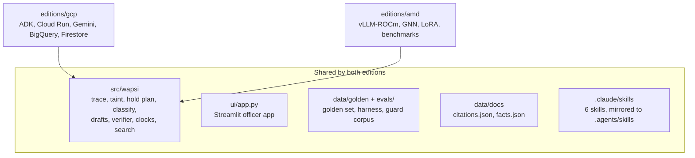

# Editions

Wapsi has two editions, each entered in its own hackathon, from one MIT-licensed repository. Each edition is a
thin, platform-specific layer under `editions/<platform>/` on top of the same portable core in `src/wapsi`. The core
decides every number, disposition, draft and citation. An edition decides where the data lives, which model writes the prose, how
officers reach the system and how it runs on that platform.

Why one core and not two products: [ADR 0005](adr/0005-one-core-two-editions.md). How the adapters plug in:
[architecture.md](architecture.md#how-editions-plug-in). What was built when: [originality.md](originality.md).

## Summary

Status as of 2026-09-29, checked against the repository.

| | Google Cloud | AMD |
|---|---|---|
| Hackathon | AI Builder Cup | lablab.ai AMD Developer Hackathon ACT III |
| Key dates | Planned: completed and deployed between 4 and 18 Oct ([originality.md](originality.md)) | Event window 12–18 Oct 2026 |
| Folder | [`editions/gcp`](../editions/gcp/README.md) | [`editions/amd`](../editions/amd/README.md) |
| Platform layer | ADK agents and a workflow on Cloud Run, Gemini (Gemini API free tier by default), BigQuery, Firestore, Secret Manager; optional Vertex AI, Model Armor, Pub/Sub, Cloud Scheduler and a private Gemma tier on Cloud Run GPU | vLLM on ROCm serving open models on one AMD Instinct MI300X, a GraphSAGE mule scorer in pure PyTorch, a LoRA fine-tune for the prose fields, benchmarks |
| Ledger | `BigQueryLedger`, or `ParquetLedger` | `ParquetLedger` |
| Prose LLM | `GeminiLLM`; Gemma via `OpenAICompatLLM` (paid add-on) | `OpenAICompatLLM` against vLLM |
| Case store | `FirestoreCaseStore` | `FileCaseStore` |
| Guard | `RulesGuard`; `ModelArmorGuard` when a template is configured | `RulesGuard`; plus an LLM judge when the verifier model is served |
| Status | Code built and tested offline with fakes. Deploy scripts written and dry-run in tests with a fake `gcloud`, not run against Google Cloud. Nothing deployed. | Code prepared before the event and tested offline. Training, fine-tuning, serving and benchmarks run on the MI300X only during 12–18 Oct 2026. No AMD GPU results exist yet. |

## What is shared and what is not

| Shared (one copy, same behaviour everywhere) | Platform-specific (per edition) |
|---|---|
| Money-trail tracing and exact per-victim taint (`wapsi.graph`) | Where the ledger lives and how a case's slice of it is loaded |
| Amount-specific hold plan and every SOP rule (`wapsi.graph.holdplan`) | Which LLM writes the three prose fields |
| Account classification and reasons (`wapsi.classify`) | Where case bundles, approvals and audit events are stored |
| Eight draft kinds, the LEA clarification letter and the placeholder-only prose contract (`wapsi.draft`) | How officers and supervisors sign in and reach the app |
| The verifier, the LEA request checklist, the account-level exception and the approval fingerprint (`wapsi.verify`, `wapsi.pipeline.run`) | Event intake (Pub/Sub, a REST API) |
| SOP clocks, the bank working-day calendar and the regulatory radar (`wapsi.domain`); the hash-chained audit log (`wapsi.audit`) | Extra guards on top of `RulesGuard` (Model Armor, an LLM judge) |
| Citation ids and verbatim quotes (`wapsi.citations`, `data/docs/`) | Optional extra scorers (a GNN) |
| The Streamlit officer app (`ui/`) | Deployment, cost controls and platform governance |
| Golden set, evaluation harness, showcase fixtures | Platform benchmarks and evidence for the judges |

The showcase numbers are the parity test for every edition: ₹1,42,848.00 held across 5 accounts and
₹3,34,848.00 recoverable for the victim in showcase case 1, against ₹5,03,50,000.00 that a whole-account freeze
would immobilise (`src/wapsi/fixtures/showcase.py`).

## Google Cloud edition (ADK)

**Folder:** [`editions/gcp`](../editions/gcp/README.md). Diagram and service-by-service table:
[`editions/gcp/architecture.md`](../editions/gcp/architecture.md).

**What is platform-specific**

- Two ADK apps: `wapsi_officer` (an `LlmAgent` with ten pipeline tools, such as `trace_money`, `hold_plan`,
  `draft_documents` and `approve_draft`, and a multimodal intake sub-agent) and `case_pipeline` (a deterministic
  ADK workflow for Pub/Sub hold notices, uploads and clock sweeps).
- Two Cloud Run services from one image: `wapsi-api` (ADK on FastAPI, the Pub/Sub trigger route, `/healthz`;
  private) and `wapsi-ui` (the shared Streamlit app on the same case store; public, for judges; all data is
  synthetic).
- A free-trial default profile: Gemini through the Gemini API free tier with an AI Studio key kept in Secret
  Manager, scale to zero and a 5 USD budget alert. Vertex AI, Model Armor, Memory Bank and the Gemma GPU tier are
  opt-in flags.
- Adapters that live in `src/wapsi/adapters` because they are general-purpose: `BigQueryLedger` (parameterised
  SQL, partitioned and clustered tables, a bytes-billed cap), `FirestoreCaseStore`, `ModelArmorGuard` and
  `GeminiLLM`. A private Gemma tier on Cloud Run GPU is reached through `OpenAICompatLLM`.
- Role grants signed with an HMAC key from Secret Manager; a supervisor role is needed to approve.
- A demo mode with zero cloud access: showcase ledger, in-memory case store, `FakeLLM`, `RulesGuard` and a
  scripted ADK model.

**Status, honestly.** The edition README says that nothing has been deployed. The code is built and unit-tested
locally with fakes (`tests/gcp`: a SQLite-backed BigQuery fake, an in-memory Firestore, fake Model Armor and
Gemini). The deploy scripts are written and dry-run in tests with a fake `gcloud`, but have not been run against
Google Cloud. The README also lists what was verified against the installed SDKs, what was taken from
documentation without running it (model ids, GPU availability, IAP flags), and open items such as Memory Bank
needing an extra package. The edition README has the latest state.

## AMD edition (ROCm)

**Folder:** [`editions/amd`](../editions/amd/README.md). Event-week steps: [`RUNBOOK.md`](../editions/amd/RUNBOOK.md).
The GNN and LoRA work streams have their own READMEs in `editions/amd/gnn/` and `editions/amd/lora/`.

**What is platform-specific**

- **Serving:** `serving/start_llm.sh` starts vLLM (OpenAI-compatible) on the MI300X. The compose file serves the
  drafting model and, with the `verifier` profile, a second, smaller model on the same GPU that acts as an
  independent LLM judge. The edition README plans Gemma 4 31B with a merged STR-drafting LoRA at about 55% of GPU
  memory, and Gemma 4 E4B as the judge at about 15%.
- **App:** a FastAPI service (`app/api.py`) and the shared Streamlit app on a JSON-file case store, calling
  `process_case` with `ParquetLedger`, `OpenAICompatLLM` (or `FakeLLM` in demo mode), `LLMJudgeGuard` (the rules
  guard plus the judge, which can add flags but never clear one) and `GnnHttpScorer`.
- **GNN:** an edge-aware GraphSAGE mule scorer in pure PyTorch (`gnn/`), trained on synthetic worlds with separate
  train, validation and test seeds. It implements the core's `Scorer` protocol, and the app falls back to the
  heuristic scorer when the GNN service is unavailable.
- **LoRA:** verifier-filtered distillation and a LoRA fine-tune of an open model for the placeholder-only prose
  fields (`lora/`).
- **Benchmarks:** LLM serving, GPU telemetry and end-to-end case benchmarks (`bench/`). The package itself says
  that no numbers live in it: every result is produced on the MI300X during the event.
- **Demo profile:** `docker compose --profile demo` runs the app with `WAPSI_DEMO_MODE=1`, no GPU and no model
  downloads.

**Status, honestly.** The code in `docker-compose.yml`, `serving/`, `app/` and `bench/` is prepared before the
event and tested offline with fakes (`tests/amd`); the edition README states that none of it has touched an AMD
GPU yet. Per [originality.md](originality.md), the AMD-specific AI work (GNN training on ROCm, the fine-tune,
vLLM-ROCm serving and benchmarks) is done during 12–18 Oct 2026. Everything that exists before then is disclosed
and will sit under the git tag `amd-baseline`, created at kickoff; the tag does not exist yet. There are no MI300X
measurements in the repository; results will be published in `editions/amd/AMD_RESULTS.md` after the event-week
runs. The only results committed now are labelled CPU-development checks (`gnn/results/cpu-dev-2026-09-23.json`,
and a fake-model pipeline check in `lora/results/`). Pre-training on IBM AMLworld is marked event-time only in
`gnn/train.py`. The app's extra dependencies are the `amd-app` extra (FastAPI, uvicorn); training uses the `amd`
extra.

## How the editions stay consistent

| Mechanism | Where |
|---|---|
| One implementation of every rule, imported by all editions | `src/wapsi` |
| Hand-computed showcase numbers every adapter must reproduce | `src/wapsi/fixtures/showcase.py`, `tests/test_contracts.py` |
| Same golden set and harness for every edition | `data/golden/`, `evals/harness.py` |
| Adapter parity tests | `tests/gcp` (BigQuery SQL against `InMemoryLedger` on SQLite); the AMD edition reads the core's own `ParquetLedger` |
| Same skills in every coding agent (Claude Code, Gemini CLI) | `.claude/skills/`, mirrored to `.agents/skills/` by `scripts/sync_skills.py` |
| Same conventions for every contributor and agent | `AGENTS.md` |

## Related documents

- [architecture.md](architecture.md): ports, adapters and the pipeline
- [ADR 0005](adr/0005-one-core-two-editions.md): why one core and two thin editions
- [originality.md](originality.md): build timeline and event boundaries
