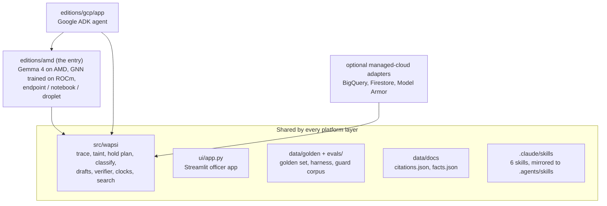

# Editions and run modes

Wapsi is entered in one hackathon: the lablab.ai **AMD Developer Hackathon ACT III** (12 to 18 October 2026),
Track 3 "Reinvent Commerce". **The AMD edition is the entry.** It runs in three modes that share one codebase: an
AMD-hosted model endpoint, a ROCm notebook and a single MI300X machine.

The officer's agent, built with Google's open-source Agent Development Kit (ADK), is edition-neutral and lives in
`editions/shared` (tools, guard / audit / trace plugins, instruction, the OpenAI-compatible endpoint model). The
entry wires it in `editions/amd/app/agent.py`: one ADK agent with the ten officer tools, with Gemma 4 on AMD as its
model. The repository also holds a second platform layer, `editions/gcp`: an ADK agent app with a hosted model (it
adds an intake sub-agent and a `case_pipeline` workflow) and a set of **optional managed-cloud adapters** for Google
Cloud. Neither is part of the entry: they are kept for a bank that wants a managed cloud, and nothing in the entry
depends on them.

Every edition is a thin layer under `editions/<platform>/` on top of the same portable core in `src/wapsi`. The
core decides every number, disposition, draft and citation. A platform layer decides where the data lives, which
model writes the prose, how officers reach the system and how it is served.

Why one core: [ADR 0005](adr/0005-one-core-two-editions.md). How the adapters plug in:
[architecture.md](architecture.md#how-editions-plug-in). What was built when: [originality.md](originality.md).

## Summary

Status as of 2026-10-14, checked against the repository.

| | AMD (the entry) | Optional managed-cloud adapters |
|---|---|---|
| Purpose | lablab.ai AMD Developer Hackathon ACT III, Track 3 | not a hackathon entry; adapters for a managed cloud |
| Folder | [`editions/amd`](../editions/amd/README.md), the ADK agent in `editions/shared`, the public demo in `deploy/` | [`editions/gcp`](../editions/gcp/README.md) (`deploy/`, and the adapters in `src/wapsi/adapters`) |
| Prose and extraction model | Gemma 4 31B served on AMD GPUs, through `OpenAICompatLLM` | `GeminiLLM`, or Gemma through `OpenAICompatLLM` |
| Agent | Google ADK agent with Gemma 4 on AMD as its model (LiteLLM connector) | the same ADK agent with a hosted model |
| Speech to text | Whisper (open weights), local by default | the hosted model reads the audio |
| Mule scorer | heuristic by default; an optional GraphSAGE GNN in PyTorch on ROCm (trained on an AMD Instinct MI300X on 2026-10-14) | heuristic |
| Ledger | `ParquetLedger` | `BigQueryLedger`, or `ParquetLedger` |
| Case store and audit chain | `FileCaseStore`: JSON files with atomic writes, chained on write | `FirestoreCaseStore`: one transaction per audit event, anchor in `audit_anchors/{case_id}` |
| Guard | `RulesGuard`, plus an LLM judge when a second model is configured | `RulesGuard`, plus `ModelArmorGuard` when a template is configured |
| Status | Core and AMD layer code existed before the event (tag `amd-baseline`). Endpoint mode ran live on 2026-10-14 (the agent with live draft prose, the showcase world through the harness, voice-note extraction and the demo's recorded prose, all on Gemma 4 through the AMD Token Factory). Notebook mode ran on 2026-10-14 on an AMD Instinct MI300X (AMD AI Notebook, ROCm 7.14): Gemma 4 31B served by vLLM, the benchmarks, the golden set, the A/B, GNN training and a Whisper timing run (`editions/amd/evidence/notebook/2026-10-14/`). AMD measurements are published only from committed results files. No droplet run is reported. | Built and unit-tested offline with fakes. Deploy scripts are dry-run in tests with a fake `gcloud`. Nothing is deployed. |

## AMD: what runs where

The hackathon asks that a meaningful part of the workload runs on AMD and that the AMD component is part of the
working product. In Wapsi it is the language side of every case; the learned mule scorer, trained on an AMD GPU,
is an optional extra. The status column says what has run on AMD so far.

| Workload | Model | Where it runs | Decides a number? | Status (14-10-2026) |
|---|---|---|---|---|
| The prose fields of a case's drafts | Gemma 4 31B | AMD GPUs, through the model endpoint | no: placeholders only, the verifier recomputes | run live (AMD Token Factory); the 39-case demo world end to end with Gemma 4 served by vLLM on an AMD Instinct MI300X (AMD AI Notebook) |
| Field extraction and translation of complaints and voice-note transcripts | Gemma 4 31B | the same endpoint | no: every extracted value is a claim, reconciled with the ledger | run live on the six sample transcripts |
| The officer's agent and its tool calls | Gemma 4 31B through Google ADK | the same endpoint | no: figures come from tools | run live |
| Second opinion on untrusted text (judge) | a small open model, configurable | the same endpoint, or a second model on the same GPU | no: it can add a flag, never clear one | wired, not yet measured |
| Speech to text | Whisper, open weights | local by default; any GPU is faster | no | timed on an AMD Instinct MI300X (AMD AI Notebook): steady-state real-time factor 0.0312; not yet run through the voice-intake reconciliation |
| Mule scoring (optional second scorer) | GraphSAGE GNN, pure PyTorch on ROCm | an AMD GPU (notebook or droplet) | it scores a role; amounts stay arithmetic | trained on an AMD Instinct MI300X (AMD AI Notebook): on the hard world, mule ROC-AUC 0.9202 against the default heuristic's 0.9411, innocent-holder recall 0.875 against 0.6875, mule recall 0.7415 against 0.966; the heuristic stays the default |
| Tracing, per-victim split, hold plan, verifier | no model | plain Python, any CPU | yes, all of them | runs everywhere |

### Three modes, one codebase

The model endpoint is a setting. Nothing in the core knows which mode it is in.

| | Endpoint mode | Notebook mode | Droplet mode |
|---|---|---|---|
| What it is | an OpenAI-compatible API that serves open models on AMD GPUs (the AMD Token Factory that the event gives every team) | a ROCm JupyterLab on an AMD GPU; Docker may not be available | one AMD Instinct MI300X with Docker Compose |
| Used for | everything on the language side: prose, extraction, the agent | serving Gemma 4 with vLLM on the notebook, GNN training, benchmarks | serving both models, the GNN and the app on one machine, so no request leaves it |
| You need | a base URL, a key and a model name | a notebook instance from the AMD portal | a droplet from the AMD Developer Cloud |
| Role in the entry | **primary**: the demo and the agent run here | the MI300X measurements | secondary |
| Status (2026-10-14) | run live with synthetic data; the agent, voice-extraction and showcase-world figures are published from committed results files, the demo-world figures through the endpoint are still open slots | run on an AMD Instinct MI300X (AMD AI Notebook, ROCm 7.14, vLLM) in two one-hour sessions, each on its own MI300X; evidence in `editions/amd/evidence/notebook/2026-10-14/` | stack, runbook and benchmark harness prepared and tested offline; not run on a droplet |

**Endpoint mode settings.** All of them come from the environment; none is ever committed.

| Variable | Meaning |
|---|---|
| `WAPSI_LLM_BASE_URL` | OpenAI-style base URL ending in `/v1` |
| `WAPSI_LLM_API_KEY` | bearer key, read by `OpenAICompatLLM`; never printed or logged |
| `WAPSI_LLM_MODEL` | model id as the endpoint lists it, for example `Gemma-4-31B-IT` |
| `WAPSI_LLM_JSON_MODE` | `json_object` for a shared endpoint; `json_schema` only where strict schemas are served (`editions/amd/app/settings.py`) |
| `WAPSI_VERIFIER_BASE_URL`, `WAPSI_VERIFIER_API_KEY` | switch on the second-opinion judge model |
| `WAPSI_GNN_URL` | switch on the GNN scoring service; empty means the heuristic scorer |

**What we observed on the shared endpoint on 2026-10-14**, and what Wapsi does about each point:

| Observation | Consequence in Wapsi |
|---|---|
| OpenAI-compatible chat completions; the model list changes over time | the model is a setting, and the smoke run reads the model list first |
| `json_object` output works; strict `json_schema` output is not accepted | `json_object` mode, then Wapsi validates the answer against its own schema and repairs or rejects it |
| `seed` and `stop` are not honoured | temperature 0, and the live smoke run caches good responses on disk; no claim of bit-for-bit repeatability with a live model |
| No audio transcription and no audio input in chat; no embeddings | speech to text runs locally with Whisper; legal search is the repository's own pure-Python BM25, which needs no embeddings |
| Per-account request and concurrency limits, a daily usage cap, HTTP 429 with `Retry-After` | live runs are sequential and spaced; the client retries 429 and 5xx with backoff and honours `Retry-After` |
| A trial service with no SLA, and a rule not to send sensitive data | only synthetic data is ever sent; a case never blocks on the model, because a failed or rejected answer is replaced by a fixed paragraph |
| Reply quality can degrade for a while | the smoke run starts with a live health probe (never answered from a cache) and refuses to record a result from a degraded endpoint or from replayed answers (`pitch/amd/evidence/token_factory_smoke.py`) |

**Notebook mode.** The GNN is pure PyTorch with standard operators only, so the same code runs on CPU and on ROCm
(`--device auto`). Training, evaluation and the checkpoint format are described in `editions/amd/gnn/README.md`.
A notebook has no Compose stack, so the app keeps using endpoint mode for the language side and loads the trained
checkpoint for scoring.

**Droplet mode.** `editions/amd/docker-compose.yml` serves the drafting model and, with the `verifier` profile, a
second smaller model on the same GPU with vLLM on ROCm, next to the GNN service and the app; everything binds to
`127.0.0.1`. The memory plan for one MI300X (192 GB) is arithmetic over the configuration, not a measurement:
about 55% of GPU memory for Gemma 4 31B in BF16 and its KV cache, about 15% for the verifier model, the rest for
the GNN and headroom. Steps: [`RUNBOOK.md`](../editions/amd/RUNBOOK.md). A LoRA fine-tune of the open model for
the prose fields is prepared in `editions/amd/lora/` and is optional.

### Built during the event

Five pieces were built in their own branches during the event window and merged on 2026-10-14
([originality.md](originality.md) has the commits). Each runs offline against a stand-in and live against the
endpoint with the same three settings.

**Open-model voice intake.** A victim's Hinglish, Hindi or English voice note is transcribed by Whisper (open
weights), and Gemma 4 on AMD extracts the complaint fields and the English translation from the transcript in
`json_object` mode. Everything after that is the existing shared code, unchanged: schema validation, phone
masking in code, guard screening, and the reconciliation of every claimed amount, UTR, date and account digit
with the ledger. Only a ledger match opens a case. The speech model is local by default because the shared
endpoint serves no audio; an OpenAI-compatible transcription endpoint is an option
(`editions/amd/asr/server.py` serves Whisper on a GPU box), and a chat-audio adapter is probed at run time so
that it switches on if the endpoint starts accepting audio. Details and settings: [Voice intake](voice-intake.md).

```bash
uv run python -m editions.amd.bench.voice_bench --fake                 # offline: fake recogniser and text model
WAPSI_VOICE_BACKEND=open WAPSI_ASR_BACKEND=local uv run streamlit run ui/app.py     # Voice Intake page, live
uv run python -m editions.amd.bench.voice_bench --asr scripts          # the text model alone (6 requests)
```

**The ADK agent on Gemma 4 served on AMD.** The officer's agent keeps its ten pipeline tools and its guard and
trace plugins (now in `editions/shared/`, imported by both layers). Its model is Gemma 4 on the AMD endpoint,
reached through ADK's LiteLLM connector as an OpenAI-compatible provider. A capability probe decides how tools
are called: natively when the endpoint returns tool calls (it does for Gemma 4 on the Token Factory), otherwise
through a strict JSON tool protocol in which the model names one tool per turn. A reply that states a rupee
amount or an account number no tool returned is not shown; a summary built from the tool results replaces it.
Every run is recorded by the agent trace (redacted arguments, result summaries taken from the tools' own results,
guard and verifier verdicts, reply grounding) and sealed into each case's audit chain
([User guide](user-guide.md#agent-trace-tab), [Trust and safety](trust-and-safety.md#agent-traces)). Before the
event the agent already had a LiteLLM path to an OpenAI-compatible server and ran offline with a scripted model.
Measured runs and every setting: [`editions/amd/AGENT.md`](../editions/amd/AGENT.md).

```bash
uv run python -m editions.amd.app.agent_demo --case 31009260000101 --demo   # offline, a fake OpenAI-compatible endpoint
uv run python -m editions.amd.app.agent_demo --case 31009260000101 --live   # Gemma 4 on AMD: the tool-by-tool trace
uv run streamlit run editions/amd/app/ui_app.py                             # "Ask the agent" in the Case Room
```

**The public demo.** One container runs the officer app for judges (`deploy/demo/`): with the three settings it
writes prose with the live endpoint and a chip on every draft names the model and the endpoint host that served
it; without them every page says "Recorded run" and replays prose recorded from an open model served on AMD
(`data/recordings/demo_prose.json`). Each visitor works on a private copy. Hosting without a credit card:
[`deploy/DEMO_HOSTING.md`](../deploy/DEMO_HOSTING.md).

```bash
uv run streamlit run deploy/demo/app.py                    # recorded run, or live when the endpoint is set
uv run python scripts/make_space.py --check                # the Hugging Face Space folder: sources and a key scan
```

**The evidence run.** `editions/amd/kickoff/run_all.sh` runs the same twelve stages in whichever way the machine
allows (`--mode endpoint | notebook | droplet`) and writes one dated bundle, `evidence.json` and `evidence.md`,
that says where it ran. `fill_pitch.py` then fills the open slots of the pitch from a valid bundle and nothing
else. Steps: [`RUNBOOK.md`](../editions/amd/RUNBOOK.md).

```bash
bash editions/amd/kickoff/run_all.sh --mode endpoint --dry-run   # prints every command, runs nothing
bash editions/amd/kickoff/run_all.sh --rehearsal                 # the whole pipeline on CPU with stub models; never a result
```

**The evaluation on the endpoint.** `uv run python -m evals.harness --world demo --llm openai-compat:Gemma-4-31B-IT`
scores the golden set with Gemma 4 alone writing every prose field (`--llm openai-compat` fails over along
`WAPSI_LLM_MODELS`, and the report then names every model that answered), behind a rate limiter, 429 retries and a
per-host response cache ([Eval report format](eval-report.md)).

### One set of settings

Every piece reads the same names. A key is only ever in the shell or in a private file outside the repository.

| Setting | Read by | Meaning |
|---|---|---|
| `WAPSI_LLM_BASE_URL`, `WAPSI_LLM_API_KEY`, `WAPSI_LLM_MODEL` | the pipeline's prose, the eval harness, the agent, voice-note extraction, the demo container, the kickoff scripts | the OpenAI-compatible endpoint, its bearer token and the served model name |
| `WAPSI_LLM_JSON_MODE` | prose and extraction | `json_object` by default for any endpoint that is not your own server; `json_schema` for your own vLLM with guided decoding |
| `WAPSI_LLM_MODELS` | the drafts' prose (the app, the demo, the eval harness), voice intake, the agent, the kickoff model plan | an ordered, comma-separated list to fail over along when a model is withdrawn or answers in garbage (`WAPSI_LLM_FALLBACK_MODELS` is read as the same list). Each draft, voice note and agent run names the model that answered, and the harness report counts prose per model (`prose_by_model`). The kickoff run uses it only with `WAPSI_ALLOW_MODEL_FALLBACK=1`: a measurement is never credited to a model that did not produce it |
| `WAPSI_LLM_PLATFORM` (or `WAPSI_LLM_ON_AMD=1`) | the draft chip, voice intake, the agent's label | the deployer's statement that an endpoint which is not AMD's own host runs on AMD hardware. Never guessed. The kickoff evidence wants the hardware itself: `WAPSI_ENDPOINT_HARDWARE` |
| `WAPSI_LLM_RPM`, `WAPSI_LLM_MIN_INTERVAL_S`, `WAPSI_LLM_MAX_CONCURRENCY` | the eval harness, the demo, the kickoff client, the benchmarks, the AMD app | pacing below a shared key's limits. The AMD app paces the drafts' prose and the agent's model turns on one process-wide limiter per endpoint host (default 18 a minute and 3 s apart for a shared endpoint, none for its own server); the agent's own gap is `WAPSI_AGENT_MIN_INTERVAL_S`, and the "Ask the agent" box says when a rate-limit wait is in progress |
| `WAPSI_STACK`, `WAPSI_LLM_CACHE_DIR` | the AMD app | `WAPSI_STACK=1`: inside the compose stack, where the `llm` service is the default endpoint; outside it, an unset `WAPSI_LLM_BASE_URL` switches the app to offline stand-ins with a notice on every page. `WAPSI_LLM_CACHE_DIR`: the prose answers' prompt-hash cache (default `<WAPSI_STATE_DIR>/llm-cache`, `off` for none) |
| `WAPSI_AGENT_*` | the agent | agent-only overrides (another model or endpoint, tool mode, limits); see `editions/amd/AGENT.md` |
| `WAPSI_VOICE_BACKEND` | Voice Intake, the agent's intake tool, the AMD API | `auto`, `open` (Whisper plus the endpoint above), `gemini` or `fake` |
| `WAPSI_ASR_BACKEND`, `WAPSI_ASR_BASE_URL`, `WAPSI_ASR_API_KEY`, `WAPSI_ASR_MODEL`, `WAPSI_ASR_LANGUAGE`, `WAPSI_ASR_DEVICE`, `WAPSI_ASR_ON_AMD` | the speech recogniser | local Whisper or an OpenAI-compatible transcription endpoint; see [Voice intake](voice-intake.md) |
| `WAPSI_UI_LLM` | the officer app | `fake` (the local default), `auto` (the demo launcher: the live endpoint, else the recorded run) |
| `WAPSI_DEMO_MODE` | the AMD app and API | `1` = offline stand-ins for the model, the agent's endpoint and the scorer |

Example files: `deploy/demo/.env.example` (the demo container), `editions/amd/kickoff/endpoint.env.example`
(endpoint mode), `editions/amd/.env.example` (the droplet's compose stack).

### Status, honestly

- The portable core, the officer app, the ADK agent app and the prepared AMD layer (`docker-compose.yml`,
  `serving/`, `app/`, `bench/`, `gnn/`, `lora/`) existed before the event and are under the git tag
  `amd-baseline` (commit `1d500f6`). [originality.md](originality.md) lists what was added during the event.
- A figure with a real model in the loop is published only from a results file committed to the repository, and
  it says where it ran: AMD Token Factory, an AMD GPU notebook or an MI300X droplet. A result from the shared
  endpoint is never presented as a benchmark of a dedicated MI300X. Open figures are listed as slots at the end
  of `pitch/NUMBERS.md`.
- The only GNN results committed at the baseline are labelled CPU-development checks
  (`gnn/results/cpu-dev-2026-09-23.json`). `editions/amd/bench/fixtures/` holds hand-written samples of the
  `amd-smi` output shape for parser tests; they are not measurements.
- The app's extra dependencies are the `amd-app` extra (FastAPI, uvicorn); training uses the `amd` extra.

## The optional managed-cloud app (`editions/gcp`; not part of the entry)

**Folder:** [`editions/gcp`](../editions/gcp/README.md). Diagram and service-by-service table:
[`editions/gcp/architecture.md`](../editions/gcp/architecture.md).

The entry's agent is the edition-neutral one in `editions/shared`, wired by `editions/amd/app/agent.py`: one ADK
`LlmAgent` with the ten officer tools and the trace, guard, audit and notice plugins, on Gemma 4 served on AMD
([`editions/amd/AGENT.md`](../editions/amd/AGENT.md)). The Google Cloud app below builds a larger app around the
same tools and plugins.

**The ADK app with a hosted model**

- Two ADK apps: `wapsi_officer` (an `LlmAgent` with ten pipeline tools, such as `trace_money`, `hold_plan`,
  `draft_documents` and `approve_draft`, and an intake sub-agent) and `case_pipeline` (a deterministic ADK
  workflow for hold notices, uploads and clock sweeps).
- **Agent trace.** `ToolTracePlugin` is the app's first plugin, so it records every model turn and tool call
  (redacted arguments, a result summary taken from the tool's own result, latency, status) before any other
  plugin can answer a callback; `WapsiGuardPlugin` reports its verdicts into the same recorder. When a run ends,
  its trace is appended to the audit log of every case it touched (an `agent_trace` event, so the hash chain
  covers it). The UI's Case Room shows the runs in its **Agent trace** tab.
- **Voice-note tool.** The `wapsi_intake` sub-agent has the `intake_voice_note` tool. It returns the transcript
  sanitised inside untrusted-text markers, marks every claim as untrusted, and names only the ledger-matched NCRP
  ids as the next step for `open_case`, whose amounts come from the ledger.
- Role grants are signed with an HMAC key; a supervisor role is needed to approve.
- A demo mode with no network access: showcase ledger, in-memory case store, `FakeLLM`, `RulesGuard` and a
  scripted ADK model. In demo mode the UI runs the offline agent script once at start-up, so the showcase cases'
  audit chains hold a real (scripted-model) agent run.

**The managed-cloud adapters (optional, not part of the entry)**

- Adapters that live in `src/wapsi/adapters` because they are general-purpose: `BigQueryLedger` (parameterised
  SQL, partitioned and clustered tables, a bytes-billed cap), `FirestoreCaseStore`, `ModelArmorGuard` and
  `GeminiLLM`.
- **Audit chain sealed in Firestore.** `FirestoreCaseStore.append_audit` runs one Firestore transaction: it reads
  the case's anchor (`audit_anchors/{case_id}`, outside the log), seals the event as the next link, creates
  `cases/{case_id}/audit/{seq:010d}` and advances the anchor in the same commit. Concurrent writers conflict on
  the anchor and Firestore re-runs one of them, so the chain stays gap-free. `verify_audit(case_id)` checks the
  stored log against the anchor.
- Two Cloud Run services from one image (`wapsi-api`, `wapsi-ui`), deploy scripts, a Pub/Sub trigger route and
  an IAP-scoped `GET /wapsi/traces`.

**Status, honestly.** Nothing has been deployed. The code is built and unit-tested locally with fakes
(`tests/gcp`: a SQLite-backed BigQuery fake, an in-memory Firestore, fake Model Armor and a fake hosted model).
The deploy scripts are dry-run in tests with a fake `gcloud` and have not been run against a cloud project. The
folder's README has the latest state.

## What is shared and what is not



| Shared (one copy, same behaviour everywhere) | Platform-specific |
|---|---|
| Money-trail tracing and exact per-victim taint (`wapsi.graph`) | Where the ledger lives and how a case's slice of it is loaded |
| Amount-specific hold plan and every SOP rule (`wapsi.graph.holdplan`) | Which model writes the three prose fields, and where it is served |
| Account classification and reasons (`wapsi.classify`) | Optional extra scorers (a GNN) |
| Eight draft kinds, the LEA clarification letter and the placeholder-only prose contract (`wapsi.draft`) | Where case bundles, approvals and audit events are stored |
| The verifier, the LEA request checklist, the account-level exception and the approval fingerprint (`wapsi.verify`, `wapsi.pipeline.run`) | How officers and supervisors sign in and reach the app |
| SOP clocks, the bank working-day calendar and the regulatory radar (`wapsi.domain`); the hash-chained audit log (`wapsi.audit`) | Extra guards on top of `RulesGuard` (an LLM judge, Model Armor) |
| Voice-note intake after the transcript: the response schema, phone masking, guard screening and ledger reconciliation (`wapsi.intake`) | Which model turns audio into text and which model extracts the fields |
| The agent-trace model, recorder, redaction and the `agent_trace` audit event (`wapsi.agenttrace`) | Which agent loop drives the recorder (ADK plugin callbacks) and which model the agent uses |
| Citation ids and verbatim quotes (`wapsi.citations`, `data/docs/`) | Deployment, cost controls and platform benchmarks |
| The Streamlit officer app (`ui/`), the golden set, the evaluation harness, the showcase fixtures | Evidence files for the judges |

The showcase numbers are the parity test for every layer: ₹1,42,848.00 held across 5 accounts and
₹3,34,848.00 recoverable for the victim in showcase case 1, against ₹5,03,50,000.00 that a whole-account freeze
would immobilise (`src/wapsi/fixtures/showcase.py`).

## How the layers stay consistent

| Mechanism | Where |
|---|---|
| One implementation of every rule, imported by all layers | `src/wapsi` |
| Hand-computed showcase numbers every adapter must reproduce | `src/wapsi/fixtures/showcase.py`, `tests/test_contracts.py` |
| Same golden set and harness whatever the model | `data/golden/`, `evals/harness.py` (`--llm`) |
| Adapter parity tests | `tests/amd` (offline, with fakes); `tests/gcp` (BigQuery SQL against `InMemoryLedger` on SQLite) |
| Same skills in every coding agent | `.claude/skills/`, mirrored to `.agents/skills/` by `scripts/sync_skills.py` |
| Same conventions for every contributor and agent | `AGENTS.md` |

## Related documents

- [architecture.md](architecture.md): ports, adapters and the pipeline
- [ADR 0005](adr/0005-one-core-two-editions.md): why one core and thin platform layers
- [originality.md](originality.md): the baseline tag and what was built during the event
- `pitch/TRACK_FIT.md` in the repository: the Track 3 brief against the evidence
