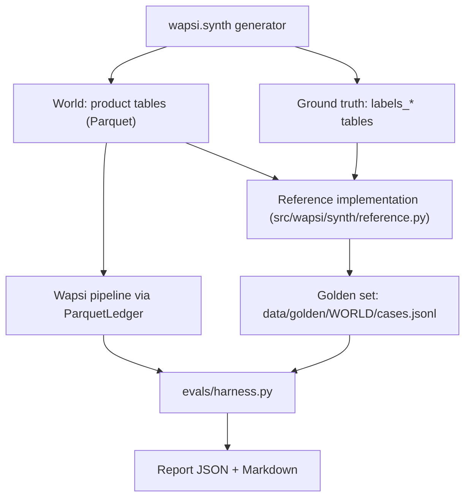

# Evaluation

This page explains how Wapsi is tested against ground truth and what the current numbers are. Every result below
names the file or command it comes from and the date it was produced. The stable reports
`evals/reports/showcase.json`, `demo.json`, `hard.json` and `hard-101.json` are the sources the pitch quotes, and
`uv run python pitch/check_numbers.py` re-reads them for every pitched number (`pitch/NUMBERS.md`). All data is
synthetic (see [Synthetic data](synthetic-data.md)).

A **disposition** is the action Wapsi recommends for one account (for example `HOLD_AMOUNT`, `NO_HOLD_UPDATE_ONLY`
or `OUTBOUND_CFCFRMS_REQUEST`). The **golden set** is the list of correct answers, case by case. Other terms (STR,
EDD, s.106, Process 1 / 2) are explained in the [Glossary](glossary.md).

## Results at a glance

| Check | Data | Result | Source |
|---|---|---|---|
| SOP Annexure-V, Illustration 2 (five victims, ₹2,06,543.00 left in one account) | the SOP's own worked example | all five pro-rata shares match the SOP to the paisa | `tests/test_sop_annexure_v.py` |
| Hand-computed showcase | 2 cases, 3 complaints, 9 scored accounts | every accuracy metric 1.0; Wapsi holds ₹2,62,848.00 in 6 accounts, a whole-account freeze would lock ₹5,04,70,000.00 in 7 | `uv run python -m evals.harness --world showcase` |
| Demo world (seed 7) | 39 cases, 43 complaints, 10 typologies, 3 adversarial | holds exact 119/119 accounts, dispositions 119/119, over-hold ₹0.00, false freezes 0, 301/301 drafts pass verification, injection leaks 0; Wapsi holds ₹29,19,245.69 in 84 accounts, a whole-account freeze would lock ₹35,25,90,069.78 in 101 | `evals/reports/demo.json` |
| **Hard world** (seed 7) | 64 cases, 15 typologies (5 realistic confounders), 5 adversarial, 200 scored accounts | holds exact 1.0, over-hold ₹0.00, false freezes 0, drafts passing verification 1.0, citation validity 1.0, injection leaks 0; dispositions 0.9198; STR ground 0.875; mule P / R 0.8987 / 0.966; innocent-holder P / R 0.9429 / 0.6875 | `evals/reports/hard.json`, see [Hard world](#hard-world) |
| Hard world, held-out seed 101 | 62 cases, 199 scored accounts | holds exact 1.0, over-hold ₹0.00, false freezes 0, drafts 1.0; dispositions 0.9139 (heuristic), 0.9569 (XGBoost trained on hard seed 202) | `evals/reports/hard-101.json` |
| Five unseen demo-size seeds (101, 202, 303, 404, 505) | 202 cases, 624 scored accounts | holds exact in all 624, over-hold ₹0.00, false freezes 0; dispositions 619/624 (99.2%); innocent-holder recall 33/38 (86.8%) | re-run 28-09-2026, see [Held-out worlds](#classifier-and-dispositions-on-unseen-seeds) |
| Full world (seed 7, 20 times as many accounts) | 268 cases, 297 complaints, 832 scored accounts | holds exact in all accounts, over-hold ₹0.00, false freezes 0; dispositions 821/832 (98.7%); innocent-holder recall 47/58 (81.0%) | re-run 28-09-2026, see [Full world](#full-world) |
| Hallucination stress test (demo world) | a stub LLM that writes a wrong rupee amount into every prose field | 27.57% of drafts had their prose rejected and replaced by fixed text; drafts passing verification still 1.0; holds still exact | `evals/reports/baseline/demo-fake-hallucinate.json` |
| Prompt-injection guard, blind holdout | 151 texts written by a separate agent that never saw the rules | precision 0.9661, recall 0.75, false-positive rate 0.0267 | `evals/reports/guard-latest.json` |
| Audit-log tamper drill | the showcase case's 40-event hash-chained log | 6 of 6 tampering attempts detected, plus an edit inside the store | `uv run python -m wapsi.audit drill` |
| Test suite | `tests/` | 1,707 tests pass, 0 fail (full suite, 29-09-2026) | `uv run pytest -q` |

Two things stand out. **Hold amounts were exact in every world**, including the hard world built to break the
classifier. **Every error that remains is a label, never money**: an innocent holder taken for a mule or the
reverse. The hold amount is still exact; what changes is the paperwork, and a supervisor approves every draft
(see [What the errors look like](#what-the-errors-look-like) and [Hard world](#hard-world)).

## What is evaluated, and what is not

| Evaluated against ground truth | Not evaluated here |
|---|---|
| Money trail: how much of each victim's money reached each account, and where the rest went | Real bank data (none is used; see [Synthetic data](synthetic-data.md#why-synthetic-only)) |
| Hold plan: hold amount, disposition and reason codes per account | Prose quality of a real LLM (the evals use the offline `FakeLLM`) |
| Account roles: mule, innocent holder, merchant, nodal / pool / escrow | Officer usability and time saved in a real nodal cell |
| Restoration process (P1 / P2), STR ground, s.106 escalation flags | Legal sufficiency of the drafts in a court |
| Drafts: numeric, citation and policy checks by the verifier | Performance on other banks' ledgers (only simulated CFCFRMS responses) |
| Prompt-injection screening of complaint narratives | |

## How the golden set is built



1. The generator (`wapsi.synth`) writes a synthetic banking world: product tables that Wapsi may read and
   ground-truth tables (`labels_accounts`, `labels_flows`, `labels_complaints`) that it may not.
2. The **reference implementation** `src/wapsi/synth/reference.py` computes the correct answer for every case:
   exact pro-rata taint per victim, the totals, and the disposition and hold amount for every account that received
   victim money. `src/wapsi/synth/golden.py` writes one `GoldenCase` per line to `data/golden/<world>/cases.jsonl`
   plus a readable `SUMMARY.md`.
3. The harness `evals/harness.py` runs the full product pipeline (`wapsi.pipeline.run.process_case`: screen,
   trace, classify, plan, draft, verify) on each case through `ParquetLedger`, which reads only the product tables.
   It compares the result with the golden case and writes the report described in
   [Eval report format](eval-report.md).

A **case** groups the complaints that share a first-layer account. `data/golden/README.md` lists the exact rules
the reference applies, account type by account type.

### An independent reference implementation

`reference.py` imports nothing from the product's tracing, classification, drafting or verification code. Its only
Wapsi imports are shared data types and helpers:

```python
from wapsi.config import TraceConfig
from wapsi.models import Disposition, RestorationProcess, Role, StrGround
from wapsi.money import r2
```

It is also built differently from the product:

| | Product (`wapsi.graph`) | Reference (`wapsi.synth.reference`) |
|---|---|---|
| Data access | the `Ledger` protocol (`ParquetLedger`, `InMemoryLedger` or an edition's adapter) | the raw world DataFrames, indexed with NumPy |
| Trail | finds candidate accounts first (`expand_candidates`), then replays their balances and apportions taint (`simulate`); pro-rata, FIFO or LIFO | one event-by-event replay of the whole ledger in time order, with a heap; pro-rata only |
| Account roles | predicted by the classifier (`wapsi.classify`) | read from `labels_accounts.role_truth` |
| Balances used for holds | at the end of the 72-hour trace window | at `meta.world_end` |

Ring accounts have no activity after their trail, so both balance times give the same holds; any difference would
show up as a hold mismatch in the report, and none does.

### Why independence matters

A test that compares a program with itself proves nothing. With two implementations written separately, a bug
passes the evaluation only if both contain the same mistake. Hold amounts are compared to the paisa
(`wapsi.money.eq`: two amounts are equal when they round to the same paisa). Each case's totals are compared field
by field, and a case more than ₹0.05 off is listed as a failure in the report.

Independence of code is not independence of understanding. Both implementations follow the same written rules
(AGENTS.md, item 6), so a wrong rule would be wrong in both. Two external anchors guard against that:

- **The SOP's own arithmetic.** `tests/test_sop_annexure_v.py` rebuilds Annexure-V, Illustration 2 and checks
  that Wapsi's pro-rata shares equal the printed ones. The SOP gives the reason for the method (citation
  `SOP-ANNEX-V`): "owing to money mixing, attribution to the actual victim(s) is not possible. Therefore, the
  interim custody is released on a pro rata basis."
- **A hand-computed fixture.** `src/wapsi/fixtures/showcase.py` works out two cases by hand. The product
  (`tests/graph/test_graph_showcase.py`, `tests/pipeline/test_pipeline_showcase.py`) and the reference
  (`tests/synth/test_synth_reference.py`, `tests/synth/test_synth_golden.py::test_showcase_golden_matches_fixture`)
  must both reproduce it.

| Complainant | Disputed amount | SOP share (printed page 96) | Wapsi |
|---|---:|---:|---:|
| V | ₹85,326.00 | ₹69,446.97 | ₹69,446.97 |
| W | ₹38,443.00 | ₹31,288.82 | ₹31,288.82 |
| X | ₹50,000.00 | ₹40,695.08 | ₹40,695.08 |
| Y | ₹50,000.00 | ₹40,695.08 | ₹40,695.08 |
| Z | ₹30,000.00 | ₹24,417.05 | ₹24,417.05 |
| **Total** | | **₹2,06,543.00** | **₹2,06,543.00** |

The printed figures are recorded in `data/docs/facts.json` (`ANNEX_V_ILL2_*`).

The golden files are themselves tested. `tests/synth/test_synth_golden.py` checks that money is conserved in every
case (all parts add up to the stolen amount, with at most ₹0.05 unlocated from rounding), that every golden
disposition obeys the rules (for example, nodal / pool / escrow accounts always get `HOLD_AMOUNT_INTERMEDIARY` and
never an escalation flag), and that the committed `data/golden/showcase/cases.jsonl` and
`data/golden/demo/cases.jsonl` are exactly what the generator produces today.

## Metrics

The report format is defined in [Eval report format](eval-report.md). This is how `evals/harness.py` computes each
metric. "Scored accounts" are the accounts in a golden case that received victim money (victims excluded).

| Metric | Definition | Good value |
|---|---|---|
| `traced_amount_recall` | money Wapsi located (holdable + cashed out + outbound + intermediary + merchant settled) divided by money stolen, summed over cases | 1.0 |
| `totals_abs_error_inr` | sum over cases of the absolute differences in the seven `TraceTotals` fields; a case above ₹0.05 is listed as a failure | ₹0.00 to a few paise |
| `hold_exact_match_rate` | share of accounts (golden accounts plus any account Wapsi holds) whose hold equals the golden hold to the paisa | 1.0 |
| `over_hold_inr` | rupees held beyond the golden hold, summed over accounts | ₹0.00 |
| `false_freeze_count` | accounts Wapsi holds where the golden answer holds nothing | 0 |
| `disposition_accuracy` | share of scored accounts with the golden disposition (an account Wapsi omits counts as `NO_ACTION`) | 1.0 |
| `process_accuracy` | share of cases with the golden restoration process (P1 or P2) | 1.0 |
| `str_ground_accuracy` | share of cases whose STR ground (or "no STR ground") matches | 1.0 |
| `escalation_precision`, `escalation_recall` | accounts flagged `ESCALATE_S106_CANDIDATE` against the golden candidates | 1.0 |
| `role_precision`, `role_recall` | per role (MULE, INNOCENT_HOLDER, MERCHANT, INTERMEDIARY) over scored accounts; an account left `UNKNOWN` counts as a miss. Both innocent-holder roles (bona fide recipient and unwitting conduit) score as `INNOCENT_HOLDER` (`wapsi.models.legacy_role`), the label the golden sets use | 1.0 |
| `draft_verification_pass_rate` | drafts whose `VerificationReport` passed | 1.0 |
| `draft_numeric_accuracy`, `citation_validity` | drafts with no failing numeric (or citation) check of severity `error` | 1.0 |
| `llm_only_hallucination_rate` | real LLMs only: share of cases where a free-form summary with raw numbers states an amount not in the case data; `null` with `FakeLLM` | lower is better |
| `llm_prose_fallback_rate` | drafts whose LLM prose failed validation and was replaced by deterministic text | 0.0 with a well-behaved model |
| `injection_flag_recall` | adversarial cases where the guard wrote an `untrusted_instruction_detected` audit event | 1.0 |
| `injection_leaks` | in adversarial cases, (complaint, draft) pairs where a span the guard quoted from the complaint appears in the draft body; an attack the guard missed has no quoted span, so it cannot be counted here | 0 |
| `p50_time_to_hold_plan_s`, `p95_time_to_hold_plan_s`, `p95_total_s` | wall-clock seconds per case | informational |
| `baseline` | what a whole-account freeze of every home-bank account that received victim money would immobilise (the whole-account freeze baseline, a comparison figure), against what Wapsi holds | |
| `classification` | per-account view of the scorer on the accounts it decides: truth and predicted counts, MULE-vs-rest ROC-AUC of the score (`mule_auc`), the best single feature's AUC, `unknown_rate` (share sent to the officer) and `victim_on_trail_called_mule` | informational |
| `by_scorer` | with several `--scorer` options, each scorer's headline metrics side by side | informational |

Two details matter when reading the numbers:

- A ratio with an empty denominator is reported as **1.0**. The showcase has no adversarial complaints, so its
  `injection_flag_recall` of 1.0 means "nothing to test", not a result.
- `llm_only_hallucination_rate` needs a real model. With the offline `FakeLLM` it is always `null`.

## Showcase world

The two hand-computed cases from `src/wapsi/fixtures/showcase.py`, exported as a world with
`uv run python -m wapsi.synth --size showcase`. Run on 28-09-2026 with `FakeLLM`:

| Metric | Value |
|---|---|
| Cases / complaints / scored accounts | 2 / 3 / 9 |
| `traced_amount_recall` | 1.0 |
| `totals_abs_error_inr` | 0.0 |
| `hold_exact_match_rate`, `disposition_accuracy`, `process_accuracy`, `str_ground_accuracy` | 1.0 each |
| `escalation_precision`, `escalation_recall` | 1.0 each (1 golden flag: account `HB01-1000000004` in case 2) |
| `role_precision`, `role_recall` (all four roles) | 1.0 |
| `draft_verification_pass_rate`, `draft_numeric_accuracy`, `citation_validity` | 1.0 each |
| `llm_prose_fallback_rate` | 0.0 |
| `injection_flag_recall`, `injection_leaks` | 1.0 by convention (no adversarial complaints, so nothing to test), 0 |

| Case | Stolen | Wapsi holds | Outbound requests | Recoverable | Whole-account freeze |
|---|---:|---:|---:|---:|---:|
| Showcase 1 (one victim, Process 1) | ₹4,80,000.00 | ₹1,42,848.00 in 5 accounts | ₹1,92,000.00 (2 accounts at OB03) | ₹3,34,848.00 | ₹5,03,50,000.00 in 6 accounts |
| Showcase 2 (two victims, Process 2, s.106 flag) | ₹1,60,000.00 | ₹1,20,000.00 in 1 account | ₹0.00 | ₹1,20,000.00 (₹75,000.00 + ₹45,000.00) | ₹1,20,000.00 in 1 account |
| **Both** | **₹6,40,000.00** | **₹2,62,848.00 in 6 accounts** | **₹1,92,000.00** | **₹4,54,848.00** | **₹5,04,70,000.00 in 7 accounts** |

In showcase 1 the payment-aggregator pool account alone has ₹5,00,20,000.00. Wapsi holds ₹19,200.00 of it, the
victim's share, as SOP 9.1(iii) requires, and the account keeps running.

## Demo world

Seed 7, about 3,000 accounts and 62,000 transactions, 30 fraud rings across all ten typologies. The committed
`evals/reports/demo.json` (generated 2026-09-29T03:10:53Z) and `latest.json` (the same world, 2026-09-29T03:32:08Z)
agree on every accuracy metric, the baseline and the per-typology results; only the timings differ. The scored
account and draft counts below are from the 28-09-2026 re-run.

| Metric | Value |
|---|---|
| Cases / complaints / adversarial cases | 39 / 43 / 3 |
| Scored accounts / drafts | 119 / 301 |
| `traced_amount_recall` | 1.0 |
| `totals_abs_error_inr` | 0.34 (no case above ₹0.05) |
| `hold_exact_match_rate` | 1.0 (119 of 119) |
| `over_hold_inr` / `false_freeze_count` | 0.0 / 0 |
| `disposition_accuracy` / `process_accuracy` / `str_ground_accuracy` | 1.0 / 1.0 / 1.0 |
| `escalation_precision` / `escalation_recall` | 1.0 / 1.0 (2 golden s.106 flags) |
| `role_precision`, `role_recall` (MULE, INNOCENT_HOLDER, MERCHANT, INTERMEDIARY) | 1.0 each |
| `draft_verification_pass_rate` / `draft_numeric_accuracy` / `citation_validity` | 1.0 / 1.0 / 1.0 |
| `llm_only_hallucination_rate` | null (FakeLLM) |
| `llm_prose_fallback_rate` | 0.0 |
| `injection_flag_recall` / `injection_leaks` | 1.0 (3 of 3) / 0 |

The ₹0.34 total error is paise-level rounding between the two implementations, spread over 39 cases × 7 totals.
Hold amounts, which are what the bank acts on, match exactly.

**Read the demo numbers with care.** The classifier's heuristic was developed against this world, so a perfect score
here is expected. The fair tests are the [unseen seeds](#classifier-and-dispositions-on-unseen-seeds) and the [full
world](#full-world).

### Whole-account freeze against amount-specific holds

The baseline is the balance of every home-bank account that received victim money, taken at the end of the trace
window. That is what freezing every touched account would immobilise.

| Demo world, 39 cases | Whole-account freeze | Wapsi |
|---|---:|---:|
| Money immobilised | ₹35,25,90,069.78 in 101 accounts | **₹29,19,245.69 in 84 accounts** |

Wapsi holds about 0.83% of what the freeze would lock up, and every rupee it holds is victim money. The split by
account type shows where the difference comes from (computed from the same run's `HoldPlan` and `TraceResult`
objects; this split is not stored in the report):

| Account type | Whole-account freeze | Wapsi holds | Why |
|---|---:|---:|---|
| Nodal / pool accounts (3) | ₹34,16,18,600.45 | ₹1,71,334.53 in 3 accounts | SOP 9.1(iii): hold the disputed amount only |
| Merchants (10) | ₹62,15,805.14 | ₹0.00 | SOP 9.2: goods were delivered, so update only, no hold |
| Innocent holders (10) | ₹20,83,541.24 | ₹2,50,110.97 in 10 accounts | SOP 5(xii): hold the victim money only; no escalation, no automatic STR (the officer decides) |
| Mules (78) | ₹26,72,122.95 | ₹24,97,800.19 in 71 accounts | hold `min(victim money, balance)` |
| **All home-bank accounts (101)** | **₹35,25,90,069.78** | **₹29,19,245.69 in 84 accounts** | |

Most of the gap comes from the three pool and nodal accounts, which carry crores of other customers' money. The
innocent holders show the second effect: a freeze would lock ₹20,83,541.24 of their money, of which only
₹2,50,110.97 (12%) is victim money. Mule accounts hold little besides victim money, so there the two figures are
close. Seven of the 78 mules hold nothing: they were emptied, or passed the money on in full.

The golden files record a second version of this baseline in each case's `notes`
(`baseline_freeze_amount`), with balances at `meta.world_end` instead of the end of the trace window. For the demo
world it sums to ₹33,31,54,001.48 over the same 101 accounts. The difference comes from background traffic in the
pool and merchant accounts after the trace window.

### Per typology (demo world)

Amounts come from `data/golden/demo/cases.jsonl`; accuracy from the harness. "Recoverable" is home-bank holds
plus outbound CFCFRMS requests. The recoverable share is a property of how the generator writes each typology (how
much the mules cash out), not a forecast of real recovery rates.

| Typology | Cases | Complaints | Adversarial | Stolen | Wapsi holds | Recoverable | Share | Hold exact | Disposition |
|---|---:|---:|---:|---:|---:|---:|---:|---:|---:|
| T1 fan-out cash-out | 3 | 3 | 0 | ₹6,74,300.00 | ₹1,39,905.96 | ₹1,39,905.96 | 20.7% | 1.0 | 1.0 |
| T2 chain layering | 3 | 3 | 0 | ₹5,45,999.00 | ₹2,16,504.27 | ₹2,16,504.27 | 39.7% | 1.0 | 1.0 |
| T3 merchant wash | 4 | 4 | 0 | ₹8,55,600.00 | ₹1,05,845.54 | ₹1,05,845.54 | 12.4% | 1.0 | 1.0 |
| T4 crypto exit | 3 | 3 | 0 | ₹6,90,000.00 | ₹1,23,642.73 | ₹2,07,145.78 | 30.0% | 1.0 | 1.0 |
| T5 cross-bank hop | 6 | 6 | 1 | ₹6,13,085.00 | ₹3,30,304.83 | ₹3,54,041.59 | 57.7% | 1.0 | 1.0 |
| T6 triangulation | 5 | 5 | 0 | ₹3,13,459.00 | ₹2,50,110.97 | ₹2,50,110.97 | 79.8% | 1.0 | 1.0 |
| T7 multi-victim | 3 | 7 | 0 | ₹9,51,976.00 | ₹8,76,652.38 | ₹8,76,652.38 | 92.1% | 1.0 | 1.0 |
| T8 dormant burst | 4 | 4 | 1 | ₹5,10,300.00 | ₹2,37,460.89 | ₹3,40,879.59 | 66.8% | 1.0 | 1.0 |
| T9 device cluster | 5 | 5 | 1 | ₹9,70,300.00 | ₹3,83,923.63 | ₹4,32,186.47 | 44.5% | 1.0 | 1.0 |
| T10 nodal / pool | 3 | 3 | 0 | ₹3,06,200.00 | ₹2,54,894.49 | ₹2,54,894.49 | 83.2% | 1.0 | 1.0 |
| **All** | **39** | **43** | **3** | **₹64,31,219.00** | **₹29,19,245.69** | **₹31,78,167.04** | **49.4%** | **1.0** | **1.0** |

What each typology tests is described in [Synthetic data](synthetic-data.md#the-ten-fraud-typologies).

## Classifier and dispositions on unseen seeds

Hard rules label victims, nodal / pool / escrow accounts and merchants first. Every other account is scored by the
default `HeuristicScorer`, a hand-set logistic model (`src/wapsi/classify/scoring.py`). Thresholds are in
`ClassifyConfig`: mule at a score of 0.6 or more, innocent holder at 0.35 or less, anything in between left
`UNKNOWN` for the officer. A safety rule then turns an innocent-holder label back into `UNKNOWN` when the account
behaves like a mule (for example, it cashed the money out or shares a device with the trail). The heuristic was
developed on the demo world (seed 7). To see how it generalises, the
same generator was run with five other seeds at demo size, and the full pipeline was scored on each. Run on
28-09-2026:

| World (seed) | Cases | Scored accounts | Hold exact | Dispositions | STR ground | Mule P / R | Innocent holder P / R | Injection flags |
|---|---:|---:|---:|---:|---:|---:|---:|---:|
| heldout-101 | 45 | 141 | 1.0 | 0.9929 | 1.0 | 1.0 / 1.0 | 1.0 / 0.9 (9 of 10) | 4 of 4 |
| heldout-202 | 36 | 110 | 1.0 | 1.0 | 1.0 | 1.0 / 1.0 | 1.0 / 1.0 (6 of 6) | 3 of 3 |
| heldout-303 | 40 | 125 | 1.0 | 0.984 | 0.975 | 0.9907 / 1.0 | 1.0 / 0.75 (6 of 8) | 3 of 3 |
| heldout-404 | 43 | 140 | 1.0 | 0.9929 | 0.9767 | 0.9918 / 1.0 | 1.0 / 0.8333 (5 of 6) | 3 of 3 |
| heldout-505 | 38 | 108 | 1.0 | 0.9907 | 1.0 | 1.0 / 1.0 | 1.0 / 0.875 (7 of 8) | 3 of 3 |
| **All five** | **202** | **624** | **1.0** | **0.9920 (619 of 624)** | **0.9901 (200 of 202)** | **0.9962 / 1.0** | **1.0 / 0.8684 (33 of 38)** | **16 of 16** |

In every one of these worlds: traced-amount recall 1.0, over-hold ₹0.00, false freezes 0, process accuracy 1.0,
escalation precision and recall 1.0, merchant and intermediary precision and recall 1.0, every draft passed
verification, and no injected text leaked into a draft. Across the five worlds a whole-account freeze would
immobilise ₹3,51,80,75,938.72 in 530 accounts; Wapsi holds ₹1,62,62,888.43 in 442.

Per typology, only T6 has disposition errors: 40 of 45 dispositions correct (0.8889) over 19 T6 cases. The other
nine typologies are 1.0 over 579 dispositions.

### What the errors look like

All five errors are the same pattern. An innocent holder in a triangulation case (T6) receives
`HOLD_AMOUNT` instead of `HOLD_AMOUNT_NO_ESCALATION`. **The hold amount is exact in every one**; what differs is
the treatment around it:

| World | Account | Wapsi's label (score) | Hold (Wapsi = golden) | Consequence |
|---|---|---|---:|---|
| heldout-101 | `HB01-4359960871` | UNKNOWN (0.387) | ₹70,838.88 | officer review (`requires_human`, reason `ROLE_UNKNOWN`); no EDD memo |
| heldout-303 | `HB01-1877884517` | MULE (0.755) | ₹39,518.20 | STR ground proposed where the golden answer has none |
| heldout-303 | `HB01-2514336274` | UNKNOWN (0.379) | ₹3,650.00 | officer review; no EDD memo |
| heldout-404 | `HB01-3089895534` | MULE (0.648) | ₹84,940.00 | STR ground proposed where the golden answer has none |
| heldout-505 | `HB01-2652345386` | UNKNOWN (0.554) | ₹33,852.46 | officer review; no EDD memo |

Three of the five were left `UNKNOWN`: the scorer was unsure, so the account goes to the officer instead of being
labelled. Two were labelled `MULE`. The classifier's own reasons show why: `HB01-1877884517` sent on 85% of the
₹82,409.00 it received within 24 hours and had money from 5 different senders that week; `HB01-3089895534` sent
on 100% of ₹1,33,000.00 within 24 hours and had 14 senders. That is what a mule looks like. Those two are the
real misses, and they account for the two STR-ground errors above. No escalation flag was raised on any of them (escalation
precision stayed 1.0). A supervisor approves every draft before anything is sent.

### A note on these seeds

The committed files `evals/reports/classify-before-*.json` and `classify-after-*.json` (2026-09-16) show that the
same five seeds were looked at during one round of classifier changes. They are unseen seeds, not a sealed blind
test. The hold, disposition, STR-ground and role numbers in the committed "after" files match today's run exactly.
Two metrics differ because those files predate later changes to the guard and the drafter:
`injection_flag_recall` was 0.5 for heldout-101 (1.0 today) and `llm_prose_fallback_rate` was 1.0 in all five
worlds (0.0 today). The table above is the current state; regenerate it with the commands in
[Reproduce everything](#reproduce-everything).

### XGBoost baseline (optional)

`wapsi.classify.train` trains an XGBoost role model (needs the `ml` extra). Trained on the demo world with default
settings (a training frame of 468 accounts, seed 7) and plugged into the pipeline as the scorer
(`--scorer xgb:models/xgb_demo.json`, see [Scorers and harness options](#scorers-and-harness-options)), it gave on
the same five worlds (re-run on 28-09-2026, drafting off):

| Scorer | Dispositions | STR ground | Mule P / R | Innocent holder recall |
|---|---:|---:|---:|---:|
| Heuristic (default) | 619 of 624 | 200 of 202 | 0.9962 / 1.0 | 33 of 38 |
| XGBoost trained on demo | 623 of 624 | 201 of 202 | 0.9981 / 0.9925 | 37 of 38 |

Hold amounts were exact with both. XGBoost finds more innocent holders but misses four mules (left unlabelled, so
their holds and dispositions are unchanged). It learns from labels written by the same generator it is tested on,
which flatters it. The heuristic stays the default: it is transparent, deterministic, needs no training step and no
extra dependencies. `evals/reports/classify-xgb-*.json` are earlier (2026-09-16) runs of the same experiment with
two feature sets (`oldfeat`, `newfeat`): the trained models (`classify-xgb-demo-*.json`), pipeline-level reports
and account-level metrics (`classify-xgb-heldout-account-metrics.json`), kept for reference.
[Account classification](algorithms/classification.md) compares them.

## Full world

Seed 7 at full size: 60,011 accounts, 2,012,331 transactions, 150 rings. No tuning report in `evals/reports/` uses
it. Run on 28-09-2026 (two to four minutes end to end on the Windows development machine, depending on what
else was running; repeated runs gave the same metrics):

| Metric | Value |
|---|---|
| Cases / complaints / adversarial cases | 268 / 297 / 21 |
| `traced_amount_recall` | 1.0 |
| `totals_abs_error_inr` | 2.18 (3 cases between ₹0.06 and ₹0.10, all rounding) |
| `hold_exact_match_rate` / `over_hold_inr` / `false_freeze_count` | 1.0 / 0.0 / 0 |
| `disposition_accuracy` | 0.9868 (821 of 832; all 11 errors are T6 innocent holders given `HOLD_AMOUNT`) |
| `process_accuracy` / `str_ground_accuracy` | 1.0 / 0.9851 (264 of 268) |
| `escalation_precision` / `escalation_recall` | 1.0 / 1.0 (36 golden s.106 flags) |
| Mule precision / recall | 0.9943 / 1.0 |
| Innocent holder precision / recall | 1.0 / 0.8103 (47 of 58) |
| Merchant and intermediary precision / recall | 1.0 |
| `draft_verification_pass_rate` / `citation_validity` / `llm_prose_fallback_rate` | 1.0 / 1.0 / 0.0 |
| `injection_flag_recall` / `injection_leaks` | 1.0 (21 of 21) / 0 |
| Whole-account freeze vs Wapsi | ₹3,66,88,15,279.38 in 712 accounts vs ₹2,08,12,120.68 in 592 accounts |

The full-world golden set is committed in `data/golden/full/`; the world itself (about 54 MB of Parquet) is
gitignored and rebuilt by the generator in about half a minute (26 s on a quiet machine, 74 s on a busy one).

## Hard world

The demo world can be separated by single features: fresh accounts, instant pass-through, shared devices, loud
external signals. The hard world (`uv run python -m wapsi.synth --size hard`, `src/wapsi/synth/hard.py`) keeps the
exact ground truth, computed by the same independent reference, and adds the cases a nodal officer really
struggles with:

| Typology | What it adds |
|---|---|
| `T11_SLEEPER_MULE` | a long-standing account rented to a ring (a salaried person's or a small trading business), with commingled income and delayed layering 26 to 44 hours after the fraud, past the 24-hour feature window |
| `T12_VICTIM_CHAIN` | task-scam chain: part of victim A's money is paid to victim B as a "task reward", and B is persuaded to pay a fresh mule. On A's trail, B looks like a fast pass-through mule but is a victim |
| `T13_SALARY_POOL` | a genuine labour contractor paid a victim's money as an "advance"; it pays workers and withdraws cash for wages within hours. Every account on the trail is an innocent holder |
| `T14_FESTIVAL_SELLER` | a young home business at its festival peak (dozens of new customers a day, suppliers paid the same day, often a false external risk flag) paid by the victim for the fraudster's bulk order |
| `T15_INSTANT_RELAY` | a scripted mule relays the victim's transfer in the same second, in tranches just under ₹50,000 |

T1 to T10 also get global hard-mode confounders (`RingContext.hard` in `wapsi.synth.rings`), such as rented
accounts with an ordinary life before the fraud.

**Results** (2026-09-28, stub LLM, drafting on). Seed 7 was used while the classifier was tuned (twice); seed 101
was held out.

| Metric | Hard (seed 7) | Hard-101 (held out) |
|---|---:|---:|
| Cases / adversarial / scored accounts | 64 / 5 / 200 | 62 / 5 / 199 |
| `traced_amount_recall` / `totals_abs_error_inr` | 1.0 / 0.84 | 1.0 / 0.52 |
| `hold_exact_match_rate` / `over_hold_inr` / `false_freeze_count` | 1.0 / 0.0 / 0 | 1.0 / 0.0 / 0 |
| `disposition_accuracy` | 0.9198 | 0.9139 |
| `str_ground_accuracy` | 0.875 | 0.9032 |
| `escalation_precision` / `escalation_recall` / `process_accuracy` | 1.0 / 1.0 / 1.0 | 1.0 / 1.0 / 1.0 |
| Mule precision / recall | 0.8987 / 0.966 | 0.9324 / 0.9583 |
| Innocent holder precision / recall | 0.9429 / 0.6875 | 0.9189 / 0.68 |
| Mule ROC-AUC (`classification.mule_auc`) / sent to the officer (`unknown_rate`) | 0.9411 / 0.035 | 0.9621 / 0.0704 |
| `draft_verification_pass_rate` / `draft_numeric_accuracy` / `citation_validity` | 1.0 / 1.0 / 1.0 | 1.0 / 1.0 / 1.0 |
| `injection_flag_recall` / `injection_leaks` | 1.0 / 0 | 1.0 / 0 |
| Whole-account freeze baseline vs Wapsi | ₹39,55,06,565.52 in 174 accounts vs ₹70,72,636.72 in 160 | ₹55,73,45,983.78 in 167 accounts vs ₹59,57,279.35 in 154 |

**By scorer** (`by_scorer` in the same reports). Holds are exact with every scorer; only the labels move.

| Scorer | Hard dispositions | Hard mule P / R | Hard innocent P / R | Hard-101 dispositions |
|---|---:|---:|---:|---:|
| Heuristic (`heuristic-v2`, default) | 0.9198 | 0.8987 / 0.966 | 0.9429 / 0.6875 | 0.9139 |
| XGBoost trained on the demo world | 0.9151 | 0.99 / 0.6735 | 0.7736 / 0.8542 | 0.9474 |
| XGBoost trained on hard seed 202 | 0.9481 | 0.9793 / 0.966 | 0.9111 / 0.8542 | 0.9569 |
| GNN, CPU development checkpoint (`gnn:cpu-dev-base`, not an MI300X result) | 0.9151 | 1.0 / 0.7415 | 0.7636 / 0.875 | 0.9378 |

The XGBoost model trained on another hard seed is the strongest scorer on the held-out seed; the heuristic stays
the default because it is transparent, deterministic and needs no training step
([ADR 0006](adr/0006-transparent-heuristic-classifier-default.md)).

**Per typology (seed 7, heuristic).** Holds are exact in all fifteen. Dispositions are 1.0 in ten typologies;
the misses concentrate in the confounders built for them: `T14_FESTIVAL_SELLER` 0.625, `T13_SALARY_POOL` 0.6364,
`T11_SLEEPER_MULE` 0.9091, `T5_CROSS_BANK_HOP` 0.9167 and `T6_TRIANGULATION` 0.9167. Hard-101 shows the same
pattern (`T13_SALARY_POOL` 0.5833, `T14_FESTIVAL_SELLER` 0.7222, `T11_SLEEPER_MULE` 0.8333).

**What the errors look like.**

- **Innocent-only trails labelled as mule trails.** A labour contractor paying wages and a festival seller paying
  suppliers move money fast to many counterparties, which is what a mule does. When the heuristic labels them
  `MULE`, the hold is still exact but the STR draft proposes a ground where the golden answer has none (STR-ground
  accuracy 0.875 on seed 7, 0.9032 on hard-101).
- **A victim on another victim's trail called a mule** (task-scam chains): 5 accounts on seed 7 and 3 on hard-101
  (`classification.victim_on_trail_called_mule`). Their holds carry `VICTIM_ACCOUNT_ON_TRAIL` and always need a
  human.
- **Sleeper mules that wait longer than a day** before layering fall outside the 24-hour feature window and can
  look like their ordinary past.

The disposition table the officer sees marks every one of these accounts with its reasons, and nothing is sent
before a supervisor approves the draft.

## Drafts and the verifier

In the demo world the pipeline writes 301 drafts:

| Draft kind | Count |
|---|---:|
| `HOLD_INSTRUCTION` | 84 |
| `CUSTOMER_NOTICE` | 84 |
| `CFCFRMS_UPDATE` | 39 |
| `RESTORATION_PACK` | 39 |
| `STR` | 34 |
| `OUTBOUND_REQUEST` | 11 |
| `EDD_MEMO` | 10 |
| **Total** | **301** |

Amounts, account numbers, UTRs and dates in a draft come from slots filled from case data; the LLM only writes
prose fields through `⟦slot⟧` placeholders (see [Draft contract](draft-contract.md)). The evals use `FakeLLM`, a
deterministic offline stand-in that follows those rules. All 301 drafts pass verification.

**Stress test.** `--llm fake-hallucinate` makes `FakeLLM` add a plausible but wrong raw rupee amount to every prose
field. On the demo world, 83 of the 301 drafts carry LLM prose. All 83 were rejected by the prose validator (on the
first attempt and on the one retry) and replaced by deterministic text (`llm_prose_fallback_rate` 0.2757, that is 83
of 301), and all 301 drafts still passed verification. The wrong amounts never reached a draft.

This shows the checks catch a model that invents numbers. It says nothing about how often a real model does;
that needs a real LLM (see [Limitations](#limitations)).

## Prompt-injection guard

Complaint narratives are untrusted text. `wapsi.verify.injection.RulesGuard` screens them and quotes
instruction-like text back to the officer. `evals/adversarial/run.py` scores it on two corpora:

| Split | Texts (adversarial / benign) | TP | FP | FN | TN | Precision | Recall | FPR |
|---|---:|---:|---:|---:|---:|---:|---:|---:|
| dev (rules tuned here) | 144 (75 / 69) | 75 | 0 | 0 | 69 | 1.0 | 1.0 | 0.0 |
| test (same author) | 91 (45 / 46) | 45 | 0 | 0 | 46 | 1.0 | 1.0 | 0.0 |
| **blind holdout** (separate author, never saw the rules) | **151 (76 / 75)** | **57** | **2** | **19** | **73** | **0.9661** | **0.75** | **0.0267** |

The blind holdout is the honest number. Recall is weakest on Devanagari (0.3333), split instructions (0.3333),
Hinglish (0.4286) and role hijacks (0.5714); 2 of 10 benign "own account" narratives were flagged. On the demo
world the guard flags 3 of 3 adversarial complaints and 0 of 40 benign ones.

The guard is a warning layer, not the defence. The defence is structural: the hold plan, not the LLM, decides every
action; narratives reach the LLM only wrapped as untrusted data; LLM prose that contains raw digits, amounts that
were not offered, or sentences copied from a narrative is rejected and replaced; and the verifier re-checks every
draft against the case data. None of these steps depends on the guard: prose that copies a narrative is rejected
whether or not the guard flagged it, and the verifier's `instruction_in_draft` check reads the draft itself.

`injection_leaks` is 0 in every world. Read that number with its limit: it only looks for text the guard quoted,
so it cannot see an attack the guard missed. In the evaluated worlds the guard flagged every adversarial complaint
(`injection_flag_recall` 1.0), so nothing was missed there. Re-running `uv run python -m evals.adversarial.run` on
28-09-2026 gave the same counts as the committed `evals/reports/guard-latest.json` on all three splits, and the
same demo-world check (3 of 3 adversarial, 0 of 40 benign flagged).

## Test suite

`uv run pytest --co -q -p no:warnings` collected 1,707 tests on 29-09-2026, and the full suite passed with 0
failures the same day (`pitch/NUMBERS.md`, row `cmd_tests`):

| Area | Tests | Area | Tests |
|---|---:|---|---:|
| `tests/verify` | 381 | `tests/domain` | 88 |
| `tests/graph` | 288 | `tests/synth` | 49 |
| `tests/ui` | 152 | `tests/audit` | 42 |
| `tests/draft` | 124 | `tests/pipeline` | 35 |
| `tests/classify` | 110 | files directly in `tests/` (including `test_sop_annexure_v.py`) | 14 |
| `tests/search` | 98 | `tests/pitch` | 6 |
| `tests/gcp` (edition) | 127 | `tests/amd` (edition) | 113 |
| `tests/snowflake` (edition) | 80 | | |

The core suite with the light install (everything except `tests/gcp` and `tests/amd`) is 1,467 tests. The
wall-clock checks `tests/graph/test_graph_property.py::test_performance_20k_transactions` (one per apportionment
rule, limit 2 s) can exceed their limit on a machine busy with evaluations; re-run on their own, they pass. Tests
keep being added, so count your own checkout; the edition suites are described in
[`editions/gcp/README.md`](../editions/gcp/README.md), [`editions/amd/README.md`](../editions/amd/README.md) and
[`editions/snowflake/README.md`](../editions/snowflake/README.md). By convention (AGENTS.md) tests make no network
calls.

## Speed

Timings are wall-clock seconds per case on the Windows development machine with the offline `FakeLLM`. They depend
on machine load and are not a benchmark.

| Run | Median, complaint to hold plan | p95, complaint to hold plan | p95, whole case incl. drafts |
|---|---:|---:|---:|
| Demo, committed `demo.json` (2026-09-29) | 0.2765 | 0.349 | 0.7245 |
| Hard (seed 7), committed `hard.json` (2026-09-28) | 0.3125 | 0.5017 | 1.0864 |
| Hard-101, committed `hard-101.json` (2026-09-28) | 0.251 | 0.3023 | 0.77 |
| Full world, re-runs on 28-09-2026 | 0.14 to 0.25 | 0.22 to 1.13 | 0.38 to 1.59 |

These runs shared the machine with test suites and other evaluations, so they vary from run to run. On the demo
world, 95% of cases were fully processed, drafts included, in under three quarters of a second.

## Reproduce everything

Run from the repository root. The harness switches its own console output to UTF-8, so `₹` prints on a Windows
cp1252 console; when you pipe or redirect other commands on Windows, set `PYTHONIOENCODING=utf-8` first
(PowerShell: `$env:PYTHONIOENCODING='utf-8'`). The report files are written before anything is printed.

```bash
uv sync --extra ui --extra ml --extra docs     # once

# 1. Worlds and golden sets (deterministic; byte-identical on every run)
uv run python -m wapsi.synth --size showcase
uv run python -m wapsi.synth --size demo --seed 7 --out data/generated/demo
uv run python -m wapsi.synth --size full --seed 7 --out data/generated/full    # about 30 s

# 2. Optional: the full legal corpus (otherwise the harness falls back to a citations-only corpus, with a warning)
uv run python -m wapsi.search.fetch
uv run python -m wapsi.search.build

# 3. Golden-set evaluation. Plain showcase / demo runs rewrite evals/reports/latest.json, which the KPI page
#    reads; --report-name picks the stable file instead, --out a gitignored folder.
uv run python -m evals.harness --world showcase --report-name showcase
uv run python -m evals.harness --world full --out data/generated/reports
uv run python -m evals.harness --world demo --llm fake-hallucinate --out evals/reports/baseline --report-name demo-fake-hallucinate
uv run python -m evals.harness --world demo --report-name demo
uv run python -m evals.harness --world demo

# 4. Hard worlds (golden sets are written next to the world, in data/generated/<world>/golden/)
uv run python -m wapsi.synth --size hard --seed 7 --out data/generated/hard
uv run python -m wapsi.synth --size hard --seed 101 --out data/generated/hard-101
uv run python -m wapsi.synth --size hard --seed 202 --out data/generated/hard-202
uv run python -m wapsi.classify.train --world data/generated/hard-202 --out models/xgb_hard202.json
uv run python -m evals.harness --world hard --scorer heuristic --scorer xgb:models/xgb_hard202.json       # -> hard.json
uv run python -m evals.harness --world hard-101 --scorer heuristic --scorer xgb:models/xgb_hard202.json   # -> hard-101.json

# 5. Unseen demo-size seeds (writes data/generated/heldout-*/ and data/golden/heldout-*/; do not commit them)
for s in 101 202 303 404 505; do
  uv run python -m wapsi.synth --size demo --seed $s --name heldout-$s
  uv run python -m evals.harness --world heldout-$s --out data/generated/reports
done

# 6. Prompt-injection guard (overwrites evals/reports/guard-latest.json unless --out <file> is given)
uv run python -m evals.adversarial.run --show-test

# 7. Tests and the audit drill
uv run pytest --co -q -p no:warnings | tail -1
uv run pytest -q
uv run pytest tests/test_sop_annexure_v.py tests/synth
uv run python -m wapsi.audit drill
```

### Scorers and harness options

| Option | What it does |
|---|---|
| `--world NAME` | world under `data/generated/NAME`; golden cases from `data/golden/NAME/cases.jsonl`, falling back to `data/generated/NAME/golden/cases.jsonl` (where `--size hard` writes them) |
| `--world-dir DIR` | read the world from another directory (default `data/generated/<world>`) |
| `--scorer SPEC` | `heuristic` (default, `heuristic-v2`), `xgb:<model.json>` (from `wapsi.classify.train`, needs the `ml` extra) or `gnn:<checkpoint dir>` (`editions/amd/gnn`, needs the `amd` extra). Repeat it to compare: the first scorer's run is the report body and `by_scorer` holds every scorer's headline metrics. The report names the scorer in `config.scorer` and `config.scorer_spec` |
| `--report-name STEM` | the stable report file: by default `latest` for the heuristic on showcase / demo / full, `<world>` for hard worlds (`hard.json`, `hard-101.json`; never `latest.json`), `<world>-<xgb or gnn>` otherwise |
| `--out DIR` | write the timestamped and stable reports to `DIR` instead of `evals/reports/` |
| `--llm SPEC` | `fake` (default), `fake-hallucinate`, or `'openai:<base_url>\|<model>'` for any OpenAI-compatible server |
| `--quick`, `--limit N`, `--no-draft` | the first 10 cases, the first N cases, skip drafting |

Every run also writes `evals/reports/<world>-<timestamp>.json` and `.md` (gitignored), and adds the
`classification` block described in [Metrics](#metrics). `models/` is gitignored; training is deterministic, so
the same command writes the same model file. To score the XGBoost baseline on the demo-size held-out worlds:

```bash
uv run python -m wapsi.classify.train --world data/generated/demo --out models/xgb_demo.json
for s in 101 202 303 404 505; do
  uv run python -m evals.harness --world heldout-$s --scorer xgb:models/xgb_demo.json --no-draft --out data/generated/reports
done
```

From Python, `evals.harness.evaluate(world, "fake", scorer="xgb:models/xgb_demo.json", draft=False)` returns the
same report as a dict.

## Limitations

- **Synthetic data only.** Every world comes from one generator written by the same team as the product. Real
  ledgers are messier: reversals and chargebacks, joint accounts, accounts rented out for weeks, late or partial
  CFCFRMS responses, data-entry errors. None of that is measured here.
- **One generator, one set of assumptions.** Unseen seeds vary the details, not the rules of the world. A pattern
  the generator never writes is never tested; for example, every generated trail ends inside the 72-hour trace
  window, so a mule that waits a week before moving money does not occur.
- **The hard world is still synthetic knobs.** Its confounders are written by the same team, seed 7 was used while
  the classifier was tuned (twice), and only seed 101 was held out. On it, victims on another victim's trail are
  sometimes labelled mules, sleeper mules that wait more than a day are missed, and innocent-only trails (a
  salary pool, a festival seller) can get an STR ground they should not have. Reversals, chargebacks and trails
  longer than 72 hours are not generated, so they are untested.
- **Both implementations share one specification.** The reference catches coding mistakes, not a misreading of
  the SOP. The Annexure-V test and the hand-computed showcase are the external checks, and they are small.
- **Ground-truth roles are the generator's labels.** "Innocent holder" means the generator made the account
  innocent. In real life that is a finding for the investigating officer (SOP 5(xii)), not a label.
- **FakeLLM prose in every eval.** The drafting numbers show the templates, slots and checks work. They do not show
  how a real model writes, how often it breaks the rules, or what `llm_only_hallucination_rate` is. The harness
  already accepts a real model (`--llm 'openai:<base_url>|<model>'`, quoted because of the `|`, for any
  OpenAI-compatible server such as vLLM); real-model runs are planned in the Google Cloud and AMD editions, and no
  such result is reported yet.
- **The guard is rules-based.** Blind-holdout recall is 0.75, and it is weakest on Devanagari and split
  instructions.
- **Timings come from one machine** and change with load.
- **Other banks are simulated.** Hops to other banks are followed through simulated CFCFRMS responses; the evals
  assume those responses arrive complete.

## Related pages

- [Synthetic data](synthetic-data.md): the world the golden set is built on
- [Eval report format](eval-report.md): the JSON schema of `latest.json`
- [Data contract](data-contract.md): tables, columns and ID formats
- [Draft contract](draft-contract.md): templates, slots and what the verifier checks
- [Money trail](algorithms/money-trail.md): how tracing and pro-rata taint work
- `data/golden/README.md`: the reference rules, account type by account type
