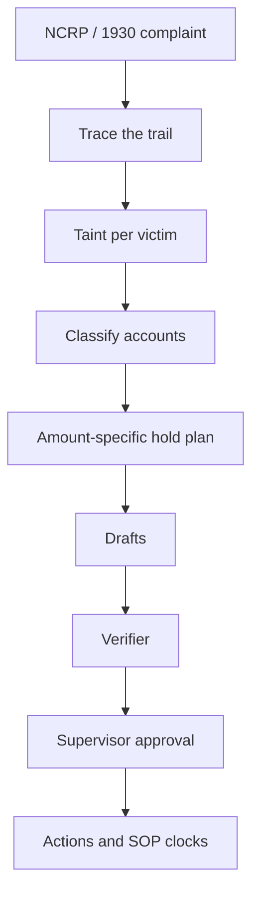

# Wapsi (वापसी)

**A money-trail and victim-restoration copilot for a bank's cyber-fraud nodal officer.**

*Wapsi* means "return". A cyber-fraud victim reports on the National Cybercrime Reporting Portal (NCRP) or the
1930 helpline. The police push the complaint to CFCFRMS, the Citizen Financial Cyber Fraud Reporting and
Management System, which sends hold notices to the banks the money reached. When such a notice arrives, Wapsi
traces the stolen money through the mule accounts, which are accounts used to receive and pass on stolen money. It
works out, to the paisa, how much of each victim's money is still in each account. It then prepares
**amount-specific holds** and the paperwork the MHA/I4C *SOP for NCRP-CFCFRMS, Custody, Restoration of money and
Grievance Redressal* (02.01.2026) asks for. Holds are amount-specific by default; account-level action exists only
as a recorded, supervisor-approved exception, and Wapsi never emits one on its own. A supervisor approves every
action. All data in this repository is synthetic.

!!! tip "Judges: start here"
    Open [`pitch/START_HERE_FOR_JUDGES.md`](../pitch/START_HERE_FOR_JUDGES.md) in the repository: the 60-second
    hook, every headline number with its source file, and a 2-minute tour you can run from a checkout.
    `uv run python pitch/check_numbers.py` re-checks every pitched number against the repository.

    **Entry:** lablab.ai AMD Developer Hackathon ACT III, Track 3 "Reinvent Commerce". The words in every draft,
    the fields read from a complaint and the officer's agent come from Gemma 4 served on AMD GPUs; every number
    comes from data. What runs on AMD and in which mode: [Editions](editions.md).

**At a glance** (the sources are given further down):

- **Showcase fraud.** The victim loses ₹4,80,000.00. A whole-account freeze would lock up ₹5,03,50,000.00 in 6
  accounts. Wapsi holds ₹1,42,848.00 in 5 accounts, all of it the victim's money, and finds ₹3,34,848.00 recoverable.
- **Honest merchants keep trading.** Of what that freeze would lock, ₹5,02,26,200.00 sits in three honest
  accounts: a kirana shop, a landlord and a payment-aggregator pool. Wapsi holds ₹24,000.00 across them, and
  nothing at all from the shop that delivered its goods.
- **The SOP's own worked example** (Annexure-V, Illustration 2) is reproduced to the paisa.
- **Synthetic test world of 39 cases.** Every hold amount matches an independent reference implementation. Nothing
  is held beyond that reference (₹0.00), and no account is held that should not be.
- **A hard world of 64 cases** with five realistic confounders: dispositions 0.9198, and every miss is a label,
  never money (holds exact, over-hold ₹0.00, 0 false freezes).
- **Nothing leaves without a supervisor.** A supervisor can approve a draft only after it passes a separate
  verifier, and every step is sealed into a hash-chained audit log.

## The 2.18% problem

The SOP gives the national figures (Para 2, printed page 9). From April 2021 to November 2025, CFCFRMS kept
**₹7,647 crore** of the **₹52,969 crore** reported from reaching cyber criminals. Only **₹167 crore** had been
restored to victims. That is about **2.18% of the money saved**.
(Source: `data/docs/facts.json`, facts `CFCFRMS_AMOUNT_SAVED`, `CFCFRMS_AMOUNT_REPORTED`,
`CFCFRMS_AMOUNT_RESTORED` and `CFCFRMS_RESTORED_SHARE_OF_SAVED`.)

So stopping the money works much better than returning it. Before money can go back, someone has to show whose
money is in which account, after it has been split, mixed with other funds and passed through several layers.
Freezing whole accounts skips that work and hurts people who did nothing wrong. The SOP and several High Courts
tell banks to hold only the disputed amount. [The full story](overview.md) explains the rules and the court rulings.

## What Wapsi does



1. **Traces** the money from the victim's transfer through every layer at the home bank. Hops to other banks are
   followed through CFCFRMS responses, which are simulated in this repository.
2. **Splits the taint exactly per victim.** "Taint" is the victim money inside an account that also holds other
   money. The default split is pro-rata (SOP Para 5(xiii)); FIFO and LIFO are also available.
3. **Classifies** each account as a mule, a merchant (9.2), a nodal / pool / escrow account (9.1(iii)) or an
   innocent holder (SOP 5(xii)), and gives plain-English reasons. Innocent holders are split into a **bona fide
   recipient** (kept the money as rent, salary or payment) and an **unwitting conduit** (passed most of it on,
   used as a pass-through by someone else). When the evidence is unclear, the account is marked for the officer
   to decide.
4. **Plans amount-specific holds by default**: a hold is `min(victim money in the account, balance)`, a lien on
   that amount. Account-level action is only a recorded, supervisor-approved exception: an officer requests it
   with at least one reason from a closed list, and a different supervisor approves it (maker-checker). Forward
   holds (on future credits) go only on first-layer accounts. Money that has moved to another bank becomes an
   outbound CFCFRMS request. Innocent holders get no escalation and **no automatic STR: the officer decides, and
   an STR is recommended where the account was used as a conduit**.
5. **Checks police / LEA hold requests** against an 8-field checklist, limits the hold to the amount identifiable
   on the trail and drafts a clarification letter for anything missing.
6. **Drafts the paperwork** from templates: hold instruction, customer notice, EDD (enhanced due diligence) memo,
   outbound CFCFRMS request, STR (suspicious transaction report, modelled on FINnet 2.0), CFCFRMS update,
   restoration pack (Process 1 or 2) and the officer's account-level hold request. CFCFRMS actions go through a
   **simulated CFCFRMS interface**, labelled as such.
7. **Verifies every draft** independently of the planner: every amount, account number, UTR, date, citation and
   policy rule. The LLM writes only prose, and only through placeholders.
8. **Waits for a supervisor.** Each approval is bound to the SHA-256 fingerprint of the exact draft and sealed into
   a hash-chained, append-only audit log. Wapsi then tracks the SOP and STR deadlines, counting the STR's seven
   working days on an Indian bank holiday calendar.
9. **Watches the rules.** A read-only regulatory change radar sets new and pending rules (among them the RBI draft
   SOP on money-mule accounts of 11 Sep 2026, a **DRAFT**) against the SOP and shows what each would change for a
   case, for a human to review.
10. **Takes a victim's voice note.** A Hinglish, Hindi or English voice note becomes a transcript, an English
    translation and complaint fields (in the AMD entry: a Whisper-class speech model, then Gemma 4 on AMD). Every
    number in it is a claim reconciled with the ledger; spoken instructions are quoted, never followed; only a
    ledger match opens a case ([Voice intake](voice-intake.md)).
11. **Shows what the AI agent did.** Every tool call the Google ADK agent made on a case, with the guard and
    verifier verdicts around it, is recorded, redacted and sealed into the case's audit log, and shown in the Case
    Room's Agent trace tab ([User guide](user-guide.md#agent-trace-tab)).

## Showcase case: whole-account freeze vs Wapsi

On 10-09-2026 a caller claiming to be from the victim's bank persuades her to move ₹4,80,000.00 by IMPS to a
"safe account". The money passes through three mule accounts at the home bank. The first mule pays ₹5,000.00 of
rent to a landlord, makes two ATM withdrawals of ₹50,000.00 each and sends ₹50,000.00 to another bank. The second
pays ₹1,200.00 to a kirana shop and ₹20,000.00 into a payment-aggregator pool account, then passes ₹2,50,000.00 to
the third, which sends ₹2,00,000.00 to the other bank, where a third ATM withdrawal takes place. The numbers
below are hand-computed in `src/wapsi/fixtures/showcase.py`, and the pipeline reproduces them exactly.

| | Whole-account freeze baseline | Wapsi |
|---|---|---|
| Money immobilised at the home bank | ₹5,03,50,000.00 in 6 accounts | **₹1,42,848.00 in 5 accounts**, only the victim's money |
| Three mule accounts | whole balances frozen (₹1,23,800.00) | ₹43,200.00 + ₹27,648.00 + ₹48,000.00 held |
| Landlord who received ₹5,000.00 rent from the mule | whole account frozen (balance ₹1,55,000.00) | ₹4,800.00 held, no escalation, EDD memo (bona fide recipient, SOP 5(xii)) |
| Kirana shop, goods delivered | whole account frozen (balance ₹51,200.00) | no hold; CFCFRMS update only (SOP 9.2) |
| Payment-aggregator pool account | ₹5,00,20,000.00 frozen | ₹19,200.00 held; the account keeps running (SOP 9.1(iii)) |
| Money now at the other bank | outside this comparison | outbound CFCFRMS requests for ₹48,000.00 and ₹1,44,000.00 |
| Recoverable for the victim | not worked out | **₹3,34,848.00** (home-bank holds + outbound requests) |

The freeze locks 352× what Wapsi holds, and every rupee Wapsi holds is traceable to the victim. It also marks a
forward hold of ₹96,000.00 on the first-layer mule account: the victim money that account sent to the ATMs. A
forward hold is not money in hand, so it is not counted as recoverable, and it gets its own 90-day review clock.

## Key results

All results come from synthetic data. [Evaluation](evaluation.md) explains the method and its limits.

| Check | Result | Where to verify |
|---|---|---|
| The SOP's own worked example (Annexure-V, Illustration 2: five victims, ₹2,06,543 left in the account) | all five pro-rata shares match the SOP to the paisa | `tests/test_sop_annexure_v.py` |
| Showcase cases (one victim, and two victims with an s.106 flag) | every total, hold and disposition matches the hand-computed fixture, and every draft passes verification | `tests/graph/test_graph_showcase.py`, `tests/pipeline/test_pipeline_showcase.py` |
| Demo world: 39 cases, 10 fraud typologies, 3 with injected instructions | hold exact-match 1.0, over-hold ₹0.00, false freezes 0, disposition accuracy 1.0, drafts passing verification 1.0, injection leaks 0 | `evals/reports/demo.json` |
| Demo world: money immobilised | Wapsi ₹29,19,245.69 in 84 accounts; whole-account freeze baseline ₹35,25,90,069.78 in 101 accounts (0.83%) | `evals/reports/demo.json` (`baseline`) |
| Hard world: 64 cases, 15 typologies incl. 5 realistic confounders (seed 7) | holds exact 1.0, over-hold ₹0.00, false freezes 0, drafts passing verification 1.0; dispositions 0.9198; mule P / R 0.8987 / 0.966; innocent-holder P / R 0.9429 / 0.6875 | `evals/reports/hard.json`, [Evaluation](evaluation.md#hard-world) |
| Hard world, held-out seed 101 (62 cases) | holds exact 1.0, 0 false freezes; dispositions 0.9139 with the heuristic, 0.9569 with XGBoost trained on seed 202 | `evals/reports/hard-101.json` |
| Five held-out demo-size worlds (202 cases on unseen seeds, heuristic scorer) | hold exact-match 1.0 and 0 false freezes in every world; innocent-holder recall 0.75 to 1.0; disposition accuracy 0.984 to 1.0 | `evals/reports/classify-after-heldout-*.json`, [Evaluation](evaluation.md) |
| Legal quotes, pinned figures and radar quotes | 121 of 121 checks pass: 35 citation ids (32 verbatim quotes, 3 judgments cited by URL only), 33 pinned facts and 52 regulatory-radar quotes plus the radar registry | `uv run python -m wapsi.search.check_citations` (needs the texts from `wapsi.search.fetch` and `wapsi.search.radar fetch`) |
| Audit log tamper drill | 6 of 6 tampering attempts on a 40-event hash-chained case log detected, plus an edit inside the store | `uv run python -m wapsi.audit drill` |
| Prompt-injection guard, blind holdout (151 texts written without seeing the rules) | precision 0.9661, recall 0.75. The guard is a warning layer: template-bound drafts and the verifier are the real defence | `evals/reports/guard-latest.json` |
| Speed (demo world, laptop, stub LLM) | p95 0.72 s per case, trace to verified drafts | `evals/reports/demo.json` |
| Test suite | 2,226 tests, 0 fail (full suite, 14-10-2026): all pass with the docs index and the demo world built; a fresh clone runs 2,215 and skips 11 that need them (10 docs-search tests and 1 BigQuery-ledger test) | `uv run pytest -q` |

## One core, and what runs on AMD

The portable Python core (`src/wapsi`) and the Streamlit officer app (`ui/`) decide every number. A platform
layer swaps in its own adapters for the ledger, the LLM, the guard and the case store. Details and honest status:
[Editions](editions.md).

| Layer | What it is | Status (2026-10-14) |
|---|---|---|
| AMD (the hackathon entry) | Gemma 4 on AMD GPUs writes the prose, reads complaints and voice-note transcripts and drives the agent (run live on 14-10-2026); a GraphSAGE mule scorer is prepared for ROCm (not yet run on AMD). Three modes: an AMD-hosted endpoint (default), a ROCm notebook, one MI300X with Docker Compose | The core and the prepared AMD layer are tagged `amd-baseline`; event-week work and AMD measurements are listed in [Originality](originality.md). See `editions/amd/` |
| The Google ADK agent | The officer's agent and its tool trace, with Gemma 4 on AMD as its model | Built and tested offline with a scripted model; Gemma 4 on AMD as its model is event-week work |
| Optional managed-cloud adapters | BigQuery ledger, Firestore case store, Model Armor guard, deploy scripts. Not part of the entry | Built and unit-tested offline with fakes; not deployed. See `editions/gcp/README.md` |

## Run it

You need [uv](https://docs.astral.sh/uv/) and Python 3.11 or later. Two commands start the officer app:

```bash
uv sync --extra ui --extra ml --extra docs     # core + officer app + XGBoost option + PDF reader
uv run streamlit run ui/app.py                 # opens on the Inbox
```

The app processes the showcase world with the real pipeline and an offline FakeLLM, so it needs no API keys and
no generated data. To check the results yourself:

```bash
uv run pytest --ignore=tests/gcp --ignore=tests/amd                           # core tests (light install)
uv run python -m wapsi.synth --size demo --seed 7 --out data/generated/demo   # synthetic world + golden set
uv run python -m evals.harness --world demo                                   # writes evals/reports/latest.json
uv run python -m wapsi.synth --size hard --seed 7 --out data/generated/hard   # hard world
uv run python -m evals.harness --world hard                                   # writes evals/reports/hard.json
uv run python -m wapsi.audit drill                                            # audit-chain tamper drill
```

`uv sync --all-extras` also installs the agent, cloud-adapter and AMD training dependencies (PyTorch among
them), which is a much larger download. The [Developer guide](developer-guide.md) covers the rest, including the legal corpus
(`uv run python -m wapsi.search.fetch`, then `uv run python -m wapsi.search.build`).

## Documentation map

| If you want to... | Read |
|---|---|
| Understand the problem, the user and the whole flow | [Overview](overview.md) |
| Use the officer app screen by screen | [User guide](user-guide.md) |
| See how the pieces fit | [Architecture](architecture.md), [Editions](editions.md), [Decision records](adr/README.md) |
| Check the legal basis of every rule | [Legal spine](legal-spine.md), [Glossary](glossary.md) |
| Follow the algorithms | [Money trail](algorithms/money-trail.md), [Hold plan](algorithms/hold-plan.md), [Classification](algorithms/classification.md) |
| Judge whether it can be trusted | [Trust and safety](trust-and-safety.md), [Evaluation](evaluation.md), [Synthetic data](synthetic-data.md) |
| Build on it | [Developer guide](developer-guide.md), [API reference](api-reference.md) |
| Read the contracts | [Data contract](data-contract.md), [Draft contract](draft-contract.md), [Eval report format](eval-report.md) |
| Check what was built when | [Originality](originality.md) |
| Get straight answers | [FAQ](faq.md), [Limitations and roadmap](limitations-and-roadmap.md) |

Outside `docs/`: `README.md`, `AGENTS.md` (conventions every contributor and coding agent follows),
`data/docs/README.md` (the legal corpus and how quotes are checked), `SECURITY.md` and `CONTRIBUTING.md`.

---

Wapsi is decision support for trained officers. It is not legal advice, and it does not act on its own. All
banking data is synthetic and generated by `wapsi.synth`. Public legal texts are downloaded at build time, and
only short attributed quotes are kept in the repository. The code is MIT-licensed.
