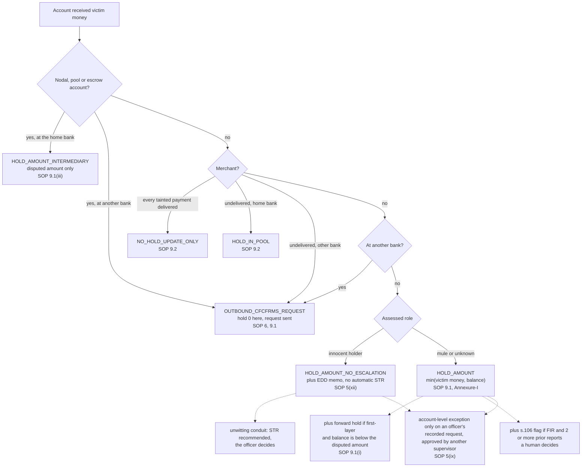
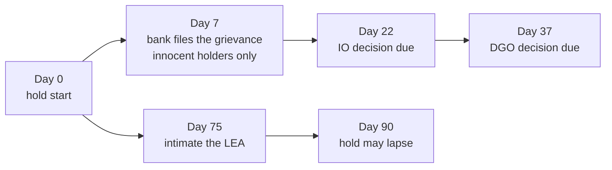

# Legal spine

This page lists every rule Wapsi enforces and where each one comes from. For each rule it gives the paragraph of
the SOP or the law, what Wapsi does, the code that does it, the citation id, and the verbatim quote that id carries.

> **Not legal advice.** Wapsi is decision support for trained bank officers. It drafts and checks. It does not
> decide. The readings of the SOP described below are ours. They are listed in
> [Interpretations we made](#interpretations-we-made) so that a lawyer or compliance officer can challenge them.
> Before you rely on a rule, read the source text.

The main source is the MHA / I4C *Standard Operating Procedure (SOP) for NCRP-CFCFRMS, Custody, Restoration of
money and Grievance Redressal* (02.01.2026). We use the copy circulated by the High Court of Uttarakhand on
18.06.2026. Unfamiliar terms are defined in the [glossary](glossary.md).

---

## In two minutes

Wapsi makes one decision (a *disposition*) for each account that received victim money. It builds that decision
in `build_hold_plan()` (`src/wapsi/graph/holdplan.py`). The verifier then re-checks every hard rule against
the money trail, not against the plan's own fields (`src/wapsi/verify/policy.py`). If a draft breaks a rule, it
fails verification, and a supervisor cannot approve it.

Key facts (each one checked against this repository):

- **16 rules, 35 citation ids.** Every rule below maps to ids in `src/wapsi/citations.py`. 32 of the ids carry a
  verbatim quote of at most 25 words. `uv run python -m wapsi.search.check_citations` re-checks all 35 citations,
  the 33 pinned facts in `data/docs/facts.json` and the 52 quotes of the regulatory radar against the downloaded
  texts. On 2026-09-29 it printed "121/121 checks passed".
- **Amount-specific by default.** Account-level action exists only as a recorded, supervisor-approved exception
  ([R15](#r15-account-level-action-only-as-a-recorded-exception)). The planner never proposes one.
- **Pending rules are labelled.** The RBI draft SOP on suspected money-mule accounts (11 Sep 2026) is a **DRAFT**
  (comments close 2 Oct 2026; proposed effective 1 Apr 2027). Wapsi tracks it on the
  [regulatory radar](#pending-and-changed-rules-the-regulatory-radar) and never treats it as in force.
- **Showcase 1.** The victim loses ₹4,80,000.00. Wapsi holds ₹1,42,848.00 across 5 home-bank accounts. Freezing
  the 6 home-bank accounts the money touched would lock up ₹5,03,50,000.00. Total recoverable, including requests
  to another bank, is ₹3,34,848.00 ([R1](#r1-hold-the-disputed-amount-only), [R7](#r7-money-held-at-any-layer-can-go-back)).
- **The SOP's own arithmetic.** Wapsi reproduces the pro-rata example in SOP Annexure-V, Illustration 2, to the
  paisa (`tests/test_sop_annexure_v.py`, [R6](#r6-pro-rata-apportionment)).
- **Open questions are listed.** Fourteen places where the SOP leaves room, and the reading Wapsi takes, are under
  [Interpretations we made](#interpretations-we-made).

| # | Rule | Source | What Wapsi does | Citation ids |
|---|---|---|---|---|
| [R1](#r1-hold-the-disputed-amount-only) | Hold the disputed amount | SOP 5(ix), 6.1(j), 9.1, Annexure-I | Amount-specific by default: hold at most `min(victim money still in the account, balance)`. No draft may instruct a whole-account or debit freeze outside an approved exception ([R15](#r15-account-level-action-only-as-a-recorded-exception)). | `SOP-5-IX` `SOP-6` `SOP-9-1` `SOP-ANNEX-I` |
| [R2](#r2-forward-holds-only-on-first-layer-accounts) | Forward holds only on first-layer accounts | SOP 9.1(i), 12(x) | Forward lien only on a layer-1 account whose balance is below the victim money it received. Never on a nodal, pool or escrow account. | `SOP-9-1-I` `SOP-DEF-FIRST-LAYER` |
| [R3](#r3-nodal-pool-and-escrow-accounts) | Nodal, pool and escrow accounts | SOP 9.1(iii), 9.1(i) | `HOLD_AMOUNT_INTERMEDIARY`: hold the disputed amount. No suspension, no seizure, no forward hold, no s.106 flag. | `SOP-9-1-III` |
| [R4](#r4-merchants) | Merchants | SOP 9.2 | Goods delivered for every tainted payment: no hold, update only. Otherwise the undelivered amount is held in the pool. | `SOP-9-2` |
| [R5](#r5-innocent-account-holders) | Innocent account holders | SOP 5(xii), 10.1 | Hold the amount only. EDD memo. Never an escalation flag, never named in the automatic STR. Bona fide recipient or unwitting conduit: no automatic STR; the officer decides, and an STR is recommended where the account was used as a conduit. | `SOP-5-XII` `SOP-10-1` |
| [R6](#r6-pro-rata-apportionment) | Pro-rata apportionment | SOP 5(xiii), Annexure-V | Every rupee is tagged with its complaint. Mixed money leaves an account pro-rata. Annexure-V Illustration 2 is reproduced to the paisa. | `SOP-5-XIII` `SOP-ANNEX-V` |
| [R7](#r7-money-held-at-any-layer-can-go-back) | Release at any layer | SOP 5(x) | Holds at every layer, and requests to other banks, count towards each victim's recoverable amount. | `SOP-5-X` |
| [R8](#r8-restoration-processes-1-to-5) | Restoration processes 1 to 5 | SOP 11 | Proposes Process 2 when more than one victim has recoverable money, otherwise Process 1. Never proposes Processes 3 to 5. | `SOP-11-P1` … `SOP-11-P5` |
| [R9](#r9-grievances-and-the-90-day-lapse) | Grievances and the 90-day lapse | SOP 10.1, Annexure-I | Grievance, lapse and restoration clocks in calendar days. The 90 days run from the hold date. | `SOP-10-1` |
| [R10](#r10-the-s106-bnss-escalation-flag) | s.106 BNSS escalation | SOP 9.1, 6.1(i); BNSS s.106, s.107 | A flag only: needs an FIR and at least 2 prior NCRP reports. The hold stays amount-specific and a human decides. | `BNSS-106` `CASE-KARTIK-CHATUR` |
| [R11](#r11-suspicious-transaction-report) | Suspicious transaction report | PML Rules 2(1)(g), 8; FIU-IND FAQ | STR draft with a Rule 2(1)(g) ground. Due 7 working days (Indian bank-holiday calendar) after the STR is approved. | `PMLR-2-1-G` `PMLR-8` |
| [R12](#r12-informing-the-account-holder-is-not-tipping-off) | Not tipping-off | SOP 9.1(ii); FIU-IND circular 02.06.2025 | The customer notice explains the hold and never mentions an STR. | `SOP-9-1-II` `FIU-CIRC-2025-06-02` |
| [R13](#r13-money-that-reached-another-bank) | Money at another bank | SOP 6.1(j), 9.1 | Outbound CFCFRMS request: hold 0 here, request amount = victim money there. Prepared through a simulated CFCFRMS interface. | `SOP-6` `SOP-9-1` |
| [R14](#r14-never-invent-a-clause) | Never invent a clause | project rule | Only the 35 registered citation ids may appear in a draft. | all |
| [R15](#r15-account-level-action-only-as-a-recorded-exception) | Account-level action only as a recorded exception | SOP 5(ix), 9.1 | Never automatic. An officer's request with at least one reason from a closed list, approved by a different supervisor; the amount-specific hold stays the recoverable amount. | `SOP-5-IX` `SOP-9-1` |
| [R16](#r16-police-and-lea-hold-requests) | Police / LEA hold requests | SOP 9.1, Annexure-I, 5(ix); BNSS s.94, s.168 | 8-field completeness checklist; hold limited to the identifiable amount; clarification letter for missing fields. | `SOP-9-1` `SOP-ANNEX-I` `SOP-5-IX` `BNSS-94` `BNSS-168` |

How Wapsi picks the disposition for one account (layer 1 or deeper):



A holding disposition always holds money. If nothing is left to hold, the account gets `CASHED_OUT` (the money
went to an ATM or a crypto exchange) or `NO_ACTION`. A first-layer account with nothing left can still get a
`FORWARD_HOLD`. Victim accounts (layer 0) never get a decision.

---

## How citations work

Code refers to legal sources only by citation id. The ids are defined in `src/wapsi/citations.py` (35 ids,
`KNOWN_IDS`). The verbatim quotes are in `data/docs/citations.json`, with a packaged copy in
`src/wapsi/_data/citations.json`.

- Each quote is at most 25 words. It is copied word for word from the downloaded source. A quote may join two
  parts of one passage with "…".
- 32 ids carry a quote. Three judgments reported only by news or blog sites (`CASE-NEELKANTH`,
  `CASE-KARTIK-CHATUR`, `CASE-SHREE-BALAJI`) carry a source URL and an empty quote. Wapsi does not fetch or
  store their text.
- If a draft contains a `[ID]` token that is not in the registry, or uses an id without declaring it, the
  verifier fails the draft (`check_citations()` in `src/wapsi/verify/citations.py`).
- **Page numbers are physical pages of the downloaded PDF.** The SOP PDF starts with the two-page High Court
  circular, so the SOP's own printed page number is the PDF page minus 2. For example, SOP PDF p. 26 is printed
  page 24. HTML sources have no page.

| Source id | Document | Used for |
|---|---|---|
| `sop-2026` | MHA/I4C SOP, 02.01.2026, from the High Court of Uttarakhand circular of 18.06.2026 | every `SOP-*` id; also `FIU-CIRC-2025-06-02`, `CASE-SAJEER` and `CASE-SAIFULLAH`, which the SOP itself summarises |
| `bnss-2023` | Bharatiya Nagarik Suraksha Sanhita, 2023, India Code consolidated PDF | `BNSS-94`, `BNSS-106`, `BNSS-107`, `BNSS-168` |
| `pmlr-2005` | PML (Maintenance of Records) Rules, 2005, consolidated text from FIU-IND | `PMLR-2-1-G` |
| `fiu-faq` | FIU-IND Frequently Asked Questions (HTML) | `PMLR-8` |
| `rbi-frm-dir-2026` | Reserve Bank of India (Commercial Banks – Fraud Risk Management) Directions, 2026, RBI/DoS/2026-27/412, 31.07.2026 (HTML). They apply to Commercial Banks only. Para 67 repeals the existing fraud-risk directions, instructions and guidelines for Commercial Banks; the repealed circulars are listed in circular DoS.CO.PPG.66/11.01.005/2026-27, and RBI's list of circulars withdrawn by the Department of Supervision names the 2024 Master Directions (which had also covered RRBs and AIFIs) | `RBI-FRM-DIR-2026` (Para 24), `RBI-FRM-DIR-2026-EWS` (Para 12) |

Each quote, and each figure in `data/docs/facts.json`, is re-checked against the downloaded documents:

```bash
uv run python -m wapsi.search.fetch             # download the public texts to data/docs/raw/ (not redistributed)
uv run python -m wapsi.search.radar fetch       # the radar's extra documents (a draft, repeal texts; not indexed)
uv run python -m wapsi.search.check_citations   # 35 citations + 33 facts + 52 radar quotes; "121/121 checks passed"
```

The checker needs `pypdf` (the `docs` extra). Where each document came from, and its SHA-256, is recorded in
`data/docs/MANIFEST.md`. `data/docs/README.md` explains how the corpus is built.

---

## The rules

### R1. Hold the disputed amount only

**Sources**

> "Unwarranted orders for freezing accounts shall be discouraged, and accountability measures shall be
> established." — `SOP-5-IX`, SOP Para 5(ix), PDF p. 15

> "The beneficiary bank or FI will put on hold an amount to the extent of the amount reported and update the same
> on CFCFRMS." — `SOP-6`, SOP Para 6.1(j), PDF p. 18

> "the bank nodal officer or any officer working on her behalf shall put the amount on hold and update the records"
> — `SOP-9-1`, SOP Para 9.1, PDF p. 25

> "Hold the amount equivalent to the Disputed amount received in A/c No." — `SOP-ANNEX-I`, SOP Annexure-I
> (notice under s.168 read with s.94 BNSS), PDF p. 62

The hold notice rests on s.168 read with s.94 BNSS (`BNSS-168`, PDF p. 68; `BNSS-94`, PDF p. 43). Five court
rulings point the same way. See [Court rulings](#court-rulings).

**What Wapsi does**

- For each home-bank account, the hold is `r2(min(tainted_now, max(balance, 0)))`. Here `tainted_now` is the
  victim money still in the account after pro-rata tracing ([R6](#r6-pro-rata-apportionment)). The hold never
  includes the holder's own money. Holds are amount-specific by default; account-level action is only a recorded,
  supervisor-approved exception ([R15](#r15-account-level-action-only-as-a-recorded-exception)), and even then the
  hold amount stays this figure.
- If the balance covers only part of the victim money, the decision gets reason code `HOLD_CAPPED_AT_BALANCE`.
- The plan records `over_hold_amount`, which must be ₹0.00. It also records `baseline_freeze_amount`: what
  freezing every touched home-bank account would lock up: the whole-account freeze baseline. The UI and the
  CFCFRMS update show it for comparison only, never as a recommendation.
- No draft may *instruct* a whole-account freeze, a debit freeze, or a hold or block on the account itself,
  unless it is the hold instruction of an approved account-level exception. The
  detector allows negated, descriptive and counterfactual sentences, such as "compared with a full freeze of
  ₹5,03,50,000.00". It also allows a freeze whose object is an amount, such as "a freeze of ₹43,200.00".

**Code**

- `build_hold_plan()` in `src/wapsi/graph/holdplan.py`. `DISPOSITION_CITATIONS[HOLD_AMOUNT]` =
  `SOP-9-1`, `SOP-ANNEX-I`, `SOP-5-IX`.
- `check_decision()` in `src/wapsi/verify/policy.py`. It recomputes the cap from the trace with `hold_cap()`
  and fails `over_hold` or `hold_without_holding_disposition`. `check_plan()` fails `over_hold` and
  `plan_total_mismatch`.
- `check_draft_policy()` runs `freeze_instructions()` on every draft's title and body and fails
  `whole_account_freeze` if it finds an instruction. The message cites `[SOP-5-IX] [CASE-KARTIK-CHATUR]`.
- `hold_instruction.j2` cites `CASE-NEELKANTH` and `CASE-SHREE-BALAJI` for the lien-not-freeze principle.

**Worked example.** This is Showcase 1 in `src/wapsi/fixtures/showcase.py`. The victim sends ₹4,80,000.00 by
IMPS to mule account A (`HB01-1000000001`). A already held ₹20,000.00 of its own, so 96% of its money is the
victim's. After onward transfers A's balance is ₹45,000.00, and ₹43,200.00 of that is victim money. Wapsi holds
₹43,200.00. Across the home bank:

| Account | Role | Balance | Victim money in it | Wapsi hold |
|---|---|---:|---:|---:|
| A `HB01-1000000001` | mule, layer 1 | ₹45,000.00 | ₹43,200.00 | ₹43,200.00 |
| B `HB01-1000000002` | mule, layer 2 | ₹28,800.00 | ₹27,648.00 | ₹27,648.00 |
| L `HB01-2000000001` | landlord (innocent holder), layer 2 | ₹1,55,000.00 | ₹4,800.00 | ₹4,800.00 |
| D `HB01-1000000003` | mule, layer 3 | ₹50,000.00 | ₹48,000.00 | ₹48,000.00 |
| P `HB01-9000000001` | payment-aggregator pool, layer 3 | ₹5,00,20,000.00 | ₹19,200.00 | ₹19,200.00 |
| K `HB01-3000000001` | kirana merchant, goods delivered, layer 3 | ₹51,200.00 | ₹1,152.00 | none (update only) |
| **Total** | | **₹5,03,50,000.00** (whole-account freeze of 6 accounts) | | **₹1,42,848.00** (5 accounts) |

**Tests.** `tests/graph/test_graph_showcase.py`, `tests/verify/test_verify_plan.py`
(`test_freeze_instruction_detector`) and `tests/verify/test_verify_policy_extra.py`.

### R2. Forward holds only on first-layer accounts

**Sources**

> "hold shall be placed only in the case of first-layer accounts … Such holds shall not be applied to nodal, pool
> and escrow accounts." — `SOP-9-1-I`, SOP Para 9.1(i), PDF p. 26

> "First-layer accounts: A bank account which receives the de-frauded money directly from the bank account of
> victim reporting on NCRP-CFCFRMS." — `SOP-DEF-FIRST-LAYER`, SOP Para 12(x), PDF p. 57

Para 9.1(i) describes this hold for an account that does not have enough balance. Its purpose is to stop the
account being used again for money taken from a later victim.

**What Wapsi does**

- A forward hold (a lien on future credits) is marked only when all four conditions hold:
  1. the account is at layer 1;
  2. its role is mule, unknown or victim-on-trail;
  3. it is not a nodal, pool or escrow account;
  4. its balance is below the victim money it received.
- The amount is the victim money this account sent to ATM or crypto exits, or to destinations the trace could
  not locate. Money it sent to accounts the trace followed, or to another bank that is asked to hold it, is not
  counted again.
- Reason code `FORWARD_HOLD_FIRST_LAYER`. The disposition stays `HOLD_AMOUNT` when there is also money to hold
  now. It is `FORWARD_HOLD` when there is not.
- A forward hold is not money in hand. It is excluded from `total_recoverable` and from each victim's recoverable
  amount.

**Code.** `build_hold_plan()` and `forward_hold_vectors()` in `src/wapsi/graph/holdplan.py`. In
`src/wapsi/verify/policy.py`, `check_decision()` fails `forward_hold_not_first_layer` and warns
`forward_hold_unneeded` when the balance already covers the disputed amount. `_check_intermediary()` fails
`forward_hold_on_intermediary`.

**Worked examples.**

- Showcase 1. A (layer 1) received ₹4,80,000.00 and has a balance of ₹45,000.00. It withdrew ₹48,000.00 of
  victim money at an ATM twice, so it gets a forward hold of ₹96,000.00. The ₹48,000.00 it sent to account C at
  another bank is requested from that bank ([R13](#r13-money-that-reached-another-bank)), so it is not counted
  again.
- Showcase 2. Mule M received ₹1,60,000.00 from two victims and has a balance of ₹1,20,000.00. ₹40,000.00 left by
  ATM, so M gets a forward hold of ₹40,000.00.
- Pool account P gets no forward hold, whatever its balance.

**Tests.** `tests/graph/test_graph_showcase.py`, `tests/verify/test_verify_plan.py` and
`tests/draft/test_draft_drafter.py` (`test_pool_account_hold_instruction`).

### R3. Nodal, pool and escrow accounts

**Source**

> "where CFCFRMS notifies for action against a nodal, escrow, or pool account, the bank shall hold the disputed
> amount" — `SOP-9-1-III`, SOP Para 9.1(iii), PDF p. 26

In the same paragraph, the SOP asks law enforcement agencies (LEAs) to normally refrain from ordering suspension
of digital banking services or seizure of such accounts, except where other measures are not sufficient. That
exception is the LEA's call, so Wapsi never instructs either. Para 9.1(i) rules out forward holds on these
accounts ([R2](#r2-forward-holds-only-on-first-layer-accounts)).

**What Wapsi does**

- A home-bank `NODAL`, `POOL` or `ESCROW` account (`INTERMEDIARY_ACCOUNT_TYPES`) gets
  `HOLD_AMOUNT_INTERMEDIARY`. The amount is `min(victim money, balance)`, with reason code
  `NO_SUSPENSION_OR_SEIZURE`. If nothing is holdable, it gets `NO_ACTION`. The same account at another bank
  becomes an outbound CFCFRMS request.
- It never gets a forward hold or an s.106 flag. `HOLD_AMOUNT_INTERMEDIARY` is reserved for these account
  types.
- The hold instruction says that only the disputed amount is held, that digital banking is not suspended, and
  that the account is not seized. The customer notice goes to the payment aggregator or intermediary, not to
  an individual.
- The trace treats these accounts as terminals. They keep victim money only while their balance covers it.
  Their payouts never taint the receiving account.

**Code.** `build_hold_plan()`. `account_role()` maps these account types to `Role.INTERMEDIARY` before any
score is used. `_check_intermediary()` fails `intermediary_disposition`, `forward_hold_on_intermediary` and
`intermediary_escalated`. `check_decision()` fails `intermediary_disposition_misused`. `check_draft_policy()`
runs `suspension_instructions()` on every draft and fails `suspension_or_seizure` when a draft instructs
suspension or seizure. It also warns `intermediary_rule_not_stated`.

**Worked example.** B sent ₹20,000.00 to pool account P, and ₹19,200.00 of it was victim money. P's balance is
₹5,00,20,000.00. Wapsi holds ₹19,200.00, which is 0.04% of the balance. A whole-account freeze would have
locked up the money of every other customer the aggregator serves.

**Tests.** `tests/verify/test_verify_plan.py`, `tests/verify/test_verify_policy_extra.py`
(`test_suspension_and_seizure_instructions_are_caught`, `test_negated_or_descriptive_suspension_mentions_are_allowed`)
and `tests/draft/test_draft_drafter.py` (`test_pool_account_notice_is_addressed_to_the_intermediary`).

### R4. Merchants

**Source**

> "It will cancel the order if delivery of goods or services is not made, and the amount shall be held back"
> — `SOP-9-2`, SOP Para 9.2(i)(a), PDF p. 28

Para 9.2(i)(d) says that where goods or services have been delivered, the e-commerce company updates the order
and delivery details on CFCFRMS. Para 9.2 is addressed to the merchant or e-commerce company. Wapsi works for the
bank that keeps the merchant's account, so it applies the same split from the bank's side
([Interpretations](#interpretations-we-made), item 12).

**What Wapsi does**

- A `MERCHANT` account is update-only (`NO_HOLD_UPDATE_ONLY`) only if **every** tainted payment into it has a
  `DELIVERED` invoice of its own. A payment with no invoice is "unproven". It is not treated as delivered.
- Otherwise the merchant gets `HOLD_IN_POOL`: the order is cancelled and the undelivered victim money is held in
  the pool or nodal account, `min(undelivered, balance)`. A merchant at another bank gets an outbound request for
  the undelivered part only.
- The classifier also treats a `BUSINESS` account as a merchant when it has an active GSTIN and every tainted
  payment into it has a delivered invoice (`hard_rules()` in `src/wapsi/classify/rules.py`).

**Code.** `build_hold_plan()` together with `delivery_fractions()`, `merchant_undelivered()` and
`fully_delivered()` in `src/wapsi/graph/common.py`. `merchant_delivery()` and `check_decision()` in
`src/wapsi/verify/policy.py` fail `delivered_merchant_held`, `update_only_undelivered_merchant`,
`update_only_non_merchant` and `update_only_with_hold`.

**Worked example.** B paid kirana shop K ₹1,200.00, and ₹1,152.00 of it was victim money. Invoice
`INV-K-5521` shows the goods were delivered. K gets no hold and appears in the CFCFRMS update only. In the trace
totals, that ₹1,152.00 is `merchant_settled`.

**Tests.** `tests/graph/test_graph_showcase.py`, `tests/verify/test_verify_plan.py`,
`tests/verify/test_verify_review_fixes.py` and `tests/classify/test_classify_showcase.py`.

### R5. Innocent account holders

**Sources**

> "An IO must take into account the possibility of reported accounts being operated without the knowledge or
> connivance or consent of the account holder" — `SOP-5-XII`, SOP Para 5(xii), PDF p. 16

Para 10.1(a) (`SOP-10-1`, PDF p. 39) has the bank carry out enhanced due diligence (EDD). If the bank is
convinced the transaction is genuine, it submits the holder's grievance to the Grievance Redressal Module.

**What Wapsi does**

- The classifier gives a score in [0, 1]. A score of 0.6 or more means `MULE`, and 0.35 or less means
  `INNOCENT_HOLDER`. Anything in between is `UNKNOWN` (`ClassifyConfig`). A safety guard turns an innocent score
  into `UNKNOWN` when the account did something a genuine holder normally would not do with the money
  (`innocent_blockers()` in `src/wapsi/classify/rules.py`):
  - sent at least half of it on to accounts it had never paid before, with a median delay of two hours or less;
  - withdrew at least half of it in cash or sent it to crypto;
  - shares a device with another account that received the same money;
  - woke from dormancy around the time of the fraud;
  - was reported on NCRP twice or more before.
- An innocent-band account is split in two (`conduit_indicators()` in `src/wapsi/classify/rules.py`):
  - a **bona fide recipient** (`Role.BONA_FIDE_RECIPIENT`, wire value `INNOCENT_HOLDER`) kept the money as rent,
    salary or payment;
  - an **unwitting conduit** (`Role.UNWITTING_CONDUIT`) passed on at least half of the victim money it received:
    it was used as a pass-through by someone else.
- Both (and `LEGIT`) get `HOLD_AMOUNT_NO_ESCALATION`. The amount is still held, there is no escalation flag, and
  an EDD memo is drafted. The hold instruction adds an "Innocent-holder handling" section.
- **No automatic STR: the officer decides, and an STR is recommended where the account was used as a conduit.**
  A bona fide recipient gets no extra reason code and no STR recommendation by default. An unwitting conduit's
  decision carries `UNWITTING_CONDUIT` and `STR_RECOMMENDED_OFFICER_DECISION` with `requires_human=True`, and its
  EDD memo sets `str_recommended=True` and `str_decision="OFFICER"`. The RBI DRAFT defines a money-mule account
  as one used "knowingly or unknowingly" on behalf of another person; radar row `RR-04` tracks what that would
  change ([Pending and changed rules](#pending-and-changed-rules-the-regulatory-radar)).
- Neither kind of innocent holder is ever an automatic STR subject or identified in the automatic STR, at any
  bank. Their amounts appear only as unnamed transaction amounts. Golden sets keep the single label
  `INNOCENT_HOLDER` (`wapsi.models.legacy_role` maps both roles onto it for scoring).
- An `UNKNOWN` account is not treated as innocent. It gets `HOLD_AMOUNT` with `requires_human=True` and reason
  code `ROLE_UNKNOWN`.

**Code.** `classify_trace()` and `role_from_score()` in `src/wapsi/classify/__init__.py`; `build_hold_plan()`.
In `src/wapsi/verify/policy.py`: `_check_escalation()` fails `innocent_escalated`; `check_str()` fails
`innocent_in_str` if the holder's account number or name appears anywhere in the STR; `check_draft_policy()`
fails `edd_memo_wrong_disposition` and `edd_conduit_str_missing`; `check_decision()` warns
`innocent_disposition`, and fails `conduit_str_not_recommended`, `conduit_without_human` and
`bona_fide_str_recommended` when the split is not carried through.

**Worked example.** Mule A paid landlord L ₹5,000.00 of rent, and ₹4,800.00 of it was victim money. L has an
account opened in 2019 with a ₹1,55,000.00 balance, no prior reports and FRI `NONE`. Wapsi holds ₹4,800.00 as
`HOLD_AMOUNT_NO_ESCALATION` and drafts an EDD memo. L kept the money, so it is a bona fide recipient: no STR is
recommended, and the STR does not name L.

**Tests.** `tests/verify/test_verify_drafts.py`, `tests/verify/test_verify_review_fixes.py`,
`tests/verify/test_verify_innocent_split.py`, `tests/classify/test_classify_innocent_split.py` and
`tests/draft/test_draft_drafter.py`.

### R6. Pro-rata apportionment

**Sources**

> "such attribution is not possible due to commingling of amounts belonging to different victims, the principle
> of equitable or pro-rata distribution will be adopted." — `SOP-5-XIII`, SOP Para 5(xiii)(b), PDF p. 16

> "owing to money mixing, attribution to the actual victim(s) is not possible. Therefore, the interim custody is
> released on a pro rata basis." — `SOP-ANNEX-V`, SOP Annexure-V Illustration 2, PDF p. 97

> "the IO or Police Officer shall ascribe the said amount in accordance with Para 5(xiii) of this SOP."
> — `SOP-11-P2`, SOP Para 11 Process 2(d), PDF p. 49

**What Wapsi does**

- Every victim transfer starts a *taint vector* keyed by the complaint's NCRP number. The trace replays every
  transaction of the candidate accounts in time order. When an account with balance `B` and taint vector `τ`
  pays out `a`, the payment carries `a × τ[v] / B` of each victim `v`'s money (`PRO_RATA`, the default).
  Legitimate credits dilute the victim share. Within the same second, a credit into an account is applied before
  the debits it funds.
- `FIFO` and `LIFO` are available through `TraceConfig.rule`. They can only be set in configuration, not in the
  UI.
- When a hold is smaller than the victim money in the account, the per-victim split is rounded to the paisa by
  largest remainder. The parts add up exactly to the hold, and no victim gets more than their own money
  (`_scale()` in `holdplan.py`).
- `src/wapsi/synth/reference.py` is a separate implementation of the same rules. It shares no code with
  `wapsi.graph` and produces the golden answers for the evaluation.

**Code.** `simulate()` in `src/wapsi/graph/taint.py`; `_scale()` in `src/wapsi/graph/holdplan.py`.
`check_decision()` in `src/wapsi/verify/policy.py` fails `per_victim_exceeds_taint` and
`per_victim_exceeds_amount`.

**Worked example: the SOP's own Illustration 2** (`tests/test_sop_annexure_v.py`). Five complainants credit
one mule account on 15.12.2024. A debit of ₹47,226.00 follows, leaving ₹2,06,543.00. Wapsi's per-victim shares
match the SOP to the paisa:

| Complainant | Credit | SOP share (Annexure-V, PDF p. 98) | Wapsi hold for the victim |
|---|---:|---:|---:|
| V | ₹85,326.00 | ₹69,446.97 | ₹69,446.97 |
| W | ₹38,443.00 | ₹31,288.82 | ₹31,288.82 |
| X | ₹50,000.00 | ₹40,695.08 | ₹40,695.08 |
| Y | ₹50,000.00 | ₹40,695.08 | ₹40,695.08 |
| Z | ₹30,000.00 | ₹24,417.05 | ₹24,417.05 |
| **Total** | ₹2,53,769.00 | ₹2,06,543.00 | ₹2,06,543.00 |

These figures are also recorded as facts `ANNEX_V_ILL2_*` in `data/docs/facts.json`. In Showcase 2, mule M keeps
₹1,20,000.00, of which ₹75,000.00 belongs to complaint `31109260000102` and ₹45,000.00 to complaint
`31109260000103`.

**Where attribution is possible.** Para 5(xiii)(a) comes first: where the amount can reasonably be attributed
to a victim, it goes to that victim. Annexure-V Illustration 1 shows such a case, attributed by the order of
credits and debits. Wapsi's default rule is still pro-rata. This matters; see
[Interpretations we made](#interpretations-we-made), item 2.

### R7. Money held at any layer can go back

**Source**

> "Money lost in CEFCs and held with the banks and FIs, at any layer, can be released to the victim"
> — `SOP-5-X`, SOP Para 5(x), PDF p. 15

Para 5(xi) adds a related point. Where the balance is below the disputed amount, the bank is not expected to
return money that has already moved on. That paragraph has no citation id in the registry, so it is paraphrased
here.

**What Wapsi does**

- `per_victim_recoverable` adds, for each complaint, the victim money in every holding disposition and every
  outbound request. Holding dispositions include nodal, pool and escrow holds and undelivered-goods holds
  (`HOLD_IN_POOL`). In Showcase 1 this covers accounts at layers 1 to 4. Forward holds are not included.
- `total_recoverable` = `total_hold` + outbound request amounts.
- The restoration pack cites `SOP-5-X` next to the attribution sheet. If a nodal, pool or escrow hold is part of
  it, the pack says so.

**Worked example.** In Showcase 1 the victim lost ₹4,80,000.00. Wapsi holds ₹1,42,848.00 across layers 1 to 3 at
the home bank. It also requests ₹48,000.00 (account C, layer 2) and ₹1,44,000.00 (account E, layer 4) from the
other bank. Total recoverable: ₹3,34,848.00. The remaining ₹1,45,152.00 is ₹1,44,000.00 withdrawn at ATMs and
₹1,152.00 paid for delivered goods.

### R8. Restoration processes 1 to 5

Para 11 of the SOP offers five alternative processes for giving the victim interim custody of held money.

| Process | SOP | Quote (PDF page) | What Wapsi does |
|---|---|---|---|
| P1 | Single victim, interim custody under s.106(3) BNSS | "Interim custody of amount below Rs. 50,000 put on hold can be given u/s 106(3) of the BNSS 2023" — `SOP-11-P1` (p. 45) | Proposed when at most one victim has recoverable money. Wapsi drafts the restoration pack and starts the P1 clocks. |
| P2 | Multiple victims or competing claims | "the IO or Police Officer shall ascribe the said amount in accordance with Para 5(xiii) of this SOP." — `SOP-11-P2` (p. 49) | Proposed when more than one victim has recoverable money. Each decision also cites `SOP-5-XIII` and `SOP-11-P2`. If a plan has more than one victim but does not say P2, the verifier fails `restoration_process`. |
| P3 | Competent court, s.497 / 498 / 503 BNSS | "may be made under Section 497 or Section 498 or 503 BNSS (451 or 457 CrPC) by the victim in the jurisdictional Courts." — `SOP-11-P3` (p. 51) | Never proposed. The value exists in `RestorationProcess`. No clocks are started, because courts set their own timelines. |
| P4 | Attachment, forfeiture or restoration under s.107 BNSS | "for the purpose of attachment, forfeiture or restoration of property may follow the procedure laid down in section 107 of BNSS" — `SOP-11-P4` (p. 52) | Never proposed. |
| P5 | Process directed by the jurisdictional court | "In case any Court prescribes processes other than those mentioned above, the same may be followed." — `SOP-11-P5` (p. 53) | Never proposed. |

For P4, BNSS s.107(6) provides for rateable distribution: "direct the District Magistrate to rateably distribute
such proceeds of crime to the persons who are affected by such crime." — `BNSS-107`, BNSS PDF p. 48.

The restoration pack (`restoration_pack.j2`) has seven parts:

- **A.** Attribution sheet.
- **B.** Bank no-objection certificate.
- **C.** Remittance letter.
- **D.** Indemnity bond. In Process 1(iv) and 2(f) the victim executes one before custody is given.
- **E.** Supurdignama (certificate of custody). Process 1(viii) and 2(l) have it updated on NCRP-CFCFRMS.
- **F.** Timeline.
- **G.** Escalation flags.

Parts B to E are templates for people to sign. Wapsi signs nothing and remits nothing.

**Code.** `build_hold_plan()` (P1 or P2 only); `check_plan()`; `_restoration_pack()` in
`src/wapsi/draft/drafter.py`; `_restoration_clocks()` in `src/wapsi/domain/clocks.py`.

**Worked example.** Showcase 1 is P1: one victim, ₹3,34,848.00 recoverable. Showcase 2 is P2: two victims, with
₹75,000.00 and ₹45,000.00. Annexure-V Illustration 2 is P2: five victims.

### R9. Grievances and the 90-day lapse

**Source**

> "within 90 calendar days of the grievance being submitted by the bank, then within 15 calendar days before the
> expiry of these 90 calendar days" — `SOP-10-1`, SOP Para 10.1, PDF p. 41

**The SOP counts the 90 days from two different start points.**

| Where | Start of the 90 days | What happens | Fact id (`data/docs/facts.json`) |
|---|---|---|---|
| Para 10.1 (PDF p. 41) | the day **the bank submits the grievance** | Applies to holds contested through the grievance mechanism. If no lawful direction arrives, the bank intimates the LEA about 15 days before the 90 days end (one sentence says "within", a later one "at least", 15 calendar days before). Subject to the conditions the paragraph lists (the amount is not needed in another case, no court petition, no request for an extension), the bank then removes the hold after EDD, on the holder's request and as the LEA instructs. The LEA may ask for up to 90 more days. | `HOLD_LAPSE_DAYS_AFTER_GRIEVANCE`, `HOLD_LAPSE_INTIMATION_DAYS`, `HOLD_EXTENSION_DAYS` |
| Annexure-I, direction 3 (PDF p. 62) | the date **the amount was put on hold** | The bank may remove a hold that the holder contested on the grievance module once 90 days have passed. The notice lists three further conditions, joined by "or": the amount is not needed in another case, no court petition for its release is pending, no LEA has asked for an extension. | `HOLD_LAPSE_DAYS_ANNEX_I` |

**Wapsi uses the Annexure-I start point: the hold date.** The `HOLD_LAPSE` clock runs 90 calendar days from
the hold start. The `HOLD_LAPSE_WARNING` clock (intimate the LEA) is due on day 75 and turns to WARNING 7 days
before that. Both clocks cite `SOP-10-1`. A grievance can only be filed after the hold is placed, so the hold date is
never later than the grievance date. Wapsi's deadline therefore comes no later than the Para 10.1 deadline would.
It is the cautious choice for reminders, but it can remind the officer before Para 10.1 strictly requires. The
hold start is, in order:

1. when a `HOLD_INSTRUCTION` action was executed;
2. otherwise, when the hold instruction draft was approved;
3. otherwise, when the trace was computed. The clock is then marked provisional.

All the clocks Wapsi keeps, with the SOP's start point next to Wapsi's:

| Clock | Length | The SOP starts it at | Wapsi starts it at | Citation |
|---|---|---|---|---|
| `HOLD_LAPSE` | 90 calendar days | grievance submitted (10.1) or hold placed (Annexure-I) | hold start, for every holding disposition | `SOP-10-1` |
| `HOLD_LAPSE_WARNING` | day 75 | at least 15 days before the 90 days end (10.1) | hold start + 75 days | `SOP-10-1` |
| `GRIEVANCE_FILING` | 7 calendar days | the day the aggrieved person complains to the bank (10.1(a)) | hold start; only for `HOLD_AMOUNT_NO_ESCALATION` | `SOP-10-1` |
| `IO_DECISION` | 15 calendar days | receipt of the grievance (10.1(d), (e)) | due date of `GRIEVANCE_FILING` | `SOP-10-1` |
| `DGO_ESCALATION` | 15 calendar days | the District Grievance Officer being notified, which happens automatically after the IO's 15 days (10.1(f)) | due date of `IO_DECISION` | `SOP-10-1` |
| `BANK_DATA` | 2 calendar days | a request for information during grievance disposal (10.1(f)) | trace computation, for every case | `SOP-10-1` |
| `P1_NOTICE` | 7 calendar days | the IO acting on the victim's verified custody request (Process 1(i), 2(a)) | complaint `reported_at` | `SOP-11-P1` / `SOP-11-P2` |
| `P1_REPLY` | 15 calendar days | the notice (Process 1(ii), 2(b)) | due date of `P1_NOTICE` | `SOP-11-P1` / `SOP-11-P2` |
| `P1_REMIT` | 15 calendar days | the bank receiving the IO's order (Process 1(v), 2(h)) | due date of `P1_REPLY` | `SOP-11-P1` / `SOP-11-P2` |
| `STR_DUE` | 7 **working** days | being satisfied that the transaction is suspicious (FIU-IND FAQ) | approval of the STR draft; provisionally, trace computation | `PMLR-8` |

The day counts for each clock are recorded as facts in `data/docs/facts.json`, each with its page:
`GRIEVANCE_FILING_DAYS`, `IO_DECISION_DAYS`, `DGO_REVIEW_DAYS`, `BANK_DATA_DAYS`, `P1_NOTICE_DAYS`,
`P1_REPLY_DAYS`, `P1_REMIT_DAYS` and `STR_DUE_WORKING_DAYS`.



**How due times are computed.**

- A clock is due at 23:59:59 IST at the end of its due day.
- It turns to WARNING once 80% of its time has passed. `HOLD_LAPSE_WARNING` is the exception: it warns 7 days
  before day 75.
- Working days (for the STR only) skip Sundays, the 2nd and 4th Saturdays, and the closed holidays in
  `src/wapsi/domain/holidays_in.json`. Those are DoPT's Delhi / New Delhi lists for 2026 and 2027, with DoPT's
  later changes for 2026, used as a national approximation. For other years, only 26 January, 15 August and
  2 October are listed.
- State bank holidays are not modelled. Code: `add_working_days()` and `is_bank_holiday()` in
  `src/wapsi/domain/calendar.py`.

**Worked example** (`tests/domain/test_domain_clocks.py`). The showcase bundle is traced at 10-09-2026 13:45 IST.

- **STR (provisional).** Due 19-09-2026 at 23:59:59 IST. 12 September (2nd Saturday) and 13 September
  (Sunday) are skipped. 19 September is the 3rd Saturday, which is a working day.
- **Hold lapse on A.** Due 09-12-2026. The LEA must be intimated by 24-11-2026, with a warning from 17-11-2026.
- **Landlord's grievance chain.** Filing 17-09-2026, IO decision 02-10-2026, DGO decision 17-10-2026.
- **Process 1.** The complaint was reported at 10-09-2026 13:40 IST. The notice is due 17-09-2026, the reply
  02-10-2026 and the remittance 17-10-2026.

**Code.** `clocks_for_bundle()`, `hold_start()`, `_hold_clocks()`, `_str_clocks()`, `_restoration_clocks()`
and `_bank_data_clocks()` in `src/wapsi/domain/clocks.py`.

### R10. The s.106 BNSS escalation flag

**Sources**

> "Any police officer may seize any property … which may be found under circumstances which create suspicion of
> the commission of any offence." — `BNSS-106`, BNSS s.106, PDF p. 47

Para 9.1(i) (PDF p. 25) says that where an account is reported multiple times, the bank also suspends digital
banking or seizes the account, as per the lawful directions of the LEAs under s.106 BNSS or other extant law. Para 5(iv)
(PDF p. 14) says seizure orders are made only with respect to an FIR or e-FIR, and Para 6.1(i) (PDF p. 18) links
s.106 action to registering one. None of these passages is among the quoted citations, so they are paraphrased
here. Wapsi's registry summarises the Bombay High Court ruling in *Kartik Yogeshwar Chatur*
as: banks may only place the disputed amount under lien, and there is no debit freeze under s.106
(`CASE-KARTIK-CHATUR`).

**What Wapsi does.** The flag is advice for a human. It is never an action.

- The reason code `ESCALATE_S106_CANDIDATE` is added only when all of these are true:
  - the account is at the home bank;
  - it is not a victim account of the case;
  - its role is `MULE` or `UNKNOWN`;
  - its disposition is `HOLD_AMOUNT` or `FORWARD_HOLD`;
  - a complaint whose money reached the account has an FIR number;
  - the account has at least `WapsiConfig.escalation_min_prior_reports` prior NCRP reports (default 2), read from
    `ExternalSignal.ncrp_prior_reports`.
- The decision is then `requires_human=True` and also cites `BNSS-106` and `CASE-KARTIK-CHATUR`.
- **The disposition stays `HOLD_AMOUNT` and the hold stays amount-specific.** `Disposition.ESCALATE_S106_CANDIDATE`
  is reserved and never emitted. The verifier fails `reserved_disposition` if it appears.
- The hold instruction adds a section headed "Escalation flag: human decision required". It says that seizure
  under s.106 needs a registered FIR, and that a debit freeze needs a Magistrate's order under s.107 (`BNSS-106`,
  `BNSS-107`). Both statements are Wapsi's summary; see [Interpretations](#interpretations-we-made), item 4.

**Code.** `build_hold_plan()` (`REASON_ESCALATE`, `ESCALATION_CITATIONS`). `_check_escalation()` in
`src/wapsi/verify/policy.py` fails `innocent_escalated`, `escalation_without_human`, `escalation_disposition`,
`escalation_without_fir` and `escalation_insufficient_reports`. `_check_intermediary()` fails
`intermediary_escalated`.

**Worked examples.**

- Showcase 2. Mule M has 2 prior NCRP reports. Complaint `31109260000102` carries "FIR 112/2026, Cyber PS Pune".
  M is flagged. It still holds ₹1,20,000.00 as `HOLD_AMOUNT`, and a human decides.
- Showcase 1. Mule D also has 2 prior reports, but complaint `31009260000101` has no FIR, so D is **not**
  flagged. Mule A has 1 prior report and is not flagged either.

**Tests.** `tests/verify/test_verify_plan.py`, `tests/verify/test_verify_drafts.py` and
`tests/graph/test_graph_showcase.py`.

### R11. Suspicious transaction report

**Sources**

> "“Suspicious transaction” means a transaction … (a) gives rise to a reasonable ground of suspicion that it may
> involve proceeds of an offence" — `PMLR-2-1-G`, PML Rules Rule 2(1)(g), PML Rules PDF p. 6

> "in respect of all suspicious transactions not later than seven working days on being satisfied that the
> transaction is suspicious" — `PMLR-8`, FIU-IND FAQ (HTML, no page)

**The 7-working-day limit comes from the FIU-IND FAQ.** The consolidated Rule 8(2), as published by FIU-IND, says
the Principal Officer furnishes the information "promptly" (PML Rules PDF p. 10). It names no number of days.
The `PMLR-8` entry in `citations.json` says so in its `section` field.

**What Wapsi does**

- The plan names the ground `PROCEEDS_OF_CRIME` when an account classified as a mule still holds victim money or
  sent it to an exit. The other three Rule 2(1)(g) grounds are in `StrGround` but are never chosen
  automatically.
- An STR is drafted for a case when at least one mule subject still holds victim money or sent some to a
  cash-out point. There is one STR per case, modelled on FINnet 2.0 sheets
  (`structured["format"] = "FINnet 2.0 (modelled)"`). It is not a file ready for FINnet.
- Its subjects are home-bank accounts at layer 1 or deeper with role `MULE` or `UNKNOWN` that received victim
  money. Innocent holders (bona fide recipients and unwitting conduits), merchants, intermediaries and
  `HOLD_IN_POOL` accounts are excluded. Everyone else is left unnamed. For an unwitting conduit, the hold
  instruction, EDD memo and CFCFRMS update recommend a separate STR for the officer's decision; nothing is filed
  automatically.
- The STR is headed "Confidential draft for the Principal Officer. Do not disclose to any account holder that
  this report is being made."
- The verifier requires the ground in both the structured payload and the body. It fails `str_ground_missing`
  or `str_ground_mismatch` otherwise, and `innocent_in_str` if an innocent holder appears.
- `STR_DUE` is 7 working days from the supervisor's approval of the STR draft, which Wapsi treats as the moment
  of satisfaction. Before approval it is provisional, counted from trace computation. It is marked done once an
  `STR_EXPORT` action has executed.

**Code.** `build_hold_plan()` (`str_ground`); `_Ctx.str_subjects()`, `_Ctx.needs_str()` and `_str()` in
`src/wapsi/draft/drafter.py`; `check_str()` in `src/wapsi/verify/policy.py`; `_str_clocks()` in
`src/wapsi/domain/clocks.py`.

**Worked example.** The Showcase 1 STR names three subjects, A, B and D, on the ground `PROCEEDS_OF_CRIME`.
Landlord L, kirana shop K and pool account P are not named. The provisional deadline is 19-09-2026
([R9](#r9-grievances-and-the-90-day-lapse)).

### R12. Informing the account holder is not tipping-off

**Sources**

> "Being initiated by a LEA, such sharing of information may not be considered as a tip-off"
> — `SOP-9-1-II`, SOP Para 9.1(ii), PDF p. 26

> "as clarified by the Financial Intelligence Unit, Ministry of Finance, in its circular dated 2nd June 2025"
> — `FIU-CIRC-2025-06-02`, quoted from SOP Para 9.1(ii), PDF p. 26

Wapsi's corpus does not contain the FIU-IND circular itself, so the citation quotes the SOP's reference to it.
The sentence in Para 9.1(ii) is about a holder who approaches the bank: the bank may then tell the holder which
LEA ordered the action, with its address and contact details. Para 9.1(ii) also says that the complainant's or
victim's details are never to be given to the suspect account holder.

**What Wapsi does**

- A customer notice is drafted for each held account. It states:
  - the amount held;
  - the UTR and date of the disputed credit;
  - the NCRP number of the complaint;
  - that the account is not frozen;
  - how to raise a grievance.
- The notice cites `SOP-9-1-II` and `FIU-CIRC-2025-06-02`, and records `tipping_off_basis` in its structured
  data. It never mentions an STR.
- It never gives the victim's name, account or mobile number. The template has no field for them.
- Approving a customer notice creates no action. Wapsi never sends a notice. The officer does.

**Code.** `customer_notice.j2`; `_customer_notice()` in `src/wapsi/draft/drafter.py`; `_ACTION_FOR_DRAFT` in
`src/wapsi/pipeline/run.py` (it has no entry for customer notices).

**Tests.** `tests/draft/test_draft_drafter.py` (`test_customer_notice_is_not_tipping_off`,
`test_pool_account_notice_is_addressed_to_the_intermediary`).

### R13. Money that reached another bank

**Sources.** `SOP-6` and `SOP-9-1`, quoted under [R1](#r1-hold-the-disputed-amount-only). Para 6.1(g)
(PDF p. 18) says notices go to every bank on the trail until the complete trail is established.

**What Wapsi does**

- An account at another bank that holds victim money gets `OUTBOUND_CFCFRMS_REQUEST`, with `hold_amount = 0` and
  the requested amount in `tainted_amount`. The outbound request draft asks that bank to hold that amount only,
  not to freeze the account.
- Wapsi is not connected to the CFCFRMS portal: it is a **simulated CFCFRMS interface**. Every draft and UI view
  that shows a CFCFRMS action says so, and `CFCFRMS_UPDATE` actions carry
  `payload.interface = "SIMULATED_CFCFRMS"`. The nodal officer submits on the portal.
- Victim money in a pool account at another bank counts as outbound. The same money in a pool account at the home
  bank counts as intermediary.

**Code.** `build_hold_plan()`. `check_decision()` fails `outbound_with_hold` and `outbound_over_request`, and warns
`outbound_home_account`. `check_draft_policy()` fails `outbound_wrong_disposition`.

**Worked example.** In Showcase 1, C (`OB03-4000000001`) gets a request for ₹48,000.00. E (`OB03-4000000002`)
received ₹1,92,000.00, withdrew ₹48,000.00 of it at an ATM and gets a request for ₹1,44,000.00.

### R14. Never invent a clause

This is a project rule, not a legal one, and it is the safeguard behind every other rule. Only ids in
`KNOWN_IDS` may appear in a draft, and each must be declared in `draft.citation_ids`. With a document search
attached, a cited id that has no verbatim quote draws a warning. The LLM writes only prose, and its prose may not
contain citation tokens. If it does, the drafter retries once and then uses a fixed paragraph. See the
[draft contract](draft-contract.md).

### R15. Account-level action only as a recorded exception

**Source.** `SOP-5-IX` (quoted under [R1](#r1-hold-the-disputed-amount-only)) discourages *unwarranted* freezing
and asks for accountability measures. `SOP-9-1` puts the amount on hold. Neither forbids account-level action
where it is warranted; both require that it be the exception and that someone answers for it.

**What Wapsi does** ([ADR 0009](adr/0009-account-level-hold-as-recorded-exception.md))

- `build_hold_plan()` never emits `EXCEPTIONAL_ACCOUNT_LEVEL_HOLD`. The whole-account freeze baseline stays a
  comparison figure.
- An officer (maker) may request it for one account with `request_account_level_hold()`, recording at least one
  reason from the closed `AccountLevelReason` list: `FRAUDSTER_CONTROLLED_ACCOUNT`, `CONTINUING_FRAUD_EVIDENCE`,
  `LEA_ORDER_ACCOUNT_LEVEL`, `IDENTITY_THEFT_ACCOUNT`. Eligible accounts: home-bank accounts whose decision is
  `HOLD_AMOUNT` or `HOLD_AMOUNT_NO_ESCALATION`; never nodal / pool / escrow (R3), merchant (R4), other-bank (R13)
  or victim accounts.
- A supervisor other than the requester approves the request with `approve()`, bound to its SHA-256 fingerprint.
  Only then is the exception applied. `hold_amount`, per-victim shares and plan totals stay the amount-specific
  figures; the reason codes add the recorded reasons, `OFFICER_REQUESTED_EXCEPTION` and
  `SUPERVISOR_APPROVED_EXCEPTION`; `requires_human` is set; citations `SOP-5-IX`, `SOP-9-1`.
- The hold instruction and CFCFRMS update are redrafted as new versions for a fresh approval; the account's
  unapproved customer notice and EDD memo are withdrawn. Every step is an audit event.

**Code.** `account_level_reasons()`, `account_level_block()` and `apply_account_level_hold()` in
`src/wapsi/graph/holdplan.py`; `request_account_level_hold()` and `approve()` in `src/wapsi/pipeline/run.py`;
`account_level_request.j2`. In `src/wapsi/verify/policy.py`, `_check_account_level()` fails
`account_level_without_reasons`, `account_level_unapproved`, `account_level_reason_mismatch`,
`account_level_without_human`, `account_level_other_bank` and `account_level_merchant`, and
`_check_account_level_request()` checks the request draft itself.

**Worked example.** In Showcase 1, an officer requests an exception on mule A with reason
`FRAUDSTER_CONTROLLED_ACCOUNT`. The officer cannot approve it; a supervisor does. A's decision becomes
`EXCEPTIONAL_ACCOUNT_LEVEL_HOLD`, its hold stays ₹43,200.00, and the plan total stays ₹1,42,848.00.

**Tests.** `tests/pipeline/test_pipeline_account_level.py`.

### R16. Police and LEA hold requests

**Sources.** `SOP-9-1` and `SOP-ANNEX-I` (quoted under [R1](#r1-hold-the-disputed-amount-only)): the notice
under s.168 read with s.94 BNSS (`BNSS-168`, `BNSS-94`) asks the bank to hold the disputed amount received in a
named account. `SOP-5-IX` discourages unwarranted freezing.

**What Wapsi does**

- `check_lea_request()` (`src/wapsi/verify/lea_request.py`, rules only, no LLM) checks a request against an
  eight-field checklist: NCRP or FIR reference, requesting officer and rank, jurisdiction, account number,
  specific amount, UTR / transaction references, legal provision (BNSS s.94, 106, 107 or 168), and date and
  validity.
- The hold is limited to the **identifiable amount**: `min(plan hold for the account, victim money carried by the
  cited credits, amount requested)`.
- Missing or unclear fields go into a template-bound clarification letter (`lea_clarification.j2`): every amount,
  account number, UTR and date in it comes from the request or the case data.
- A request for whole-account action gets the amount hold and the letter. Account-level action is only ever
  R15's recorded exception, with reason `LEA_ORDER_ACCOUNT_LEVEL` when an order specifies it.
- The request's free text is untrusted: instruction-like spans are quoted back, never followed. The check never
  changes the plan; the result is recorded as a `lea_request_checked` audit event.

**Worked example.** In Showcase 1, a request names account B, asks for ₹3,00,000.00 and for action on the whole
account, and gives no jurisdiction, UTR or validity. Wapsi limits the hold to ₹27,648.00 (the victim money in B)
and drafts a letter that asks for the three missing fields and explains that holds are amount-specific by
default.

**Tests.** `tests/verify/test_verify_lea_request.py`.

---

## Court rulings

Wapsi refers to five High Court rulings. The quotes for *Sajeer* and *Saifullah* come from the SOP's own
summaries in Annexure-III. For the other three, Wapsi stores only a one-line summary and a link to a news report,
not the judgment text. Read the judgment before relying on any of them.

| Id | Case | What Wapsi takes from it | Where Wapsi uses it | Source |
|---|---|---|---|---|
| `CASE-NEELKANTH` | *Neelkanth Pharma Logistics Pvt Ltd v. Union of India*, Delhi HC, 20.02.2025 | A lien on the disputed amount should be explored instead of freezing the account. | hold instruction | [SCC Times report](https://www.scconline.com/blog/post/2025/03/01/delhi-high-court-freezing-bank-accounts-cyber-crime-policy-reform-legal-news/) |
| `CASE-KARTIK-CHATUR` | *Kartik Yogeshwar Chatur v. Union of India*, Bombay HC, 20.11.2025 | Banks may only place the disputed amount under lien. There is no debit freeze under s.106. | escalation sections; the verifier's `whole_account_freeze` message | [SCC Times report](https://www.scconline.com/blog/post/2025/12/01/investigating-agency-cannot-debit-freeze-account-u-s-106-bnss-bom-hc/) |
| `CASE-SHREE-BALAJI` | *Shree Balaji Enterprises v. RBI*, Rajasthan HC, 20.08.2026 | Preserve the identifiable disputed amount by lien, not by a whole-account freeze. | hold instruction | [Pink City Post report](https://www.pinkcitypost.com/lien-on-disputed-amount-not-blanket-freeze-rajasthan-high-court-issues-statewide-cyber-fraud-banking-directions/) |
| `CASE-SAJEER` | *Dr Sajeer v. RBI*, Kerala HC, 2023 | "freezes must be proportionate and confined only to the specific amounts indicated in police requisitions, rather than immobilizing entire accounts" (SOP Annexure-III, PDF p. 80) | registry only | SOP Annexure-III |
| `CASE-SAIFULLAH` | *Mohammed Saifullah v. RBI*, Madras HC, W.P. No. 25631 of 2024 | "freezing an entire bank account due to a cybercrime investigation—without specific justification on the amount or duration—violates fundamental rights" (SOP Annexure-III, PDF p. 82) | registry only | SOP Annexure-III |

---

## Safeguards Wapsi adds beyond the text

The SOP does not ask for these. Wapsi adds them because a wrong hold hurts a real person.

- **Unknown role means human review.** An account with no reliable role, or a victim account on the trail, gets
  `requires_human=True` and reason code `ROLE_UNKNOWN`.
- **Victim accounts on the trail.** A victim's own account can receive another complaint's money. Wapsi then
  traces it like any other account. Only what is left after the other complaint's share counts as the reporter's
  own claim. Any hold on it needs a human (`VICTIM_ACCOUNT_ON_TRAIL`), and it is never an escalation candidate.
  `group_complaints()` in `src/wapsi/pipeline/run.py` puts such complaints in one case, so the same rupees are
  never claimed twice.
- **Maker-checker bound to the exact text.**
  - Only role `supervisor` can approve (`approve()` in `src/wapsi/pipeline/run.py`).
  - An approval records a SHA-256 fingerprint of the draft's kind, account, title, body, slots, structured data,
    citations and version (`draft_fingerprint()`).
  - A draft that changed after verification cannot be approved until it is verified again.
  - A rejected draft cannot be approved later.
- **Numbers come from data.** Every amount, account number, UTR and date in a draft is a slot, recomputed by the
  verifier and bound to its position in the text (see the [draft contract](draft-contract.md)).
- **Complaint text is untrusted.** Narratives are screened for instructions (`RulesGuard`,
  `src/wapsi/verify/injection.py`). Wapsi quotes such text back to the officer and never acts on it.
- **Tamper-evident history.** Every audit event is sealed into a per-case SHA-256 hash chain (`wapsi.audit`); an
  anchor kept outside the log catches truncation and wholesale re-hashing. `uv run python -m wapsi.audit drill`
  detects 6 of 6 tampering attempts. This is the "accountability measure" SOP 5(ix) asks for, in code.
- **Simulated CFCFRMS interface, said out loud.** Every CFCFRMS action is labelled as prepared by a simulated
  interface; nothing is sent to the portal.

---

## Pending and changed rules: the regulatory radar

Rules move. `data/docs/reg_radar.json` is a curated, read-only diff between the SOP Wapsi follows and new or
pending texts, with every quote verbatim (at most 25 words) and re-checked by
`uv run python -m wapsi.search.check_citations`. `wapsi.domain.regradar.case_impact()` shows what each row would
change for a case, from the case's own plan. It flags and suggests; every row carries `review.status = "pending"`
until a supervisor reviews it, and nothing on the radar edits a plan, clock, draft or citation. The officer app
shows it on the **Regulatory Radar** page ([User guide](user-guide.md#regulatory-radar)).

| Text | Status | What Wapsi does with it |
|---|---|---|
| RBI draft SOP on suspected money-mule accounts (draft KYC Amendment Directions, 2026, Annex III), issued 11 Sep 2026 | **DRAFT**: comments close 2 Oct 2026; proposed effective 1 Apr 2027 | Ten radar rows (`RR-01` to `RR-10`): scope and the CFCFRMS carve-out, a 60-day maximum for bank-initiated holds, the holder's explanation, unknowing mules and the STR (`RR-04`), nodal / pool / escrow accounts, whole-account holds as a last resort (`RR-06`), a transaction floor, complaints, notices and record keeping. Labelled DRAFT everywhere; never applied |
| RBI (Commercial Banks – Fraud Risk Management) Directions, 2026 (31.07.2026) | In force, Commercial Banks only | Cited as `RBI-FRM-DIR-2026` (Para 24) and `RBI-FRM-DIR-2026-EWS` (Para 12). Row `RR-11` records the repeal of the 2024 Master Directions and flags any draft that still cites the retired id |

The radar does not index the draft or the repealed texts for search, so no STR or letter is ever grounded on them
(`wapsi.search.radar`).

## Interpretations we made

These are the places where the SOP leaves room, and the reading Wapsi takes. A bank adopting Wapsi should review
each one with its legal and compliance teams.

1. **"Disputed amount" means victim money traced into the account, not the gross credit.** Annexure-I asks the
   bank to hold "the amount equivalent to the Disputed amount received" (`SOP-ANNEX-I`). Wapsi holds the victim money still in
   the account, worked out pro-rata. If the account also held money of its own, that can be less than the
   balance, even when the credit was far larger than the balance.
   - Showcase 1: A received ₹4,80,000.00 and has a balance of ₹45,000.00, but Wapsi holds ₹43,200.00. The other
     ₹1,800.00 is traced to A's own earlier ₹20,000.00 cash deposit.
   - Suppose instead each home-bank hold were the full credit from the trail, capped at the balance: A
     ₹45,000.00, B ₹28,800.00, L ₹5,000.00, D ₹50,000.00 and P ₹20,000.00. The total would be ₹1,48,800.00,
     against Wapsi's ₹1,42,848.00.
   - The verifier treats anything above traced victim money as over-hold. A bank that reads Annexure-I literally
     would need to change that rule.
2. **Pro-rata by default, even where the order of transactions would allow attribution.** Para 5(xiii)(a)
   prefers attribution to the actual victim where that is reasonably possible. Pro-rata is for money that has
   been mixed (5(xiii)(b)). Wapsi keeps each victim's money separate until it mixes in an account, which covers
   the simple cases. When money has mixed, it applies the configured rule, `PRO_RATA` by default.
   - SOP Annexure-V Illustration 1 attributes the money by sequence: A ₹0.00, B ₹8,000.00, C ₹1,50,000.00.
   - We entered that account statement as a synthetic ledger while writing this page. `LIFO` gave exactly those
     figures. The default `PRO_RATA` gave A ₹130.40, B ₹8,741.43 and C ₹1,50,000.00.
   - This check is not yet a test in the repository. Which rule to apply to a given account is for the IO and the
     bank (Process 2(d) and (g)).
3. **Size of a forward hold.** The SOP does not say how large a forward hold should be. Wapsi marks the victim
   money that the first-layer account sent to cash-out points or to destinations it could not locate. It
   excludes money sent to accounts the trace followed, or to other banks asked to hold it, so the same rupees are
   not counted twice. Wapsi reads the SOP's condition of an inadequate balance as a balance below the victim
   money the account received.
4. **When the s.106 flag is raised.** Para 9.1 ties suspension and seizure to accounts reported multiple times.
   Wapsi reads this as 2 or more *prior* NCRP reports. This threshold can be changed in configuration. Wapsi also
   requires an FIR on a complaint whose money reached the account. The drafts state that seizure under s.106
   needs a registered FIR and that a debit freeze needs a Magistrate's order under s.107. These statements
   summarise SOP Paras 5(iv) and 6.1(i) and the *Kartik Chatur* ruling as reported. Check them against the
   judgment.
5. **Start of the 90 days: the hold date.** Wapsi uses Annexure-I's start point, not Para 10.1's
   ([R9](#r9-grievances-and-the-90-day-lapse)), but still cites `SOP-10-1`.
   - It starts the lapse clocks for every holding disposition, including holds nobody has contested. Both
     sources apply the 90-day rule to contested holds.
   - The 90-day extension is not modelled.
   - A `FORWARD_HOLD` with nothing held now gets no lapse clock.
6. **Grievance clocks assume the holder complains straight away.** Para 10.1(a) gives the bank 7 days from the
   day the aggrieved person complains. Wapsi does not record that day, so it starts the 7 days at the hold date.
   It starts these clocks only for `HOLD_AMOUNT_NO_ESCALATION` accounts.
7. **Restoration clocks start at the complaint.** In the SOP, the IO's 7-day notice period runs from the IO
   acting on the victim's custody request made through the Money Restoration Module. Wapsi starts it at the
   complaint's `reported_at`, the earliest possible date.
8. **2-day bank data clock for every case.** Para 10.1(f) sets 2 calendar days for information requested during
   grievance disposal. Wapsi uses it as a general reminder, counted from trace computation. This is stricter than
   the SOP.
9. **Choosing between Process 1 and Process 2.** Wapsi counts victims with recoverable money across the whole
   case. The SOP describes Process 2 in terms of multiple holds on one suspect account. Wapsi does not apply the
   ₹50,000 line in Process 1(a) and (b). Above that amount, custody under s.106(3) is tied to an FIR (fact
   `P1_THRESHOLD_INR`). That is for the IO.
10. **STR moment and subjects.** Wapsi treats the supervisor's approval of the STR draft as "being satisfied that
    the transaction is suspicious". It lists `UNKNOWN`-role home-bank accounts as STR subjects alongside mules,
    so the Principal Officer should review them. It proposes only the `PROCEEDS_OF_CRIME` ground.
11. **Customer notices are drafted for every hold.** Para 9.1(ii) speaks of informing the holder when the holder
    approaches the bank, and says that sharing the ordering LEA's details then "may not be considered" a
    tip-off. Wapsi's notice reads this as covering a notice about the hold itself, and says so in its text.
    Wapsi prepares the notice in advance but never sends it. The notice does not include the LEA's address and
    contact details, which Para 9.1(ii) allows the bank to share, because Wapsi holds no LEA data.
12. **A merchant is "delivered" only if every tainted payment has a delivered invoice.** A payment with no invoice
    counts as unproven, and the merchant is then not update-only. Para 9.2 itself is addressed to the merchant or
    e-commerce company; Wapsi applies it from the side of the bank that keeps the merchant's account.
13. **Bona fide recipient or unwitting conduit.** Para 5(xii) names accounts operated without the holder's
    knowledge but draws no line between one that kept the money and one that passed it on. Wapsi calls an
    innocent-band account an unwitting conduit when it passed on at least half of the victim money it received
    (`CONDUIT_SHARE = 0.5`), and then recommends an STR for the officer's decision. The RBI DRAFT's mule
    definition ("knowingly or unknowingly", on behalf of another person) is tracked as radar row `RR-04`.
14. **The identifiable amount of a police request.** Wapsi holds `min(plan hold, victim money carried by the cited
    credits, amount requested)`: the disputed amount the bank can tie to the request on the trail. A request
    without transaction references falls back to the plan hold for the account.

---

## What Wapsi does not decide (humans do)

| Decision | Who decides | What Wapsi does |
|---|---|---|
| Whether any hold, notice or request goes ahead | the bank's supervisor (maker-checker) | drafts, verifies and waits; an approval applies only to the exact text that passed verification |
| Whether an account is seized or its digital banking suspended under s.106 BNSS | the LEA, by lawful direction (SOP 9.1, 10.2) | raises a flag at most; never instructs suspension or seizure |
| Restrictions pending EDD under s.12AA PMLA and RBI directions (SOP 9.1) | the bank's compliance function | out of scope; Wapsi's holds are only the CFCFRMS amount holds |
| Whether a holder is innocent, and whether a grievance succeeds | bank EDD, then the IO and the District Grievance Officer (SOP 10.1) | proposes a role with reasons; drafts the EDD memo; keeps the clocks |
| Each victim's share in a restoration | the IO, with consensus between IOs; the bank examines it (Process 2(d) to (g)); or a court | proposes pro-rata shares to the paisa |
| Process 3, 4 or 5 | the victim, the IO or a court | never proposes them |
| Filing the STR, and its ground | the Principal Officer | drafts the STR with one proposed ground |
| Whether to file an STR on an innocent holder | the officer / Principal Officer | never automatic; recommends one for an unwitting conduit, none by default for a bona fide recipient |
| Whether an account-level hold is warranted | the officer requests, a different supervisor approves | never proposes one; drafts and verifies the request; keeps the amount hold as the recoverable figure |
| Whether a police request is complete | the bank nodal officer | checks eight fields, limits the hold to the identifiable amount, drafts the clarification letter |
| Whether a pending rule (the RBI DRAFT) changes practice | the bank's supervisor and compliance function | flags the effect on the regulatory radar; never applies a draft rule |
| Extending, continuing or removing a hold after 90 days | the LEA and the bank (SOP 10.1, Annexure-I) | reminds at day 75 and day 90 |
| Sending anything to the account holder or the victim | the bank | never sends; approving a notice creates no action |

These parts of the SOP are not modelled at all:

- updating the held account's KYC details on CFCFRMS within 1 week of reporting (Para 6.1(k); fact
  `KYC_UPDATE_AFTER_HOLD`);
- loan and credit-card accounts (9.1(v));
- escalation of PoS exits to the acquirer (9.1(iv));
- notifying virtual asset service providers (9.1(vii), (viii));
- PPI and CBDC wallets (9.3, `SOP-9-3`);
- third-party app providers and payment aggregators or gateways as notified parties (9.5, `SOP-9-5`);
- unclaimed amounts (11.1).

Two ids come from the RBI (Commercial Banks – Fraud Risk Management) Directions, 2026 (RBI/DoS/2026-27/412,
31.07.2026), which apply to Commercial Banks only: `RBI-FRM-DIR-2026` (Para 24, monitoring of non-KYC-compliant
and money mule accounts) and `RBI-FRM-DIR-2026-EWS` (Para 12, early warning signals and red-flagging of
accounts). Their Para 67 repeals the existing fraud-risk directions for Commercial Banks by reference to circular
DoS.CO.PPG.66/11.01.005/2026-27, and RBI's list of circulars withdrawn by the Department of Supervision names the
2024 Master Directions, which had also covered Regional Rural Banks and All India Financial Institutions. Both
ids are in the registry, but no draft cites them.

---

## Evidence and its limits

- **Tests.** Each rule above names its tests. The SOP's pro-rata example is in `tests/test_sop_annexure_v.py`.
  The clocks are in `tests/domain/test_domain_clocks.py`, and the verifier's rule checks are in
  `tests/verify/`.
- **Golden-set evaluation.** Run `uv run python -m evals.harness --world demo`. The committed report
  `evals/reports/demo.json`, generated 2026-09-29 (UTC), has 39 cases in 10 typologies. 3 of the cases are
  adversarial: their complaint narratives carry injected instructions. It was run with the offline `FakeLLM`,
  the heuristic role scorer and the local document search. It reports:
  - over-hold ₹0.00 and 0 false freezes;
  - hold exact-match rate, disposition accuracy, process accuracy, escalation precision and recall, and
    citation validity all 1.0;
  - a whole-account-freeze baseline of ₹35,25,90,069.78 across 101 accounts, against Wapsi holds of
    ₹29,19,245.69 across 84 accounts.

  On the 64-case hard world (`evals/reports/hard.json`), built to confuse the classifier, holds stay exact,
  over-hold stays ₹0.00 and false freezes stay 0, while dispositions fall to 0.9198: the legal rules hold even
  when the labels are wrong.

  The report format is described in the [evaluation report format](eval-report.md).
- **What the evaluation can and cannot show.** The data is synthetic. The golden answers come from
  `src/wapsi/synth/reference.py`, a separate implementation of the **same** reading of the SOP. A perfect score
  shows that the product and the reference agree to the paisa. It does not show that the reading is legally
  right. That is what the interpretations above are for.

---

## Citation registry

All 35 ids in `src/wapsi/citations.py`. The page is the physical page of the source PDF; for SOP ids, the SOP's
printed page is the PDF page − 2. HTML sources have no page.

| Id | Source and section | Page | Used by |
|---|---|---|---|
| `SOP-5-IX` | SOP Para 5(ix): unwarranted freezing discouraged | 15 | `HOLD_AMOUNT`; `EXCEPTIONAL_ACCOUNT_LEVEL_HOLD`; most drafts; LEA clarification letter; verifier messages |
| `SOP-5-X` | SOP Para 5(x): release at any layer | 15 | restoration pack |
| `SOP-5-XII` | SOP Para 5(xii): accounts operated without the holder's knowledge | 16 | `HOLD_AMOUNT_NO_ESCALATION`; EDD memo |
| `SOP-5-XIII` | SOP Para 5(xiii): attribution or pro-rata | 16 | Process 2 decisions; restoration pack |
| `SOP-6` | SOP Para 6.1(j): beneficiary bank holds the reported amount | 18 | `OUTBOUND_CFCFRMS_REQUEST`; CFCFRMS update |
| `SOP-9-1` | SOP Para 9.1: nodal officer puts the amount on hold | 25 | most dispositions; hold instruction, notice, outbound request |
| `SOP-9-1-I` | SOP Para 9.1(i): forward hold, first-layer only | 26 | forward holds; pool hold instruction |
| `SOP-9-1-II` | SOP Para 9.1(ii): informing the holder is not a tip-off | 26 | customer notice |
| `SOP-9-1-III` | SOP Para 9.1(iii): nodal, escrow or pool accounts | 26 | `HOLD_AMOUNT_INTERMEDIARY` |
| `SOP-9-2` | SOP Para 9.2: merchants and e-commerce | 28 | `NO_HOLD_UPDATE_ONLY`, `HOLD_IN_POOL` |
| `SOP-9-3` | SOP Para 9.3: PPI and CBDC wallet issuers | 29 | registry only |
| `SOP-9-5` | SOP Para 9.5: TPAPs, payment aggregators and gateways | 32 | registry only |
| `SOP-10-1` | SOP Para 10.1: grievance redressal and the 90-day lapse | 41 | innocent holders; customer notice; all grievance and hold clocks |
| `SOP-11-P1` … `SOP-11-P5` | SOP Para 11, Processes 1 to 5 | 45, 49, 51, 52, 53 | restoration pack (`SOP-11-P1` or `SOP-11-P2`); P1 and P2 clocks; P3 to P5 registry only |
| `SOP-ANNEX-I` | SOP Annexure-I: notice under s.168 read with s.94 BNSS | 62 | `HOLD_AMOUNT`, `HOLD_AMOUNT_INTERMEDIARY`; hold instruction |
| `SOP-ANNEX-V` | SOP Annexure-V Illustration 2: pro-rata | 97 | restoration pack |
| `SOP-DEF-FIRST-LAYER` | SOP Para 12(x): first-layer accounts | 57 | forward holds |
| `BNSS-94` | BNSS s.94: written order to produce | 43 | hold instruction, notice, outbound request |
| `BNSS-106` | BNSS s.106: police power to seize property | 47 | escalation flag |
| `BNSS-107` | BNSS s.107: attachment, forfeiture, restoration; 107(6) rateable distribution | 48 | escalation sections |
| `BNSS-168` | BNSS s.168: police to prevent cognizable offences | 68 | hold instruction |
| `PMLR-2-1-G` | PML Rules Rule 2(1)(g): suspicious transaction | 6 | STR |
| `PMLR-8` | PML Rules Rule 8: STR timing (FIU-IND FAQ: 7 working days; Rule 8(2): "promptly") | HTML | STR; `STR_DUE` clock |
| `FIU-CIRC-2025-06-02` | FIU-IND circular 02.06.2025, as referred to in SOP 9.1(ii) | 26 (SOP) | customer notice |
| `RBI-FRM-DIR-2026` | RBI (Commercial Banks – Fraud Risk Management) Directions, 2026, Para 24: monitoring of non-KYC-compliant and money mule accounts | HTML | registry only |
| `RBI-FRM-DIR-2026-EWS` | RBI (Commercial Banks – Fraud Risk Management) Directions, 2026, Para 12: early warning signals and red-flagging of accounts | HTML | registry only |
| `CASE-NEELKANTH` | Delhi HC, 20.02.2025 | URL only | hold instruction |
| `CASE-KARTIK-CHATUR` | Bombay HC, 20.11.2025 | URL only | escalation; verifier |
| `CASE-SHREE-BALAJI` | Rajasthan HC, 20.08.2026 | URL only | hold instruction |
| `CASE-SAJEER` | Kerala HC, 2023, via SOP Annexure-III | 80 (SOP) | registry only |
| `CASE-SAIFULLAH` | Madras HC, W.P. No. 25631 of 2024, via SOP Annexure-III | 82 (SOP) | registry only |

The quotes for `SOP-9-3`, `SOP-9-5`, `BNSS-168`, `BNSS-94`, `RBI-FRM-DIR-2026` and `RBI-FRM-DIR-2026-EWS`, which
are not shown above, are in `data/docs/citations.json`.
