# Known limitations and roadmap

Wapsi is a working, tested prototype on synthetic data. It is **not** ready to act on real customers' money. This
page lists what is missing, approximate or simulated, and what we plan to do about each item. It also says what
protects a user today, so a judge or a bank reviewer does not have to find these gaps alone.

Each item names the file or test that shows it. Answers to common questions are in the [FAQ](faq.md).

## What is real and what is a stand-in

| Part | Status today |
|---|---|
| Tracing, pro-rata taint, hold plan, drafts, verifier, clocks, maker-checker, account-level exceptions, LEA request checks, hash-chained audit log | Working code, covered by tests. The full suite of 1,765 tests passed on 2026-10-07 (`uv run pytest -q`); on a heavily loaded machine a wall-clock test can fail ([7.6](#l-scale)). |
| Legal corpus (SOP, BNSS, PML Rules, FIU-IND FAQ, RBI Fraud Risk Management Directions 2026) and regulatory radar | Real public texts, downloaded at build time. 121 of 121 checks pass (`wapsi.search.check_citations`, 2026-09-29): 32 citation quotes, 33 facts and 52 radar quotes are found word for word, and 3 judgments are cited by URL only. |
| Bank data: customers, accounts, transactions, complaints | **Synthetic** (`wapsi.synth`, `wapsi.fixtures.showcase`) |
| Other banks' transactions ("CFCFRMS responses") | **Simulated** (`Ledger.consortium_transactions`); Wapsi is a simulated CFCFRMS interface and labels every CFCFRMS action so |
| RBI draft SOP on money-mule accounts (11 Sep 2026) | **DRAFT**, tracked on the regulatory radar, never applied |
| DoT FRI grades, MuleHunter-style scores, prior NCRP report counts | **Synthetic**, generated from the true labels with noise |
| LLM in every committed evaluation | **Offline stand-in** (`FakeLLM`) |
| Voice notes | **Synthetic**: six text-to-speech readings of synthetic scripts. The committed tests use the offline model's expected answers; Gemini's request format is tested with a fake client. Accuracy on real, noisy Hinglish audio is **not measured** |
| Agent trace | Working code. The local app shows a **recorded offline run** (real ADK app, tools and guards; scripted model). Live Gemini runs are recorded only by the Google Cloud edition, which is not deployed yet. A traced voice-intake step keeps the caller's name in its redacted raw result (name masking is by key) |
| Placing a lien, posting to CFCFRMS, filing with FIU-IND | **Not built.** Approvals create action *records* only. |
| Sign-in and identity | **Not in the core.** The role is a string given by the caller. |

## At a glance

| # | Limitation | Why it matters | What protects you today |
|---|---|---|---|
| 1 | [Synthetic data only](#l-synthetic) | No evidence yet on real cases | Results are reported as synthetic; the golden set, fixtures and generator are all published |
| 2 | [Golden set encodes our reading of the SOP](#l-golden) | Perfect scores show agreement with the spec, not legal correctness | SOP Annexure-V reproduced to the paisa; interpretations listed [below](#l-legal) |
| 3 | [No real-LLM evaluation](#l-llm) | Fallback rate with a real model is unknown | Numbers are slots, prose is filtered, and the verifier recomputes everything |
| 4 | [`balance_now` is a replayed balance](#l-balance) | The live balance can differ when the hold is executed | The plan never holds more than the replayed balance, and the hold instruction shows the balance it assumed so the officer can check it |
| 5 | [Tracing bounds](#l-bounds) | Very deep, very wide or late flows are not followed | Money lost past the depth or account limits shows as `unlocated` with a warning |
| 6 | [Other banks are simulated](#l-cfcfrms) | Real CFCFRMS data will arrive differently | Other-bank amounts are requests, never counted as held |
| 7 | [Complaints grouped only at the first layer](#l-grouping) | A competing claim deeper in the trail is not shown | Pro-rata keeps each case's share correct |
| 8 | [Some instruments are not modelled](#l-instruments) | Wallets, cards and cheques cannot be traced | Such cases fall outside Wapsi's scope |
| 9 | [The classifier is untested on real data](#l-classifier) | Labels drive the paperwork | Hold amounts do not depend on labels; uncertain accounts go to a human |
| 10 | [Injection guard recall is 0.75 on a blind set](#l-guard) | One in four attacks is not flagged | The money logic never reads narratives; slots, the verifier and a human sit behind the guard |
| 11 | [Legal modelling gaps](#l-legal) | Some SOP branches are simplified | Each gap is listed with its SOP reference |
| 12 | [National-only holiday calendar](#l-calendar) | State holidays can move due dates | Due dates show their basis; STR clocks are marked provisional until approval |
| 13 | [Verifier scope](#l-verifier) | It proves consistency with the data, not that the data is true | Every draft still needs human approval |
| 14 | [No sign-in or separation of duties in the core](#l-auth) | The role is self-asserted in the demo UI | The Google Cloud edition adds signed role grants (not deployed yet); a bank must connect its own sign-in |
| 15 | [No core-banking or CFCFRMS actions](#l-actions) | Nothing is actually held | By design for a prototype |
| 16 | [The hard world is still synthetic](#l-hard) | Label accuracy drops on realistic confounders | Holds stay exact, over-hold ₹0, false freezes 0; wrong labels change paperwork only |

---

## 1. Data and evidence

### 1.1 Synthetic data only

Every metric in `evals/reports/` comes from synthetic worlds. We designed the ten fraud typologies (T1 to T10) and
the generator's noise ourselves: about 15% of mules have clean-looking external signals, about 4% of legitimate
accounts have medium MuleHunter-style scores, and some families share a device (`data/golden/README.md`). Real
fraud will differ in ways we did not think of. Examples are incomplete KYC data, late complaints, reversals and
chargebacks, and poor quality in the data that reaches the bank.

**Plan:** shadow-mode evaluation on a partner bank's closed cases ([pilot readiness](#pilot-readiness)).

### 1.2 The golden set encodes our reading of the SOP

The expected answers come from `wapsi.synth.reference`, an independent implementation of the rules in
`AGENTS.md`. It does not import `wapsi.graph`, `wapsi.classify`, `wapsi.draft` or `wapsi.verify`. This catches
coding errors, but it cannot catch a misreading of the SOP, because both implementations follow the same reading.
The one external anchor is the SOP's own worked example (Annexure-V, Illustration 2), which Wapsi reproduces to
the paisa (`tests/test_sop_annexure_v.py`).

**Plan:** bank counsel reviews the interpretations in [section 5](#l-legal) and the draft templates.

### 1.3 External risk signals are simulated from the labels

In the synthetic world, the DoT FRI grade, the MuleHunter-style score and prior NCRP report counts are drawn from
different distributions for mules and for everyone else (`RingContext.mule_signal` in
`src/wapsi/synth/rings.py`, and `_signals` in `src/wapsi/synth/world.py`). Part of the classifier's accuracy
therefore comes from signals that were built to correlate with the answer. Real signals may be missing, late or
much weaker.

### 1.4 No real-LLM evaluation yet

Every committed harness report records `"llm": "fake-llm"`. The metric `llm_only_hallucination_rate` is `null`: it is
only computed for a real model. We have tested the defences with scripted bad models: one invents amounts
(`FakeLLM(hallucinate=True)`), one obeys injected text (`FakeLLM(inject_obedience=True)`), and one raises errors
(`tests/draft/test_draft_drafter.py`). But the rate at which a real model's prose fails the checks and falls back
to fixed paragraphs (`llm_prose_fallback_rate`) is unknown.

**Plan:** run the harness against a real model with
`uv run python -m evals.harness --world demo --llm "openai:<base_url>|<model>"`, and commit the report.

---

## 2. Money tracing

### 2.1 `balance_now` is a replayed balance, not a live one

`AccountState.balance_now` is the account's balance at the **end of the tracing window**. `wapsi.graph.taint`
computes it by replaying the ledger. The window is `TraceConfig.window_hours` (72 h) after the first victim
transfer, and it is extended when victim transfers are spread out (`wapsi.graph.expand`). If the trace runs
after the window closes, later credits and debits are not seen. The balance and the taint when the hold is
actually placed can then differ from the plan.

The evaluation cannot catch this. The golden set takes balances at the world's end, and synthetic ring accounts
have no activity after their trail (`data/golden/README.md`).

**Today:** the hold instruction states the amount and the "balance at assessment" it assumed, and the plan never
holds more than `min(tainted, balance)`. Nothing in Wapsi re-reads the live balance, so the officer should check
it before executing a hold.
**Plan:** re-read the live balance when the hold is executed (through the `Ledger` / `ActionSink` adapters),
re-run the trace if the account moved after the window, and record both balances in the audit trail.

### 2.2 Tracing bounds

`TraceConfig` defaults:

| Setting | Default | Effect |
|---|---|---|
| `window_hours` | 72.0 | transfers later than this after the first victim transfer are not followed |
| `max_depth` | 6 | at most 6 layers |
| `max_accounts` | 500 | the search stops growing after this |
| `min_edge_amount` | ₹100.00 | account-to-account edges carrying less tainted money are left out of the displayed edge list; the money is still counted |

Money that moves to accounts outside the search (beyond the depth or account limits) is reported as `unlocated`,
with a warning. Transfers after the window are not replayed at all, so the account still appears to hold that
money; this is the `balance_now` issue in [2.1](#l-balance). No synthetic ring goes deeper than layer 5 or carries
a tainted edge under ₹100.00 (`data/golden/README.md`), so the golden-set evaluation does not exercise these
limits. The randomised property tests do vary them and check that no rupee is lost
(`tests/graph/test_graph_property.py`).

### 2.3 Other banks and CFCFRMS are simulated

`Ledger.consortium_transactions` returns other banks' transactions from the synthetic world, "as if the other bank
answered" a trail request (`src/wapsi/ports.py`). In reality, the home bank sees only its own side. Other banks act
on their own layers when the complaint reaches them through CFCFRMS (`SOP-6`). Wapsi has **no NCRP or CFCFRMS
API client**, and outbound requests and CFCFRMS updates are drafts only. The classifier also computes features
for other-bank accounts from this simulated data, which a real bank would not have.

**Today:** other-bank money is `OUTBOUND_CFCFRMS_REQUEST` with `hold_amount = 0`. The restoration pack says such
amounts are recoverable only once the other bank confirms its hold. With `TraceConfig.follow_consortium = False`,
the trail stops at the other bank.

### 2.4 Complaints are grouped only at the first layer

`wapsi.pipeline.run.group_complaints` puts complaints into one case when their reported transfers credit the
same account, or when one victim's account received another complaint's money. Two complaints whose money meets
only at a deeper layer stay separate cases. Each case traces only its own complaint, so the other victim's money
in a shared account counts as ordinary money. Pro-rata keeps each victim's share correct. But the restoration pack
of one case does not list the other victim as a competing claimant, and the choice between Process 1 and
Process 2 does not see the other claim.

**Plan:** detect shared accounts across open cases and suggest merging them into one Process 2 case.

### 2.5 Instruments that are not modelled

Account types are `INDIVIDUAL`, `BUSINESS`, `MERCHANT`, `NODAL`, `POOL` and `ESCROW`. Channels are UPI, IMPS,
NEFT, RTGS, ATM, POS, CRYPTO, CASH_DEPOSIT and INTERNAL (`src/wapsi/models.py`). PPI and CBDC wallets (SOP
Para 9.3, `SOP-9-3`), cards, cheques and gift cards are not modelled. Payment aggregators appear only as pool
accounts: `SOP-9-5` is in the corpus, but no rule uses it.

### 2.6 Rounding

Per-victim amounts are rounded to paise, and partial holds are split by largest remainder. Across the 39 demo
cases, the trace totals differ from the reference by ₹0.34 in total (`totals_abs_error_inr` in
`evals/reports/demo.json`). Hold amounts match exactly. A victim whose money is recoverable from several accounts
is never attributed more than the victim lost: per-account paisa rounding residue is taken back from the
victim's largest share (`cap_recoverable_at_loss`, `tests/graph/test_graph_rounding.py`).

---

## 3. Classification

- **Hand-set weights, tuned on synthetic data.** The default `HeuristicScorer` is a transparent logistic model with
  hand-set weights and thresholds (`ClassifyConfig`: mule ≥ 0.6, innocent ≤ 0.35). On five held-out worlds,
  mule recall is 1.0 and innocent-holder recall is 0.75 to 1.0 (`evals/reports/classify-after-heldout-*.json`).
- **Small samples.** The worlds with account-level counts have only 10, 6 and 8 innocent holders
  (`classify-xgb-heldout-account-metrics.json`).
- **Held-out worlds reused.** The same held-out worlds were used to compare the scorer before and after a feature
  change (`classify-before-*` against `classify-after-*`). They are validation data now, not a blind test.
- **XGBoost** (`wapsi.classify.train`, optional `ml` extra) is trained on one world (demo).
- **No calibration on real labels.**
- **No graph model in the core.** A GraphSAGE scorer belongs to the AMD edition (`editions/amd/`), and so far it
  has been trained on CPU only. It plugs into the `Scorer` protocol (`src/wapsi/classify/scoring.py`).

**The hard world.** On the 64-case hard world (`evals/reports/hard.json`, seed 7), built with five realistic
confounders, the heuristic's dispositions fall to 0.9198, STR ground to 0.875 and innocent-holder recall to
0.6875; on the held-out seed 101 dispositions are 0.9139 (0.9569 with XGBoost trained on hard seed 202). Its limits:
the confounders are synthetic knobs written by the same team; seed 7 was used while the classifier was tuned
(twice) and only seed 101 is held out; victims on another victim's trail are sometimes labelled mules (5 accounts
on seed 7, 3 on seed 101, all routed to a human as `VICTIM_ACCOUNT_ON_TRAIL`); sleeper mules that wait more than
a day before layering are missed; and innocent-only trails (a salary pool, a festival seller) can get an STR
ground they should not have. Reversals, chargebacks and trails longer than 72 hours are not generated, so they
are untested. Holds stay exact, over-hold ₹0 and false freezes 0 throughout.

**Today:** labels never change hold amounts ([FAQ Q14](faq.md#q14)). An account never gets the innocent label
automatically when it shows mule behaviour (`wapsi.classify.rules.innocent_blockers`). `UNKNOWN` accounts are
routed to a human (`requires_human`, reason `ROLE_UNKNOWN`).

---

## 4. Prompt-injection guard

`RulesGuard` (`src/wapsi/verify/injection.py`) is a rules-based layer. On the blind hold-out of 151 texts, written
by a separate agent that never saw the guard, it scores recall 0.75, precision 0.9661 and a false-positive rate
of 0.0267 (`evals/reports/guard-latest.json`). Its weak spots:

| Style | Caught |
|---|---:|
| Devanagari | 2 of 6 |
| Split across sentences | 2 of 6 |
| Hinglish | 3 of 7 |
| Role hijack | 4 of 7 |

It also produced two false positives. In both, a writer asked the branch to review and release held money in
their own account or a family member's account.

The blind set's errors are now written into `guard-latest.json`, so the set is no longer blind. Any further
tuning needs a **fresh** blind set before an improvement can be claimed.

**Today:** the guard only makes attempts visible. Tracing and the hold plan never read narratives, the LLM sees
narratives only inside untrusted markers, the verifier fails drafts that leak injected text, and a supervisor
approves every draft ([FAQ Q10](faq.md#q10)). A flagged complaint whose text does not leak into a draft is a
warning, not an error (`test_flagged_complaint_without_leak_is_only_a_warning`). The Google Cloud edition can
add Model Armor as an option, and `RulesGuard` stays on ([`editions/gcp/README.md`](../editions/gcp/README.md)).

---

## 5. Legal and procedural modelling

These are the places where Wapsi simplifies the SOP or makes a choice the SOP leaves open. SOP page numbers are
physical PDF pages; the SOP's own printed page number is two less (`data/docs/README.md`).

| Topic | What the source says | What Wapsi does | Gap |
|---|---|---|---|
| 90-day hold lapse | Para 10.1 counts 90 calendar days from the bank submitting a grievance. The SHO is intimated at least 15 days before expiry, and the police may ask to continue the hold for up to 90 more days. Annexure-I, direction 3 lets the bank remove a hold 90 days after the amount was put on hold (`data/docs/facts.json`). Both apply to holds the account holder has contested through the grievance module. Both also turn on whether the money is needed in another case, whether a court petition for its release is pending and whether the police have asked for an extension; Annexure-I joins these three conditions with "or". Para 10.1 also has the bank remove the hold after EDD, on the holder's request. | One `HOLD_LAPSE` clock, 90 days from the hold start, plus a warning at day 75, for every hold. Cites `SOP-10-1`. | The grievance-based count and the extension are not modelled. The clock runs whether or not the hold is contested, and the other Annexure-I conditions are left to the officer. The clock's start follows Annexure-I while it cites Para 10.1. |
| Grievance clocks | Para 10.1(a), (d) and (f): the bank submits the holder's grievance within 7 calendar days of the holder complaining; the IO decides within 15 days of receiving it; the District Grievance Officer decides within 15 days of being notified | For innocent-holder holds only: `GRIEVANCE_FILING` 7 days from the hold start, `IO_DECISION` 15 days after that due date, `DGO_ESCALATION` 15 days after that | Proxies. Wapsi does not record when the holder complains, when the grievance is filed or when the DGO is notified, and a mule's holder can also raise a grievance. |
| Process 1 threshold | Para 11, Process 1: interim custody below ₹50,000, and above ₹50,000 in connection with an FIR (`P1_THRESHOLD_INR`, `SOP-11-P1`) | Picks P1 or P2 only by how many victims have recoverable money | The ₹50,000 / FIR condition is not checked. Showcase 1 is a P1 case with ₹3,34,848.00 recoverable and no FIR on the complaint, and the pack does not point this out. |
| Processes 3 to 5 | Court-led processes (`SOP-11-P3` to `SOP-11-P5`) | Never chosen automatically; no clocks (court timelines) | The officer handles them outside Wapsi |
| P1 / P2 clocks | Notice within 7 days, reply within 15 days, remittance within 15 days (Para 11, Processes 1 and 2) | Counted from the complaint's `reported_at` | In the SOP, these periods follow the victim's interim-custody request and the IO's notice under s.106(3), not the complaint time. This is why the showcase's `P1_NOTICE` clock shows as overdue when the showcase is run after 17-09-2026. |
| s.106 escalation flag | Seizure orders must relate to an FIR (Para 5(iv)) | A flag only, needing an FIR **and** at least 2 prior NCRP reports; always `requires_human` | "2 prior reports" is a Wapsi setting (`WapsiConfig.escalation_min_prior_reports`), not an SOP number |
| Innocent holders | Para 5(xii): accounts operated without the holder's knowledge, connivance or consent (`SOP-5-XII`) | The same no-escalation treatment is applied to good-faith recipients, such as a landlord paid rent. Split into bona fide recipients (kept the money) and unwitting conduits (passed at least half on). No automatic STR on either: the officer decides, and an STR is recommended for a conduit | An interpretation for bank counsel to confirm. The RBI DRAFT's mule definition ("knowingly or unknowingly") is tracked as radar row `RR-04` |
| Account-level action | Para 5(ix) discourages unwarranted freezing; the RBI DRAFT allows a whole-account hold only as a last resort | Amount-specific by default; account-level only as a recorded exception (closed reason list, a different supervisor approves) | The four reasons are Wapsi's list; a bank may want its own |
| Police / LEA requests | Annexure-I names an account and a disputed amount | 8-field checklist; hold limited to the identifiable amount; clarification letter | Request fields are typed in by the officer; there is no parser for scanned notices |
| STR deadline | The FIU-IND FAQ says seven working days. The consolidated Rule 8(2) says "promptly" (`PMLR-8`, `facts.json`). | 7 working days | Both are recorded. A bank may want a shorter internal target. |
| STR format | FIU-IND reporting | Sheets modelled on FINnet 2.0 (`src/wapsi/draft/templates/str.j2`) | Not a file FIU-IND would accept |
| Tipping-off | Para 9.1(ii) refers to an FIU-IND circular of 02.06.2025 (`SOP-9-1-II`, `FIU-CIRC-2025-06-02`) | Customer notices never mention an STR | No public copy of the circular was found. The citation rests on the SOP's reference to it (`data/docs/README.md`). |
| Case law | Judgments reported by news and blog sites | Cited by URL only, with no quote (`CASE-NEELKANTH`, `CASE-KARTIK-CHATUR`, `CASE-SHREE-BALAJI`) | Counsel should read the judgments themselves |
| Language | Complaints arrive in English, Hinglish and Hindi | The guard screens all three. Every draft, including customer notices, is in English only. | No Hindi or regional-language notices |

The verifier checks that each cited ID exists and is declared in the draft (`src/wapsi/verify/citations.py`). It
does not judge whether the cited paragraph supports the sentence. That is a matter for template review.

### 5.1 Holiday calendar

`wapsi.domain.calendar` treats these days as holidays: Sundays, the 2nd and 4th Saturdays, and the closed
holidays in the DoPT holiday lists for Central Government offices at Delhi and New Delhi, for 2026 and 2027
(`src/wapsi/domain/holidays_in.json`, retrieved 2026-09-16). Bank holidays are declared under the Negotiable
Instruments Act by the Central and State Governments and vary by State. This calendar is a single national
approximation. Years other than 2026 and 2027 fall back to three fixed holidays: 26 January, 15 August and
2 October.

**Plan:** load the home bank's State list, and add an alert when a due date falls in a year that is not covered.

---

## 6. Verifier scope

- **Consistency, not truth.** The verifier proves that every number, account, UTR and date in a draft is
  consistent with the case data and the hold plan. If the ledger data is wrong, the drafts are consistently
  wrong.
- **Identifier formats are the synthetic ones.** Account numbers are recognised in the form `XX00-0000000000`
  (and `XX00-` followed by 8 to 12 digits). UTRs are recognised as 12-digit RRNs or 12- to 22-character
  alphanumeric references (`docs/draft-contract.md`). Real account numbers are plain digit strings of
  bank-specific lengths. The patterns in `wapsi.money` are fixed regular expressions and must be adapted for
  each bank, or an account number in free text could be missed.
- **Plan-level checks.** These re-check the hard rules against the trace (`wapsi.verify.policy`). They cannot
  catch a rule that is wrong in both the plan and the policy check.

---

## 7. Operations and security

### 7.1 Sign-in and separation of duties

`wapsi.pipeline.run.approve` checks that the role string it is given is `supervisor`. It does not check identity,
and for ordinary drafts it does not check that the approver is a different person from the maker. The one
exception is the account-level hold request: the officer who requested it cannot approve it. The local Streamlit app has a role
switcher (analyst, supervisor and auditor) so that a demo can show each view. The Google Cloud edition adds
signed role grants ([`editions/gcp/README.md`](../editions/gcp/README.md)).

**Plan:** single sign-on, named makers and checkers, and a rule that no one approves their own work. The audit
log is already hash-chained and append-only in `InMemoryCaseStore`, `FirestoreCaseStore` and the AMD
`FileCaseStore`; a production anchor belongs in a separate trust domain (WORM storage, a signed receipt, a
daily digest).

### 7.2 Actions are records only

An approval creates `Action` records (`HOLD_INSTRUCTION`, `CFCFRMS_UPDATE`, `STR_EXPORT`, `JIRA_TICKET`). The core's
`RecordingActionSink` marks them `DONE` with the result `recorded` (`src/wapsi/adapters/memory.py`). No lien is
placed on a core-banking system, nothing is posted to CFCFRMS and nothing is filed with FIU-IND: CFCFRMS actions
carry `payload.interface = "SIMULATED_CFCFRMS"`, and every view that shows one says "Simulated CFCFRMS
interface". Hold clocks count from the time these records were executed.

### 7.3 Case storage

The local Streamlit app keeps cases, approvals and the audit trail in a session-scoped, in-memory store
(`ui/data_source.py`). They are lost when the session ends or the app restarts. The editions provide persistent stores; for example, the Google Cloud edition uses
Firestore.

### 7.4 What the LLM sees

The fact sheet leaves out victim and holder names and mobile numbers (`tests/draft/test_draft_factsheet.py`).
LLM requests do include account numbers, amounts and complaint narratives (inside untrusted markers). With a
hosted model, that data leaves the bank. Use a self-hosted model through `OpenAICompatLLM`, or the offline
`FakeLLM`, if that is not acceptable.

### 7.5 Windows console encoding

`uv run python -m evals.harness` switches its own output to UTF-8, so it prints the `₹` summary on a Windows
console with a non-UTF-8 code page, and so do the skill scripts in `.claude/skills/`. Your own scripts that print
`₹` need `PYTHONUTF8=1` or `PYTHONIOENCODING=utf-8` on such a console.

### 7.6 Scale

The tests require a trace over a 20,000-transaction world to finish in under 2 s
(`tests/graph/test_graph_property.py`). Features for 500 accounts must be computed in under 3 s
(`tests/classify/test_classify_perf.py`). These are wall-clock limits, so they depend on machine load: on
2026-09-28 one run on a heavily loaded laptop took 2.09 s for the trace and failed that test, while an earlier run
the same day passed. The generator can build a `full` world with about 2 million transactions, and its golden set
is committed (`data/golden/full/`), but no evaluation report for it is. The hard worlds are demo-sized.

### 7.7 Running tests in parallel in one checkout

`pyproject.toml` sets `--basetemp=.pytest_tmp`, so two test runs in the same checkout at the same time
overwrite each other's temporary worlds. Some `tests/synth` tests then fail with errors that look real. Give each
parallel run its own directory, for example `uv run pytest --basetemp=<a private directory>`.

---

## Roadmap

```mermaid
flowchart LR
    subgraph NT["Near term: to 18 Oct 2026"]
        N1["Google Cloud and<br/>AMD editions"]
        N2["Real-LLM evaluation"]
        N3["Fresh blind injection set"]
        N4["SOP gaps: P1 threshold,<br/>Para 10.1 clocks"]
    end
    subgraph PR["Pilot readiness: with a partner bank"]
        P1["Shadow mode on closed cases"]
        P2["Bank adapters, live balance,<br/>core-banking lien"]
        P3["Sign-in, separation of duties,<br/>persistent audit"]
        P4["State holidays, ID formats,<br/>regional-language notices"]
    end
    subgraph RI["Regulatory integration"]
        R1["NCRP and CFCFRMS API"]
        R2["Grievance Redressal and<br/>Money Restoration Modules"]
        R3["MRM and e-courts"]
        R4["FIU-IND filing format,<br/>new RBI or I4C directions"]
    end
    NT --> PR --> RI
```

### Near term: the hackathon windows (to 18 October 2026)

| Item | Detail |
|---|---|
| Google Cloud edition | Complete and deploy the agents and services described in [`editions/gcp/README.md`](../editions/gcp/README.md) (4 to 18 October) |
| AMD edition | During the event window (12 to 18 October), all runs on AMD Instinct MI300X: GNN training, LoRA fine-tuning, vLLM-ROCm serving and the benchmarks. The code prepared before the event is disclosed in [`docs/originality.md`](originality.md). See [`editions/amd/README.md`](../editions/amd/README.md). |
| Real-LLM evaluation | Run `evals.harness` against a real model (the command is in [1.4](#l-llm)) and commit `llm_prose_fallback_rate` and `llm_only_hallucination_rate` |
| Injection guard | Commission a fresh blind set that includes Devanagari, Hinglish and split-sentence attacks; add a model-based second guard and report both on the new set |
| SOP gaps | Flag the Process 1 ₹50,000 / FIR condition; add the Para 10.1 grievance-based 90-day clock and the extension, and mark which holds are contested |
| Small fixes | Alert when a due date falls outside the covered holiday years; export Firestore's `audit_anchors` to a locked (WORM) bucket |
| Regulatory radar | Review the 11 pending radar rows with a supervisor before the RBI DRAFT's comment deadline (2 October 2026); add the final text when the RBI issues it |

### Pilot readiness: with a partner bank

1. **Shadow mode.** Run Wapsi on the bank's closed CFCFRMS cases. Compare its holds, dispositions and
   restoration shares with what actually happened, and report false freezes, over-holds and innocent-holder
   recall on real data.
2. **Bank adapters.** Add a read-only `Ledger` over the bank's data, a live-balance check at execution, and an
   `ActionSink` to the core-banking lien interface with idempotent retries and reconciliation.
3. **Identity and audit.** Single sign-on, named makers and checkers with separation of duties, an append-only
   audit store and data-retention rules.
4. **Local correctness.** Load the State holiday list, configure bank account-number and UTR formats in
   `wapsi.money`, and offer customer notices in Hindi and regional languages.
5. **Classifier.** Calibrate on the bank's labelled history, monitor drift and keep the `UNKNOWN` route to a human.
6. **Reviews.** Bank counsel reviews the draft templates and the choices in [section 5](#l-legal).
   Information-security, privacy (what reaches the LLM) and model-risk reviews follow.
7. **Scale.** Run and commit an evaluation on the `full` world, and a load test at the bank's case volumes.

### Regulatory integration

| Integration | Why | Source |
|---|---|---|
| NCRP / CFCFRMS API | The SOP asks for real-time holds on reported transactions, with banks integrating with the NCRP portal by API as suggested by DFS and RBI. This would replace the simulated consortium responses and turn drafted updates into API calls. | SOP Para 5(v) (PDF page 14) |
| Grievance Redressal Module and Money Restoration Module (MRM) | Start the grievance and interim-custody clocks from the real module events instead of proxies. The SOP plans a dashboard for both modules. | SOP Para 10.1, Para 11 and Para 11.2 (PDF pages 53–54) |
| MRM and e-courts | The SOP says the MRM will be integrated with e-courts after the necessary permissions. Wapsi's attribution sheet (restoration pack, Part A) could be supplied in a machine-readable form. | SOP Para 11, Process 3 (PDF page 51) |
| FIU-IND filing | Map the STR sheets to FIU-IND's reporting format and validation rules | `PMLR-8`, `PMLR-2-1-G` |
| Mule-account directions | RBI's Fraud Risk Management Directions, 2026 already ask banks to monitor money mule accounts closely (Para 24). The RBI's draft SOP on suspected money-mule accounts (11 Sep 2026) is a **DRAFT** on the regulatory radar today. When a final text is issued, add it as citation IDs, hold-plan rules, clocks and verifier checks, as was done for the SOP | `RBI-FRM-DIR-2026`, radar rows `RR-01` to `RR-10` |
| External signals | Receive DoT FRI and MuleHunter.AI signals through `ExternalSignal` where the bank has lawful access | `src/wapsi/models.py` |
| SOP revisions | The SOP provides for a Supervisory Committee to recommend amendments. On each revision, re-run `check_citations`, the Annexure-V test and the golden sets. | SOP Para 11.2 (PDF page 53) |

### What Wapsi will not do

These are design decisions, not missing features:

- **No automatic whole-account freezes.** Holds are amount-specific by default. Account-level action happens only
  as a recorded, supervisor-approved exception on an officer's request, and the policy verifier fails any draft
  that instructs a whole-account or debit freeze outside one (`whole_account_freeze`).
- **No money movement or release by Wapsi.** There is no release action. Restoration follows the SOP process and
  the LEA's or court's direction.
- **No action without a supervisor's approval** of the exact verified draft.
- **No seizure decisions.** An s.106 escalation is a flag for the investigating officer, never a disposition.
- **Innocent holders are never named in the automatic STR** (`innocent_in_str`), and there is no automatic STR on
  them: the officer decides, and an STR is recommended where the account was used as a conduit.
- **No draft rule in force.** The RBI draft SOP stays on the radar, labelled DRAFT, until a final text exists.
