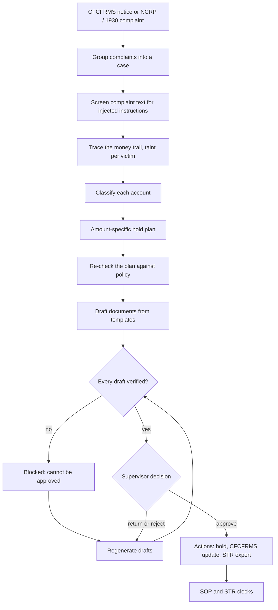
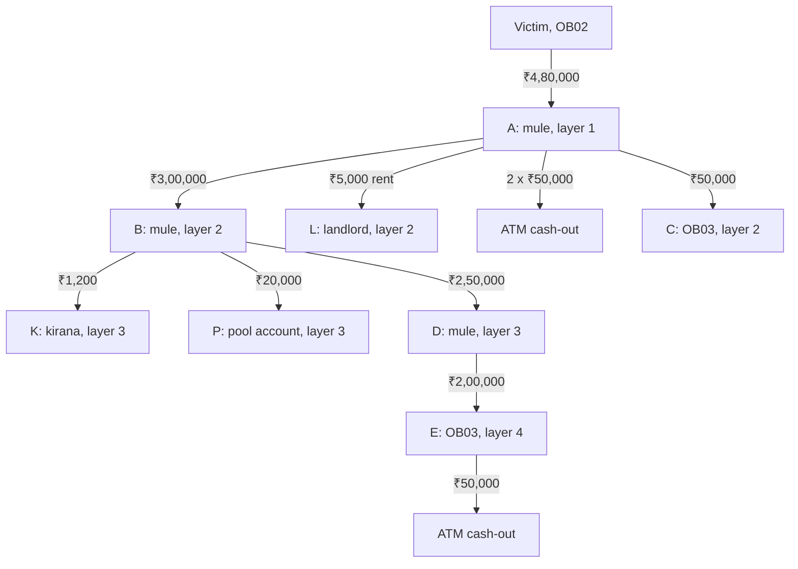

# Overview: the full story

This page is for a judge who has ten minutes. It covers the problem Wapsi solves and who uses it. It walks through
one case from complaint to approved hold, explains why the output can be trusted, and lists what Wapsi
deliberately leaves to people. Every number here comes from the code, fixtures, tests or reports in this
repository, and the source is named next to it.

- [1. The problem](#1-the-problem)
- [2. Who uses Wapsi](#2-who-uses-wapsi)
- [3. The end-to-end flow](#3-the-end-to-end-flow)
- [4. One case, step by step](#4-one-case-step-by-step)
- [5. Why the output can be trusted](#5-why-the-output-can-be-trusted)
- [6. What Wapsi deliberately does not do](#6-what-wapsi-deliberately-does-not-do)
- [7. Known limitations](#7-known-limitations)
- [8. Where to go next](#8-where-to-go-next)

Citation IDs in square brackets, such as [SOP-9-1], are the IDs Wapsi uses in code (`src/wapsi/citations.py`).
Their sources, pages and verbatim quotes are in `data/docs/citations.json`. The [Legal spine](legal-spine.md)
maps every rule to its source.

## 1. The problem

### How cyber-fraud money is stopped today

1. A victim reports the fraud on the National Cybercrime Reporting Portal (NCRP) or through the 1930 helpline and
   gets a 14-digit acknowledgement number.
2. A police officer checks that a cyber-enabled financial crime is made out and submits the complaint to CFCFRMS,
   the Citizen Financial Cyber Fraud Reporting and Management System. The banks on the money trail then receive
   notices under Section 168 read with Section 94 of the Bharatiya Nagarik Suraksha Sanhita, 2023 (BNSS)
   [BNSS-168] [BNSS-94]. Each bank that received the money holds an amount up to the amount reported and updates
   CFCFRMS [SOP-6]. This continues until the whole trail is established.
3. At each receiving bank, the **nodal officer**, or an officer acting for her, puts the amount on hold and
   updates the records [SOP-9-1].
4. Money held at any layer can later be released to the victim [SOP-5-X]. Para 11 of the SOP sets out five
   restoration processes:
    - Process 1: a single victim, under s.106 BNSS [SOP-11-P1].
    - Process 2: several victims, also under s.106 BNSS. The amount is shared between them under Para 5(xiii),
      pro-rata where it cannot be attributed [SOP-11-P2].
    - Process 3: an application to the competent court under ss.497, 498 or 503 BNSS [SOP-11-P3].
    - Process 4: attachment or forfeiture under s.107 BNSS [SOP-11-P4].
    - Process 5: a process the jurisdictional court directs [SOP-11-P5].

The procedure is the MHA/I4C *SOP for NCRP-CFCFRMS, Custody, Restoration of money and Grievance Redressal*
(02.01.2026). Wapsi uses the copy circulated by the High Court of Uttarakhand on 18.06.2026, listed in
`data/docs/README.md`.

### The gap: holding works, returning does not

The SOP gives the national figures (Para 2, printed page 9). From April 2021 to November 2025, CFCFRMS kept
**₹7,647 crore** of the **₹52,969 crore** reported out of criminals' hands. Only **₹167 crore** had been restored.
That is about **2.18% of the money saved**. It is a share of the money held, not of the money reported.
(Source: `data/docs/facts.json`, facts `CFCFRMS_AMOUNT_SAVED`, `CFCFRMS_AMOUNT_REPORTED`,
`CFCFRMS_AMOUNT_RESTORED` and `CFCFRMS_RESTORED_SHARE_OF_SAVED`.)

A hold needs only the account and the reported amount. A return needs proof of whose money is in which account.
That proof is hard to build once the money has been split, mixed with other funds and passed through several
accounts.

### Why freezing whole accounts is the wrong answer

When the proof is missing, the easy response is to freeze everything the money touched. That hurts people who did
nothing wrong: a landlord paid rent from a mule account, a shop that delivered goods, or a payment aggregator whose
pool account holds other customers' money. The SOP rejects this directly:

> "Unwarranted orders for freezing accounts shall be discouraged, and accountability measures shall be
> established." [SOP-5-IX]

The SOP also sets out specific rules:

- Hold the disputed amount only [SOP-9-1] [SOP-ANNEX-I].
- Consider that an account may have been operated without the holder's knowledge, connivance or consent
  [SOP-5-XII].
- For nodal, pool or escrow accounts, hold the disputed amount; law enforcement agencies should normally refrain
  from suspending or seizing such accounts [SOP-9-1-III].
- A forward-looking hold is allowed only on first-layer accounts, and never on nodal, pool or escrow accounts
  [SOP-9-1-I].
- For merchants, cancel the order and hold the amount only if the goods or services were not delivered [SOP-9-2].

High Courts have said the same. Wapsi cites these rulings by ID, paraphrases them, and stores none of their text:

| Citation ID | Court and date | What Wapsi takes from it |
|---|---|---|
| `CASE-NEELKANTH` | *Neelkanth Pharma Logistics Pvt Ltd v. Union of India*, Delhi HC, 20.02.2025 | In a case about bank accounts frozen during a cyber-crime investigation, the court said a lien on the disputed amount should be explored. |
| `CASE-KARTIK-CHATUR` | *Kartik Yogeshwar Chatur v. Union of India*, Bombay HC, 20.11.2025 | Banks may only place the disputed amount under lien. Section 106 BNSS does not allow a debit freeze of the account. |
| `CASE-SHREE-BALAJI` | *Shree Balaji Enterprises v. RBI*, Rajasthan HC, 20.08.2026 | Preserve the identifiable disputed amount by a lien, not by a whole-account freeze. |
| `CASE-SAJEER` | *Dr Sajeer v. RBI*, Kerala HC, 2023 (as summarised in SOP Annexure-III) | Freezes should be proportionate and limited to the amounts in the police requisition. |
| `CASE-SAIFULLAH` | *Mohammed Saifullah v. RBI*, Madras HC, W.P. No. 25631 of 2024 (as summarised in SOP Annexure-III) | Freezing a whole account without specific justification of the amount or duration violates fundamental rights. |

The first three rows rest on news and legal-blog reports of the judgments; their URLs are in
`data/docs/citations.json`. The last two rest on the SOP's own summaries, which Wapsi quotes and checks word for
word.

### Why doing it right by hand is hard

- **Money gets mixed.** A mule account holds its own money alongside money from one or more victims. Every
  outgoing transfer carries a share of each. The SOP settles competing claims pro-rata where attribution is not
  possible [SOP-5-XIII], and Annexure-V gives a worked example [SOP-ANNEX-V]. Doing that arithmetic by hand across
  several layers, to the paisa, is slow and easy to get wrong.
- **Money moves in minutes.** In the showcase case below, ₹4,80,000.00 passes through four layers in just over
  two hours (11:02 to 13:10 IST). By the time the victim reports it at 13:40 IST, eight accounts and three ATM
  withdrawals are involved.
- **Different accounts need different treatment.** Mule accounts, innocent holders, merchants, pool accounts and
  accounts at other banks each follow a different SOP rule, and one case can include all of them.
- **Every step has a deadline.** The STR (suspicious transaction report to FIU-IND) is due within seven working
  days under PML Rules, Rule 8, as the FIU-IND FAQ explains it [PMLR-8]. The consolidated Rule 8(2) text published by FIU-IND says "promptly". Grievance,
  data-request, notice and hold-lapse timelines run under Paras 10.1 and 11 and Annexure-I of the SOP.
- **The paperwork must agree with itself.** One case can produce a dozen or more documents. Every amount, account
  number and UTR (the transfer's reference number) in them must match the ledger.

## 2. Who uses Wapsi

The user is the **cyber-fraud nodal officer at a bank that received stolen money**. The SOP gives this officer the
job of placing holds [SOP-9-1]. Put simply, the officer needs to answer four questions for every CFCFRMS notice,
quickly and in a way that stands up to review by courts and auditors:

1. Where did the victim's money go, and how much of it is still here?
2. Whose account is each one: a mule, an innocent holder, a merchant or a pool account?
3. Exactly how much should be held in each account, and on what legal basis?
4. Which documents are due, to whom, and by when?

The officer app in `ui/` has three roles:

| Role | Who | Can do |
|---|---|---|
| Analyst | the nodal officer (maker) | open cases, review the trail and the hold plan, generate drafts |
| Supervisor | the approving officer (checker) | approve, return or reject each draft with a reason code; approval triggers the actions |
| Auditor | internal audit or a regulator | read everything, with personal details masked |

The officer starts on the **Inbox**, which lists hold notices ordered by the money still recoverable. From there
the officer moves through the Case Room (the trail), the Hold Plan, Drafts & Verification, Approvals, Clocks, KPIs
and Audit. The [User guide](user-guide.md) walks through each screen.

## 3. The end-to-end flow

Every step is plain Python in `src/wapsi`. Each edition calls the same pipeline with its own adapters for the
ledger, the LLM, the guard and the case store. The entry point is `wapsi.pipeline.run.process_case`, and the
approval step is `wapsi.pipeline.run.approve`.

| Step | What happens | Code | Legal basis |
|---|---|---|---|
| Group | Complaints whose transfers credit the same account become one case, so several victims of one mule are handled together | `wapsi.pipeline.run.group_complaints` | [SOP-5-XIII] |
| Screen | Complaint narratives are untrusted. Instruction-like text (English, Hinglish, Hindi, encoded or obfuscated) is flagged, quoted back to the officer and logged. It is never acted on | `wapsi.verify.injection.RulesGuard` | none |
| Trace | Every transaction touching the candidate accounts is replayed in time order. Each victim's money is tracked separately, keyed by NCRP number. Other-bank hops are followed through CFCFRMS responses, which are simulated here. Defaults: 72-hour window, depth 6 | `wapsi.graph.trace.trace_case` | [SOP-5-XIII] |
| Classify | Hard rules first (victim, nodal / pool / escrow, merchant), then a transparent heuristic score. If an "innocent" score conflicts with what the account actually did, the account goes to the officer | `wapsi.classify.classify_trace` | [SOP-5-XII] [SOP-9-2] [SOP-9-1-III] |
| Plan | One decision per account: hold `min(victim money in it, balance)`, and forward holds only on first-layer accounts. Money at other banks becomes a request, not a hold | `wapsi.graph.holdplan.build_hold_plan` | [SOP-9-1] [SOP-9-1-I] [SOP-5-IX] |
| Re-check | The plan's policy rules are re-derived independently of the planner | `wapsi.verify.verify_plan` | as above |
| Draft | Template-bound documents (eight draft kinds). Every value is a slot filled from case data. The LLM only writes prose, through placeholders | `wapsi.draft.drafter.draft_case` | per document |
| Verify | Every amount, account number, UTR, date, citation and policy rule in every draft is recomputed | `wapsi.verify.verify_draft` | as cited |
| Approve | Only a supervisor can approve, and the approval is bound to the draft's SHA-256 fingerprint | `wapsi.pipeline.run.approve` | none |
| Clocks | SOP and STR deadlines. The STR clock counts working days on an Indian bank calendar; the others count calendar days | `wapsi.domain.clocks.clocks_for_bundle` | [PMLR-8] [SOP-10-1] [SOP-11-P1] [SOP-11-P2] |

### What the plan decides for each account

| Account found on the trail | Disposition | What the officer is asked to do | Basis |
|---|---|---|---|
| Mule holding victim money | `HOLD_AMOUNT` | hold the victim money still there, capped at the balance | [SOP-9-1] [SOP-ANNEX-I] [SOP-5-IX] |
| First-layer account (not nodal, pool or escrow) whose balance is below the disputed amount | reason `FORWARD_HOLD_FIRST_LAYER` (disposition `FORWARD_HOLD` if nothing can be held now) | also mark a forward hold for the victim money it already sent to ATMs, crypto exits or untraced destinations | [SOP-9-1-I] [SOP-DEF-FIRST-LAYER] |
| Innocent holder: a bona fide recipient (kept the money) or an unwitting conduit (passed it on) | `HOLD_AMOUNT_NO_ESCALATION` | hold the amount only; EDD (enhanced due diligence) memo; no escalation; no automatic STR: the officer decides, and an STR is recommended for a conduit | [SOP-5-XII] [SOP-10-1] |
| Merchant, goods delivered | `NO_HOLD_UPDATE_ONLY` | no hold; report in the CFCFRMS update | [SOP-9-2] |
| Merchant, goods not delivered | `HOLD_IN_POOL` | cancel the order; hold the amount in the pool or nodal account | [SOP-9-2] |
| Nodal, pool or escrow account at the home bank | `HOLD_AMOUNT_INTERMEDIARY` | hold the disputed amount only; no suspension or seizure; no forward hold; never an s.106 flag | [SOP-9-1-III] [SOP-9-1-I] |
| Account at another bank | `OUTBOUND_CFCFRMS_REQUEST` | request that bank to hold the amount; home hold is ₹0.00 | [SOP-9-1] [SOP-6] |
| Account that sent victim money to an ATM or crypto exit and has none left to hold | `CASHED_OUT` | nothing to hold | [SOP-9-1] |
| Home-bank mule that received money from a complaint with an FIR (first information report) and has at least 2 prior NCRP reports | stays `HOLD_AMOUNT` (or `FORWARD_HOLD`), plus reason `ESCALATE_S106_CANDIDATE` and `requires_human` | a person decides on any s.106 step | [BNSS-106] [CASE-KARTIK-CHATUR] |
| Home-bank account where the officer records a reason for account-level action (fraudster-controlled, continuing fraud, an LEA order, identity theft) | `EXCEPTIONAL_ACCOUNT_LEVEL_HOLD`, never proposed by the plan; applied only after a different supervisor approves the officer's request | the amount hold stays the recoverable figure; the account-level restriction sits on top | [SOP-5-IX] [SOP-9-1] |

The restoration pack uses Process 2 when more than one victim has recoverable money, and Process 1 otherwise.
The full decision table, with every reason code, is in [Hold plan](algorithms/hold-plan.md).

## 4. One case, step by step

This is showcase case 1 from `src/wapsi/fixtures/showcase.py`. The numbers were computed by hand, and every
module is tested against them. `tests/graph/test_graph_showcase.py` and `tests/pipeline/test_pipeline_showcase.py`
check that the pipeline reproduces them exactly. The home bank is `HB01`; the victim banks with `OB02`; the second bank on the
trail is `OB03`.

### The fraud

On 10-09-2026 a caller claims to be from the victim's bank. He says her account will be blocked and asks her to
move her money to a "safe account". At 11:02 IST she sends ₹4,80,000.00 by IMPS to `HB01-1000000001`, a mule
account called A below. She reports the fraud at 13:40 IST.

### Tracing and pro-rata taint

Before the fraud, A already held ₹20,000.00 of its own money from a cash deposit on 01-09-2026. After the victim's
transfer, 96% of A's balance is victim money (₹4,80,000 of ₹5,00,000). Under the pro-rata rule, every rupee that
leaves A carries 96 paise of victim money. B, D and E receive no other money during the fraud, so the same share
carries down the chain.

| Txn | Time (IST) | From → to | Amount | Victim money carried |
|---|---|---|---|---|
| `TX-001` | 11:02 | Victim → A | ₹4,80,000.00 | ₹4,80,000.00 |
| `TX-002` | 11:09 | A → B | ₹3,00,000.00 | ₹2,88,000.00 |
| `TX-003` | 11:15 | A → L (rent) | ₹5,000.00 | ₹4,800.00 |
| `TX-004` | 11:20 | A → ATM | ₹50,000.00 | ₹48,000.00 |
| `TX-005` | 11:24 | A → ATM | ₹50,000.00 | ₹48,000.00 |
| `TX-006` | 11:30 | A → C (other bank) | ₹50,000.00 | ₹48,000.00 |
| `TX-007` | 11:40 | B → K (order 5521, delivered 11:55) | ₹1,200.00 | ₹1,152.00 |
| `TX-008` | 11:45 | B → P (wallet top-up) | ₹20,000.00 | ₹19,200.00 |
| `TX-009` | 12:05 | B → D | ₹2,50,000.00 | ₹2,40,000.00 |
| `TX-010` | 12:30 | D → E (other bank) | ₹2,00,000.00 | ₹1,92,000.00 |
| `TX-011` | 13:10 | E → ATM | ₹50,000.00 | ₹48,000.00 |

Every rupee of the ₹4,80,000.00 is accounted for:

| Where the victim's money is now | Amount |
|---|---|
| In home-bank accounts that can be held (A, B, D, L) | ₹1,23,648.00 |
| In the payment-aggregator pool account (P) | ₹19,200.00 |
| At the other bank (C, E) | ₹1,92,000.00 |
| Withdrawn at ATMs | ₹1,44,000.00 |
| Paid to the kirana shop for goods delivered | ₹1,152.00 |
| Not located | ₹0.00 |
| **Total** | **₹4,80,000.00** |

### The hold plan

| Account | Classified as | Balance now | Victim money in it | Disposition | Home hold |
|---|---|---|---|---|---|
| `HB01-1000000001` (A) | mule, layer 1 | ₹45,000.00 | ₹43,200.00 | `HOLD_AMOUNT` + `FORWARD_HOLD_FIRST_LAYER` | ₹43,200.00, plus a forward hold of ₹96,000.00 |
| `HB01-1000000002` (B) | mule, layer 2 | ₹28,800.00 | ₹27,648.00 | `HOLD_AMOUNT` | ₹27,648.00 |
| `HB01-1000000003` (D) | mule, layer 3 | ₹50,000.00 | ₹48,000.00 | `HOLD_AMOUNT` | ₹48,000.00 |
| `HB01-2000000001` (L) | innocent holder (landlord) | ₹1,55,000.00 | ₹4,800.00 | `HOLD_AMOUNT_NO_ESCALATION` | ₹4,800.00 |
| `HB01-3000000001` (K) | merchant, goods delivered | ₹51,200.00 | ₹1,152.00 | `NO_HOLD_UPDATE_ONLY` | ₹0.00 |
| `HB01-9000000001` (P) | pool account | ₹5,00,20,000.00 | ₹19,200.00 | `HOLD_AMOUNT_INTERMEDIARY` + `NO_SUSPENSION_OR_SEIZURE` | ₹19,200.00 |
| `OB03-4000000001` (C) | mule at another bank | ₹50,000.00 | ₹48,000.00 | `OUTBOUND_CFCFRMS_REQUEST` | ₹0.00 (request ₹48,000.00) |
| `OB03-4000000002` (E) | mule at another bank | ₹1,50,000.00 | ₹1,44,000.00 | `OUTBOUND_CFCFRMS_REQUEST` | ₹0.00 (request ₹1,44,000.00) |

The result:

- **Total held at the home bank: ₹1,42,848.00 in 5 accounts.** Freezing the same 6 home-bank accounts whole would
  lock up ₹5,03,50,000.00, and ₹5,00,20,000.00 of that is the pool account.
- **Total recoverable for the victim: ₹3,34,848.00**, which is 69.8% of what was stolen. This counts home-bank
  holds plus the outbound requests to the other bank.
- **Forward hold: ₹96,000.00** on A. A is a first-layer account and its balance is below the disputed amount, so
  the victim money it sent to the two ATM withdrawals is marked against future credits. A forward hold is not
  money in hand, so it is not counted as recoverable.
- **Restoration: Process 1** (one victim). **Suggested STR ground: proceeds of crime** (PML Rules, Rule 2(1)(g)
  [PMLR-2-1-G]).

### What the officer gets

The pipeline produces 16 drafts for this case:

- 5 hold instructions and 5 customer notices, one of each per held account. The pool account's notice goes to
  the intermediary.
- 1 EDD memo, for the landlord.
- 2 outbound CFCFRMS requests, for C and E.
- 1 STR, 1 CFCFRMS update and 1 restoration pack (Process 1), for the case.

All 16 drafts and the plan pass verification: 17 reports, all passed. The landlord's name and account number
never appear in the STR; the verifier would fail the draft (`innocent_in_str`) if they did. Wapsi also opens 19
clocks:

- the Process 1 notice, reply and remittance;
- the bank-data deadline and the STR deadline;
- for the landlord, the grievance-filing, investigating officer (IO) decision and District Grievance Officer
  (DGO) escalation clocks;
- a day-75 warning and a day-90 lapse for each of the five holds;
- a forward-hold review on the same 90-day timeline for mule A's forward hold.

### Two more cases that matter

**Two victims, one mule (showcase case 2, Process 2).** On 11-09-2026 two victims send ₹1,00,000.00 and ₹60,000.00
to the same mule, which then withdraws ₹40,000.00 at an ATM. Pro-rata, that withdrawal carried ₹25,000.00 of the
first victim's money and ₹15,000.00 of the second's. The mule still holds ₹1,20,000.00, split ₹75,000.00 and
₹45,000.00, and Wapsi holds exactly that. Here the hold equals the whole balance, because all the money left in
the account is victim money. It is still a lien on that amount, not a debit freeze of the account. The mule is a
first-layer account whose balance is below the ₹1,60,000.00 it received, so Wapsi also marks a forward hold of
₹40,000.00 for the ATM withdrawal. The first victim
has an FIR and the mule has 2 prior NCRP reports, so the account gets the `ESCALATE_S106_CANDIDATE` flag and
`requires_human`. The hold itself stays amount-specific.

**The SOP's own worked example (Annexure-V, Illustration 2).** Five complainants credit ₹85,326, ₹38,443,
₹50,000, ₹50,000 and ₹30,000 to one account on 15.12.2024. One debit of ₹47,226 follows, which leaves
₹2,06,543. The SOP lists the pro-rata shares. Wapsi's `trace_case` and `build_hold_plan` reproduce all five to the
paisa and choose Process 2. In the same order as the credits, the shares are ₹69,446.97, ₹31,288.82, ₹40,695.08,
₹40,695.08 and ₹24,417.05. See `tests/test_sop_annexure_v.py` and the `ANNEX_V_ILL2_*` entries in
`data/docs/facts.json`.

## 5. Why the output can be trusted

### Numbers come from data; words come from the LLM

Each draft is a template. Every amount, account number, UTR and date in it is a **slot**, filled from the case
tables and formatted the same way every time (`₹4,80,000.00`, `10-09-2026 11:02 IST`). The LLM never writes a
value. It gets a fact sheet and a list of `⟦placeholder⟧` names. Its prose may contain no digits except in a
legal reference such as "Section 106", no currency words or symbols, and no number words except small counts such
as "three accounts". If its text breaks a rule, the drafter retries once and then uses a fixed paragraph.
Complaint narratives are passed to it wrapped in untrusted-text markers, and prose that copies them is rejected.
See [Draft contract](draft-contract.md).

Every draft also carries a **skeleton**: the title and body with a marker wherever a slot value was placed. The
verifier refills the skeleton with **its own recomputed values** and requires an exact match. A correct number in
the wrong place fails too, for example a hold amount swapped with the disputed amount (`body_skeleton_mismatch`).

### An independent verifier

`wapsi.verify.verify_draft` runs four families of checks on every draft, and `verify_plan` re-checks the plan:

| Family | Examples of what fails a check |
|---|---|
| Numeric | an amount in words or digits (including "₹1.2 lakh", "Rs.4,80,000/-" or Devanagari digits) that matches no verified slot; an unknown account number, UTR or date |
| Citation | a citation ID that is not registered in `wapsi.citations`, or not listed on the draft |
| Policy | `over_hold`, `whole_account_freeze`, `forward_hold_on_intermediary`, `forward_hold_not_first_layer`, `suspension_or_seizure`, `delivered_merchant_held`, `innocent_escalated`, `innocent_in_str`, `escalation_without_fir`, `escalation_insufficient_reports` |
| Injection | instruction-like text from a complaint appearing in the draft (`injection_leak`); instruction-like text or invisible characters in the draft itself (`instruction_in_draft`) |

The policy rules are written a second time in the verifier instead of being imported from the planner. A bug in
one is then unlikely to hide the same bug in the other.

### A legal spine in code

- Every plan decision that asks the officer to act carries citation IDs from `wapsi.citations`, and the templates
  cite IDs inline. An unknown ID fails the draft.
- `data/docs/citations.json` holds one verbatim quote of at most 25 words per ID, with a page number for PDF
  sources. The quote is empty for the three judgments cited by URL.
- `uv run python -m wapsi.search.check_citations` finds every quote and every recorded figure in the downloaded
  government texts. It passes 121 of 121: 35 citation ids (32 verbatim quotes and 3 judgments cited by URL
  only), 33 pinned figures, and the 52 quotes of the regulatory radar plus its registry check.
- A read-only **regulatory change radar** sets new and pending rules against the SOP and shows what each would
  change for a case. The RBI draft SOP on money-mule accounts (11 Sep 2026) is labelled **DRAFT** and never
  treated as in force; RBI fraud-risk citations point to the (Commercial Banks – Fraud Risk Management)
  Directions, 2026.

### Answers checked against an independent reference

The golden answers in `data/golden/` come from `src/wapsi/synth/reference.py`. It is a second implementation of
the taint and disposition rules and shares no code with `wapsi.graph` or `wapsi.classify`. On the demo world
(39 cases, 10 fraud typologies, 3 complaints with injected instructions), `evals/reports/demo.json` records:

| Metric | Demo world |
|---|---|
| Traced-amount recall | 100% |
| Hold exact-match rate (equal to the paisa) | 100% |
| Money held beyond the golden hold | ₹0.00 |
| Accounts held that should hold nothing | 0 |
| Disposition, restoration-process and STR-ground accuracy | 100% each |
| Drafts passing verification | 100% |
| Injected complaints flagged / drafts containing injected text | 3 of 3 / 0 |
| Absolute differences from the golden trace totals, summed over every total and all 39 cases | ₹0.34 |
| Money immobilised: Wapsi vs whole-account freeze | ₹29,19,245.69 in 84 accounts vs ₹35,25,90,069.78 in 101 accounts |

On the 64-case hard world, built with five realistic confounders (`evals/reports/hard.json`), dispositions are
0.9198 while holds stay exact, over-hold stays ₹0.00 and false freezes stay 0: every miss is a label, never
money. [Evaluation](evaluation.md) has the method, the held-out and hard worlds and the metric definitions.

### Maker-checker bound to the exact draft

`wapsi.pipeline.run.approve` enforces these rules, and `tests/pipeline/test_pipeline_approvals.py` tests them:

- Only the supervisor role can record a decision.
- The approval stores a SHA-256 fingerprint of everything the supervisor saw: kind, account, title, body,
  slots, structured data, citations and version.
- The draft must have passed verification **in exactly that form**. A draft edited after verification is refused
  or re-verified.
- A rejected draft can never be approved later. It has to be regenerated as a new version.
- Approving the same content twice does nothing the second time, so no action is duplicated.

The case's audit trail records these events with actor, role and time: case opened, untrusted text detected,
case processed (with step timings), each draft verified (with its fingerprint), each decision, and each action.
Every event is sealed into a SHA-256 hash chain, so an edited, deleted or reordered event is detected
(`uv run python -m wapsi.audit drill`: 6 of 6 tampering attempts caught). The Audit screen shows it and
re-verifies the chain on demand.

Police hold requests get the same discipline: an 8-field completeness check, a hold limited to the amount
identifiable on the trail, and a template-bound clarification letter for anything missing.

### Protecting people who did nothing wrong

In the showcase case the landlord's account is not frozen. Only the ₹4,800.00 of victim money in it is held.
There is no escalation and no automatic STR (it is a bona fide recipient: it kept the money), and an EDD memo
goes with the hold. The customer notice explains the hold and
the grievance route [SOP-10-1]. It relies on the SOP's position that informing the holder is not tipping-off
[SOP-9-1-II] [FIU-CIRC-2025-06-02]. The kirana shop that delivered groceries has nothing held. The pool account
keeps running for its other customers.

## 6. What Wapsi deliberately does not do

| Wapsi does not... | Instead |
|---|---|
| freeze or debit-freeze a whole account on its own | it holds `min(victim money, balance)` by default [SOP-5-IX] [CASE-KARTIK-CHATUR]; account-level action happens only as a recorded exception an officer requests and a different supervisor approves |
| suspend, seize or forward-hold a nodal, pool or escrow account | it holds the disputed amount only [SOP-9-1-III] [SOP-9-1-I] |
| decide on s.106 BNSS escalation | it raises a flag that needs an FIR and at least 2 prior NCRP reports, and a person decides. `Disposition.ESCALATE_S106_CANDIDATE` is reserved and never emitted |
| act without a supervisor | nothing leaves the case until a supervisor approves the exact draft. The core ships `RecordingActionSink`, which only records actions and is what both editions use; a deployment can plug in a Jira, Slack or ticketing sink through the `ActionSink` port |
| file the STR with FIU-IND | it drafts the STR for the bank's Principal Officer, in a layout modelled on FINnet 2.0; filing stays with the bank |
| connect to the live NCRP or CFCFRMS | it is a simulated CFCFRMS interface: other-bank responses come from `Ledger.consortium_transactions`, and every CFCFRMS action it prepares is labelled as simulated |
| let the LLM write numbers | every value is a slot, and the verifier recomputes it |
| follow instructions found in complaint text | it quotes them to the officer and logs them |
| name an innocent holder in the automatic STR | it describes the account as operated without the holder's knowledge, and the holder is not identified; for an unwitting conduit it recommends an STR for the officer's decision |
| apply a draft rule | pending rules (the RBI DRAFT) stay on the regulatory radar, labelled DRAFT, for a human to review |
| decide restoration | it prepares the Process 1 or Process 2 pack; the investigating officer or the court decides. Processes 3 to 5 are court routes and outside its scope |
| use real people's data | every account, name and complaint is generated by `wapsi.synth` |
| give legal advice | it is decision support for trained officers |
| redistribute the source documents | government texts are downloaded at build time; only short quotes are committed (`data/docs/README.md`) |

## 7. Known limitations

- **Synthetic data only.** Every world comes from one generator. The same team wrote the generator, the rules and
  the reference implementation. Perfect scores on the demo world show the code agrees with the written rules;
  they do not show real-world accuracy.
- **Classification is harder on unseen worlds.** On five held-out worlds (202 cases,
  `evals/reports/classify-after-heldout-*.json`), hold amounts still matched exactly with no false freezes.
  Innocent-holder recall ranged from 75% to 100%, and disposition accuracy from 98.4% to 100%. The seeds were
  unseen, but their results were looked at during one round of classifier changes, so this is not a sealed blind
  test. Of the 5 innocent holders missed (out of 38), 3 went to the officer as unknown and 2 were labelled as
  mules. The hold amount was still exact in all five; the errors were in the treatment around it (no EDD memo,
  or an STR ground proposed). [Evaluation](evaluation.md) lists each one.
- **The injection guard is a warning layer.** On a blind holdout of 151 texts, written by an agent that never saw
  the rules, it reached 96.6% precision and 75.0% recall. It caught only 2 of 6 attacks written in Devanagari,
  2 of 6 instructions split across sentences and 3 of 7 Hinglish attacks (`evals/reports/guard-latest.json`). The
  real defence is structural: drafts are template-bound and verified, and the demo evaluation found 0 drafts
  containing injected text.
- **The LLM in the evaluation is a stub.** Reported evaluations use the offline `FakeLLM`. Measuring real models
  (Gemini, Gemma, models served with vLLM) is edition work, so `llm_only_hallucination_rate` is `null` for now.
- **The bank holiday calendar is national.** `wapsi.domain.calendar` treats Sundays, the 2nd and 4th Saturdays
  and the DoPT list of closed holidays for Central Government offices in Delhi as non-working days. Real bank
  holidays vary by State.
- **The SOP has two 90-day rules.** Para 10.1 counts 90 days from the bank submitting a grievance. The Annexure-I
  notice lets the bank remove a contested hold 90 days after the amount was put on hold
  (`data/docs/facts.json`). Wapsi's `HOLD_LAPSE` clock counts 90 calendar days from the hold, with a warning at
  day 75. The [Legal spine](legal-spine.md) discusses this.
- **The editions are at different stages.** On 29-09-2026 the Google Cloud edition was tested offline with fakes
  and is deployed in October; the AMD edition's GPU work runs only during the event (12 to 18 Oct 2026). See
  [Editions](editions.md).
- **The hard world shows where labels break.** On its 64 cases the heuristic's dispositions are 0.9198 and
  innocent-holder recall 0.6875; victims on another victim's trail are sometimes called mules, and innocent-only
  trails can get an STR ground. Holds stay exact ([Evaluation](evaluation.md#hard-world)).

[Limitations and roadmap](limitations-and-roadmap.md) has the full list.

## 8. Where to go next

| You are... | Start with |
|---|---|
| A Google Cloud or AMD judge | [Editions](editions.md), [Architecture](architecture.md), [Evaluation](evaluation.md), [FAQ](faq.md) |
| A bank fraud or compliance expert | [Legal spine](legal-spine.md), [Hold plan](algorithms/hold-plan.md), [Trust and safety](trust-and-safety.md), [User guide](user-guide.md) |
| A developer | [Developer guide](developer-guide.md), [API reference](api-reference.md), [Data contract](data-contract.md), [Draft contract](draft-contract.md) |
| Curious how the money is followed | [Money trail](algorithms/money-trail.md), [Classification](algorithms/classification.md), [Synthetic data](synthetic-data.md) |
| Checking what was built when | [Originality](originality.md), [Decision records](adr/README.md) |

Back to the [home page](index.md).
