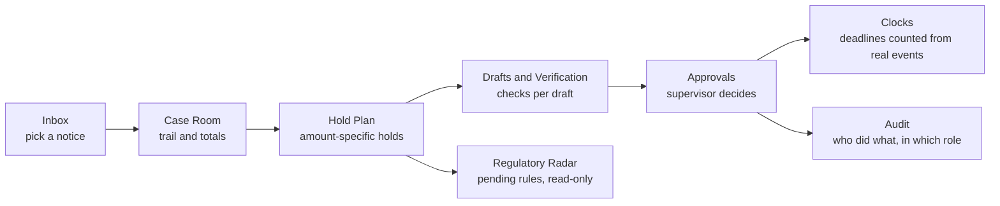
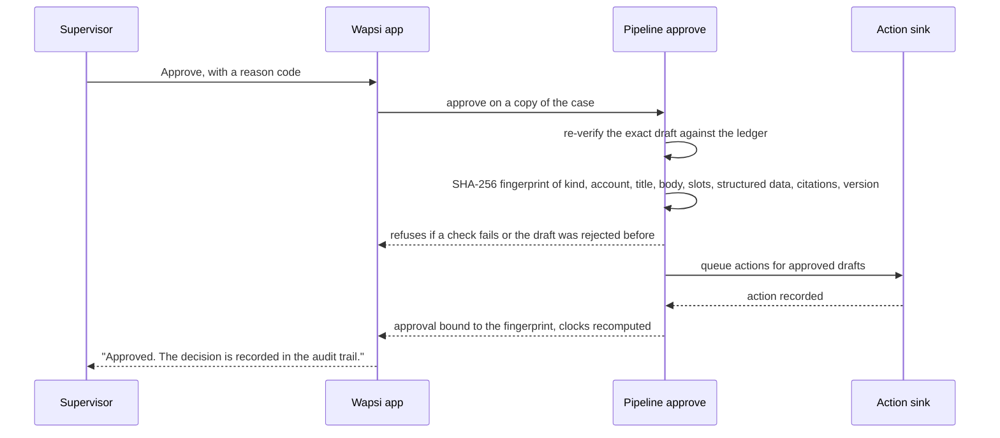
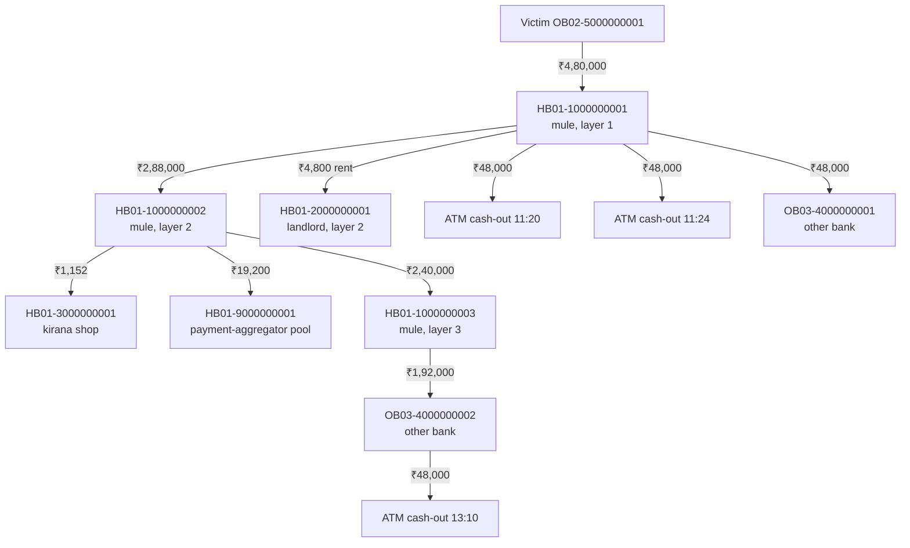

# Officer's guide to the Wapsi app

Wapsi's officer app is a Streamlit application (`ui/app.py`). It is the screen a bank's cyber-fraud nodal officer
works from when an NCRP / 1930 complaint arrives as a CFCFRMS "put on hold" notice. The app opens on an **Inbox of
hold notices**, not a chatbot. From there the officer follows the money, reviews an amount-specific hold plan, reads
drafts that have already been checked, and passes them to a supervisor for approval. Deadlines and the audit trail
update as work moves on.

This guide covers each screen, the three roles, a walkthrough of the showcase case with screenshots, deep links,
and the demo settings. The case numbers come from the synthetic showcase world in
`src/wapsi/fixtures/showcase.py`, processed by the real pipeline (`wapsi.pipeline.run.process_case`). The KPI
numbers come from the committed evaluation report, `evals/reports/latest.json`.

> **Synthetic data, decision support.** Every bank, account, person and complaint in the app is synthetic. Wapsi
> recommends and drafts. A trained officer decides, and nothing is final until a supervisor approves it.

**At a glance**

| What | Number in the app |
|---|---|
| Showcase case `CASE-31009260000101` | One victim loses ₹4,80,000 by IMPS |
| Whole-account freeze of every home-bank account the money reached | ₹5,03,50,000 across 6 accounts |
| Wapsi's amount-specific holds | **₹1,42,848 across 5 accounts**, only the victim's money (352× less) |
| Recoverable for the victim | **₹3,34,848** (69.8% of ₹4,80,000): home-bank holds plus ₹1,92,000 requested from the other bank |
| Drafts produced and checked | 16, all passing every check |
| Supervisor approval | 17 items approved; 14 follow-on actions recorded, none sent to a real system |
| Evaluation (39 demo cases, 3 adversarial) | Traced-amount recall 100%, over-hold ₹0, false freezes 0, injection leaks 0 |

**Contents**

1. [Two-minute tour](#1-two-minute-tour)
2. [Start the app](#2-start-the-app)
3. [Layout and navigation](#3-layout-and-navigation)
4. [Roles and masking](#4-roles-and-masking)
5. [The screens](#5-the-screens)
6. [Walkthrough: the showcase case from notice to clocks](#6-walkthrough-the-showcase-case-from-notice-to-clocks)
7. [Deep links](#7-deep-links)
8. [Demo settings (environment variables)](#8-demo-settings-environment-variables)
9. [Regenerating the screenshots](#9-regenerating-the-screenshots)
10. [Known limitations](#10-known-limitations)
11. [Where the code lives](#11-where-the-code-lives)

---

## 1. Two-minute tour

| Screen | What the officer does there | Who can act |
|---|---|---|
| **Inbox** | Sees every open hold notice, ordered by money still recoverable, with deadline chips | Everyone views |
| **Case Room** | Follows the victim's money layer by layer; inspects any account's numbers, reasons and SOP basis | Everyone views |
| **Hold Plan** | Reviews the recommended hold, request or no-hold for each account, with the Annexure-I wording; requests an exceptional account-level hold; checks a police / LEA hold request | Everyone views; CSV export; analyst and supervisor request and check |
| **Drafts & Verification** | Reads each draft (hold instruction, customer notice, EDD memo, CFCFRMS request, CFCFRMS update, STR, restoration pack, account-level hold request) together with its check results | Analyst and supervisor can regenerate |
| **Approvals** | Maker-checker: approve, request changes or reject each item with a reason code | Supervisor only |
| **Clocks** | Sees SOP and statutory deadlines on a timeline, on an India bank-holiday calendar | Everyone views |
| **Regulatory Radar** | Sees new and pending rules (the RBI DRAFT mule-account SOP, the RBI FRM Directions 2026) set against the SOP, and what each would change for the case | Everyone views; read-only |
| **KPIs** | Reads the golden-set evaluation (`evals/reports/latest.json`) | Everyone views |
| **Audit** | Every page view, role switch, check, decision and action, with actor and role, in a hash-chained log with a **Verify chain** button | Everyone views; CSV export |

The work moves through the screens like this:



The Hold Plan screen puts the key comparison first. For the showcase case, freezing every home-bank account the
money touched would immobilise ₹5,03,50,000 across 6 accounts; Wapsi holds ₹1,42,848 across 5 accounts.


**Terms used on the screens.** Short meanings; the [glossary](glossary.md) has the full definitions and sources.

| Term | Meaning in this app |
|---|---|
| NCRP, 1930 | National Cybercrime Reporting Portal and the national cyber-fraud helpline. Each complaint has an NCRP ID (14 digits in the synthetic data) |
| CFCFRMS | The I4C platform that sends "put on hold" notices to banks and records their holds and the onward money trail |
| Hold (lien) | A restriction on a specific amount in an account. The rest of the balance stays usable. Holds are amount-specific by default; account-level action is only a recorded, supervisor-approved exception |
| First-layer account | The account that received the money directly from the victim's account (layer 1 on the trail) |
| Forward hold | A mark against future credits on a first-layer account, for victim money it has already sent to cash-out points or untraced destinations. It is not money in hand (SOP 9.1(i)) |
| Innocent holder | An account that may have been operated without the holder's knowledge, connivance or consent (SOP 5(xii)): a **bona fide recipient** that kept the money, such as a landlord paid rent, or an **unwitting conduit** that passed it on. No automatic STR: the officer decides, and an STR is recommended for a conduit |
| Simulated CFCFRMS interface | Wapsi prepares CFCFRMS updates and requests and records them; nothing is sent to the portal until the nodal officer submits it there. Every screen that shows a CFCFRMS action says so |
| DRAFT | The RBI's draft SOP on money-mule accounts (11 Sep 2026). Shown on the Regulatory Radar, labelled DRAFT, never applied |
| Pool / nodal / escrow account | An intermediary's account holding many customers' money. The bank holds only the disputed amount, and the SOP asks LEAs to normally refrain from suspending or seizing the account (SOP 9.1(iii)) |
| STR, FIU-IND | Suspicious Transaction Report, filed with the Financial Intelligence Unit – India. Wapsi's clock gives 7 working days, the period in FIU-IND's FAQ on Rule 8 of the PML Rules (`PMLR-8`) |
| EDD memo | Enhanced due diligence note the bank prepares for an innocent-holder hold |
| LEA, IO, DGO | Law enforcement agency (the police), Investigating Officer, District Grievance Officer |
| Process 1, Process 2 | Two of the five SOP Para 11 routes to interim custody of held money for victims: Process 1 for a single victim, Process 2 for several victims, with the amount attributed under SOP 5(xiii) (Wapsi proposes pro-rata shares). Wapsi proposes only these two; the IO or a court decides |
| s.106 flag | A note that the investigating officer may consider seizure under s.106 BNSS (needs an FIR and at least 2 earlier NCRP reports). Wapsi only flags it; a person decides |
| UTR | The payment's unique transaction reference number |
| FRI, MuleHunter-style score | Synthetic external risk signals: the DoT Financial Fraud Risk Indicator, and a mule-risk score modelled on the Reserve Bank Innovation Hub's MuleHunter.AI |
| Maker-checker | The analyst prepares, a different person (the supervisor) approves |

---

## 2. Start the app

You need [uv](https://docs.astral.sh/uv/) and Python 3.11 or later. From the repository root:

```bash
uv sync --extra ui                 # once: core engine + Streamlit and Plotly (or: uv sync --all-extras)
uv run streamlit run ui/app.py     # opens http://localhost:8501
```

The app needs only the core dependencies and the `ui` extra. uv also installs the `dev` group (pytest and ruff)
by default, which the UI tests need. `--all-extras` also installs the heavy ML, AMD and Google Cloud extras.

The first page load shows a spinner, "Tracing the showcase cases…". During that load the app runs both showcase
cases through the full pipeline (`wapsi.pipeline.run.process_case`): screening, tracing, classification, the hold
plan, drafting with the offline `FakeLLM`, verification and clocks. The result is cached for the life of the
server process, and each browser session then works on its own copy.

The sidebar footer names the data source:

| Footer text | Meaning |
|---|---|
| Showcase ledger · processed by the live pipeline | Both cases came from the real pipeline (the default) |
| Showcase ledger · some cases from saved fixtures | The pipeline failed for at least one case, which fell back to its hand-built bundle |
| Showcase fixtures | `WAPSI_UI_SOURCE=fixtures` (or the pipeline failed for both cases): hand-built bundles from `wapsi.fixtures.bundles`, with no drafts until you press **Generate drafts** |
| Showcase fixtures · drafting engine not installed yet | The engine modules are missing, so only the fixture bundles can be shown |

The app makes no network calls of its own. The LLM is the offline `FakeLLM`, and citation look-ups use the local
BM25 index (`wapsi.search.index.LocalDocSearch`). The index is not committed. If it has not been built, look-ups
fall back to the verbatim quotes committed in `data/docs/citations.json`, and the app works the same way.
Building it is optional: `uv run python -m wapsi.search.fetch && uv run python -m wapsi.search.build` downloads the
public legal texts (network access needed) and parses the PDFs (needs the `docs` extra). All times are shown in
IST.

The app follows the viewer's light or dark setting. The theme accents are in `.streamlit/config.toml`, with an
identical copy in `ui/.streamlit/config.toml` that Streamlit reads when `ui/app.py` is started from another
directory. The screenshots in this guide use light mode.

---

## 3. Layout and navigation

![The sidebar and Inbox. The sidebar has the Wapsi mark, a Case selector reading "Meera Joshi · ₹3.35 L", the Go to list (Inbox, Case Room, Hold Plan, Drafts & Verification · 16, Approvals · 17 pending, Clocks, KPIs, Audit), the Signed in as selector set to Analyst, the actor nodal.officer@hb01 and the data-source note. The Inbox tiles read Recoverable at risk ₹4.55 L of ₹6.40 L reported stolen, Open notices 2, Awaiting approval 21 and Clocks needing action 3. Below are the two notices: Meera Joshi (₹3.35 L recoverable, 70% of ₹4.80 L stolen) and Arjun Nair + 1 more (₹1.20 L, 75% of ₹1.60 L).](assets/screenshots/01-inbox-analyst.png)

**Sidebar, top to bottom**

- **Case**: the case that the case-level pages show. Each entry reads "victim · recoverable", for example
  "Meera Joshi · ₹3.35 L" or "Arjun Nair +1 · ₹1.20 L". The list is sorted by money still recoverable.
- **Go to**: the nine screens (the screenshots in this guide predate the Regulatory Radar entry, which sits
  between Clocks and KPIs). Two entries carry counts for the selected case. **Drafts & Verification · 16** is
  the number of drafts. **Approvals · 17 pending** is the drafts plus the hold plan not yet approved.
- **Signed in as**: the demo role switcher (Analyst, Supervisor, Auditor). Your actor ID and a one-line
  description of the role appear under it. See [Roles and masking](#4-roles-and-masking).
- **Footer**: the data source, "All data is synthetic. Times in IST."

**Case bar.** The five case-level screens (Case Room, Hold Plan, Drafts & Verification, Approvals, and Clocks in
its "This case" scope) show a bar under the page title. It holds the case ID, the victim(s), the NCRP ID(s), the
recoverable amount and a status chip:

| Status chip | When |
|---|---|
| New notice | Case opened, not traced yet |
| Trail traced | Money trail computed |
| Recommended — pending approval | Hold plan built (fixture mode starts here) |
| Drafts ready for checks | Drafts generated |
| Verified — pending approval | Every draft and the hold plan passed their checks (pipeline mode starts here) |
| Approved | Every hold instruction in the case is approved |
| Closed | Case closed |

**When something breaks.** A page that fails to build shows "This page couldn't load", a **Try again** button and
a collapsed "Technical details" panel. The stack trace appears only inside that panel, so the page itself shows a
plain message. Your data is unchanged.

---

## 4. Roles and masking

The app has three roles. In this demo build the role is a sidebar switch, not a login. Every switch is written to
the audit trail as "Switched role", with the from and to roles.

| Role | Actor ID | Can do | Cannot do | Personal details |
|---|---|---|---|---|
| **Analyst** (maker) | `nodal.officer@hb01` | View every screen; generate or regenerate drafts; download CSVs and drafts | Record approval decisions (the Approvals screen says "View only") | Shown |
| **Supervisor** (checker) | `supervisor@hb01` | Everything an analyst can, plus approve, request changes or reject each item, one at a time or in bulk | Approve an item that failed a check | Shown |
| **Auditor** | `auditor@hb01` | View every screen, filter and export the audit trail | Generate drafts (button disabled: "Auditors have read-only access."); record decisions ("Read-only.") | **Masked** |

The approval rule is enforced below the screen too.

- The data layer, `ShowcaseDataSource.save_approval`, refuses any role other than supervisor ("Only a supervisor
  can record an approval decision (maker-checker).").
- It also refuses a decision without a reason ("Pick a reason before recording the decision.").
- The pipeline's `approve()` raises `PermissionError` for anyone who is not a supervisor.

**What masking does for the auditor** (`ui/components/formatting.py`)

| Item | Analyst and supervisor see | Auditor sees |
|---|---|---|
| Victim and account-holder names | Meera Joshi | M•••• J•••• (first letter of each word; word lengths kept) |
| Mobile numbers | 98XXXXXX21 | ••••••••21 (last two characters only) |
| Free text: complaint narratives, draft bodies, filled values, STR sheets, reasons, notes, approval comments, audit details and the audit CSV | As written | Known names and mobiles of the case's victims and account holders are masked, plus anything shaped like an Indian mobile number |
| Account numbers, UTRs, amounts, dates, citations | Shown | Shown (an auditor needs them to check the work) |

For auditors the Inbox search also stops matching victim names, so a masked name cannot be found by guessing.
It still matches case IDs, NCRP IDs, and first-layer and victim account numbers.


---

## 5. The screens

### 5.1 Inbox

*"Hold notices waiting for you, with the money still recoverable in each."*

- **Tiles**:
    - **Recoverable at risk**: the sum over open cases (₹4.55 L of ₹6.40 L reported stolen in the showcase world).
    - **Open notices**: 2 notices covering 3 victim complaints.
    - **Awaiting approval**: see the note below.
    - **Clocks needing action**: due soon or overdue.
- **Search** by NCRP ID, case ID, first-layer account or victim account (and victim name, unless you are an
  auditor).
- **Sort**: "Recoverable at risk (highest first)" (the default), "Newest notice first" or "Oldest notice first".
- **Each notice row** shows:
    - the victim or victims, the source (1930 or NCRP) and when it was reported;
    - the case ID and status chip;
    - deadline chips: "STR in 10 days", "Holds lapse in 90 days", "1 other clock needs action";
    - the first-layer account and how many accounts are on the trail;
    - the recoverable amount and its share of the money stolen;
    - the buttons **Open case** and **Hold plan**.

The **Awaiting approval** tile counts drafts not yet approved. For a case with no drafts it counts the hold plan
instead. The sidebar's "Approvals · N pending" counts the drafts *and* the hold plan for the selected case, so
the two numbers can differ: 21 in the tile (16 + 5 drafts across both cases) against 17 for the showcase case in
the sidebar (16 drafts + the plan).

### 5.2 Case Room

*"Follow the victim's money, see what can still be held, and why."*


**Badges** above the graph show the apportionment rule (pro-rata, SOP Para 5(xiii), is the default), the share
of stolen money located (green at 95% and above), and how many accounts and layers the trail has.

**How to read the trail graph** (`ui/components/trail_dot.py`)

| What you see | Meaning |
|---|---|
| Columns left to right | Layers: the victim is layer 0, the first account that received the money is layer 1 (the "first-layer account"), and so on |
| Label on a line | Victim money carried by that transfer, not the raw transfer amount |
| Line width | Grows with the victim money carried |
| Node colour | The recommended disposition (legend under the graph). Every node also states its recommendation in words, so colour is never the only cue |
| Node header | Short role and layer, e.g. "Mule · L1", "Innocent? · L2", "Pool / nodal · L3" |
| Dashed node border | Account at another bank |
| Dashed line | Transfer learned through CFCFRMS (both sides outside the home bank) |
| Cylinder | Pool, nodal or escrow account |
| Tab shape | Merchant |
| Red double octagon | ATM cash-out or crypto exit, with the IST time |
| "Human decision" line | The recommendation needs a person to decide (e.g. an s.106 escalation flag) |
| Heavy blue outline | The account open in the inspector |

Hover over a node for its bank, balance and victim money now. Hover over a line for the transaction ID, channel,
UTR, time and amounts. If the tracer left notes, a "Trace notes (N)" expander appears under the legend.

**Where the money is now.** Seven tiles, and a waterfall chart that runs from *Stolen* down to *Unlocated*. The
buckets are **Holdable now** (in home-bank accounts), **Cashed out** (ATM or crypto), **Other banks** (request
through CFCFRMS), **Pool / nodal** (held there without suspension), and **Merchant settled** (goods delivered, no
hold).
The **Recoverable** tile is home-bank holds plus the amounts requested from other banks. Forward holds are not
money in hand, so they are not counted.

**Account inspector.** Pick any account on the trail, or use **Inspect** on the Hold Plan. The inspector shows:

- layer, holder, account type and bank; role and recommendation chips;
- balance now, victim money now, hold (or request amount), forward hold, victim money received and sent on, and
  the time of the first victim credit;
- **Victim money now, per complaint**: the per-NCRP split (pro-rata across victims);
- **Why this recommendation**: up to three plain-English reasons, the mule score and its source (for example
  "heuristic-v2");
- **External signals**: DoT Financial Fraud Risk Indicator, a MuleHunter-style score, earlier NCRP reports, and
  shared devices;
- **Basis**: reason codes, notes, the citation table (ID, section, source) and a **Quoted text** expander with the
  verbatim quotes;
- **Transactions on the trail (N)**: time, direction, counterparty, channel, UTR, amount and victim money.

Picking a victim's own account (layer 0) shows the complaint instead: victim, mobile, amount claimed, when and
where it was reported, FIR, and the amount recoverable for that victim.


**Complaints.** Each complaint opens into the complainant's words, labelled "untrusted, shown as received". It
also shows the category, language, source, FIR and victim account. If the screening guard finds instruction-like
text, a warning appears ("This complaint contains instruction-like text. It is shown for information only; Wapsi
never acts on it."), and the suspicious spans are quoted back. The three showcase complaints contain no such
text. The adversarial complaints are in the evaluation world (see [KPIs](#57-kpis)).

### 5.3 Hold Plan

*"Hold only the victim's money, account by account, with the SOP basis for each step."*

1. **Freeze versus Wapsi banner** (`ui/components/baseline_strip.py`). The left side shows what freezing every
   home-bank account that received victim money would immobilise. The right side shows what Wapsi holds. The
   middle shows the ratio, labelled "less money immobilised". The banner's footnote cites SOP Para 5(ix) and 9.1.
2. **Tiles**:
    - **Hold now**: all holding dispositions, including pool and nodal holds.
    - **Request other banks**: through CFCFRMS.
    - **Recoverable**: holds plus requests.
    - **Forward holds**: on future credits, first-layer accounts only.
    - **Over-hold**: money held beyond victim money. It must stay ₹0.
3. **Chips**:
    - the restoration route (Process 1 for a single victim; Process 2 for multiple victims, pro-rata);
    - the STR ground, for example "STR ground: Proceeds of crime" (hover: PML (Maintenance of Records) Rules,
      Rule 2(1)(g));
    - the plan's approval status, once decided;
    - "Plan checks passed", or the number of failed checks.
4. **Pro-rata share per victim (SOP Para 5(xiii))**: shown only when the case has more than one victim.
5. **Recommendations table**:
    - Filter with **Show**: Holds, Other-bank requests, No hold.
    - Columns: account · layer · role, recommendation, hold, forward hold, victim money, balance, basis.
    - Chips flag "Needs human decision". Hover over a citation chip to see its section.
    - Once drafts exist, each hold row has a sub-line with the exact **Annexure-I wording** taken from its hold
      instruction, followed by "Hold ₹X only."
6. **Download CSV**: `<case_id>-hold-plan.csv`, with columns `account_id, bank_id, layer, role, recommendation,
   hold_amount, forward_hold_amount, victim_money, balance_now, citations, requires_human`.
7. **Open an account in the case room**: pick an account and press **Inspect** to jump to the Case Room with that
   account selected.
8. **Exceptional account-level hold** panel. Holds are amount-specific by default (SOP Para 5(ix), 9.1). An
   analyst or supervisor can open **Request an exceptional account-level hold**, pick an eligible account (only
   home-bank accounts with an amount-specific hold; never nodal, pool or escrow, merchant or other-bank accounts),
   tick at least one recorded reason (the account is wholly controlled by the fraudster; the fraud is continuing
   through it; an LEA order specifies account-level action; the account was opened with a stolen identity), add an
   optional evidence or order reference, and press **Send to a supervisor**. The request waits in Approvals; a
   supervisor other than the requester approves it. Once applied, the panel shows the recorded reasons and says
   that the amount-specific hold stays the recoverable amount. Auditors see exceptions but cannot request them.
9. **Police / LEA hold request** panel. **Check a hold request** takes the request's fields (NCRP number, FIR,
   officer and rank, jurisdiction, account, amount, UTRs, legal provision, date, validity, whether it asks for
   whole-account action) and the request text as received (untrusted). **Check request** shows how many of the
   eight checklist fields are complete, the hold limited to the amount identifiable on the trail, what was
   requested, the missing or unclear fields with the reason, any instruction-like text quoted back, and the
   clarification letter, which you can download as `.md`. The check never changes the plan.

CFCFRMS rows carry the note "Simulated CFCFRMS interface: Wapsi prepares CFCFRMS updates and requests and records
them here; nothing is sent to the portal until the nodal officer submits it there."

The wording comes from the SOP's Annexure-I notice format. The citation registry holds this verbatim fragment:
"Hold the amount equivalent to the Disputed amount received in A/c No." (`SOP-ANNEX-I`).

**What each recommendation means**

| Recommendation (UI label) | Disposition code | Rule | SOP basis |
|---|---|---|---|
| Hold victim amount | `HOLD_AMOUNT` | Hold `min(victim money, balance)`: amount-specific by default | 9.1, 5(ix), Annexure-I |
| Hold, no escalation | `HOLD_AMOUNT_NO_ESCALATION` | Possible innocent holder: hold the amount, no escalation, EDD memo, no automatic STR (for an unwitting conduit an STR is recommended and the officer decides) | 5(xii), 10.1 |
| Hold amount · pool/nodal account — no suspension | `HOLD_AMOUNT_INTERMEDIARY` | Hold the disputed amount only; no forward hold, no suspension of digital banking or seizure | 9.1(iii), 9.1(i) |
| Hold in merchant pool | `HOLD_IN_POOL` | Merchant, goods not delivered | 9.2 |
| No hold, update only | `NO_HOLD_UPDATE_ONLY` | Merchant, goods delivered: update CFCFRMS only | 9.2 |
| Request other bank | `OUTBOUND_CFCFRMS_REQUEST` | Money at another bank: request a hold through CFCFRMS (`hold_amount` is 0; the request amount is shown) | 9.1, 6 |
| Forward hold | `FORWARD_HOLD` | First-layer account with nothing holdable now | 9.1(i) |
| Exceptional account-level hold | `EXCEPTIONAL_ACCOUNT_LEVEL_HOLD` | Only after a supervisor approved an officer's recorded request; the amount-specific hold stays the recoverable amount | 5(ix), 9.1 |

The paragraph on pool accounts, quoted verbatim from the registry: "where CFCFRMS notifies for action against a
nodal, escrow, or pool account, the bank shall hold the disputed amount" (`SOP-9-1-III`).

### 5.4 Drafts & Verification

*"Review each draft after its checks. Nothing is final until a supervisor approves it."*


- The **summary chips** give the number of drafts, how many passed every check, and how many need attention or
  are not checked yet. A supervisor also gets a **Go to approvals** button.
- There is **one tab per draft kind**, in this order: Hold instruction, STR, Restoration pack, EDD memo, CFCFRMS
  requests, CFCFRMS update, Customer notice. A tab with several drafts has an account picker. A tab whose drafts
  failed a check is labelled "needs attention".
- The **draft header** shows the title, version, creation time and chips: "Ready for approval", "Blocked: failed
  checks" or "Not checked yet", followed by the approval status.
- **Check cards**. Each card shows Passed, Passed with warnings, Failed, Pending or Not run, with the engine's
  message. The cards are:

    | Card | What it verifies |
    |---|---|
    | **Numbers** | Every slot is recomputed from the case tables; positions, amounts, accounts, UTRs and dates trace to the case |
    | **Citations** | Every cited ID is declared and exists in the citation registry. A cited source with no verbatim quote in the document corpus raises a warning, not a failure |
    | **Policy** | Hold, intermediary, escalation, STR and freeze rules are re-checked against the trace |
    | **Untrusted text** | No complaint instructions or injected text made it into the draft |
    | **Format** | No template leftovers |

- **Draft body**. There are two views: **Formatted**, and **Plain text with highlights**. The page opens in plain
  view when a failed check names text in the draft. Text named by a failed check is highlighted red, text named
  by a warning amber; hover over a highlight to see why. The footer says who wrote the prose: "Prose by the
  offline stub (no model call); every number is filled from case tables." in the local app, "Prose by Gemma 4 on
  AMD via developer.amd.com.cn (model Gemma-4-31B-IT, live call); ..." in the public demo with a live endpoint,
  "... recorded on <date> and replayed; ..." for a recorded run, or, for template-only drafts, just the second
  half. In the public demo a chip above the drafts names the model and endpoint host for the whole case (the
  hosting guide is `deploy/DEMO_HOSTING.md` in the repository). In the showcase case the EDD memo, the STR and the
  CFCFRMS update carry LLM prose; the other 13 drafts are template-only.
- **Citations** table: ID, section, and whether the ID is cited in the text.
- The **Values filled from case tables (N)** expander lists every slot and its value. For the hold instruction on
  HB01-1000000001 there are 12, including `hold_amount = ₹43,200.00` and `utrs = 425310000001`.
- When a draft has a structured payload, it appears as JSON in the **FINnet-style sheets** expander (STR) or the
  **Structured fields** expander (other kinds). Auditors see it masked.
- **Download draft (.md)** saves `<draft_id>.md`.
- The **Regenerate drafts** expander runs the pipeline for the case again (trail, hold plan, drafts and checks)
  and replaces the drafts. Earlier approvals and audit entries are kept (see the rejected-draft note in
  [Known limitations](#10-known-limitations)).

Numbers in drafts never come from the language model. Drafts are templates whose amounts, account numbers, UTRs
and dates are slots filled from case tables, and the LLM writes prose only through placeholders. For the full
rules, see [draft-contract.md](draft-contract.md).

**If no drafts exist yet** (fixture mode), the page shows "Drafts not generated yet", a **Generate drafts** button
(disabled for auditors), the list of drafts expected for this plan, and the four checks each draft must pass.

### 5.5 Approvals

*"Approve, return or reject each item. Every decision is recorded with your name and role."*


- **Items**: the hold plan, plus one item per draft, including an officer's **account-level hold request**. The
  officer who requested an exception cannot approve it. Approving it applies the exception, redrafts the
  account's hold instruction and the CFCFRMS update as new versions for a fresh approval, and withdraws the
  account's unapproved customer notice and EDD memo.
- **Audit chip**: every decision is sealed into the case's hash-chained audit log; the chip shows the chain's
  status (verify it on the Audit page).
- **Tiles**: Pending, Approved, Rejected, Changes requested.
- **Bulk approval** is for a supervisor when more than one item passed every check. Tick "I have reviewed all N
  items", then press **Approve N items**. Each item still gets its own approval and audit entry, recorded with
  reason `CHECKS_PASSED` and the note "Approved together after review".
- **One item at a time**: pick a decision, a reason and an optional note (up to 300 characters, visible in the
  audit trail), then press the button. An item that failed a check can only be returned or rejected: the Approve
  button is disabled.
- **Filter**: "Needs a decision" (the default) or "All items".
- **Actions queued by approvals** and **Decision history** tables appear under the items.

**Reason codes**

| Decision | Reasons |
|---|---|
| Approve | `CHECKS_PASSED` Checks passed and matches the hold plan · `VERIFIED_ON_LEDGER` Re-checked against the ledger · `APPROVED_WITH_NOTE` Approved with a note |
| Request changes | `AMOUNT_QUERY` An amount needs a second look · `WORDING` Wording needs changes · `MISSING_EVIDENCE` Evidence is missing · `CITATION_QUERY` A citation needs checking |
| Reject | `NOT_VICTIM_MONEY` Account doesn't hold victim money · `WRONG_ACCOUNT` Wrong account · `DUPLICATE_NOTICE` Duplicate notice · `LEA_WITHDRAWN` LEA withdrew the request |

**What happens when a supervisor approves a draft** (`wapsi.pipeline.run.approve`)



- The approval stores `draft_sha256`, the fingerprint of exactly what was approved. The audit trail records it for
  every "Draft verified" and "Draft approved" event.
- Approving the same content twice is ignored, so no duplicate actions are queued.
- A rejected draft cannot be approved later.
- Hold-plan decisions are recorded by the app itself, and are refused if a plan check failed.

**Actions per approved draft**

| Draft kind | Actions queued |
|---|---|
| Hold instruction | Hold instruction, plus a Jira ticket "Hold placed: `<account>` (`<case>`)" |
| CFCFRMS update, CFCFRMS request | CFCFRMS update |
| STR | STR export |
| Customer notice, EDD memo, restoration pack | None |

In this app the actions go to `RecordingActionSink` (`wapsi.adapters.memory`), which marks each one **Done** with
the result "recorded". No core-banking, CFCFRMS, FIU-IND or Jira system is contacted; CFCFRMS actions carry the
"Simulated CFCFRMS interface" note and `payload.interface = "SIMULATED_CFCFRMS"`. The sink sits behind the
`ActionSink` port in `wapsi.ports`, so real connectors can replace it.

### 5.6 Clocks

*"Deadlines that start once holds are placed, so nothing lapses unnoticed."*

- **Scope**: "This case" or "All cases". In the all-cases view each label is prefixed with the last six characters
  of the case ID.
- **Show what falls due within (days)**: a slider from 1 to 90, default 15.
- **Tiles**: Overdue, Due within N days (including overdue), On track, Done.
- **Timeline**: one bar per clock from start to due, coloured by status, with ◆ warning points and a dotted
  **Now** line.
- **Table** of what is due or lapsing in the next N days: clock, what it applies to, due time (IST), relative time,
  status and basis. Clocks counted from an event that has not happened yet carry a **Provisional** chip. The
  expander **All clocks (N)** lists every clock.

**The clocks** (`src/wapsi/domain/clocks.py`). Every deadline falls at 23:59:59 IST on its due day. A clock turns
"Due soon" once 80% of its time has passed; the LEA reminder is the exception and warns 7 days before its day 75.

| UI label | Starts | Due | Basis |
|---|---|---|---|
| STR due | Approval of the STR draft; before that, the time the trail was computed (provisional) | 7 **working** days | `PMLR-8` |
| Hold lapses | Hold start: when the hold instruction was executed, else when it was approved, else when the trail was computed (provisional) | 90 calendar days | `SOP-10-1` |
| Tell LEA before hold lapses | Hold start | Day 75 (15 days before the lapse) | `SOP-10-1` |
| Grievance filing window | Hold start, innocent-holder holds only | 7 calendar days | `SOP-10-1` |
| IO decision | End of the grievance filing window | 15 calendar days | `SOP-10-1` |
| DGO escalation | IO decision due date | 15 calendar days | `SOP-10-1` |
| IO notice to holder | Complaint reported (Process 1 or 2, victims with recoverable money) | 7 calendar days | `SOP-11-P1` / `SOP-11-P2` |
| Holder reply | Notice due date | 15 calendar days | same |
| Bank remits to victim | Reply due date | 15 calendar days | same |
| Bank data to LEA | Trail computed | 2 calendar days | `SOP-10-1` |

The STR clock is marked **Done** once an STR export action has executed. Working days come from
`wapsi.domain.calendar`. Sundays and the 2nd and 4th Saturdays are non-working days, and so are the closed
(gazetted) holidays in `src/wapsi/domain/holidays_in.json`: DoPT's lists for Central Government offices at Delhi /
New Delhi for 2026 and 2027. This is a single national approximation, and the module's docstring says so: bank
holidays vary by State.

Some start points are Wapsi's choices, not the SOP's. The SOP starts the IO's 7-day notice when the IO acts on
the victim's custody request; Wapsi starts it at the complaint's reported time, the earliest possible date. The
grievance window starts at the hold, not on the day the holder complains. The [legal spine](legal-spine.md) lists
each clock's SOP start point next to Wapsi's.

### 5.7 KPIs

*"How Wapsi scores on the golden set: money located, holds, drafts and safety."*

![KPIs page. Chips: World demo, 39 cases, 3 adversarial, rule PRO_RATA, LLM fake-llm, scorer heuristic, search True, generated 17-09-2026 00:26 IST. Headline tiles: traced-amount recall 100%, over-hold ₹0, false freezes 0, draft numeric accuracy 100%, citation validity 100%, injection leaks 0, p95 time to hold plan 0.14 s, each marked "met". A banner compares a whole-account freeze of ₹35.26 Cr across 101 accounts with Wapsi holds of ₹29.19 L across 84 accounts (121× less). Below are role precision and recall bars and hold match by typology.](assets/screenshots/15-kpis.png)

The page reads `evals/reports/latest.json`, or the file named by `WAPSI_EVAL_REPORT`. The schema is in
[eval-report.md](eval-report.md). To refresh it, run `uv run python -m evals.harness --world demo`. The harness
needs the generated demo world, which is not in git (`data/generated/` is ignored). On a fresh clone, build it
first with `uv run python -m wapsi.synth --size demo --seed 7 --out data/generated/demo`; the generator is
deterministic, so seed 7 rebuilds the same world as the committed golden set. If there is no report, the page
shows "No evaluation report yet" and the harness command. If the file cannot be parsed, it shows an error card.

The report committed at the time of writing (generated 2026-09-16 18:56 UTC):

| Headline metric | Target | Value |
|---|---|---|
| Traced-amount recall | ≥ 95% | 100% |
| Over-hold | ₹0 | ₹0 |
| False freezes | 0 | 0 |
| Draft numeric accuracy | ≥ 100% | 100% |
| Citation validity | ≥ 100% | 100% |
| Injection leaks | 0 | 0 |
| p95 time to hold plan | ≤ 90 s | 0.14 s (0.1391 s) |

- **Freeze versus Wapsi across the golden set**: ₹35,25,90,069.78 across 101 accounts against ₹29,19,245.69
  across 84 accounts. The page shows this as ₹35.26 Cr, ₹29.19 L and "121× less".
- **Role precision and recall**: 100% for mule, innocent holder, merchant and pool / nodal.
- **Hold match by typology**: 100% for all 10 typologies.
- **Failures**: none.

**LLM-only drafts with a wrong amount** shows "—". The `llm_only_hallucination_rate` field is `null` in this
report because, per the schema, it is measured with real LLMs only.

### 5.8 Audit

*"Every view, decision and role change, with who did it and in which role."*


- **Filters**: Scope (All cases, or This case), Activity (for example "Viewed", "Switched role", "Draft
  approved", "Hold plan approved", "Drafts generated", "Instruction-like text found in complaint", "Action
  recorded") and Role.
- **Tiles**: Events, Decisions, Role switches, Page views. **Decisions** counts every event whose code starts with
  `draft_` or `plan_`. That includes the automatic "Draft verified" entries, so it is larger than the number of
  supervisor decisions. In the screenshot above (taken after the walkthrough in section 6) it reads 54: 17
  supervisor decisions (16 "Draft approved" and 1 "Hold plan approved") plus 37 "Draft verified" entries (21 from
  the pipeline run for both cases and 16 re-verifications at approval).
- **What gets recorded**:
    - a page view when the page, case or role changes;
    - role switches;
    - the pipeline's own events: case opened, instruction-like text found, draft verified (with `passed` and
      `draft_sha256`), and case processed (with per-stage timings);
    - draft runs, approvals and actions;
    - account-level requests and their application, withdrawn drafts, and police / LEA request checks.
- **Audit chain**: a note explains that editing, deleting or reordering a recorded event breaks the chain, and a
  chip per case shows "chain intact · N events", "chain broken at event #N" or "not chained" (a store that does
  not seal events yet). **Verify chain** re-checks every hash and link and records the check itself as an
  `audit_chain_verified` event.
- **Table**: the newest 200 events, with IST time, actor, role, activity, object and details.
- **Download audit CSV** saves `wapsi-audit.csv`, with columns `at_utc, actor, role, action, object_type,
  object_id, case_id, details`. It covers every filtered event, not only the 200 shown, and for auditors the
  details are masked.

<a id="regulatory-radar"></a>
### 5.9 Regulatory Radar

*"New and pending rules set against the SOP Wapsi follows, and what they would change."*

Read-only. The rows come from `data/docs/reg_radar.json`, written by hand from the primary texts; every quote is
verbatim and checked word for word against its source.

- **Tiles**: rows shown, decisions pending (rows open for a supervisor), rows awaiting review, and when comments
  on the RBI DRAFT close (with its proposed effective date).
- **What would change for this case**: for the selected case, each row that touches it, with severity (needs
  action, needs review, for information) and the findings, computed from the case's own hold plan. For the
  showcase case, RR-04 reads "1 innocent-holder hold needs a recorded STR decision." and RR-02 "All 5 holds are
  within the RBI DRAFT's 60-day maximum today."
- **All rows**: one expander per row, marked "· DRAFT" when it rests on the RBI draft SOP, with chips for the
  kind of change, Wapsi's status and the review status ("Awaiting supervisor review"), the new or pending text
  and the current baseline side by side, and the suggested action.
- **Documents tracked**: every source with its status (DRAFT · not in force, In force, Repealed, Reference).

The radar flags and suggests; it never changes a hold, clock, draft or citation. A row changes Wapsi only after a
supervisor approves it. Deep link: `?page=regulatory-radar`.

---

## 6. Walkthrough: the showcase case from notice to clocks

**The story.** On 10-09-2026 a caller posing as her bank tells Meera Joshi (account `OB02-5000000001` at another
bank) that her account will be blocked and asks her to move money to a "safe account". At 11:02 IST she sends
**₹4,80,000** by IMPS to `HB01-1000000001` at the home bank (Sahyadri Co-operative Bank, synthetic). She reports
it on 1930 at 13:40 IST (NCRP `31009260000101`), and the notice reaches the nodal officer as case
**`CASE-31009260000101`**, opened at 13:45 IST.

The money trail the app reconstructs (edge labels are victim money carried, not raw amounts):



### Step 1: open the case from the Inbox

Signed in as **Analyst**, the Inbox lists two notices. Meera Joshi's is first because it has the most money still
recoverable: **₹3.35 L**, 70% of ₹4.80 L stolen (exactly ₹3,34,848 of ₹4,80,000). Its chips read "Verified —
pending approval", "STR in 10 days", "Holds lapse in 90 days" and "1 other clock needs action". Press **Open
case**.

### Step 2: read the trail and the totals

The Case Room shows 8 accounts over 4 layers, with 100% of the stolen money located. The totals add up to the
rupee:

| Bucket | Amount | Where |
|---|---|---|
| Holdable now | ₹1,23,648 | HB01-1000000001 ₹43,200 · HB01-1000000002 ₹27,648 · HB01-1000000003 ₹48,000 · HB01-2000000001 ₹4,800 |
| Cashed out | ₹1,44,000 | three ATM withdrawals × ₹48,000 of victim money |
| Other banks | ₹1,92,000 | OB03-4000000001 ₹48,000 · OB03-4000000002 ₹1,44,000 |
| Pool / nodal | ₹19,200 | HB01-9000000001 |
| Merchant settled | ₹1,152 | HB01-3000000001, goods delivered |
| Unlocated | ₹0 | |
| **Stolen** | **₹4,80,000** | |

### Step 3: inspect the first-layer account

`HB01-1000000001` had ₹20,000 of its own (a cash deposit on 01-09-2026) when ₹4,80,000 arrived. Victim money is
therefore 96% of everything in the account. Under pro-rata apportionment every rupee that leaves carries the same
96%. The account now holds ₹45,000, so the victim's money in it is **₹43,200**, and that is what Wapsi holds; the
other ₹1,800 is not touched.

The account is a first-layer account and its balance is below the disputed amount. Wapsi therefore also marks a
**forward hold of ₹96,000**, the victim money it sent to the two ATM cash-outs. This rests on SOP 9.1(i) and the
reason code `FORWARD_HOLD_FIRST_LAYER`. A forward hold is not money in hand, so it is not counted as recoverable.

The inspector explains the "Suspected mule" call:

- 95% of the ₹4,80,000.00 received was sent on within 24 hours, typically 7 minutes after arriving;
- device shared with 2 other accounts that received the same money;
- account opened 11 days before the fraud;
- mule score 0.99 from Wapsi's own scorer (`heuristic-v2`). The external signals are listed separately: FRI
  "High", MuleHunter-style score 0.82 and 1 earlier NCRP report.

### Step 4: inspect the landlord (possible innocent holder)

![Inspector for HB01-2000000001 (Suresh Patil), marked "Possible innocent holder" and "Recommended: Hold, no escalation". Balance now ₹1,55,000; victim money now ₹4,800; hold ₹4,800; sent on ₹0; first victim credit 10-09-2026 11:15 IST. The reasons say none of the money was sent on within 24 hours, the MuleHunter-style score is low (0.03), and it is a long-standing account with regular rent credits (SOP Para 5(xii)). External signals: FRI None, score 0.03, 0 earlier reports, device shared with no other accounts. The Basis table starts with SOP-5-XII and SOP-10-1.](assets/screenshots/04-case-room-innocent-holder-analyst.png)

`HB01-2000000001` received ₹5,000 labelled "rent Sept". At 96% victim money, that transfer carried ₹4,800. It is a
long-standing account (opened in 2019) with regular rent credits, and it forwarded nothing, so Wapsi classifies it
as a **possible innocent holder**; it kept the money, so it is a bona fide recipient. Wapsi holds **₹4,800 of a
₹1,55,000 balance**, with no escalation, no automatic STR and an EDD memo. The SOP paragraph behind this, verbatim from the registry: "An IO must take into account the
possibility of reported accounts being operated without the knowledge or connivance or consent of the account
holder" (`SOP-5-XII`).

### Step 5: review the hold plan

Go to **Hold Plan**. The banner reads: *"A whole-account freeze would immobilise ₹5.04 Cr across 6 accounts;
Wapsi holds ₹1.43 L across 5 — only the victim's money"*. That is 352× less. Most of the freeze figure is one
account: the pool account's balance is ₹5,00,20,000, of which Wapsi holds ₹19,200.

![Recommendations table. Each hold row has an Annexure-I wording sub-line, for example: "As per the SOP, please put on hold the amount equivalent to the disputed amount received in A/c No. HB01-1000000001 vide UTR/TRX ID 425310000001 on 10-09-2026 [SOP-9-1] [SOP-ANNEX-I]." followed by "Hold ₹43,200 only." Rows show the holds, the innocent holder's "Hold, no escalation", a "Request other bank" row for OB03-4000000001, the pool account's "Hold amount · pool/nodal account — no suspension" and the merchant's "No hold, update only".](assets/screenshots/06-hold-plan-table-analyst.png)

| Account | Layer · role | Recommendation | Hold | Forward hold | Victim money | Balance | Basis |
|---|---|---|---:|---:|---:|---:|---|
| HB01-1000000001 | L1 · suspected mule | Hold victim amount | ₹43,200 | ₹96,000 | ₹43,200 | ₹45,000 | SOP-9-1, SOP-ANNEX-I, SOP-5-IX, SOP-9-1-I, SOP-DEF-FIRST-LAYER |
| HB01-1000000002 | L2 · suspected mule | Hold victim amount | ₹27,648 | — | ₹27,648 | ₹28,800 | SOP-9-1, SOP-ANNEX-I, SOP-5-IX |
| HB01-2000000001 | L2 · possible innocent holder | Hold, no escalation | ₹4,800 | — | ₹4,800 | ₹1,55,000 | SOP-5-XII, SOP-10-1, SOP-9-1 |
| OB03-4000000001 | L2 · suspected mule, other bank | Request other bank | Request ₹48,000 | — | ₹48,000 | ₹50,000 | SOP-9-1, SOP-6 |
| HB01-1000000003 | L3 · suspected mule | Hold victim amount | ₹48,000 | — | ₹48,000 | ₹50,000 | SOP-9-1, SOP-ANNEX-I, SOP-5-IX |
| HB01-9000000001 | L3 · pool / nodal account | Hold amount · pool/nodal account — no suspension | ₹19,200 | — | ₹19,200 | ₹5,00,20,000 | SOP-9-1-III, SOP-9-1, SOP-ANNEX-I |
| HB01-3000000001 | L3 · merchant | No hold, update only | — | — | ₹1,152 | ₹51,200 | SOP-9-2 |
| OB03-4000000002 | L4 · suspected mule, other bank | Request other bank | Request ₹1,44,000 | — | ₹1,44,000 | ₹1,50,000 | SOP-9-1, SOP-6 |

**Totals**:

- **Hold now: ₹1,42,848** (43,200 + 27,648 + 4,800 + 48,000 + 19,200).
- **Request other banks: ₹1,92,000.**
- **Recoverable: ₹3,34,848.**
- **Forward holds: ₹96,000.**
- **Over-hold: ₹0.**
- Restoration route: Process 1 (single victim).
- STR ground: proceeds of crime.
- Plan checks: passed.

The kirana shop's ₹1,152 is not held because invoice `INV-K-5521` shows the goods were delivered at 11:55 (SOP
9.2). The pool account keeps operating for its other customers; only ₹19,200 is held (SOP 9.1(iii)).

### Step 6: read the drafts and their checks

Go to **Drafts & Verification**. The pipeline produced **16 drafts, and all 16 passed every check**:

| Kind | Count | For |
|---|---:|---|
| Hold instruction | 5 | HB01-1000000001, HB01-1000000002, HB01-1000000003, HB01-2000000001, HB01-9000000001 |
| Customer notice | 5 | the same five accounts (the pool account's notice is addressed to the intermediary) |
| EDD memo | 1 | HB01-2000000001 (innocent holder) |
| CFCFRMS request | 2 | OB03-4000000001 (₹48,000), OB03-4000000002 (₹1,44,000) |
| STR | 1 | the case: three subject accounts; the innocent holder is not identified |
| CFCFRMS update | 1 | the case |
| Restoration pack (P1) | 1 | the case |

![The hold instruction for HB01-1000000001, formatted. Under "Hold to be placed": the notice under Section 168 read with Section 94 BNSS [BNSS-168] [BNSS-94], then the Annexure-I sentence with A/c No. HB01-1000000001, UTR 425310000001 and date 10-09-2026. A table lists Disputed amount received ₹4,80,000.00, Balance at assessment ₹45,000.00, Victim money still in the account ₹43,200.00, Hold amount ₹43,200.00 and Forward hold on future credits ₹96,000.00, followed by "Place the hold for ₹43,200.00 only", the forward-hold section and the basis for the assessment.](assets/screenshots/08-drafts-hold-instruction-analyst.png)

On the hold instruction for `HB01-1000000001` the Numbers card says **12 slot(s) recomputed**. The Citations card
says **Passed with warnings**: "No verbatim quote in the document corpus for: CASE-NEELKANTH, CASE-SHREE-BALAJI".
Those two High Court judgments (Delhi HC, 20.02.2025, and Rajasthan HC, 20.08.2026) are in the citation registry
with a one-line summary of each holding, but `data/docs/citations.json` has no verbatim quote for them. The check
therefore warns instead of failing, and the draft stays approvable. All five hold instructions carry the same
warning, because each cites both judgments.

The STR tab holds the "Suspicious Transaction Report (FINnet 2.0 sheets, modelled)". Its Numbers card reports
78 slots recomputed, and the structured sheets are in the **FINnet-style sheets** expander.


### Step 7: switch to Supervisor and approve

In the sidebar, set **Signed in as → Supervisor** (the audit trail records "Switched role"). Go to **Approvals**.
There are 17 items: the hold plan and 16 drafts, all with "Checks passed". Tick **I have reviewed all 17 items**
and press **Approve 17 items**.


The case status becomes **Approved**, because every hold instruction is now approved. **14 actions** are queued
and recorded:

- 5 hold instructions;
- 5 Jira tickets, one per hold ("Hold placed: HB01-… (CASE-31009260000101)");
- 3 CFCFRMS updates: the case update and the two outbound requests;
- 1 STR export.

The Decision history lists 17 rows by `supervisor@hb01`, each with reason "Checks passed and matches the hold
plan".


### Step 8: watch the clocks

Go to **Clocks**. The showcase case has **18 clocks**, the same number as before approval:

- 1 STR clock;
- 5 "Hold lapses" clocks;
- 5 "Tell LEA before hold lapses" clocks;
- 3 grievance-chain clocks for the landlord's hold;
- 3 restoration clocks for the victim;
- 1 "Bank data to LEA" clock.

Approval moved several of them:

- The hold clocks now count from when the hold instruction was executed, and are no longer provisional.
- The STR clock is **Done**, because the STR export action executed.


In the screenshots, captured on the evening of 23-09-2026 (IST), the table shows:

| Clock | Applies to | Due (IST) | Status |
|---|---|---|---|
| IO notice to holder | NCRP 31009260000101 | 17-09-2026 23:59 | Overdue by 5 days (7 days from the 10-09 complaint) |
| Bank data to LEA | Whole case | 25-09-2026 23:59 | On track, due in 2 days |
| Grievance filing window | HB01-2000000001 | 30-09-2026 23:59 | On track, due in 7 days |
| Holder reply | NCRP 31009260000101 | 02-10-2026 23:59 | On track, due in 9 days |

Statuses are judged against the date the app runs on (or `WAPSI_NOW`), so these rows will differ on another day.
The showcase story happened on 10-09-2026, while the app computes the trail when the server starts (see
[Known limitations](#10-known-limitations)).

**Worked example: 7 working days is 10 calendar days here.** Before approval, the Inbox chip read "STR in 10
days". The STR clock counted 7 working days from 23-09-2026 and landed on **03-10-2026**. Three days in between
are bank holidays in `wapsi.domain.calendar`: 26-09 (the 4th Saturday), 27-09 (Sunday) and 02-10 (Gandhi
Jayanti). 03-10 is a 1st Saturday, which is a working day.


### Step 9: check the work as Auditor

Switch to **Auditor**. The Case Room's graph, inspector and complaints now show masked names (screenshot in
[section 4](#4-roles-and-masking)). The **Audit** page shows the "Masked view" callout and every event of the
session:

- 11 page views across the three roles, and both role switches;
- the pipeline's own entries for both cases, including 21 "Draft verified";
- the supervisor's 16 re-verifications and 17 approvals;
- the 14 recorded actions.

That is the 85 events in the Audit screenshot in [5.8](#58-audit).

### Step 10 (optional): the two-victim case, Process 2

Open `CASE-31109260000102` from the Inbox, or with the deep link in [section 7](#7-deep-links). Two victims paid
the same mule account, `HB01-1000000004`:

- Arjun Nair, NCRP `31109260000102`: ₹1,00,000 by IMPS, with an FIR;
- Fatima Shaikh, NCRP `31109260000103`: ₹60,000 by UPI.

The mule withdrew ₹40,000 at an ATM, so ₹1,20,000 is left and all of it is victim money. The banner therefore
reads **"="**: Wapsi holds the same ₹1.20 L that a freeze would, because every rupee in the account belongs to the
victims. Pro-rata gives Arjun ₹75,000 and Fatima ₹45,000 (SOP 5(xiii)), and the restoration route is **Process
2**.

The account has 2 earlier NCRP reports and one complaint carries an FIR. The row therefore carries **Needs human
decision**: an s.106 escalation *flag* (`ESCALATE_S106_CANDIDATE`, `requires_human`). The hold itself stays
amount-specific. There is also a forward hold of ₹40,000, the victim money cashed out at the ATM.

![Hold Plan for the two-victim case. The banner shows "=" and "same amount": ₹1.20 L across 1 account on both sides, with the sentence "here every rupee in the account is victim money." Tiles: Hold now ₹1.20 L, Request other banks ₹0, Recoverable ₹1.20 L, Forward holds ₹40,000, Over-hold ₹0. Chips: "Process 2 · multiple victims, pro-rata", "STR ground: Proceeds of crime", "Plan checks passed". The pro-rata table lists 31109260000102 Arjun Nair, claimed ₹1,00,000, recoverable ₹75,000 and 31109260000103 Fatima Shaikh, claimed ₹60,000, recoverable ₹45,000. HB01-1000000004 is recommended "Hold victim amount" with a "Needs human decision" chip.](assets/screenshots/18-hold-plan-two-victims-analyst.png)

---

## 7. Deep links

You can open the app on a given screen, case and role with query parameters:

```
http://localhost:8501/?page=<slug>&case=<case id>&role=<analyst|supervisor|auditor>
```

| Screen | `page=` |
|---|---|
| Inbox | `inbox` |
| Case Room | `case-room` |
| Hold Plan | `hold-plan` |
| Drafts & Verification | `drafts-verification` |
| Approvals | `approvals` |
| Clocks | `clocks` |
| Regulatory Radar | `regulatory-radar` |
| KPIs | `kpis` |
| Audit | `audit` |

Examples:

- `http://localhost:8501/?page=case-room&case=CASE-31009260000101&role=analyst` opens the showcase trail as the
  analyst.
- `http://localhost:8501/?page=approvals&case=CASE-31009260000101&role=supervisor` opens the checker's queue.
- `http://localhost:8501/?page=hold-plan&case=CASE-31109260000102&role=analyst` opens the two-victim case.
- `http://localhost:8501/?page=audit&role=auditor` opens the masked audit trail.

Rules (`_init_state` in `ui/app.py`):

- Parameters are read **once, on the first run of a browser session**. After that, the sidebar is in control and
  the URL is not rewritten as you move around.
- An unknown page opens the Inbox. An unknown role becomes Analyst. An unknown case falls back to the case with
  the most money recoverable.
- Opening a link in a new tab starts a **new session**. Approvals and audit entries made in another tab are not
  there (see [Known limitations](#10-known-limitations)).

---

## 8. Demo settings (environment variables)

| Variable | Default | Effect |
|---|---|---|
| `WAPSI_UI_SOURCE` | `pipeline` | `fixtures` loads the hand-built bundles (`wapsi.fixtures.bundles`): trail, classifications and hold plan, but no drafts until you press **Generate drafts**. Any other value runs the live pipeline on the showcase ledger at start-up. |
| `WAPSI_NOW` | real clock | ISO 8601 time, for example `2026-09-16T11:00:00+05:30`. It freezes the clock the **app** uses to judge deadlines ("due in", "overdue", "13 days ago", clock status). An invalid value is ignored with a log warning. The engine still stamps trail computation, approvals and actions with the real time, so clocks counted from those events start at the real time. |
| `WAPSI_EVAL_REPORT` | `evals/reports/latest.json` | Path of the evaluation report the KPIs page reads |
| `WAPSI_UI_RAISE` | unset | For developers: any non-empty value lets exceptions propagate instead of showing the "This page couldn't load" card. The UI tests set it. |

Git Bash / macOS / Linux:

```bash
WAPSI_UI_SOURCE=fixtures WAPSI_NOW=2026-09-16T11:00:00+05:30 uv run streamlit run ui/app.py
```

PowerShell:

```powershell
$env:WAPSI_UI_SOURCE = "fixtures"; $env:WAPSI_NOW = "2026-09-16T11:00:00+05:30"; uv run streamlit run ui/app.py
```

The UI tests (`tests/ui/test_ui_app.py`) run with exactly these two values, which gives them a fixed, drafts-free
starting point. `test_live_pipeline_source_renders` covers the pipeline mode.

---

## 9. Regenerating the screenshots

`scripts/capture_screenshots.py` produced every image in this guide:

```bash
uv run --with playwright python -m playwright install chromium   # once; skip if Google Chrome or Edge is installed
uv run --with playwright python scripts/capture_screenshots.py
```

The script:

1. starts `uv run streamlit run ui/app.py --server.headless true --server.port 8799` with
   `WAPSI_UI_SOURCE=pipeline`, and waits for `/_stcore/health`;
2. opens a 1440×900 light-mode browser in the `Asia/Kolkata` time zone. It tries Playwright's bundled Chromium
   first, then the installed Google Chrome, then Microsoft Edge;
3. walks the showcase case in **one session**: Inbox, then Case Room, Hold Plan and Drafts as analyst, then
   Approvals (bulk approve), Clocks and KPIs as supervisor, then Case Room and Audit as auditor. It ends with a
   deep link to the two-victim hold plan;
4. saves 18 PNGs to `docs/assets/screenshots/`, named by step, screen and role (for example
   `05-hold-plan-analyst.png`), and stops the server.

Options:

- `--port` (default 8799);
- `--out` (default `docs/assets/screenshots`; any folder works, for example a scratch folder to compare runs);
- `--case` (default `CASE-31009260000101`; for another case the innocent-holder image, 04, is skipped);
- `--now`, which passes `WAPSI_NOW` to the server (only the app's clock moves; see
  [section 8](#8-demo-settings-environment-variables));
- `--headed`, to watch the browser;
- `--reuse`, to use a server already running on the port.

A full run takes one to three minutes, including server start-up and the first pipeline run (2 min 36 s in a
run on 28-09-2026). The committed images were captured on the evening of 23-09-2026 (IST) with Chromium 153.
Relative times, draft timestamps and clock statuses in the images depend on the capture date, so a new run will
not match them pixel for pixel. A run on 28-09-2026, for example, showed "IO notice to holder" overdue by 10 days,
not 5.

---

## 10. Known limitations

These describe the app as it is in this repository.

- **State lives in the browser session.** `ShowcaseDataSource` keeps the bundles, approvals and audit events in
  memory for one Streamlit session, so a reload or a new tab starts again from the showcase data.
  `ui/data_source.py` defines a `DataSource` protocol so that a Firestore-, BigQuery- or Postgres-backed store can
  take its place.
  What each platform provides is described in [editions/gcp](../editions/gcp/README.md) and
  [editions/amd](../editions/amd/README.md).
- **Actions are recorded, not sent.** `RecordingActionSink` marks every action Done ("recorded"). No bank, CFCFRMS,
  FIU-IND or ticketing system is called: the app is a simulated CFCFRMS interface and says so.
- **The role switcher is not authentication.** Anyone at the screen can pick any role. The approval rule is
  enforced in code, but identity is not.
- **`WAPSI_NOW` only moves the app's clock**, not the engine's timestamps (see
  [section 8](#8-demo-settings-environment-variables)).
- **Demo clocks mix story time and real time.** The showcase complaints are fixed on 10-09-2026 and 11-09-2026,
  so the restoration clocks counted from them fall due on fixed dates. For the showcase case, "IO notice to
  holder" was due on 17-09-2026 and shows as overdue on any later day; "Holder reply" (02-10-2026) and "Bank
  remits to victim" (17-10-2026) follow. The STR, hold and "Bank data to LEA" clocks start when the server
  computes the trail, or when a supervisor approves, so they always start on the day you run the app.
- **The restoration route is a proposal.** Wapsi proposes Process 2 when more than one victim has recoverable
  money, otherwise Process 1. It does not apply the SOP's ₹50,000 line in Process 1: above that amount, custody
  under s.106(3) BNSS is tied to an FIR. The showcase victim has ₹3,34,848 recoverable and no FIR, and the chip
  still reads Process 1. The IO decides (see the [legal spine](legal-spine.md)).
- **A rejected draft stays blocked in this build.** Regenerating a draft gives it the same draft ID and version 1,
  and the rejection is still its latest decision. "Approve" therefore keeps answering "was rejected; regenerate it
  before approving". Reload the page to start over.
- **Two different "awaiting approval" counts.** The Inbox tile counts drafts (or the plan when there are no
  drafts). The sidebar counts drafts plus the plan. See [5.1](#51-inbox).
- **The Audit "Decisions" tile includes automatic "Draft verified" events.** See [5.8](#58-audit).
- **KPI rounding.** "Totals error vs golden" is ₹0.34 in `latest.json`. The page rounds it to "₹0" but still marks
  it "Below target", because the target is exactly ₹0.
- **The fixture-mode preview list undercounts customer notices for pool accounts.** On the Drafts page with no
  drafts yet, "What will be drafted for this plan" lists 4 customer notices for the showcase case. The drafter
  produces 5, because [draft-contract.md](draft-contract.md) also addresses a notice to the intermediary for
  pool, nodal and escrow accounts.
- **Holiday calendar.** It is a national approximation (DoPT gazetted holidays plus the 2nd and 4th Saturdays),
  not the home bank's State list.
- **The showcase complaints contain no instruction-like text**, so the untrusted-text warning never appears with
  the demo data. The injection defences are measured on the 3 adversarial cases in the demo evaluation world
  (see [KPIs](#57-kpis)).

---

## 11. Where the code lives

| Path | What |
|---|---|
| `ui/app.py` | Entry point: page setup, sidebar, roles, deep links, page routing, audit of views and role switches, error state |
| `ui/data_source.py` | `ShowcaseDataSource` (session store), `build_showcase_bundles`, `now_for_ui` (`WAPSI_NOW`), `load_eval_report` (`WAPSI_EVAL_REPORT`), approval and draft-run wrappers |
| `ui/views/inbox.py`, `case_room.py`, `hold_plan.py`, `drafts.py`, `approvals.py`, `clocks.py`, `radar.py`, `kpis.py`, `audit.py` | One module per screen |
| `ui/views/common.py` | Page list, case bar, status and deadline chips, navigation, the **Generate drafts** button |
| `ui/components/trail_dot.py` | Trail graph (Graphviz DOT, drawn in the browser) and legend |
| `ui/components/totals_waterfall.py`, `clock_timeline.py`, `baseline_strip.py` | Waterfall, clock timeline and freeze-versus-Wapsi banner |
| `ui/components/formatting.py` | Indian rupee formats (`inr_short`: ₹43,200 · ₹2.88 L · ₹5.04 Cr), IST times, plain-English labels, roles and masking |
| `ui/components/html.py`, `theme.py` | Small HTML builders (chips, tiles, tables, empty states) with escaping; colour tokens and the CSS block for light and dark mode |
| `ui/components/compat.py` | Shims so one codebase runs on Streamlit 1.38 (the oldest the `ui` extra allows) and current releases (this guide used 1.64.0) |
| `.streamlit/config.toml`, `ui/.streamlit/config.toml` | Identical copies: theme accents for light and dark mode, minimal toolbar, usage statistics off |
| `tests/ui/` | AppTest smoke tests for every screen × both cases × all three roles, plus component, formatting, audit-chain, radar and legal-wording tests: 152 tests on 29-09-2026, all passing in that day's full-suite run |
| `scripts/capture_screenshots.py` | The screenshot script in [section 9](#9-regenerating-the-screenshots) |

Related documents: [overview.md](overview.md) (what Wapsi does, with the showcase numbers),
[legal-spine.md](legal-spine.md) (every SOP rule, clock and citation behind the screens),
[editions.md](editions.md) (the Google Cloud and AMD editions),
[glossary.md](glossary.md) (terms and abbreviations), [data-contract.md](data-contract.md) (the generated world),
[draft-contract.md](draft-contract.md) (draft templates, slots and checks), [eval-report.md](eval-report.md)
(the KPI report format) and [originality.md](originality.md) (build timeline).
