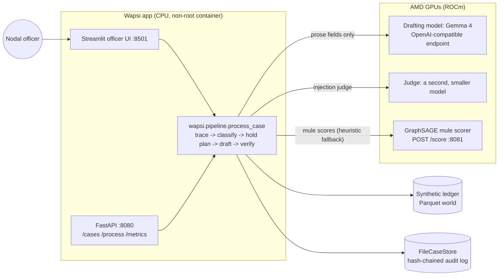

# Wapsi, AMD edition: open models on AMD GPUs keep honest commerce running after a fraud

**lablab.ai AMD Developer Hackathon ACT III, Track 3 "Reinvent Commerce".** When a digital payment turns out to be
fraud, banks today freeze whole accounts: the kirana shop that received one tainted payment loses its working
capital, and the bank loses a customer. Wapsi turns the bank's own transaction data into a better action: it traces
the stolen money through mule layers, holds **only the disputed amount** in each account, separates mules from
innocent holders and merchants, drafts the STR and the restoration packet, and verifies every number and citation
before a supervisor approves (see the [repository README](../../README.md)).

What runs on AMD in this edition:

- **The language model: Gemma 4, Google's open model, served on AMD GPUs.** It writes prose only, through
  placeholders; every amount, account number and date is filled from data and re-checked by the verifier. During the
  event it is served by **AMD Token Factory** (an OpenAI-compatible API on AMD GPUs); the same three variables
  (`WAPSI_LLM_BASE_URL`, `WAPSI_LLM_API_KEY`, `WAPSI_LLM_MODEL`) point the app at a bank's own vLLM-ROCm endpoint
  instead, where customer data never leaves the bank.
- **A second, smaller model as judge.** It screens untrusted complaint text next to the deterministic rules; it can
  add a flag, never clear one.
- **A GraphSAGE mule scorer** (PyTorch, built to run on ROCm; CPU-tested, not yet run on AMD) and an optional **LoRA fine-tune** of the drafting model, when a GPU
  box is available (a ROCm notebook or an MI300X droplet).
- **Predictions are never the language model's.** Mule, innocent-holder and merchant decisions come from a
  transparent scorer with per-feature contributions and from the GNN; the rules decide dispositions; the LLM is not
  a forecasting method anywhere in the pipeline.
- **Measured, not claimed.** `kickoff/` writes dated evidence bundles: latency and throughput, cases and drafts per
  hour, the cost the API reports, a golden-set evaluation with the real model, and a raw-LLM versus Wapsi-bound A/B.
  The numbers live in `evidence/` and are copied into the pitch by a script that re-reads them. This file contains
  no numbers.

The core rule is the same as in every edition: **numbers come from data, words come from the LLM.** If the model's
prose fails a check, the case keeps a fixed paragraph in its place and is never blocked.

## Three ways to run it

| Mode | What you need | What runs on AMD | Start here |
|---|---|---|---|
| **Endpoint** (the primary path) | a Token Factory key, or anyone's OpenAI-compatible vLLM URL | every LLM call: drafting, the judge, the evaluations and benchmarks. The GPU is the provider's | [RUNBOOK.md](RUNBOOK.md), "Fastest path: endpoint mode in 15 minutes" |
| **Notebook** | an AMD ROCm JupyterLab, no Docker | the above served locally (vLLM's python entrypoint, or transformers), plus GNN training and the LoRA fine-tune as plain python | [`kickoff/wapsi_amd_kickoff.ipynb`](kickoff/wapsi_amd_kickoff.ipynb) |
| **Droplet** | an AMD Developer Cloud MI300X droplet with Docker | the whole stack in containers: two vLLM-ROCm servers, the GNN service and the app on one GPU | [RUNBOOK.md](RUNBOOK.md), "Droplet mode" |

```bash
set -a; source /path/outside/git/amd_tokenfactory.env; set +a     # WAPSI_LLM_BASE_URL, WAPSI_LLM_API_KEY, WAPSI_LLM_MODEL
bash editions/amd/kickoff/preflight.sh                             # detects the mode; a green / amber / red table
bash editions/amd/kickoff/run_all.sh --dry-run                     # every command, nothing executed
bash editions/amd/kickoff/run_all.sh                               # the run: one evidence bundle at the end
```

All three write the same bundle and feed the same pitch filler. What a bundle may claim follows where it ran: an
endpoint run names the endpoint host and the model id and makes no GPU claim; a notebook names the GPU as it names
itself; only an MI300X run says MI300X.

## Architecture



Where the AMD box is: **endpoint mode**, AMD Token Factory behind `WAPSI_LLM_BASE_URL` (drafting model and judge;
the scorer is the transparent heuristic). **Notebook and droplet modes**, one machine: vLLM-ROCm serves the drafting
model (the merged LoRA checkpoint when there is one) and the judge, the GNN service scores accounts, and on the
droplet `bench/gpu_telemetry.py` reads `amd-smi` on the host.

## What is in this folder

| Path | What |
|---|---|
| `kickoff/` | The event-week pipeline as one resumable command, in three modes. `preflight.sh` (detects the mode, readiness table), `run_all.sh` (twelve stages from environment to evidence bundle, event-window and budget guards, `--dry-run`, `--stage`, a CPU `--rehearsal`), `endpoint.py` (the metered client for a shared endpoint: rate limit, 429 retries, `json_object`, disk cache, `usage.cost`; the probe; `wait-model`), `model_plan.py` (drafting model and judge by environment, Gemma 4 first, documented fallbacks), `golden_eval.py`, `ab_hallucination.py`, `collect_evidence.py`, `fill_pitch.py`, `wapsi_amd_kickoff.ipynb` (generated by `make_notebook.py`), `train_image_check.py`. See [kickoff/README.md](kickoff/README.md). |
| `evidence/` | Dated evidence bundles written by `run_all.sh` during the event: `endpoint/<UTC date>/`, `notebook/<UTC date>/`, `<UTC date>/` (droplet). CPU rehearsals go to the gitignored `evidence/cpu-rehearsal/`. |
| `RUNBOOK.md` | 14 to 18 Oct, day by day, fastest path first; notebook and droplet modes; the model plan; troubleshooting; budget. |
| `docker-compose.yml`, `.env.example` | The droplet stack. Profiles: `gpu` (llm + app), `verifier`, `gnn`, `demo` (no GPU). ROCm device flags, healthchecks and a fixed start order. Everything binds to 127.0.0.1. Images are pinned by digest. |
| `serving/start_llm.sh` | Starts vLLM with one of four profiles (`gemma4-merged`, `gemma4-base`, `qwen-fallback`, `verifier`): in a container, with `docker run`, or without Docker through `python -m vllm.entrypoints.openai.api_server` (`python` mode, bound to 127.0.0.1). It adds the ROCm flags and `--attention-backend TRITON_ATTN` for Gemma 4. `print` shows the commands without running them. |
| `serving/pull_and_pin.sh`, `serving/smoke_test.py` | Pins each image by digest (refuses `:latest`); checks `/v1/models`, one completion, then one showcase case through the pipeline. |
| `app/` | The app container. `api.py` is the FastAPI. `services.py` builds the adapters: `OpenAICompatLLM` pointed at the endpoint, `ParquetLedger`, `FileCaseStore`, `GnnHttpScorer`, `LLMJudgeGuard`. `ui_app.py` starts the shared Streamlit UI. `Dockerfile` builds a non-root image. |
| `bench/` | `llm_bench.py` (streaming TTFT, tokens/s, concurrency sweep; `--rpm` for a rate-limited endpoint), `gpu_telemetry.py` (amd-smi or rocm-smi, memory per container), `e2e_bench.py` (golden cases, cases/hour, cost per case; `--endpoint` for the metered client), `voice_bench.py` (voice intake: speech-to-text real-time factor, extraction latency per model, samples reconciled as documented), `report.py` (writes `AMD_RESULTS.md`). |
| `asr/` | `server.py`: Whisper on the AMD GPU behind an OpenAI-compatible `POST /v1/audio/transcriptions` (transformers on torch-ROCm; runs on the droplet host or in a GPU notebook, no Docker needed). Voice intake then runs on open models end to end: Whisper transcribes, the `llm` service translates and extracts the fields. See `docs/voice-intake.md`. |
| `AGENT.md`, `app/agent.py`, `app/agent_demo.py` | The officer agent: Google ADK on Gemma 4 served on AMD (AMD Token Factory, vLLM-ROCm or a notebook), through an OpenAI-compatible endpoint and no Google Cloud service. Native tool calls or a strict JSON tool protocol, chosen by a capability probe. `POST /agent/run`, "Ask the agent" in the Case Room, and a CLI that prints the tool-by-tool trace and the verified outcome. Measured results are in `AGENT.md`. |
| `gnn/`, `lora/` | GraphSAGE training and scoring service, and the Gemma 4 LoRA fine-tune and merge. Their own READMEs. |

## Run the demo locally (no GPU, no key, no model downloads)

Demo mode (`WAPSI_DEMO_MODE=1`) uses the offline `FakeLLM`, the in-memory showcase ledger, the rules guard and the
heuristic scorer. It runs on any laptop and the demo URL can use it too.

With Docker (from the repository root):

```bash
docker compose -f editions/amd/docker-compose.yml --profile demo up --build
# UI  http://127.0.0.1:8501   API  http://127.0.0.1:8080/healthz
curl -X POST http://127.0.0.1:8080/cases/31009260000101/process
```

If you have created `editions/amd/.env`, Compose reads it. Set `COMPOSE_PROFILES=` (empty) on a laptop,
otherwise it also tries to start the GPU services.

Without Docker (uv):

```bash
WAPSI_DEMO_MODE=1 WAPSI_STATE_DIR=.wapsi-state uv run streamlit run editions/amd/app/ui_app.py
WAPSI_DEMO_MODE=1 WAPSI_STATE_DIR=.wapsi-state uv run uvicorn editions.amd.app.api:app --port 8080
uv run python -m editions.amd.bench.e2e_bench --world showcase-memory --fake-llm --out /tmp/wapsi-bench  # harness check
bash editions/amd/kickoff/run_all.sh --rehearsal      # the whole pipeline on CPU with stub models (never a result)
uv run pytest tests/amd -q
```

(PowerShell: `$env:WAPSI_DEMO_MODE=1; $env:WAPSI_STATE_DIR=".wapsi-state"; uv run streamlit run editions/amd/app/ui_app.py`.
The API also needs `fastapi` and `uvicorn`: `uv sync --extra amd-app`; the officer agent needs `--extra agent`.)

The officer agent (Google ADK on Gemma 4 served on AMD) runs offline too, against a fake OpenAI-compatible
endpoint, and live when `WAPSI_LLM_BASE_URL` is set; see [AGENT.md](AGENT.md):

```bash
uv run python -m editions.amd.app.agent_demo --case 31009260000101 --demo
```

During the event, follow [RUNBOOK.md](RUNBOOK.md).

## Configuration

Everything is set through environment variables.

- **The model endpoint** (the app, the agent, voice-note extraction, the benchmarks and the kickoff pipeline
  alike): `WAPSI_LLM_BASE_URL`, `WAPSI_LLM_API_KEY`, `WAPSI_LLM_MODEL`, `WAPSI_LLM_JSON_MODE` (unset: `json_object`
  for an endpoint that is not this stack's own server, because the AMD Token Factory accepts no strict JSON
  schema, and `json_schema` for the compose `llm` service or a loopback vLLM). `WAPSI_LLM_MODELS` is the ordered
  list the drafts' prose, voice intake and the agent fail over along. Endpoint mode adds `WAPSI_JUDGE_MODEL`, `WAPSI_LLM_RPM`,
  `WAPSI_LLM_MAX_CONCURRENCY`, `WAPSI_LLM_CACHE_DIR`, `WAPSI_ALLOW_MODEL_FALLBACK`; the names are in
  [`kickoff/endpoint.env.example`](kickoff/endpoint.env.example). A draft records what really served its prose:
  `Gemma-4-31B-IT on AMD @ developer.amd.com.cn` through the Token Factory, `vllm-rocm:<model>` only for this
  stack's own vLLM-ROCm server.
- **Voice intake**: `WAPSI_VOICE_BACKEND` (`auto`, `open`, `gemini`, `fake`), `WAPSI_ASR_BASE_URL`,
  `WAPSI_ASR_API_KEY`, `WAPSI_ASR_MODEL` (an OpenAI-compatible transcription endpoint; without one the open path
  uses local Whisper through transformers). Field extraction and translation go to the model endpoint above. See
  [`docs/voice-intake.md`](../../docs/voice-intake.md).
- **A GPU box**: `WAPSI_BASE_MODEL`, `WAPSI_VERIFIER_MODEL_ID`, `WAPSI_LORA_CONFIG`, `VLLM_GPU_UTIL`,
  `VERIFIER_GPU_UTIL`, `WAPSI_VERIFIER_BASE_URL` (switches on the judge), `WAPSI_GNN_URL` (switches on the GNN); see
  `.env.example` and `app/settings.py`.
- **Secrets** (`WAPSI_LLM_API_KEY`, `HF_TOKEN`, `VLLM_API_KEY`, `WAPSI_API_TOKEN`) come only from the shell or a
  private file outside the repository. They are never in `.env`, in git, in a log, in a cache file or in a report.

### GNN scoring contract (`app/gnn_client.py`)

The client sends `POST {WAPSI_GNN_URL}/score` with
`{"account_ids": [...], "feature_columns": [...], "features": [{"account_id": ..., <feature>: value}]}`.
It accepts either of these replies:

- `{"scores": {id: p}, "contributions": {id: {feature: log_odds, "bias": b, ...}}, "model": "..."}`
- `{"scores": [{"account_id", "score", "contributions"}]}`

Extra contribution columns such as `graph_neighbourhood` and `ig_residual` are kept, so each row still adds up to
the logit. The client falls back to the heuristic scorer when the service is down or times out, the reply is
malformed or has non-finite scores, or an account has no score (only that row falls back). After a failure it skips
the service for 30 s. The case always completes, and the `model` field of each classification records which scorer
produced it.

## Originality boundary (12 to 18 Oct 2026)

Disclosed in full; see also `docs/originality.md`. Commit dates are never rewritten.

- **Before the event.** The portable Wapsi core already existed: tracing, taint apportionment, hold plans,
  classifier, drafter, verifier, synthetic data, UI and evals (`src/wapsi/`, `ui/`, `evals/`), and the Google Cloud
  edition. All of it is under the git tag **`amd-baseline`** (the repository at kickoff).
- **Prepared before the event, run only during it.** `docker-compose.yml`, `serving/`, `app/`, `bench/`, `gnn/`,
  `lora/` and the first version of `kickoff/` (the droplet pipeline and the CPU rehearsal; commits dated 7 Oct on its
  branch, merged after the tag) were written before 12 Oct so that event week goes to running. Their tests run
  offline on a laptop with fakes. None of it had touched an AMD GPU before the event.
- **Built during the event (after 12 Oct 15:00 UTC).** The three execution modes: the metered endpoint client and
  endpoint mode, notebook mode and the notebook, the model plan, the golden-set evaluation stage, the mode-aware
  evidence bundle and pitch filler; and every run on AMD compute, with every number those runs produced
  (`evidence/`). The git history and the timestamps in each result file show when each run happened.
- **Measured results in this folder** are only under `evidence/` (evidence bundles of `kickoff/run_all.sh`; none
  committed yet), `bench/results/` (the AMD Token Factory runs of 2026-10-14: the agent and voice extraction) and
  the "What was measured" section of [`AGENT.md`](AGENT.md), which describes the committed agent run.
  `bench/fixtures/` holds hand-written samples of the amd-smi JSON shape with synthetic values, used only to test
  the parsers, and `gnn/results/cpu-dev-*.json` are CPU development checks, not AMD results.

All banking data is synthetic. Models and their licences are listed in the root
[README](../../README.md#models-and-licences): Gemma 4 (Apache-2.0, open weights), Whisper large-v3-turbo (MIT), and
the failover / judge models used only through the AMD Token Factory API under its trial terms. The self-hosted
fallback `Qwen/Qwen3.6-35B-A3B` of the model plan has not been used for any result; check its model card's licence
before serving it. Code is MIT.
