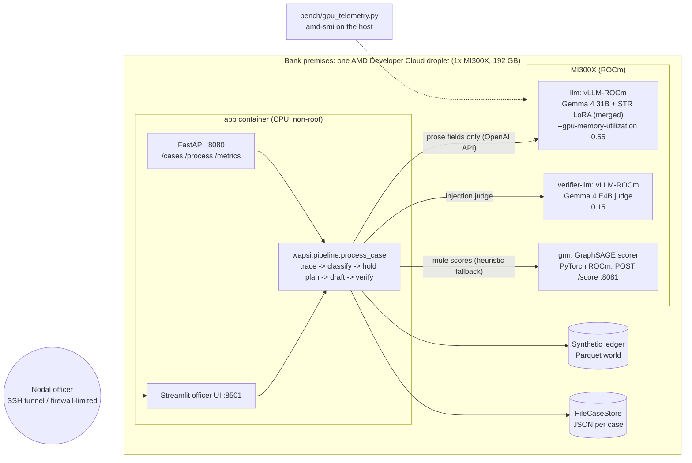

# Wapsi, AMD edition: the whole copilot on one AMD Instinct MI300X, on-prem

Wapsi helps a bank's cyber-fraud nodal officer act on NCRP / 1930 complaints: it traces stolen money through mule
layers, holds **only the disputed amount** in each account, drafts the STR and restoration packet, and verifies every
number and citation before a supervisor approves (see the [repository README](../../README.md)).

This edition runs all of it inside the bank, on a single AMD Instinct MI300X (192 GB HBM3):

- **Customer data stays inside the bank.** Ledger, case store, models and inference share one machine.
  No request leaves it; there is no external LLM API.
- **Two language models and a GNN share one GPU.**
  - The drafting model is Gemma 4 31B with an STR-drafting LoRA merged into its weights. vLLM-ROCm serves it
    at about 55 % of the GPU's memory.
  - A second, smaller model (Gemma 4 E4B) acts as an independent judge. It uses about 15 % of the memory and
    screens untrusted complaint text alongside the deterministic rules.
  - A GraphSAGE mule scorer trained on ROCm scores the accounts on each case's money trail.
- **Measured, not claimed.** `bench/` records serving throughput, time to first token, cases per hour, cost per
  case at $1.99 per GPU-hour, and GPU memory per container, all from `amd-smi` on the droplet. The numbers are
  published in `AMD_RESULTS.md` once the event-week runs are done. This file contains no numbers.

The core rule is the same as in every edition: **numbers come from data, words come from the LLM.** The models
write prose through placeholders. The verifier recomputes every amount. If the model's prose fails a check, the
case keeps a fixed paragraph in its place and is never blocked.

## Architecture



## What is in this folder

| Path | What |
|---|---|
| `docker-compose.yml`, `.env.example` | The stack. Profiles: `gpu` (llm + app), `verifier`, `gnn`, `demo` (no GPU). ROCm device flags, healthchecks and a fixed start order. Everything binds to 127.0.0.1. Images are pinned by digest. |
| `serving/start_llm.sh` | Starts vLLM with one of four profiles: `gemma4-merged`, `gemma4-base`, `qwen-fallback` or `verifier`. It adds the ROCm flags and `--attention-backend TRITON_ATTN` for Gemma 4. `print` shows the command without running it. |
| `serving/pull_and_pin.sh` | Pulls each image and writes `VAR=repo@sha256:…` into `.env`. Refuses `:latest`. |
| `serving/smoke_test.py` | Checks `/v1/models` and one completion, then runs one showcase case through the pipeline against the endpoint and prints the verification summary. |
| `app/` | The app container. `api.py` is the FastAPI. `services.py` builds the adapters: `OpenAICompatLLM` pointed at vLLM, `ParquetLedger`, `FileCaseStore`, `GnnHttpScorer`, `LLMJudgeGuard`. `ui_app.py` starts the shared Streamlit UI. `Dockerfile` builds a non-root image. |
| `bench/` | `llm_bench.py` (streaming TTFT, ITL, tokens/s, concurrency sweep), `gpu_telemetry.py` (amd-smi or rocm-smi, memory per container), `e2e_bench.py` (golden cases, cases/hour, cost per case), `voice_bench.py` (voice intake: speech-to-text real-time factor, extraction latency per model, samples reconciled as documented), `report.py` (writes `AMD_RESULTS.md`). |
| `asr/` | `server.py`: Whisper on the AMD GPU behind an OpenAI-compatible `POST /v1/audio/transcriptions` (transformers on torch-ROCm; runs on the droplet host or in a GPU notebook, no Docker needed). Voice intake then runs on open models end to end: Whisper transcribes, the `llm` service translates and extracts the fields. See `docs/voice-intake.md`. |
| `RUNBOOK.md` | Event-week steps: credits, droplet, firewall, serving, training, benchmarks, video capture, teardown, budget. |
| `gnn/`, `lora/` | GraphSAGE training and scoring service, and the Gemma 4 LoRA fine-tune and merge. These are separate work streams with their own READMEs. |

## Run the demo locally (no GPU, no model downloads)

Demo mode (`WAPSI_DEMO_MODE=1`) uses the offline `FakeLLM`, the in-memory showcase ledger, the rules guard and the
heuristic scorer. It runs on any laptop and the demo URL can use it too.

With Docker (from the repository root):

```bash
docker compose -f editions/amd/docker-compose.yml --profile demo up --build
# UI  http://127.0.0.1:8501   API  http://127.0.0.1:8080/healthz
curl -X POST http://127.0.0.1:8080/cases/31009260000101/process
```

If you have created `editions/amd/.env`, Compose reads it. Set `COMPOSE_PROFILES=` (empty) on a laptop,
otherwise it also tries to start the GPU services.

Without Docker (uv):

```bash
WAPSI_DEMO_MODE=1 WAPSI_STATE_DIR=.wapsi-state uv run streamlit run editions/amd/app/ui_app.py
WAPSI_DEMO_MODE=1 WAPSI_STATE_DIR=.wapsi-state uv run uvicorn editions.amd.app.api:app --port 8080
uv run python -m editions.amd.bench.e2e_bench --world showcase-memory --fake-llm --out /tmp/wapsi-bench  # harness check
uv run pytest tests/amd -q -k "serving or bench"
```

(PowerShell: `$env:WAPSI_DEMO_MODE=1; $env:WAPSI_STATE_DIR=".wapsi-state"; uv run streamlit run editions/amd/app/ui_app.py`.
The API also needs `fastapi` and `uvicorn`. Both are in the uv environment when the `gcp` extra is installed; the app
image installs them at the versions pinned in `uv.lock`.)

On the MI300X, follow [RUNBOOK.md](RUNBOOK.md).

## Configuration

Everything is set through environment variables; see `.env.example` and `app/settings.py`. The main ones:
`WAPSI_LLM_PROFILE` and `WAPSI_LLM_MODEL` choose the model and checkpoint. `VLLM_GPU_UTIL` and `VERIFIER_GPU_UTIL`
set the memory split. `WAPSI_VERIFIER_BASE_URL` switches on the judge. `WAPSI_GNN_URL` switches on the GNN.
`WAPSI_WORLD_DIR` picks the synthetic world. `WAPSI_VOICE_BACKEND` and `WAPSI_ASR_BASE_URL` choose the voice-intake
models (`docs/voice-intake.md`). `*_BIND` controls network exposure. Secrets (`HF_TOKEN`,
`VLLM_API_KEY`, `WAPSI_API_TOKEN`) come only from the shell environment on the droplet. They are never in `.env`
or git.

### GNN scoring contract (`app/gnn_client.py`)

The client sends `POST {WAPSI_GNN_URL}/score` with
`{"account_ids": [...], "feature_columns": [...], "features": [{"account_id": ..., <feature>: value}]}`.
It accepts either of these replies:

- `{"scores": {id: p}, "contributions": {id: {feature: log_odds, "bias": b, ...}}, "model": "..."}`
- `{"scores": [{"account_id", "score", "contributions"}]}`

Extra contribution columns such as `graph_neighbourhood` and `ig_residual` are kept, so each row still adds up to
the logit.

The client falls back to the heuristic scorer when:

- the service is down or times out
- the reply is malformed or has non-finite scores
- an account has no score (only that row falls back)

After a failure it skips the service for 30 s. The case always completes, and the `model` field of each
classification records which scorer produced it.

## Originality boundary (lablab.ai AMD Developer Hackathon ACT III, 12–18 Oct 2026)

This is disclosed in full; see also `docs/originality.md`.

- **Before the event.** The portable Wapsi core already existed: tracing, taint apportionment, hold plans,
  classifier, drafter, verifier, synthetic data, UI and evals (`src/wapsi/`, `ui/`, `evals/`). So did the Google
  Cloud edition. All of it is under the git tag **`amd-baseline`**, created at kickoff. An edition for a separate,
  earlier event was also built on this core before the event; it was removed from the tree on 2026-10-07 and stays
  in the git history before the tag (see `docs/originality.md`).
- **Prepared before the event, run only during it.** The code in this folder (`docker-compose.yml`, `serving/`,
  `app/`, `bench/`, `RUNBOOK.md`) was written before the event so that event week goes to GPU work. Its tests run
  offline on a laptop with fakes. None of it had touched an AMD GPU before the event.
- **Done during 12–18 Oct 2026 on the MI300X, and nowhere else:**
  - GNN training on ROCm (`gnn/`)
  - Gemma 4 LoRA fine-tuning and the merged checkpoint (`lora/`)
  - vLLM-ROCm serving of the merged model next to the verifier model and the GNN
  - every benchmark and every reported number (`bench/results/`, `AMD_RESULTS.md`)
  The git history and the timestamps in each result file show when each run happened.
- **Nothing in this folder is a measured result.** `bench/fixtures/` holds hand-written samples of the amd-smi
  JSON shape with synthetic values, used only to test the parsers. They are not measurements.

All banking data is synthetic. Model licences: Gemma 4 (Apache-2.0) and Qwen3.6 (Apache-2.0, fallback only).
Code is MIT.
