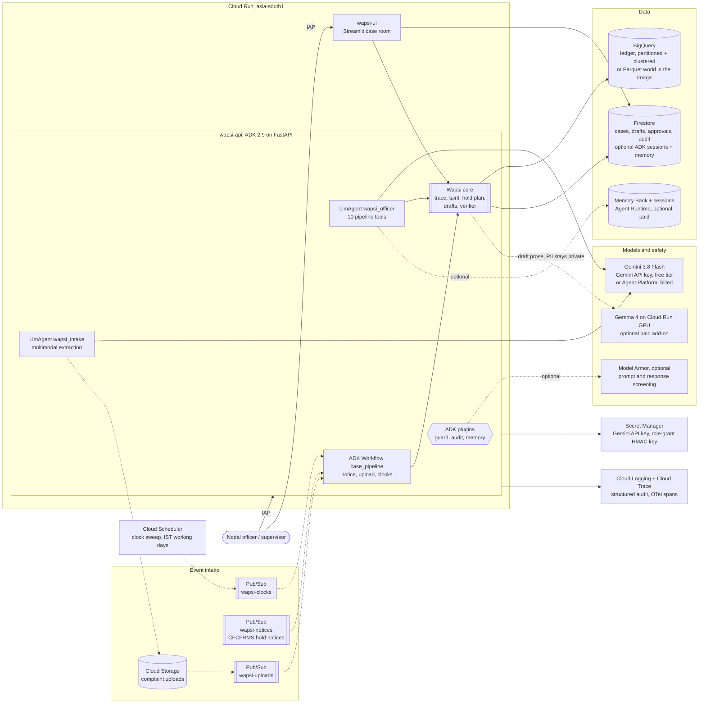
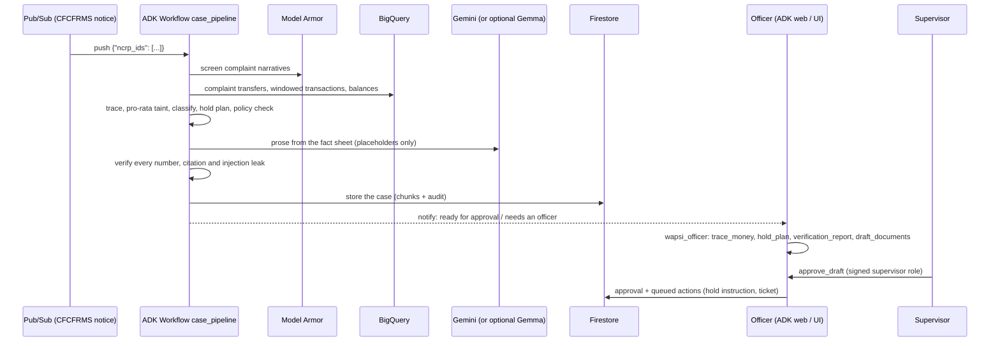

# Wapsi on Google Cloud: architecture

Wapsi helps a bank's cyber-fraud nodal officer handle NCRP / 1930 hold notices. It traces stolen money, holds
only the tainted amount, drafts the STR and the restoration packet, and verifies every number before a
supervisor approves. Every box in the live path below is a Google Cloud service. All data is synthetic.

Solid edges are the default free-trial deployment (`deploy/cloudrun.sh`, `PROFILE=free`). Dotted edges lead to
optional pieces: Model Armor, Memory Bank and Gemma on GPU are paid or need an upgraded billing account, and
Pub/Sub, Scheduler and the intake bucket come with the optional `wire` step. Gemini runs on the Gemini API free
tier with an AI Studio key by default, or on Agent Platform (billed) with `WAPSI_GEMINI_BACKEND=vertex`.

Build path (not in the live path): Cloud Build → Artifact Registry → Cloud Run. Everything is set up by
`deploy/cloudrun.sh`. The optional paid GPU tier has its own script, `deploy/gemma_vllm_service.sh`, which
refuses to run without `ALLOW_GPU=1`.

## What each service does

| Service | Role in Wapsi | Where in the code |
|---|---|---|
| **Cloud Run** | Two services from one image. `wapsi-api` runs ADK (`get_fast_api_app`), the Pub/Sub trigger route and `/healthz`. `wapsi-ui` runs the shared Streamlit app on the same case store. Both scale to zero. | `app/server.py`, `ui_app.py`, `Dockerfile` |
| **ADK 2.9** | `wapsi_officer` (LlmAgent) and its `wapsi_intake` sub-agent. `case_pipeline` is a deterministic graph `Workflow` (2.x replaces `SequentialAgent`). Plugins provide guard, audit and memory. | `app/agent.py`, `app/workflow.py`, `app/plugins.py` |
| **Gemini** (default: Gemini API with an AI Studio key, free tier; optional: Agent Platform) | Agent reasoning, tool selection, multimodal extraction (PDF or screenshot to JSON), and draft prose from the fact sheet. `WAPSI_GEMINI_BACKEND` picks `aistudio` or `vertex`. On the free tier, 429s are retried and then explained to the officer. | `app/agent.py`, `app/intake.py`, `wapsi/adapters/gemini_llm.py` |
| **Gemma 4 on Cloud Run GPU** (optional paid add-on, off) | Private tier. When configured, draft prose that reads victim PII runs on our own vLLM service (optionally in asia-south2, Delhi), called with an IAM ID token. The free trial blocks GPUs; the AMD edition covers private Gemma inference. | `deploy/gemma_vllm_service.sh`, `gemma_private_llm()` |
| **Model Armor** (optional, `WAPSI_MODEL_ARMOR_TEMPLATE`) | Screens complaint text, pasted text and tool arguments (prompt injection, malicious URLs, CSAM), plus model replies. Fails open to the deterministic `RulesGuard`, which is always on, and records when it does. Free up to 2M tokens a month. | `wapsi/adapters/model_armor_guard.py`, `deploy/model_armor_template.json` |
| **BigQuery** (default ledger; `WAPSI_LEDGER=parquet` makes it optional) | The ledger. All queries are parameterized. `transactions` is partitioned by `DATE(ts)` and clustered by `from_account, to_account`. A `WITH RECURSIVE` reachability query serves as an optional pre-filter. The ~2 MB demo world stays far inside the free tier. | `wapsi/adapters/bigquery_ledger.py`, `deploy/bigquery_setup.sql` |
| **Firestore** | Case store. A small queryable header per case, the bundle as zlib-compressed chunks under 1 MiB, and an append-only audit subcollection. With `WAPSI_ADK_STORE=firestore`, it also holds ADK sessions and keyword memory. | `wapsi/adapters/firestore_store.py`, `app/memory.py` |
| **Cloud Storage** | Intake bucket for complaint uploads. Private, uniform access, 30-day lifecycle. | `app/intake.py` |
| **Pub/Sub** | CFCFRMS notices, upload notifications and clock ticks, pushed with OIDC into the ADK trigger route. Failed messages go to a dead-letter topic after 5 attempts. | `app/workflow.py` |
| **Cloud Scheduler** | Twice-daily clock sweep (STR due, hold lapse, restoration steps) on IST working days. | `sweep_clocks` |
| **Memory Bank / Agent Runtime** (optional paid, off) | Cross-session case memory (`load_memory`) and durable sessions, via `agentengine://projects/.../reasoningEngines/<id>`. The default is in-memory or Firestore. | `app/memory.py`, `app/config.py` |
| **Secret Manager** | The Gemini API key (created by the user, mounted as `GEMINI_API_KEY`) and the HMAC key that signs role grants in ADK session state. | `app/identity.py`, `deploy/cloudrun.sh` |
| **Cloud Logging / Trace** | One structured JSON audit record per tool call, plus ADK OpenTelemetry spans (`otel_to_cloud`). | `AuditLogPlugin` |

## Trust boundaries

1. **Numbers come from data, words come from the LLM.** Gemini and Gemma only write prose, and only with
   `⟦slot⟧` placeholders. Every amount, account, UTR and date is filled from BigQuery-derived case tables, and
   the verifier recomputes each one. Tool outputs carry pre-formatted amounts, and the agent is told never to
   state a number a tool did not return.
2. **Complaint text is data.** Every narrative and upload is screened, sanitized, wrapped in
   `<<<UNTRUSTED_COMPLAINT_TEXT>>>` markers and quoted back to the officer. No instruction inside it is
   followed. ADK also fences other agents' turns.
3. **Maker-checker.** Only a supervisor can approve. The role comes from a server-signed grant in session
   state, bound to the IAP identity, and is checked by the guard plugin and again by the tool. `approve()`
   re-verifies the exact draft content (SHA-256) before any action is queued.
4. **Amount-specific holds.** Hard rules (tainted amount only, forward holds only on first-layer accounts, no
   seizure of nodal or pool accounts) are enforced in the hold plan and re-checked by the verifier.

## One case, end to end

## Regions and data residency

- Cloud Run, BigQuery, Firestore, Cloud Storage, Pub/Sub, Model Armor, Memory Bank and Secret Manager all run
  in `asia-south1` (Mumbai).
- The Gemini API (the default, with an AI Studio key) has no region setting. Availability follows the caller's
  location (Cloud Run in India is supported), and Google chooses where requests are processed. On Agent
  Platform, Gemini uses the `global` endpoint by default; set `WAPSI_LOCATION=asia-south1` to process in India.
- Gemma (optional, paid) runs on L4 in `us-central1` for development, or on RTX PRO 6000 in `asia-south2`
  (Delhi) for the in-country private tier.
